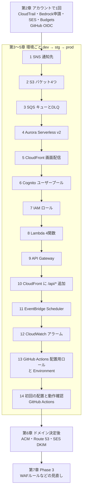

# RPG学習アプリ AWS構築手順書

| 項目   | 内容                                                              |
| ---- | --------------------------------------------------------------- |
| 文書名  | RPG学習アプリ AWS構築手順書                                               |
| 版数   | 第0.4版（ドラフト。アプリの配置を GitHub Actions に変更）                          |
| 作成日  | 2026-10-19                                                      |
| 入力文書 | RPG学習アプリ 外部設計書 第0.6版（第2章 システム方式設計、第6章、第8章）                      |
| 対象   | Phase 1（MVP）のパイロット環境。Phase 3 で行う作業（AWS WAF のルールの見直しなど）は第7章にまとめる |
| 作業方法 | AWSのリソースはマネジメントコンソール（Web画面）で構築する。アプリの配置（Lambda のコード・画面・DBのテーブル）は GitHub Actions で行う（詳細設計書 第11章） |

---

## 1. はじめに

### 1.1 この手順書の使い方

- 第2章（アカウントで1回だけ行う作業）を最初に行い、そのあと **dev → stg → prod の順** に第3〜5章を進める
- 第3〜5章は同じ手順を環境ごとに書いている。各章の中は上から順に作業すればよく、他の章を見なくてよい
- 手順の中の `<アカウントID>` などの山かっこは、自分の環境の値に置き換える
- 作業中に控える値（ARN・ID）は、各章の最初にある「控える値」表に書き込む
- 本書で作ったリソースへのアプリの配置は GitHub Actions が行う。本書の手順でコンソールから zip や画面をアップロードすることはない
- コンソールの項目名は2026年10月時点の想定。画面の文言が少し違う場合は、意味の近い項目を選ぶ

### 1.2 前提

| 項目       | 内容                                                                               |
| -------- | -------------------------------------------------------------------------------- |
| AWSアカウント | 1つ（dev・stg・prod を同じアカウントに作る）。AWSの無料利用枠のみのアカウントではないこと                             |
| 作業者の権限   | 管理者権限（AdministratorAccess）を持つIAMユーザーまたはIAM Identity Centerのユーザー。MFA必須            |
| リージョン    | アジアパシフィック（東京） `ap-northeast-1`。ACM の CloudFront 用証明書だけ 米国東部（バージニア北部） `us-east-1` |
| ドメイン     | 未定。決まるまではCloudFrontの既定ドメイン（`xxxx.cloudfront.net`）で動かす。決定後の作業は第6章                 |
| アプリの資材   | Lambda のコード・画面一式（HTML・CSS・JS）・テーブルは、GitHub Actions がリポジトリから配置する。本書では関数を仮のコードで作り、各環境の手順14で初回の配置を行う |
| GitHub   | アプリのリポジトリ `<オーナー>/rpg-learning-app` の管理者権限（Settings を変更できる）。Environments を使うため、非公開リポジトリの場合は GitHub Team 以上のプラン |

### 1.3 名前とタグの決まり

| 項目      | ルール                                                           | 例                            |
| ------- | ------------------------------------------------------------- | ---------------------------- |
| リソース名   | `rpg-{環境}-{用途}`                                               | `rpg-dev-api-handler`        |
| S3バケット名 | 世界で重複できないため、末尾にアカウントIDを付ける `rpg-{環境}-{用途}-<アカウントID>`          | `rpg-dev-web-123456789012`   |
| タグ（必須）  | `Project` = `rpg-learning`、`Environment` = `dev`／`stg`／`prod` | すべてのリソースに付ける（タグを付けられないものを除く） |

タグは請求を環境ごとに分けるのに使う。作成画面にタグの欄がない場合は、作成後に各リソースの「タグ」タブで付ける。

### 1.4 構築の順番



- CloudFront を Cognito より先に作るのは、Cognito のログイン後の戻り先URLに CloudFront のドメインが必要なため
- API Gateway を作ったあとで CloudFront に `/api/*` を追加する（API Gateway のURLが必要なため）
- 配置用ロール（手順13）は、配置先の Lambda・S3・CloudFront・Aurora がそろってから作る（ポリシーにそれらのARNを書くため）

### 1.5 環境ごとの設定値

| 項目                   | dev                    | stg                    | prod                   |
| -------------------- | ---------------------- | ---------------------- | ---------------------- |
| Aurora の容量           | 0〜1 ACU                | 0〜2 ACU                | 0〜4 ACU                |
| Aurora の自動停止         | 無操作300秒で停止             | 無操作300秒で停止             | 無操作300秒で停止             |
| Aurora のバックアップ保持     | 1日                     | 1日                     | 7日                     |
| 削除保護（Aurora・Cognito） | オフ                     | オフ                     | **オン**                 |
| Lambda のログ保持         | 30日                    | 30日                    | 90日                    |
| 招待メールの送信元（Cognito）   | Cognito の既定            | Cognito の既定            | SES（ドメイン決定後。それまでは既定）   |
| メール送信の定期処理（B-03）     | 作成するが無効（確認時だけ有効にする）    | 有効                     | 有効                     |
| アラームの通知先             | 開発者                    | 開発者                    | システム管理者・開発者            |
| CloudFront の料金プラン    | 定額プラン Free（AWS WAF 付き） | 定額プラン Free（AWS WAF 付き） | 定額プラン Free（AWS WAF 付き） |

### 1.6 CloudFront の料金プラン（決定：Free プラン）

2025年11月から、CloudFront の作成画面で定額の料金プラン（Free・Pro・Business・Premium）を選ぶ形になった。本書では **全環境で Free プラン（月額0ドル）** を使う（2026-10-19 決定。外部設計書 第0.6版 2.3・2.9 に反映済み）。

| 項目      | Free プランの内容                              | 本書での扱い                                                                                   |
| ------- | ---------------------------------------- | ---------------------------------------------------------------------------------------- |
| 料金      | 月額0ドル。配信・リクエスト・AWS WAF の料金を含む            | 追加の費用なし                                                                                  |
| 数       | 1つのアカウントで3つまで                            | dev・stg・prod で3つを使い切る                                                                    |
| 利用量の目安  | 月100万リクエスト・100GB。超えても追加料金はなく、続くと速度が調整される | パイロット10名なら十分に収まる                                                                         |
| AWS WAF | Web ACL の関連付けが必須（外せない）。ルールは5つまで          | Phase 1 はプランの既定の保護を使う。ルールの見直しは第7章                                                        |
| ビヘイビア   | 5つまで                                     | 本書では3つ（`/api/*`・`/partners/*`・既定）                                                        |
| 使えない機能  | アクセスログ、独自のキャッシュポリシー・レスポンスヘッダーポリシー        | AWS 管理のポリシー（`CachingOptimized`・`CachingDisabled`・`AllViewerExceptHostHeader`）だけを使うため影響なし |

- アクセスログやセキュリティヘッダー（CSP など）が必要になったら、Pro プラン（月15ドル）に変える（第7章）
- AWS の無料利用枠（Free Tier）で使っているアカウントは、料金プランに加入できない。作業の前に、アカウントが通常の有料アカウントであることを確かめる（1.2 の前提）

### 1.7 控える値の一覧

各環境の作業中に、次の値を控える。Lambda の環境変数や、開発チームへの連絡に使う。

| 記号   | 値                                  | 控えるタイミング |
| ---- | ---------------------------------- | -------- |
| V-01 | AWSアカウントID（12桁）                    | 第2章      |
| V-02 | 高精度モデルのモデルID（Sonnet）               | 第2章      |
| V-03 | 軽量モデルのモデルID（Haiku 5.5）                 | 第2章      |
| V-04 | SNS トピックの ARN                      | 各環境の手順1  |
| V-05 | SQS キューの ARN・URL                   | 各環境の手順3  |
| V-06 | Aurora クラスターの ARN                  | 各環境の手順4  |
| V-07 | Aurora のシークレットの ARN                | 各環境の手順4  |
| V-08 | CloudFront のドメイン名・ディストリビューションID    | 各環境の手順5  |
| V-09 | Cognito ユーザープールID・アプリクライアントID・ドメイン | 各環境の手順6  |
| V-10 | API Gateway の API ID・URL           | 各環境の手順9  |
| V-11 | GitHub Actions 配置用ロールの ARN          | 各環境の手順13 |

---

## 2. アカウントで1回だけ行う作業

### 2.1 サインインとリージョン

1. 管理者権限のユーザーでマネジメントコンソールにサインインする（ルートユーザーは使わない）
2. 画面右上のリージョンを **アジアパシフィック（東京）ap-northeast-1** にする
3. 画面右上のアカウント名を押し、表示される12桁の **アカウントID** を控える（V-01）

### 2.2 CloudTrail（操作記録）

1. 「CloudTrail」を開き、「証跡の作成」を押す
2. 次のとおり入力して作成する

| 項目         | 値                                                   |
| ---------- | --------------------------------------------------- |
| 証跡名        | `rpg-trail`                                         |
| ストレージの場所   | 新しいS3バケットを作成 `rpg-trail-<アカウントID>`                  |
| ログファイルの暗号化 | SSE-KMS をオフ（S3 の既定の暗号化を使う）                          |
| ログのイベント    | 管理イベント（読み取り・書き込みとも）                                 |
| タグ         | `Project` = `rpg-learning`、`Environment` = `common` |

3. 作成したバケットを開き、「管理」タブ →「ライフサイクルルールを作成」で、全オブジェクトを **365日後に削除** する

### 2.3 Amazon Bedrock（利用申請とモデルの確認）

2025年10月から、Bedrock のモデルは最初から有効になっている（以前の「モデルアクセス」画面は廃止）。ただし Anthropic のモデル（Claude）は、**最初に1回だけ利用目的の申請** が必要になる。本節の進め方（利用目的の申請、モデル呼び出しログを記録しない）は 2026-10-19 に決定した。

1. リージョンが東京であることを確認し、「Amazon Bedrock」を開く
2. 左メニューの「プレイグラウンド」→「チャット／テキスト」を開き、モデルの選択で Anthropic の **Claude Sonnet 5.5** を選ぶ
3. 利用目的の入力画面（初回だけ）が出たら、次のように入力して送信する

| 項目      | 入力例                                            |
| ------- | ---------------------------------------------- |
| 会社名・URL | 自社の名称とWebサイト                                   |
| 業種      | 社内教育                                           |
| 想定する利用者 | 社内の従業員（資格学習）                                   |
| 利用目的    | 資格試験の問題の抽出、学習者の説明文の採点、学習を励ますコメントの生成。外部への公開はしない |

4. プレイグラウンドで「こんにちは」と送り、応答が返ることを確かめる
5. 同じように **Claude Haiku 5.5** でも応答を確かめる
6. 左メニューの「モデルカタログ」で各モデルを開き、**モデルID** を控える（V-02・V-03）

**モデルの確認ポイント（重要）**

| 確認すること                                               | 判断                                                                                                         |
| ---------------------------------------------------- | ---------------------------------------------------------------------------------------------------------- |
| Sonnet 5.5 が東京リージョンで「オンデマンド」で使えるか                    | 使える → そのモデルIDを使う                                                                                           |
| Haiku 5.5 が東京リージョンで「オンデマンド」で使えるか                     | 使える → そのモデルIDを使う                                                                                           |
| 東京で使えない、または推論プロファイル（`jp.` や `apac.` で始まるID）経由でしか使えない | 東京でオンデマンドで使える別バージョンの Sonnet（Haiku 5.5 の場合は Haiku）を選ぶ。推論プロファイルは東京以外のリージョンにデータが送られるため、外部設計書 2.8 の方針では使わない。どうしても必要なら第8章 No.2 で相談する |

7. 「設定」→「モデル呼び出しのログ記録」は **オフのまま** にする（学習者の説明文を余計に保存しないため）

### 2.4 Amazon SES（メール送信）

SES は東京リージョンにアカウントで1つの設定。dev・stg・prod で共用する。

**(1) 送信元の登録（ドメイン決定前）**

1. 「Amazon SES」を開き、左メニューの「ID（Identities）」→「IDの作成」を押す
2. 「Eメールアドレス」を選び、テスト用の送信元アドレス（開発チームが受信できるもの）を入力して作成する
3. 届いた確認メールのリンクを押す。状態が「検証済み」になったことを確かめる
4. dev・stg のテストで送り先にする開発者・コース管理者のアドレスも、同じ手順で登録する（サンドボックスの間は、登録したアドレスにしか送れないため）

**(2) 本番利用の申請（サンドボックスの解除）**

ドメイン決定後（第6章で送信ドメインを登録したあと）に行う。審査に1日程度かかるため、パイロット開始の1週間前までに出す。

1. 左メニューの「アカウントダッシュボード」→「本番アクセスをリクエスト」を押す
2. 次のとおり入力して送信する

| 項目         | 入力例                                                                                                                                          |
| ---------- | -------------------------------------------------------------------------------------------------------------------------------------------- |
| メールタイプ     | トランザクション                                                                                                                                     |
| WebサイトのURL | `https://app.example.co.jp`（決定したドメイン）                                                                                                        |
| ユースケースの説明  | 社内向け学習アプリの通知です。送信先は社内の登録利用者のみで、1日最大約1,000通です。学習のお知らせ・招待・アカウント停止のお知らせを送ります。各メールに通知設定へのリンクを入れ、利用者が配信を止められます。バウンスと苦情はSESの通知で確認し、該当アドレスへの送信を止めます |

3. 承認のメールが届いたら、アカウントダッシュボードで「本番アクセス」になったことを確かめる

### 2.5 請求の管理（コスト配分タグと予算）

**(1) コスト配分タグの有効化**

1. 「請求とコスト管理（Billing and Cost Management）」を開く
2. 左メニューの「コスト配分タグ」→「ユーザー定義のコスト配分タグ」で、`Project` と `Environment` を選んで「有効化」を押す
   - タグが一覧に出てくるのは、タグを付けたリソースを作ってから最大24時間後。第3章のあとで行ってもよい

**(2) 予算（AWS Budgets）**

1. 左メニューの「予算（Budgets）」→「予算を作成」を押す
2. 「カスタマイズ」→「コスト予算」を選び、次のとおり入力する

| 項目    | 値                                                |
| ----- | ------------------------------------------------ |
| 予算名   | `rpg-monthly`                                    |
| 期間    | 毎月、定期的な予算                                        |
| 予算額   | 100 USD（約15,000円。外部設計書 8.4）                      |
| 範囲    | すべての AWS サービス                                    |
| アラート1 | **予測** コストが予算の 100% を超えたとき → システム管理者・開発者のメールアドレス |
| アラート2 | **実際の** コストが予算の 80% を超えたとき → 同上                  |

3. 内訳を見たいときは「Cost Explorer」でタグ `Environment` ごとにグループ化する

### 2.6 GitHub Actions との連携（OIDC）

GitHub Actions が AWS に配置するときは、アクセスキーを使わず、GitHub が発行する一時的なトークン（OIDC）で各環境の配置用ロールを引き受ける。そのための ID プロバイダーをアカウントに1つ作る。

**(1) ID プロバイダーの作成**

1. 「IAM」→「ID プロバイダー」→「プロバイダを追加」
2. 次のとおり入力し、タグを付けて追加する

| 項目          | 値                                             |
| ----------- | --------------------------------------------- |
| プロバイダのタイプ   | **OpenID Connect**                            |
| プロバイダの URL  | `https://token.actions.githubusercontent.com` |
| 対象者         | `sts.amazonaws.com`                           |

**(2) GitHub リポジトリの共通設定**

リポジトリ `<オーナー>/rpg-learning-app` の「Settings」で行う。

| 場所                                    | 設定                                                                                     |
| ------------------------------------- | -------------------------------------------------------------------------------------- |
| 「Secrets and variables」→「Actions」→「Variables」 | リポジトリの変数 `AWS_REGION` = `ap-northeast-1`                                                 |
| 「Rules」→「Rulesets」（ブランチ `main`）       | プルリクエスト必須、ステータスチェック `ci` の成功を必須、force push と削除を禁止                                        |
| 「Rules」→「Rulesets」（タグ `release-*`）    | 作成は Maintain 以上の人だけ（バイパスリストで指定）、更新と削除を禁止                                                 |
| 「Actions」→「General」                    | Workflow permissions は「Read repository contents and packages permissions」（必要な権限はワークフローに書く） |

- 各環境の Environment（`dev`・`stg`・`prod`）は、環境ごとの手順13で作る
- AWS のアクセスキーは作らない。GitHub の Secrets にも入れない

---

## 3. dev 環境の構築

最初に作る環境。ここで手順と画面を確かめ、つまずいた点は本書に書き足してから stg に進む。

### 3.0 この章で使う値

| 項目               | dev の値                                           |
| ---------------- | ------------------------------------------------ |
| 接頭辞              | `rpg-dev-`                                       |
| タグ               | `Project` = `rpg-learning`、`Environment` = `dev` |
| Aurora の容量       | 0〜1 ACU（自動停止）                                    |
| Aurora のバックアップ保持 | 1日                                               |
| 削除保護             | オフ                                               |
| ログの保持            | 30日                                              |
| アラームの通知先         | 開発者                                              |

**控える値（この環境）**

| 記号   | 値                                  | メモ欄 |
| ---- | ---------------------------------- | --- |
| V-04 | SNS トピック ARN                       |     |
| V-05 | SQS キュー ARN・URL                    |     |
| V-06 | Aurora クラスター ARN                   |     |
| V-07 | Aurora シークレット ARN                  |     |
| V-08 | CloudFront ドメイン名・ディストリビューションID     |     |
| V-09 | Cognito ユーザープールID・アプリクライアントID・ドメイン |     |
| V-10 | API ID・API のURL                    |     |
| V-11 | 配置用ロール ARN                       |     |

### 3.1 SNS（アラームの通知先）

1. 「Amazon SNS」→「トピック」→「トピックの作成」
2. タイプ **スタンダード**、名前 `rpg-dev-alerts`、タグ `Project`・`Environment` を付けて作成する
3. トピックの ARN を控える（V-04）
4. 「サブスクリプションの作成」→ プロトコル **Eメール**、エンドポイントに 開発者 のアドレスを入れて作成する。複数人なら人数分作る
5. 届いたメールの「Confirm subscription」を押す。状態が「確認済み」になったことを確かめる

### 3.2 S3（バケット4つ）

「Amazon S3」→「バケットを作成」で、次の4つを作る。どれも共通の設定は下の表のとおり。

| バケット名                      | 用途                            | 追加の設定           |
| -------------------------- | ----------------------------- | --------------- |
| `rpg-dev-web-<アカウントID>`    | 画面（HTML・CSS・JS）               | なし              |
| `rpg-dev-assets-<アカウントID>` | AIパートナーの紋章画像（`partners/` の下）  | CORS（下記）        |
| `rpg-dev-import-<アカウントID>` | 問題取り込みの原本                     | CORS（下記）、90日で削除 |
| `rpg-dev-notify-<アカウントID>` | 通知の送信リスト（`notify/日付/時刻.json`） | 7日で削除           |

**共通の設定**

| 項目                | 値                                                |
| ----------------- | ------------------------------------------------ |
| リージョン             | アジアパシフィック（東京）                                    |
| バケットタイプ           | 汎用                                               |
| オブジェクト所有者         | ACL無効（推奨）                                        |
| パブリックアクセスをすべてブロック | **オン**（4つのチェックすべて）                               |
| バージョニング           | 無効                                               |
| タグ                | `Project` = `rpg-learning`、`Environment` = `dev` |
| 暗号化               | SSE-S3（既定のまま）                                    |

**ライフサイクル（import・notify）**

1. バケットを開き「管理」タブ →「ライフサイクルルールを作成する」
2. ルール名 `expire`、範囲「バケット内のすべてのオブジェクトに適用」
3. 「オブジェクトの現行バージョンを有効期限切れにする」にチェックし、import は **90日**、notify は **7日** を入れて作成する

**CORS（assets・import）**

画面から署名付きURLで直接アップロードするために設定する。バケットを開き「アクセス許可」タブ →「CORS」→「編集」に次を貼り付ける。`<CloudFrontのドメイン>` は 3.5 のあとで分かるので、3.5 が終わってから戻って入れる。

```json
[
  {
    "AllowedOrigins": ["https://<CloudFrontのドメイン>"],
    "AllowedMethods": ["PUT"],
    "AllowedHeaders": ["*"],
    "MaxAgeSeconds": 3000
  }
]
```

### 3.3 SQS（取り込みキューとDLQ）

**(1) デッドレターキュー（失敗した取り込みの置き場）**

1. 「Amazon SQS」→「キューを作成」
2. タイプ **標準**、名前 `rpg-dev-import-dlq`
3. メッセージ保持期間 **14日**、その他は既定のまま。タグを付けて作成する

**(2) 取り込みキュー**

1. 「キューを作成」→ タイプ **標準**、名前 `rpg-dev-import-queue`
2. 次のとおり設定する

| 項目          | 値                                   | 理由                                      |
| ----------- | ----------------------------------- | --------------------------------------- |
| 可視性タイムアウト   | **90分**                             | `import-worker` のタイムアウト（15分）の6倍（AWSの推奨） |
| メッセージ保持期間   | 4日                                  | 既定                                      |
| 受信メッセージ待機時間 | 20秒                                 | 空振りの受信を減らす                              |
| デッドレターキュー   | 有効。`rpg-dev-import-dlq`、最大受信数 **3** | 外部設計書 4.10（最大3回やり直し）                    |

3. 「アクセスポリシー」で「アドバンスト」を選び、次の JSON に置き換える（S3 からの通知を受け取るため）

```json
{
  "Version": "2012-10-17",
  "Statement": [
    {
      "Sid": "AllowS3Upload",
      "Effect": "Allow",
      "Principal": {"Service": "s3.amazonaws.com"},
      "Action": "sqs:SendMessage",
      "Resource": "arn:aws:sqs:ap-northeast-1:<アカウントID>:rpg-dev-import-queue",
      "Condition": {
        "ArnLike": {"aws:SourceArn": "arn:aws:s3:::rpg-dev-import-<アカウントID>"},
        "StringEquals": {"aws:SourceAccount": "<アカウントID>"}
      }
    }
  ]
}
```

4. タグを付けて作成する。キューの ARN と URL を控える（V-05）

**(3) S3 からの通知を設定する**

1. S3 のバケット `rpg-dev-import-<アカウントID>` を開き「プロパティ」タブ →「イベント通知」→「イベント通知を作成」
2. 名前 `to-import-queue`、プレフィックス `uploads/`、イベントタイプ「すべてのオブジェクト作成イベント」
3. 送信先「SQS キュー」→ `rpg-dev-import-queue` を選んで保存する

### 3.4 Aurora PostgreSQL Serverless v2

**(1) データベースの作成**

1. 「Amazon RDS」→「データベースの作成」→「標準作成」
2. 次のとおり設定する（書いていない項目は既定のまま）

| 区分         | 項目                            | 値                                                       |
| ---------- | ----------------------------- | ------------------------------------------------------- |
| エンジン       | エンジンのタイプ                      | **Aurora (PostgreSQL Compatible)**                      |
|            | エンジンバージョン                     | 選べる最新の PostgreSQL 17系 または 16系（16.3 以降。0 ACU に対応したバージョン） |
|            | RDS Data API                  | **有効にする**（「RDS Data API を有効にする」にチェック）                   |
| テンプレート     |                               | **開発/テスト**（Aurora レプリカは作らない＝コスト最小方針）                    |
| 設定         | DB クラスター識別子                   | `rpg-dev-db`                                            |
|            | マスターユーザー名                     | `rpgadmin`                                              |
|            | 認証情報の管理                       | **AWS Secrets Manager で管理**                             |
| クラスターストレージ | 設定                            | Aurora スタンダード                                           |
| インスタンスの設定  | DB インスタンスクラス                  | **Serverless v2**                                       |
|            | 最小キャパシティ                      | **0 ACU**                                               |
|            | 最大キャパシティ                      | **1 ACU**                                               |
|            | 非アクティブ後に一時停止するまでの時間           | **300 秒**（5分）                                           |
| 可用性        | Aurora レプリカ                   | 作成しない                                                   |
| 接続         | コンピューティングリソース                 | EC2 に接続しない                                              |
|            | VPC                           | デフォルト VPC                                               |
|            | パブリックアクセス                     | **なし**                                                  |
|            | VPC セキュリティグループ                | 新規作成 `rpg-dev-db-sg`（インバウンドのルールは追加しない。Data API だけで使う）   |
| モニタリング     | Performance Insights・拡張モニタリング | オフ（費用を抑える）                                              |
| 追加設定       | 最初のデータベース名                    | `rpg`                                                   |
|            | バックアップ保持期間                    | **1日**                                                  |
|            | 暗号化                           | 有効（既定の `aws/rds` キー）                                    |
|            | ログのエクスポート                     | オフ                                                      |
|            | 削除保護                          | **オフ**                                                  |
| タグ         |                               | `Project` = `rpg-learning`、`Environment` = `dev`        |

3. 「データベースの作成」を押す。作成には10〜20分かかる
4. 作成後、クラスター `rpg-dev-db` を開き、次を確かめて控える
   - 「設定」タブ：容量 0〜1 ACU、一時停止までの時間 300秒
   - 「接続とセキュリティ」タブ：RDS Data API が **有効**（無効なら「変更」から有効にする）
   - クラスターの ARN（V-06）
   - 「設定」タブの「マスター認証情報 ARN」＝シークレットの ARN（V-07）

**(2) テーブルの作成**

テーブルはここでは作らない。3.14 の初回の配置で、GitHub Actions がリポジトリの `db/migrations/` のSQLを Data API で流して作る（詳細設計書 8.7・11.6）。ここでは、RDS Data API が **有効** になっていることだけを確かめておく。

> マスターユーザーのパスワードは Secrets Manager が7日ごとに自動で変える。Data API は常に最新の値を読むので、アプリ側の作業はない。

### 3.5 CloudFront（画面の配信）

**(1) ディストリビューションの作成**

1. 「CloudFront」→「ディストリビューションを作成」
2. 料金プランで **Free** を選ぶ（第1.6節）
3. 次のとおり設定する

| 項目           | 値                                                   |
| ------------ | --------------------------------------------------- |
| ディストリビューション名 | `rpg-dev-cdn`                                       |
| 種類           | 単一のWebサイトまたはアプリ                                     |
| ドメイン         | 指定しない（ドメイン決定後に第6章で追加）                               |
| オリジンのタイプ     | Amazon S3                                           |
| S3 オリジン      | `rpg-dev-web-<アカウントID>`                             |
| オリジンの設定      | 「推奨設定を使う」（オリジンアクセスコントロール（OAC）を作り、バケットポリシーも自動で更新する）  |
| キャッシュの設定     | 推奨設定（CachingOptimized）                              |
| セキュリティ（WAF）  | Free プランに付く AWS WAF の既定の保護をそのまま使う（外せない。ルールの見直しは第7章） |

4. 作成後、ディストリビューションを開き「一般」タブの「設定」→「編集」で、**デフォルトルートオブジェクト** に `index.html` を入れて保存する
5. 「ディストリビューションドメイン名」（`xxxx.cloudfront.net`）とディストリビューションIDを控える（V-08）
6. S3 のバケット `rpg-dev-web-<アカウントID>` の「アクセス許可」→「バケットポリシー」に、CloudFront からの読み取りを許可する文が入っていることを確かめる

**(2) 紋章画像のオリジンを追加する**

1. ディストリビューションの「オリジン」タブ →「オリジンを作成」
2. オリジンドメインで `rpg-dev-assets-<アカウントID>` を選び、「オリジンアクセス」で **Origin access control settings** を選ぶ。OAC は「新規作成」で `rpg-dev-assets-oac`
3. 作成後に表示される「ポリシーをコピー」を押し、S3 の assets バケットの「バケットポリシー」に貼り付けて保存する
4. 「ビヘイビア」タブ →「ビヘイビアを作成」

| 項目              | 値                    |
| --------------- | -------------------- |
| パスパターン          | `/partners/*`        |
| オリジン            | assets バケット          |
| ビューワープロトコルポリシー  | HTTP を HTTPS にリダイレクト |
| 許可される HTTP メソッド | GET, HEAD            |
| キャッシュポリシー       | CachingOptimized     |

5. 「3.2 の CORS」に戻り、`<CloudFrontのドメイン>` を V-08 のドメインにして保存する

### 3.6 Cognito（ログイン）

**(1) ユーザープールの作成**

1. 「Amazon Cognito」→「ユーザープールを作成」
2. 次のとおり入力して作成する

| 項目          | 値                        |
| ----------- | ------------------------ |
| アプリケーションタイプ | **シングルページアプリケーション（SPA）** |
| アプリケーション名   | `rpg-dev-web`            |
| サインイン識別子    | **メールアドレス**              |
| 自己登録        | **有効にしない**（管理者が招待する）     |
| サインアップの必須属性 | email                    |
| リターンURL     | `https://<V-08 のドメイン>/`  |

3. 作成されたユーザープールを開き、右上の「名前を変更」で `rpg-dev-users` にする
4. ユーザープールID（`ap-northeast-1_xxxx`）を控える（V-09）

**(2) 認証の設定**

| メニュー             | 項目          | 値                           |
| ---------------- | ----------- | --------------------------- |
| 認証方法 → パスワードポリシー | モード         | カスタム                        |
|                  | 最小文字数       | **8**                       |
|                  | 必須          | **数字・大文字・小文字**（特殊文字は必須にしない） |
|                  | 仮パスワードの有効期限 | 7日                          |
| 認証方法 → 多要素認証     | MFA         | なし（パイロット期間。Phase 3 で見直し）    |
| サインアップ           | 自己登録        | 無効                          |
| サインイン → アカウントの復旧 | 復旧方法        | Eメールのみ                      |
| 設定 → 機能プラン       | プラン         | Essentials（マネージドログインを使うため）  |
| 設定 → 削除保護        |             | **オフ**                      |
| タグ               |             | `Project`・`Environment`     |

**(3) グループ**

「グループ」→「グループを作成」で3つ作る。

| グループ名          | 優先順位 | 説明      |
| -------------- | ---- | ------- |
| `system_admin` | 1    | システム管理者 |
| `course_admin` | 2    | コース管理者  |
| `learner`      | 3    | 学習者     |

**(4) アプリクライアント**

「アプリケーションクライアント」→ `rpg-dev-web` を開き、各タブを次のとおり編集する。

| タブ               | 項目                   | 値                                                |
| ---------------- | -------------------- | ------------------------------------------------ |
| アプリケーションクライアント情報 | クライアントシークレット         | なし（SPA のため）                                      |
|                  | 認証フロー                | `ALLOW_REFRESH_TOKEN_AUTH`・`ALLOW_USER_SRP_AUTH` |
|                  | IDトークン・アクセストークンの有効期限 | **60分**                                          |
|                  | 更新トークンの有効期限          | **7日**                                           |
|                  | トークンの取り消し            | 有効                                               |
| ログインページ          | 許可されているコールバックURL     | `https://<V-08 のドメイン>/`                          |
|                  | 許可されているサインアウトURL     | `https://<V-08 のドメイン>/`                          |
|                  | OAuth 2.0 許可タイプ      | **認証コード付与**（PKCE は画面側で使う）                        |
|                  | OpenID Connect のスコープ | `openid`・`email`・`profile`                       |

アプリクライアントIDを控える（V-09）。

**(5) ドメインとログイン画面**

1. 「ブランディング」→「ドメイン」→「Cognito ドメインを作成」で、プレフィックス `rpg-dev-<社名などの短い文字>` を入れる（世界で重複できない）。ブランディングのバージョンは **マネージドログイン**
2. 「ブランディング」→「マネージドログイン」→「スタイルを作成」で、アプリクライアント `rpg-dev-web` を選んで既定のスタイルで作る（色の調整は任意）
3. ドメイン（`rpg-dev-xxxx.auth.ap-northeast-1.amazoncognito.com`）を控える（V-09）
   - 画面側はログイン画面を開くときに `lang=ja` を付けて日本語で表示する

**(6) 招待メールの文面**

「認証方法」→「メッセージテンプレート」→「招待メッセージ」を編集する（外部設計書 5.6）。

| 項目 | 値                                                                                                                            |
| -- | ---------------------------------------------------------------------------------------------------------------------------- |
| 件名 | 【RPG学習アプリ】ギルドへの招待                                                                                                            |
| 本文 | 冒険者ギルドへようこそ。<br />ログインURL：`https://<V-08 のドメイン>/`<br />メールアドレス：{username}<br />仮パスワード：{####}<br />初回ログイン時に新しいパスワードを設定してください。 |

dev では招待メールは Cognito の既定の送信元（`no-reply@verificationemail.com`）から送る。1日50通までの制限があるが、dev では十分。

**(7) 最初のシステム管理者を作る**

1. 「ユーザー」→「ユーザーを作成」→「招待メッセージを送信」、メールアドレスを入れ、「Eメールアドレスを検証済みとしてマーク」にチェック、仮パスワードは「パスワードを生成」で作成する
2. 作成したユーザーを開き「グループにユーザーを追加」→ `system_admin` と `learner` に入れる

### 3.7 IAM ロール（Lambda 4関数用）

「IAM」→「ロール」→「ロールを作成」で、関数ごとに1つ作る。手順は4つとも同じ。

1. 信頼されたエンティティ「AWS のサービス」→ ユースケース **Lambda**
2. 許可ポリシーで `AWSLambdaBasicExecutionRole` を付ける（import-worker は `AWSLambdaSQSQueueExecutionRole` も付ける）
3. ロール名を入れ、タグを付けて作成する
4. 作成したロールを開き「許可を追加」→「インラインポリシーを作成」→「JSON」に下のポリシーを貼り、名前 `app` で保存する

| ロール名                          | インラインポリシー                                          |
| ----------------------------- | -------------------------------------------------- |
| `rpg-dev-api-handler-role`    | 共通DB ＋ Haiku ＋ 採点の起動 ＋ 画像・取り込みのURL発行 ＋ 利用者管理 ＋ メール |
| `rpg-dev-grading-worker-role` | 共通DB ＋ Sonnet                                      |
| `rpg-dev-import-worker-role`  | 共通DB ＋ Sonnet ＋ 原本の読み取り                            |
| `rpg-dev-batch-runner-role`   | 共通DB ＋ 送信リスト ＋ メール ＋ 利用者の削除                        |

ポリシーは、下の部品（Statement）を組み合わせて1つの JSON にする。`<アカウントID>`・`<V-02>` などは控えた値に置き換える。

```json
{
  "Version": "2012-10-17",
  "Statement": [
    {
      "Sid": "DataApi",
      "Effect": "Allow",
      "Action": ["rds-data:ExecuteStatement", "rds-data:BatchExecuteStatement", "rds-data:BeginTransaction", "rds-data:CommitTransaction", "rds-data:RollbackTransaction"],
      "Resource": "<V-06 クラスターARN>"
    },
    {
      "Sid": "DbSecret",
      "Effect": "Allow",
      "Action": "secretsmanager:GetSecretValue",
      "Resource": "<V-07 シークレットARN>"
    }
  ]
}
```

**関数ごとに追加する部品**

| 部品      | 付けるロール                       | Action                                                                                                                                         | Resource                                                                                             |
| ------- | ---------------------------- | ---------------------------------------------------------------------------------------------------------------------------------------------- | ---------------------------------------------------------------------------------------------------- |
| Haiku   | api-handler                  | `bedrock:InvokeModel`                                                                                                                          | `arn:aws:bedrock:ap-northeast-1::foundation-model/<V-03>`                                            |
| Sonnet  | grading-worker、import-worker | `bedrock:InvokeModel`                                                                                                                          | `arn:aws:bedrock:ap-northeast-1::foundation-model/<V-02>`                                            |
| 採点の起動   | api-handler                  | `lambda:InvokeFunction`                                                                                                                        | `arn:aws:lambda:ap-northeast-1:<アカウントID>:function:rpg-dev-grading-worker`                            |
| URL発行   | api-handler                  | `s3:PutObject`,`s3:DeleteObject`                                                                                                               | `arn:aws:s3:::rpg-dev-import-<アカウントID>/uploads/*`,`arn:aws:s3:::rpg-dev-assets-<アカウントID>/partners/*` |
| 原本の読み取り | import-worker                | `s3:GetObject`                                                                                                                                 | `arn:aws:s3:::rpg-dev-import-<アカウントID>/uploads/*`                                                    |
| 送信リスト   | batch-runner                 | `s3:PutObject`,`s3:GetObject`                                                                                                                  | `arn:aws:s3:::rpg-dev-notify-<アカウントID>/notify/*`                                                     |
| メール     | api-handler、batch-runner     | `ses:SendEmail`,`ses:SendRawEmail`                                                                                                             | `arn:aws:ses:ap-northeast-1:<アカウントID>:identity/*`                                                    |
| 利用者管理   | api-handler                  | `cognito-idp:AdminCreateUser`,`AdminAddUserToGroup`,`AdminRemoveUserFromGroup`,`AdminDisableUser`,`AdminEnableUser`,`AdminGetUser`,`ListUsers` | `arn:aws:cognito-idp:ap-northeast-1:<アカウントID>:userpool/<V-09 ユーザープールID>`                             |
| 利用者の削除  | batch-runner                 | `cognito-idp:AdminDeleteUser`                                                                                                                  | 同上                                                                                                   |

- Action の `cognito-idp:` の接頭辞は各項目に付ける（表では2つ目以降を省略）
- どのロールも、自分の環境（`rpg-dev-`）のリソースしか指定しない。これで環境どうしの誤操作を防ぐ

### 3.8 Lambda（4関数）

**(1) ロググループを先に作る（保持期間を決めるため）**

「CloudWatch」→「ロググループ」→「ロググループを作成」で、次の4つを作る。保持期間はすべて **30日**、タグを付ける。

- `/aws/lambda/rpg-dev-api-handler`
- `/aws/lambda/rpg-dev-grading-worker`
- `/aws/lambda/rpg-dev-import-worker`
- `/aws/lambda/rpg-dev-batch-runner`

**(2) 関数の作成**

「Lambda」→「関数の作成」→「一から作成」で、次の4つを作る。共通の設定はランタイム **Node.js 22.x**、アーキテクチャ **arm64**、実行ロール「既存のロールを使用する」。

| 関数名                      | 実行ロール                         | メモリ     | タイムアウト  |
| ------------------------ | ----------------------------- | ------- | ------- |
| `rpg-dev-api-handler`    | `rpg-dev-api-handler-role`    | 512 MB  | **29秒** |
| `rpg-dev-grading-worker` | `rpg-dev-grading-worker-role` | 512 MB  | **60秒** |
| `rpg-dev-import-worker`  | `rpg-dev-import-worker-role`  | 1024 MB | **15分** |
| `rpg-dev-batch-runner`   | `rpg-dev-batch-runner-role`   | 256 MB  | **15分** |

作成後、関数ごとに次を行う。

1. 「コード」はまだ変えない（作成時の既定のコードのまま）。本物のコードは 3.14 で GitHub Actions が入れる
2. 「設定」→「一般設定」→「編集」で、メモリとタイムアウトを上の表のとおりにする
3. 「設定」→「タグ」で `Project`・`Environment` を付ける
4. 「設定」→「環境変数」で、次の値を入れる（変数名は 2026-10-19 に決定）

| 変数名                | 値                                        | 使う関数                         |
| ------------------ | ---------------------------------------- | ---------------------------- |
| `APP_ENV`          | `dev`                                    | すべて                          |
| `DB_CLUSTER_ARN`   | V-06                                     | すべて                          |
| `DB_SECRET_ARN`    | V-07                                     | すべて                          |
| `DB_NAME`          | `rpg`                                    | すべて                          |
| `MODEL_HIGH`       | V-02                                     | grading-worker、import-worker |
| `MODEL_LIGHT`      | V-03                                     | api-handler                  |
| `GRADING_FUNCTION` | `rpg-dev-grading-worker`                 | api-handler                  |
| `IMPORT_BUCKET`    | `rpg-dev-import-<アカウントID>`               | api-handler、import-worker    |
| `ASSETS_BUCKET`    | `rpg-dev-assets-<アカウントID>`               | api-handler                  |
| `NOTIFY_BUCKET`    | `rpg-dev-notify-<アカウントID>`               | batch-runner                 |
| `USER_POOL_ID`     | V-09 のユーザープールID                          | api-handler、batch-runner     |
| `MAIL_FROM`        | 2.4 で登録した送信元（ドメイン決定後は `no-reply@<ドメイン>`） | api-handler、batch-runner     |
| `APP_URL`          | `https://<V-08 のドメイン>`                   | api-handler、batch-runner     |

**(3) 関数ごとに追加設定**

| 関数             | 追加の設定                                                               |
| -------------- | ------------------------------------------------------------------- |
| grading-worker | 「設定」→「非同期呼び出し」→ 再試行 **0回**（同じ説明文を二重に採点しない。失敗時は学習者が「もう一度採点してもらう」を押す） |
| import-worker  | 「トリガーを追加」→ SQS `rpg-dev-import-queue`、バッチサイズ **1**、「部分的なバッチ応答を報告」オン |
| import-worker  | 「設定」→「同時実行」→ 予約された同時実行 **2**（Bedrock の使いすぎを防ぐ）                      |
| batch-runner   | 「設定」→「非同期呼び出し」→ 再試行 **2回**（外部設計書 6.3）                               |

- 予約された同時実行を設定できない（アカウントの同時実行数の上限が10など小さい）場合は、設定せずに進め、「Service Quotas」で Lambda の「同時実行数」の引き上げを申請する

**(4) 動作の確認**

ここでは行わない。関数のコードはまだ仮のもの（作成時の既定のコード）のため、3.14 の初回の配置のあとで GitHub Actions がヘルスチェックを行う。

### 3.9 API Gateway（HTTP API）

1. 「API Gateway」→「API を作成」→ **HTTP API** の「構築」
2. 統合「Lambda」→ `rpg-dev-api-handler`、バージョン 2.0。API 名 `rpg-dev-api`
3. ルート：メソッド **ANY**、パス **`/api/{proxy+}`**、統合先 `rpg-dev-api-handler`
4. ステージ：`$default`、自動デプロイ オン。作成する
5. 左メニュー「認可」→「ルートに認可をアタッチ」→ `ANY /api/{proxy+}` を選び「オーソライザーを作成してアタッチ」

| 項目     | 値                                                                   |
| ------ | ------------------------------------------------------------------- |
| タイプ    | JWT                                                                 |
| 名前     | `rpg-dev-cognito`                                                   |
| ID ソース | `$request.header.Authorization`                                     |
| 発行者URL | `https://cognito-idp.ap-northeast-1.amazonaws.com/<V-09 ユーザープールID>` |
| 対象者    | V-09 のアプリクライアントID                                                   |

6. 左メニュー「スロットリング」→ `$default` ステージを編集し、バーストの制限 **50**、レートの制限 **20** にする
7. 左メニュー「ログ記録」→ `$default` を選び、アクセスログを有効にする。ロググループは先に CloudWatch で `/aws/apigateway/rpg-dev-api`（保持 30日）を作って指定し、ログの形式は JSON
8. 「タグ」を付ける。API ID と「呼び出しURL」を控える（V-10）

- CORS は設定しない（画面とAPIを CloudFront の同じドメインで出すため）
- 画面からは CloudFront 経由でしか呼ばないが、API Gateway のURLは公開される。JWT で守られているため、パイロット期間はこのままとする

### 3.10 CloudFront に API を追加する

1. CloudFront の `rpg-dev-cdn` →「オリジン」→「オリジンを作成」
   - オリジンドメイン：`<V-10 の API ID>.execute-api.ap-northeast-1.amazonaws.com`
   - プロトコル：**HTTPS のみ**、名前 `api`
2. 「ビヘイビア」→「ビヘイビアを作成」

| 項目              | 値                                            |
| --------------- | -------------------------------------------- |
| パスパターン          | `/api/*`                                     |
| オリジン            | `api`                                        |
| ビューワープロトコルポリシー  | HTTPS のみ                                     |
| 許可される HTTP メソッド | GET, HEAD, OPTIONS, PUT, POST, PATCH, DELETE |
| キャッシュポリシー       | **CachingDisabled**                          |
| オリジンリクエストポリシー   | **AllViewerExceptHostHeader**                |

3. ビヘイビアの並び順が `/api/*` → `/partners/*` → デフォルト `*` になっていることを確かめる（ビヘイビアは3つ。Free プランの上限は5つ）
4. 状態が「デプロイ済み」になるまで待つ（数分）

### 3.11 EventBridge Scheduler（定期処理）

「Amazon EventBridge」→「スケジューラ」→「スケジュール」→「スケジュールを作成」で2つ作る。

| 項目            | 日次処理（B-01・B-02）                            | メール送信（B-03）                     |
| ------------- | ------------------------------------------ | ------------------------------- |
| 名前            | `rpg-dev-daily`                            | `rpg-dev-mail`                  |
| スケジュールのパターン   | 定期的なスケジュール・cron ベース                        | 同左                              |
| cron 式        | `0 0 * * ? *`                              | `0/30 6-22 * * ? *`             |
| タイムゾーン        | **Asia/Tokyo**                             | **Asia/Tokyo**                  |
| フレックスタイムウィンドウ | オフ                                         | オフ                              |
| ターゲット         | AWS Lambda Invoke → `rpg-dev-batch-runner` | 同左                              |
| ペイロード         | `{"job": "daily"}`                         | `{"job": "mail"}`               |
| 再試行ポリシー       | 最大再試行回数 2                                  | 最大再試行回数 0（次の30分で送る）             |
| 実行ロール         | 新しいロールを作成 `rpg-dev-scheduler-role`         | 既存のロール `rpg-dev-scheduler-role` |
| 状態            | 有効                                         | **無効（確認するときだけ有効にする）**           |

- メール送信の cron は 6:00〜22:30 に動くが、22:30 の送信リストは作られないため何も送らない（外部設計書 6.1 の 6:00〜22:00 の範囲になる）
- ペイロードの形は開発チームと合わせる

### 3.12 CloudWatch アラーム（監視）

「CloudWatch」→「アラーム」→「アラームの作成」で、次の5つを作る。通知はすべて SNS `rpg-dev-alerts`、欠落データは「欠落データを良好として扱う」。

| アラーム名                     | メトリクス                                                              | 条件   | 期間  |
| ------------------------- | ------------------------------------------------------------------ | ---- | --- |
| `rpg-dev-api-5xx`         | ApiGateway → `5xx`（ApiId＝V-10、Stage＝`$default`）合計                  | 5 以上 | 5分  |
| `rpg-dev-grading-errors`  | Lambda → `Errors`（`rpg-dev-grading-worker`）合計                      | 3 以上 | 1時間 |
| `rpg-dev-grading-timeout` | 下記のメトリクスフィルター `GradingTimeout` 合計                                  | 3 以上 | 1時間 |
| `rpg-dev-batch-errors`    | Lambda → `Errors`（`rpg-dev-batch-runner`）合計                        | 1 以上 | 5分  |
| `rpg-dev-import-dlq`      | SQS → `ApproximateNumberOfMessagesVisible`（`rpg-dev-import-dlq`）最大 | 1 以上 | 5分  |

**採点30秒超えのメトリクスフィルター**

1. ロググループ `/aws/lambda/rpg-dev-api-handler` を開き「メトリクスフィルター」→「メトリクスフィルターを作成」
2. フィルターパターン `GRADING_TIMEOUT`（画面に 504 を返すときにアプリが出すログ。開発チームと合わせる）
3. 名前空間 `rpg/dev`、メトリクス名 `GradingTimeout`、値 `1`

### 3.13 GitHub Actions の配置用ロールと Environment

**(1) 配置用ロールの作成**

1. 「IAM」→「ロール」→「ロールを作成」→ 信頼されたエンティティ **カスタム信頼ポリシー** を選び、次の JSON を貼る（`<オーナー>` はリポジトリの持ち主）

```json
{
  "Version": "2012-10-17",
  "Statement": [
    {
      "Effect": "Allow",
      "Principal": { "Federated": "arn:aws:iam::<アカウントID>:oidc-provider/token.actions.githubusercontent.com" },
      "Action": "sts:AssumeRoleWithWebIdentity",
      "Condition": {
        "StringEquals": {
          "token.actions.githubusercontent.com:aud": "sts.amazonaws.com",
          "token.actions.githubusercontent.com:sub": "repo:<オーナー>/rpg-learning-app:environment:dev"
        }
      }
    }
  ]
}
```

2. 許可ポリシーは付けずに次へ進み、ロール名 `rpg-dev-deploy-role`、タグを付けて作成する
3. 作成したロールを開き「許可を追加」→「インラインポリシーを作成」→「JSON」に次を貼り、名前 `deploy` で保存する

```json
{
  "Version": "2012-10-17",
  "Statement": [
    {
      "Sid": "LambdaCode",
      "Effect": "Allow",
      "Action": ["lambda:UpdateFunctionCode", "lambda:GetFunction", "lambda:GetFunctionConfiguration"],
      "Resource": "arn:aws:lambda:ap-northeast-1:<アカウントID>:function:rpg-dev-*"
    },
    {
      "Sid": "HealthCheck",
      "Effect": "Allow",
      "Action": "lambda:InvokeFunction",
      "Resource": "arn:aws:lambda:ap-northeast-1:<アカウントID>:function:rpg-dev-api-handler"
    },
    {
      "Sid": "WebBucket",
      "Effect": "Allow",
      "Action": "s3:ListBucket",
      "Resource": "arn:aws:s3:::rpg-dev-web-<アカウントID>"
    },
    {
      "Sid": "WebObjects",
      "Effect": "Allow",
      "Action": ["s3:PutObject", "s3:GetObject"],
      "Resource": "arn:aws:s3:::rpg-dev-web-<アカウントID>/*"
    },
    {
      "Sid": "Invalidation",
      "Effect": "Allow",
      "Action": ["cloudfront:CreateInvalidation", "cloudfront:GetInvalidation"],
      "Resource": "arn:aws:cloudfront::<アカウントID>:distribution/<V-08 ディストリビューションID>"
    },
    {
      "Sid": "Migration",
      "Effect": "Allow",
      "Action": ["rds-data:ExecuteStatement", "rds-data:BatchExecuteStatement"],
      "Resource": "<V-06 クラスターARN>"
    },
    {
      "Sid": "DbSecret",
      "Effect": "Allow",
      "Action": "secretsmanager:GetSecretValue",
      "Resource": "<V-07 シークレットARN>"
    }
  ]
}
```

4. ロールの ARN を控える（V-11）

- 信頼ポリシーの `sub` で、GitHub の Environment `dev` で動くジョブだけがこのロールを使えるようにしている。ほかの環境のジョブやフォークからは引き受けられない
- 権限は配置に必要なものだけ。Lambda の設定（環境変数・メモリなど）やリソースの作成・削除はできない

**(2) GitHub の Environment**

1. GitHub のリポジトリ →「Settings」→「Environments」→「New environment」で、名前 `dev` を作る
2. 「Deployment branches and tags」で「Selected branches and tags」を選び、`main`（ブランチ）だけを追加する
3. 「Environment variables」に次を入れる（値はどれも秘密ではないため Variables に入れる）

| 変数名                  | 値                                  |
| -------------------- | ---------------------------------- |
| `AWS_ROLE_ARN`       | V-11                               |
| `WEB_BUCKET`         | `rpg-dev-web-<アカウントID>`            |
| `CF_DISTRIBUTION_ID` | V-08 のディストリビューションID                  |
| `DB_CLUSTER_ARN`     | V-06                               |
| `DB_SECRET_ARN`      | V-07                               |
| `DB_CLUSTER_ID`      | `rpg-dev-db`                     |

### 3.14 初回の配置と動作確認

**(1) 初回の配置（GitHub Actions）**

1. 開発チームに V-08・V-09 の値を伝え、画面の設定ファイル `web/config/config.dev.js` に入れて `main` にマージしてもらう
2. GitHub の「Actions」→「release」→「Run workflow」で、ブランチ `main` を選んで実行する（設定ファイルのマージで自動的に動いた場合は、その実行を見ればよい）
3. ジョブ `build` → `deploy-dev` がすべて緑（成功）になるまで待つ（約15分）。失敗したら、失敗したステップのログを開発チームに渡す

配置が終わったら、次を確かめる。

| No | 確認すること                                                    | 期待する結果                                                    |
| -- | --------------------------------------------------------- | --------------------------------------------------------- |
| 1  | 配置ジョブの概要（Summary）                                         | マイグレーション `V001`・`V002` を適用、Lambda 4関数の SHA-256 が一致、ヘルスチェック 200 |
| 2  | Lambda `rpg-dev-api-handler` の「コード」タブ                       | 仮のコードではなく、配置した `index.mjs` になっている                          |
| 3  | RDS のクエリエディタ（`rpg-dev-db`、V-07、データベース `rpg`）で `SELECT version, release_no FROM schema_migrations;` | `V001`・`V002` の2行があり、`release_no` に今回のリリース番号が入っている              |
| 4  | S3 の `rpg-dev-web-<アカウントID>`                               | `index.html`・`sw.js`・`css/`・`js/` などがある                       |

続けて、次を行う。

1. 3.6 (7) で作ったシステム管理者を、アプリの `users` に登録する。クエリエディタで詳細設計書 8.5 の末尾にあるSQL（3文）を、`<sub>`（Cognito のユーザー詳細の「ユーザーID（sub）」）・メール・氏名を置き換えて実行する
2. キャラクター画像がある場合は、S-14 から登録する（ない場合は頭文字の表示のままでよい）

- 以後のアプリの更新は、詳細設計書 第11章のとおり GitHub Actions で配置する。コンソールから zip や画面をアップロードしない

**(2) 動作確認**

| No | 確認すること                                                                   | 期待する結果                                           |
| -- | ------------------------------------------------------------------------ | ------------------------------------------------ |
| 1  | `https://<V-08 のドメイン>/` を開く                                              | 画面が表示され、Cognito のログイン画面に移る                       |
| 2  | 3.6 で作り 3.14 で登録した管理者でログイン                                                         | 新しいパスワードの設定を求められる。設定後に S-13 が開く                  |
| 3  | 朝一番など、DB が止まっているときに操作する                                                  | 「ギルドの扉を開けています…」が出て、30秒以内に表示される                   |
| 4  | S-13 で学習者を1人招待する                                                         | 招待メールが届く                                         |
| 5  | 学習者でログイン                                                                 | ニックネーム → コース選択 → パートナー選択 → ホームの順に進む              |
| 6  | S-11 で問題を取り込む（テキスト貼り付け）                                                  | 数分で下書きができ、公開できる                                  |
| 7  | 四肢択一とキーワード説明を解く                                                          | 結果とEXPが表示される。説明の採点が30秒以内に返る                      |
| 8  | 10分ほど操作しない                                                               | RDS コンソールで `rpg-dev-db` のインスタンスが「一時停止」（0 ACU）になる |
| 9  | Lambda `rpg-dev-batch-runner` を「テスト」で `{"job": "daily"}` を付けて実行          | S3 の notify バケットに当日の送信リストができる                    |
| 10 | `rpg-dev-mail` を一時的に有効にし、通知時刻を直近の30分枠にした学習者（SES に登録済みのアドレス）で待つ。確認後は無効に戻す | 送信時刻にメールが届く                                      |
| 11 | API Gateway のURLに直接トークンなしでアクセス                                           | 401 が返る                                          |
| 12 | 請求の画面 → Cost Explorer をタグ `Environment` で絞る                              | `dev` の費用が見える（反映は翌日以降）                           |

**dev の完了条件**：上の確認がすべて終わり、つまずいた点を本書に反映したこと。

---

## 4. stg 環境の構築

受け入れ確認とパイロット前の検証に使う環境。第3章（dev）で書き足した点も含めて、上から順に作業する。コース管理者にも触ってもらう。

### 4.0 この章で使う値

| 項目               | stg の値                                           |
| ---------------- | ------------------------------------------------ |
| 接頭辞              | `rpg-stg-`                                       |
| タグ               | `Project` = `rpg-learning`、`Environment` = `stg` |
| Aurora の容量       | 0〜2 ACU（自動停止）                                    |
| Aurora のバックアップ保持 | 1日                                               |
| 削除保護             | オフ                                               |
| ログの保持            | 30日                                              |
| アラームの通知先         | 開発者                                              |

**控える値（この環境）**

| 記号   | 値                                  | メモ欄 |
| ---- | ---------------------------------- | --- |
| V-04 | SNS トピック ARN                       |     |
| V-05 | SQS キュー ARN・URL                    |     |
| V-06 | Aurora クラスター ARN                   |     |
| V-07 | Aurora シークレット ARN                  |     |
| V-08 | CloudFront ドメイン名・ディストリビューションID     |     |
| V-09 | Cognito ユーザープールID・アプリクライアントID・ドメイン |     |
| V-10 | API ID・API のURL                    |     |
| V-11 | 配置用ロール ARN                       |     |

### 4.1 SNS（アラームの通知先）

1. 「Amazon SNS」→「トピック」→「トピックの作成」
2. タイプ **スタンダード**、名前 `rpg-stg-alerts`、タグ `Project`・`Environment` を付けて作成する
3. トピックの ARN を控える（V-04）
4. 「サブスクリプションの作成」→ プロトコル **Eメール**、エンドポイントに 開発者 のアドレスを入れて作成する。複数人なら人数分作る
5. 届いたメールの「Confirm subscription」を押す。状態が「確認済み」になったことを確かめる

### 4.2 S3（バケット4つ）

「Amazon S3」→「バケットを作成」で、次の4つを作る。どれも共通の設定は下の表のとおり。

| バケット名                      | 用途                            | 追加の設定           |
| -------------------------- | ----------------------------- | --------------- |
| `rpg-stg-web-<アカウントID>`    | 画面（HTML・CSS・JS）               | なし              |
| `rpg-stg-assets-<アカウントID>` | AIパートナーの紋章画像（`partners/` の下）  | CORS（下記）        |
| `rpg-stg-import-<アカウントID>` | 問題取り込みの原本                     | CORS（下記）、90日で削除 |
| `rpg-stg-notify-<アカウントID>` | 通知の送信リスト（`notify/日付/時刻.json`） | 7日で削除           |

**共通の設定**

| 項目                | 値                                                |
| ----------------- | ------------------------------------------------ |
| リージョン             | アジアパシフィック（東京）                                    |
| バケットタイプ           | 汎用                                               |
| オブジェクト所有者         | ACL無効（推奨）                                        |
| パブリックアクセスをすべてブロック | **オン**（4つのチェックすべて）                               |
| バージョニング           | 無効                                               |
| タグ                | `Project` = `rpg-learning`、`Environment` = `stg` |
| 暗号化               | SSE-S3（既定のまま）                                    |

**ライフサイクル（import・notify）**

1. バケットを開き「管理」タブ →「ライフサイクルルールを作成する」
2. ルール名 `expire`、範囲「バケット内のすべてのオブジェクトに適用」
3. 「オブジェクトの現行バージョンを有効期限切れにする」にチェックし、import は **90日**、notify は **7日** を入れて作成する

**CORS（assets・import）**

画面から署名付きURLで直接アップロードするために設定する。バケットを開き「アクセス許可」タブ →「CORS」→「編集」に次を貼り付ける。`<CloudFrontのドメイン>` は 4.5 のあとで分かるので、4.5 が終わってから戻って入れる。

```json
[
  {
    "AllowedOrigins": ["https://<CloudFrontのドメイン>"],
    "AllowedMethods": ["PUT"],
    "AllowedHeaders": ["*"],
    "MaxAgeSeconds": 3000
  }
]
```

### 4.3 SQS（取り込みキューとDLQ）

**(1) デッドレターキュー（失敗した取り込みの置き場）**

1. 「Amazon SQS」→「キューを作成」
2. タイプ **標準**、名前 `rpg-stg-import-dlq`
3. メッセージ保持期間 **14日**、その他は既定のまま。タグを付けて作成する

**(2) 取り込みキュー**

1. 「キューを作成」→ タイプ **標準**、名前 `rpg-stg-import-queue`
2. 次のとおり設定する

| 項目          | 値                                   | 理由                                      |
| ----------- | ----------------------------------- | --------------------------------------- |
| 可視性タイムアウト   | **90分**                             | `import-worker` のタイムアウト（15分）の6倍（AWSの推奨） |
| メッセージ保持期間   | 4日                                  | 既定                                      |
| 受信メッセージ待機時間 | 20秒                                 | 空振りの受信を減らす                              |
| デッドレターキュー   | 有効。`rpg-stg-import-dlq`、最大受信数 **3** | 外部設計書 4.10（最大3回やり直し）                    |

3. 「アクセスポリシー」で「アドバンスト」を選び、次の JSON に置き換える（S3 からの通知を受け取るため）

```json
{
  "Version": "2012-10-17",
  "Statement": [
    {
      "Sid": "AllowS3Upload",
      "Effect": "Allow",
      "Principal": {"Service": "s3.amazonaws.com"},
      "Action": "sqs:SendMessage",
      "Resource": "arn:aws:sqs:ap-northeast-1:<アカウントID>:rpg-stg-import-queue",
      "Condition": {
        "ArnLike": {"aws:SourceArn": "arn:aws:s3:::rpg-stg-import-<アカウントID>"},
        "StringEquals": {"aws:SourceAccount": "<アカウントID>"}
      }
    }
  ]
}
```

4. タグを付けて作成する。キューの ARN と URL を控える（V-05）

**(3) S3 からの通知を設定する**

1. S3 のバケット `rpg-stg-import-<アカウントID>` を開き「プロパティ」タブ →「イベント通知」→「イベント通知を作成」
2. 名前 `to-import-queue`、プレフィックス `uploads/`、イベントタイプ「すべてのオブジェクト作成イベント」
3. 送信先「SQS キュー」→ `rpg-stg-import-queue` を選んで保存する

### 4.4 Aurora PostgreSQL Serverless v2

**(1) データベースの作成**

1. 「Amazon RDS」→「データベースの作成」→「標準作成」
2. 次のとおり設定する（書いていない項目は既定のまま）

| 区分         | 項目                            | 値                                                       |
| ---------- | ----------------------------- | ------------------------------------------------------- |
| エンジン       | エンジンのタイプ                      | **Aurora (PostgreSQL Compatible)**                      |
|            | エンジンバージョン                     | 選べる最新の PostgreSQL 17系 または 16系（16.3 以降。0 ACU に対応したバージョン） |
|            | RDS Data API                  | **有効にする**（「RDS Data API を有効にする」にチェック）                   |
| テンプレート     |                               | **開発/テスト**（Aurora レプリカは作らない＝コスト最小方針）                    |
| 設定         | DB クラスター識別子                   | `rpg-stg-db`                                            |
|            | マスターユーザー名                     | `rpgadmin`                                              |
|            | 認証情報の管理                       | **AWS Secrets Manager で管理**                             |
| クラスターストレージ | 設定                            | Aurora スタンダード                                           |
| インスタンスの設定  | DB インスタンスクラス                  | **Serverless v2**                                       |
|            | 最小キャパシティ                      | **0 ACU**                                               |
|            | 最大キャパシティ                      | **2 ACU**                                               |
|            | 非アクティブ後に一時停止するまでの時間           | **300 秒**（5分）                                           |
| 可用性        | Aurora レプリカ                   | 作成しない                                                   |
| 接続         | コンピューティングリソース                 | EC2 に接続しない                                              |
|            | VPC                           | デフォルト VPC                                               |
|            | パブリックアクセス                     | **なし**                                                  |
|            | VPC セキュリティグループ                | 新規作成 `rpg-stg-db-sg`（インバウンドのルールは追加しない。Data API だけで使う）   |
| モニタリング     | Performance Insights・拡張モニタリング | オフ（費用を抑える）                                              |
| 追加設定       | 最初のデータベース名                    | `rpg`                                                   |
|            | バックアップ保持期間                    | **1日**                                                  |
|            | 暗号化                           | 有効（既定の `aws/rds` キー）                                    |
|            | ログのエクスポート                     | オフ                                                      |
|            | 削除保護                          | **オフ**                                                  |
| タグ         |                               | `Project` = `rpg-learning`、`Environment` = `stg`        |

3. 「データベースの作成」を押す。作成には10〜20分かかる
4. 作成後、クラスター `rpg-stg-db` を開き、次を確かめて控える
   - 「設定」タブ：容量 0〜2 ACU、一時停止までの時間 300秒
   - 「接続とセキュリティ」タブ：RDS Data API が **有効**（無効なら「変更」から有効にする）
   - クラスターの ARN（V-06）
   - 「設定」タブの「マスター認証情報 ARN」＝シークレットの ARN（V-07）

**(2) テーブルの作成**

テーブルはここでは作らない。4.14 の初回の配置で、GitHub Actions がリポジトリの `db/migrations/` のSQLを Data API で流して作る（詳細設計書 8.7・11.6）。ここでは、RDS Data API が **有効** になっていることだけを確かめておく。

> マスターユーザーのパスワードは Secrets Manager が7日ごとに自動で変える。Data API は常に最新の値を読むので、アプリ側の作業はない。

### 4.5 CloudFront（画面の配信）

**(1) ディストリビューションの作成**

1. 「CloudFront」→「ディストリビューションを作成」
2. 料金プランで **Free** を選ぶ（第1.6節）
3. 次のとおり設定する

| 項目           | 値                                                   |
| ------------ | --------------------------------------------------- |
| ディストリビューション名 | `rpg-stg-cdn`                                       |
| 種類           | 単一のWebサイトまたはアプリ                                     |
| ドメイン         | 指定しない（ドメイン決定後に第6章で追加）                               |
| オリジンのタイプ     | Amazon S3                                           |
| S3 オリジン      | `rpg-stg-web-<アカウントID>`                             |
| オリジンの設定      | 「推奨設定を使う」（オリジンアクセスコントロール（OAC）を作り、バケットポリシーも自動で更新する）  |
| キャッシュの設定     | 推奨設定（CachingOptimized）                              |
| セキュリティ（WAF）  | Free プランに付く AWS WAF の既定の保護をそのまま使う（外せない。ルールの見直しは第7章） |

4. 作成後、ディストリビューションを開き「一般」タブの「設定」→「編集」で、**デフォルトルートオブジェクト** に `index.html` を入れて保存する
5. 「ディストリビューションドメイン名」（`xxxx.cloudfront.net`）とディストリビューションIDを控える（V-08）
6. S3 のバケット `rpg-stg-web-<アカウントID>` の「アクセス許可」→「バケットポリシー」に、CloudFront からの読み取りを許可する文が入っていることを確かめる

**(2) 紋章画像のオリジンを追加する**

1. ディストリビューションの「オリジン」タブ →「オリジンを作成」
2. オリジンドメインで `rpg-stg-assets-<アカウントID>` を選び、「オリジンアクセス」で **Origin access control settings** を選ぶ。OAC は「新規作成」で `rpg-stg-assets-oac`
3. 作成後に表示される「ポリシーをコピー」を押し、S3 の assets バケットの「バケットポリシー」に貼り付けて保存する
4. 「ビヘイビア」タブ →「ビヘイビアを作成」

| 項目              | 値                    |
| --------------- | -------------------- |
| パスパターン          | `/partners/*`        |
| オリジン            | assets バケット          |
| ビューワープロトコルポリシー  | HTTP を HTTPS にリダイレクト |
| 許可される HTTP メソッド | GET, HEAD            |
| キャッシュポリシー       | CachingOptimized     |

5. 「4.2 の CORS」に戻り、`<CloudFrontのドメイン>` を V-08 のドメインにして保存する

### 4.6 Cognito（ログイン）

**(1) ユーザープールの作成**

1. 「Amazon Cognito」→「ユーザープールを作成」
2. 次のとおり入力して作成する

| 項目          | 値                        |
| ----------- | ------------------------ |
| アプリケーションタイプ | **シングルページアプリケーション（SPA）** |
| アプリケーション名   | `rpg-stg-web`            |
| サインイン識別子    | **メールアドレス**              |
| 自己登録        | **有効にしない**（管理者が招待する）     |
| サインアップの必須属性 | email                    |
| リターンURL     | `https://<V-08 のドメイン>/`  |

3. 作成されたユーザープールを開き、右上の「名前を変更」で `rpg-stg-users` にする
4. ユーザープールID（`ap-northeast-1_xxxx`）を控える（V-09）

**(2) 認証の設定**

| メニュー             | 項目          | 値                           |
| ---------------- | ----------- | --------------------------- |
| 認証方法 → パスワードポリシー | モード         | カスタム                        |
|                  | 最小文字数       | **8**                       |
|                  | 必須          | **数字・大文字・小文字**（特殊文字は必須にしない） |
|                  | 仮パスワードの有効期限 | 7日                          |
| 認証方法 → 多要素認証     | MFA         | なし（パイロット期間。Phase 3 で見直し）    |
| サインアップ           | 自己登録        | 無効                          |
| サインイン → アカウントの復旧 | 復旧方法        | Eメールのみ                      |
| 設定 → 機能プラン       | プラン         | Essentials（マネージドログインを使うため）  |
| 設定 → 削除保護        |             | **オフ**                      |
| タグ               |             | `Project`・`Environment`     |

**(3) グループ**

「グループ」→「グループを作成」で3つ作る。

| グループ名          | 優先順位 | 説明      |
| -------------- | ---- | ------- |
| `system_admin` | 1    | システム管理者 |
| `course_admin` | 2    | コース管理者  |
| `learner`      | 3    | 学習者     |

**(4) アプリクライアント**

「アプリケーションクライアント」→ `rpg-stg-web` を開き、各タブを次のとおり編集する。

| タブ               | 項目                   | 値                                                |
| ---------------- | -------------------- | ------------------------------------------------ |
| アプリケーションクライアント情報 | クライアントシークレット         | なし（SPA のため）                                      |
|                  | 認証フロー                | `ALLOW_REFRESH_TOKEN_AUTH`・`ALLOW_USER_SRP_AUTH` |
|                  | IDトークン・アクセストークンの有効期限 | **60分**                                          |
|                  | 更新トークンの有効期限          | **7日**                                           |
|                  | トークンの取り消し            | 有効                                               |
| ログインページ          | 許可されているコールバックURL     | `https://<V-08 のドメイン>/`                          |
|                  | 許可されているサインアウトURL     | `https://<V-08 のドメイン>/`                          |
|                  | OAuth 2.0 許可タイプ      | **認証コード付与**（PKCE は画面側で使う）                        |
|                  | OpenID Connect のスコープ | `openid`・`email`・`profile`                       |

アプリクライアントIDを控える（V-09）。

**(5) ドメインとログイン画面**

1. 「ブランディング」→「ドメイン」→「Cognito ドメインを作成」で、プレフィックス `rpg-stg-<社名などの短い文字>` を入れる（世界で重複できない）。ブランディングのバージョンは **マネージドログイン**
2. 「ブランディング」→「マネージドログイン」→「スタイルを作成」で、アプリクライアント `rpg-stg-web` を選んで既定のスタイルで作る（色の調整は任意）
3. ドメイン（`rpg-stg-xxxx.auth.ap-northeast-1.amazoncognito.com`）を控える（V-09）
   - 画面側はログイン画面を開くときに `lang=ja` を付けて日本語で表示する

**(6) 招待メールの文面**

「認証方法」→「メッセージテンプレート」→「招待メッセージ」を編集する（外部設計書 5.6）。

| 項目 | 値                                                                                                                            |
| -- | ---------------------------------------------------------------------------------------------------------------------------- |
| 件名 | 【RPG学習アプリ】ギルドへの招待                                                                                                            |
| 本文 | 冒険者ギルドへようこそ。<br />ログインURL：`https://<V-08 のドメイン>/`<br />メールアドレス：{username}<br />仮パスワード：{####}<br />初回ログイン時に新しいパスワードを設定してください。 |

stg でも招待メールは Cognito の既定の送信元（`no-reply@verificationemail.com`）から送る。1日50通までの制限があるが、stg では十分。SES がサンドボックスの間は、学習のお知らせメールは 2.4 で登録したアドレスにしか届かない。

**(7) 最初のシステム管理者を作る**

1. 「ユーザー」→「ユーザーを作成」→「招待メッセージを送信」、メールアドレスを入れ、「Eメールアドレスを検証済みとしてマーク」にチェック、仮パスワードは「パスワードを生成」で作成する
2. 作成したユーザーを開き「グループにユーザーを追加」→ `system_admin` と `learner` に入れる

### 4.7 IAM ロール（Lambda 4関数用）

「IAM」→「ロール」→「ロールを作成」で、関数ごとに1つ作る。手順は4つとも同じ。

1. 信頼されたエンティティ「AWS のサービス」→ ユースケース **Lambda**
2. 許可ポリシーで `AWSLambdaBasicExecutionRole` を付ける（import-worker は `AWSLambdaSQSQueueExecutionRole` も付ける）
3. ロール名を入れ、タグを付けて作成する
4. 作成したロールを開き「許可を追加」→「インラインポリシーを作成」→「JSON」に下のポリシーを貼り、名前 `app` で保存する

| ロール名                          | インラインポリシー                                          |
| ----------------------------- | -------------------------------------------------- |
| `rpg-stg-api-handler-role`    | 共通DB ＋ Haiku ＋ 採点の起動 ＋ 画像・取り込みのURL発行 ＋ 利用者管理 ＋ メール |
| `rpg-stg-grading-worker-role` | 共通DB ＋ Sonnet                                      |
| `rpg-stg-import-worker-role`  | 共通DB ＋ Sonnet ＋ 原本の読み取り                            |
| `rpg-stg-batch-runner-role`   | 共通DB ＋ 送信リスト ＋ メール ＋ 利用者の削除                        |

ポリシーは、下の部品（Statement）を組み合わせて1つの JSON にする。`<アカウントID>`・`<V-02>` などは控えた値に置き換える。

```json
{
  "Version": "2012-10-17",
  "Statement": [
    {
      "Sid": "DataApi",
      "Effect": "Allow",
      "Action": ["rds-data:ExecuteStatement", "rds-data:BatchExecuteStatement", "rds-data:BeginTransaction", "rds-data:CommitTransaction", "rds-data:RollbackTransaction"],
      "Resource": "<V-06 クラスターARN>"
    },
    {
      "Sid": "DbSecret",
      "Effect": "Allow",
      "Action": "secretsmanager:GetSecretValue",
      "Resource": "<V-07 シークレットARN>"
    }
  ]
}
```

**関数ごとに追加する部品**

| 部品      | 付けるロール                       | Action                                                                                                                                         | Resource                                                                                             |
| ------- | ---------------------------- | ---------------------------------------------------------------------------------------------------------------------------------------------- | ---------------------------------------------------------------------------------------------------- |
| Haiku   | api-handler                  | `bedrock:InvokeModel`                                                                                                                          | `arn:aws:bedrock:ap-northeast-1::foundation-model/<V-03>`                                            |
| Sonnet  | grading-worker、import-worker | `bedrock:InvokeModel`                                                                                                                          | `arn:aws:bedrock:ap-northeast-1::foundation-model/<V-02>`                                            |
| 採点の起動   | api-handler                  | `lambda:InvokeFunction`                                                                                                                        | `arn:aws:lambda:ap-northeast-1:<アカウントID>:function:rpg-stg-grading-worker`                            |
| URL発行   | api-handler                  | `s3:PutObject`,`s3:DeleteObject`                                                                                                               | `arn:aws:s3:::rpg-stg-import-<アカウントID>/uploads/*`,`arn:aws:s3:::rpg-stg-assets-<アカウントID>/partners/*` |
| 原本の読み取り | import-worker                | `s3:GetObject`                                                                                                                                 | `arn:aws:s3:::rpg-stg-import-<アカウントID>/uploads/*`                                                    |
| 送信リスト   | batch-runner                 | `s3:PutObject`,`s3:GetObject`                                                                                                                  | `arn:aws:s3:::rpg-stg-notify-<アカウントID>/notify/*`                                                     |
| メール     | api-handler、batch-runner     | `ses:SendEmail`,`ses:SendRawEmail`                                                                                                             | `arn:aws:ses:ap-northeast-1:<アカウントID>:identity/*`                                                    |
| 利用者管理   | api-handler                  | `cognito-idp:AdminCreateUser`,`AdminAddUserToGroup`,`AdminRemoveUserFromGroup`,`AdminDisableUser`,`AdminEnableUser`,`AdminGetUser`,`ListUsers` | `arn:aws:cognito-idp:ap-northeast-1:<アカウントID>:userpool/<V-09 ユーザープールID>`                             |
| 利用者の削除  | batch-runner                 | `cognito-idp:AdminDeleteUser`                                                                                                                  | 同上                                                                                                   |

- Action の `cognito-idp:` の接頭辞は各項目に付ける（表では2つ目以降を省略）
- どのロールも、自分の環境（`rpg-stg-`）のリソースしか指定しない。これで環境どうしの誤操作を防ぐ

### 4.8 Lambda（4関数）

**(1) ロググループを先に作る（保持期間を決めるため）**

「CloudWatch」→「ロググループ」→「ロググループを作成」で、次の4つを作る。保持期間はすべて **30日**、タグを付ける。

- `/aws/lambda/rpg-stg-api-handler`
- `/aws/lambda/rpg-stg-grading-worker`
- `/aws/lambda/rpg-stg-import-worker`
- `/aws/lambda/rpg-stg-batch-runner`

**(2) 関数の作成**

「Lambda」→「関数の作成」→「一から作成」で、次の4つを作る。共通の設定はランタイム **Node.js 22.x**、アーキテクチャ **arm64**、実行ロール「既存のロールを使用する」。

| 関数名                      | 実行ロール                         | メモリ     | タイムアウト  |
| ------------------------ | ----------------------------- | ------- | ------- |
| `rpg-stg-api-handler`    | `rpg-stg-api-handler-role`    | 512 MB  | **29秒** |
| `rpg-stg-grading-worker` | `rpg-stg-grading-worker-role` | 512 MB  | **60秒** |
| `rpg-stg-import-worker`  | `rpg-stg-import-worker-role`  | 1024 MB | **15分** |
| `rpg-stg-batch-runner`   | `rpg-stg-batch-runner-role`   | 256 MB  | **15分** |

作成後、関数ごとに次を行う。

1. 「コード」はまだ変えない（作成時の既定のコードのまま）。本物のコードは 4.14 で GitHub Actions が入れる
2. 「設定」→「一般設定」→「編集」で、メモリとタイムアウトを上の表のとおりにする
3. 「設定」→「タグ」で `Project`・`Environment` を付ける
4. 「設定」→「環境変数」で、次の値を入れる（変数名は 2026-10-19 に決定）

| 変数名                | 値                                        | 使う関数                         |
| ------------------ | ---------------------------------------- | ---------------------------- |
| `APP_ENV`          | `stg`                                    | すべて                          |
| `DB_CLUSTER_ARN`   | V-06                                     | すべて                          |
| `DB_SECRET_ARN`    | V-07                                     | すべて                          |
| `DB_NAME`          | `rpg`                                    | すべて                          |
| `MODEL_HIGH`       | V-02                                     | grading-worker、import-worker |
| `MODEL_LIGHT`      | V-03                                     | api-handler                  |
| `GRADING_FUNCTION` | `rpg-stg-grading-worker`                 | api-handler                  |
| `IMPORT_BUCKET`    | `rpg-stg-import-<アカウントID>`               | api-handler、import-worker    |
| `ASSETS_BUCKET`    | `rpg-stg-assets-<アカウントID>`               | api-handler                  |
| `NOTIFY_BUCKET`    | `rpg-stg-notify-<アカウントID>`               | batch-runner                 |
| `USER_POOL_ID`     | V-09 のユーザープールID                          | api-handler、batch-runner     |
| `MAIL_FROM`        | 2.4 で登録した送信元（ドメイン決定後は `no-reply@<ドメイン>`） | api-handler、batch-runner     |
| `APP_URL`          | `https://<V-08 のドメイン>`                   | api-handler、batch-runner     |

**(3) 関数ごとに追加設定**

| 関数             | 追加の設定                                                               |
| -------------- | ------------------------------------------------------------------- |
| grading-worker | 「設定」→「非同期呼び出し」→ 再試行 **0回**（同じ説明文を二重に採点しない。失敗時は学習者が「もう一度採点してもらう」を押す） |
| import-worker  | 「トリガーを追加」→ SQS `rpg-stg-import-queue`、バッチサイズ **1**、「部分的なバッチ応答を報告」オン |
| import-worker  | 「設定」→「同時実行」→ 予約された同時実行 **2**（Bedrock の使いすぎを防ぐ）                      |
| batch-runner   | 「設定」→「非同期呼び出し」→ 再試行 **2回**（外部設計書 6.3）                               |

- 予約された同時実行を設定できない（アカウントの同時実行数の上限が10など小さい）場合は、設定せずに進め、「Service Quotas」で Lambda の「同時実行数」の引き上げを申請する

**(4) 動作の確認**

ここでは行わない。関数のコードはまだ仮のもの（作成時の既定のコード）のため、4.14 の初回の配置のあとで GitHub Actions がヘルスチェックを行う。

### 4.9 API Gateway（HTTP API）

1. 「API Gateway」→「API を作成」→ **HTTP API** の「構築」
2. 統合「Lambda」→ `rpg-stg-api-handler`、バージョン 2.0。API 名 `rpg-stg-api`
3. ルート：メソッド **ANY**、パス **`/api/{proxy+}`**、統合先 `rpg-stg-api-handler`
4. ステージ：`$default`、自動デプロイ オン。作成する
5. 左メニュー「認可」→「ルートに認可をアタッチ」→ `ANY /api/{proxy+}` を選び「オーソライザーを作成してアタッチ」

| 項目     | 値                                                                   |
| ------ | ------------------------------------------------------------------- |
| タイプ    | JWT                                                                 |
| 名前     | `rpg-stg-cognito`                                                   |
| ID ソース | `$request.header.Authorization`                                     |
| 発行者URL | `https://cognito-idp.ap-northeast-1.amazonaws.com/<V-09 ユーザープールID>` |
| 対象者    | V-09 のアプリクライアントID                                                   |

6. 左メニュー「スロットリング」→ `$default` ステージを編集し、バーストの制限 **50**、レートの制限 **20** にする
7. 左メニュー「ログ記録」→ `$default` を選び、アクセスログを有効にする。ロググループは先に CloudWatch で `/aws/apigateway/rpg-stg-api`（保持 30日）を作って指定し、ログの形式は JSON
8. 「タグ」を付ける。API ID と「呼び出しURL」を控える（V-10）

- CORS は設定しない（画面とAPIを CloudFront の同じドメインで出すため）
- 画面からは CloudFront 経由でしか呼ばないが、API Gateway のURLは公開される。JWT で守られているため、パイロット期間はこのままとする

### 4.10 CloudFront に API を追加する

1. CloudFront の `rpg-stg-cdn` →「オリジン」→「オリジンを作成」
   - オリジンドメイン：`<V-10 の API ID>.execute-api.ap-northeast-1.amazonaws.com`
   - プロトコル：**HTTPS のみ**、名前 `api`
2. 「ビヘイビア」→「ビヘイビアを作成」

| 項目              | 値                                            |
| --------------- | -------------------------------------------- |
| パスパターン          | `/api/*`                                     |
| オリジン            | `api`                                        |
| ビューワープロトコルポリシー  | HTTPS のみ                                     |
| 許可される HTTP メソッド | GET, HEAD, OPTIONS, PUT, POST, PATCH, DELETE |
| キャッシュポリシー       | **CachingDisabled**                          |
| オリジンリクエストポリシー   | **AllViewerExceptHostHeader**                |

3. ビヘイビアの並び順が `/api/*` → `/partners/*` → デフォルト `*` になっていることを確かめる（ビヘイビアは3つ。Free プランの上限は5つ）
4. 状態が「デプロイ済み」になるまで待つ（数分）

### 4.11 EventBridge Scheduler（定期処理）

「Amazon EventBridge」→「スケジューラ」→「スケジュール」→「スケジュールを作成」で2つ作る。

| 項目            | 日次処理（B-01・B-02）                            | メール送信（B-03）                     |
| ------------- | ------------------------------------------ | ------------------------------- |
| 名前            | `rpg-stg-daily`                            | `rpg-stg-mail`                  |
| スケジュールのパターン   | 定期的なスケジュール・cron ベース                        | 同左                              |
| cron 式        | `0 0 * * ? *`                              | `0/30 6-22 * * ? *`             |
| タイムゾーン        | **Asia/Tokyo**                             | **Asia/Tokyo**                  |
| フレックスタイムウィンドウ | オフ                                         | オフ                              |
| ターゲット         | AWS Lambda Invoke → `rpg-stg-batch-runner` | 同左                              |
| ペイロード         | `{"job": "daily"}`                         | `{"job": "mail"}`               |
| 再試行ポリシー       | 最大再試行回数 2                                  | 最大再試行回数 0（次の30分で送る）             |
| 実行ロール         | 新しいロールを作成 `rpg-stg-scheduler-role`         | 既存のロール `rpg-stg-scheduler-role` |
| 状態            | 有効                                         | **有効**                          |

- メール送信の cron は 6:00〜22:30 に動くが、22:30 の送信リストは作られないため何も送らない（外部設計書 6.1 の 6:00〜22:00 の範囲になる）
- ペイロードの形は開発チームと合わせる

### 4.12 CloudWatch アラーム（監視）

「CloudWatch」→「アラーム」→「アラームの作成」で、次の5つを作る。通知はすべて SNS `rpg-stg-alerts`、欠落データは「欠落データを良好として扱う」。

| アラーム名                     | メトリクス                                                              | 条件   | 期間  |
| ------------------------- | ------------------------------------------------------------------ | ---- | --- |
| `rpg-stg-api-5xx`         | ApiGateway → `5xx`（ApiId＝V-10、Stage＝`$default`）合計                  | 5 以上 | 5分  |
| `rpg-stg-grading-errors`  | Lambda → `Errors`（`rpg-stg-grading-worker`）合計                      | 3 以上 | 1時間 |
| `rpg-stg-grading-timeout` | 下記のメトリクスフィルター `GradingTimeout` 合計                                  | 3 以上 | 1時間 |
| `rpg-stg-batch-errors`    | Lambda → `Errors`（`rpg-stg-batch-runner`）合計                        | 1 以上 | 5分  |
| `rpg-stg-import-dlq`      | SQS → `ApproximateNumberOfMessagesVisible`（`rpg-stg-import-dlq`）最大 | 1 以上 | 5分  |

**採点30秒超えのメトリクスフィルター**

1. ロググループ `/aws/lambda/rpg-stg-api-handler` を開き「メトリクスフィルター」→「メトリクスフィルターを作成」
2. フィルターパターン `GRADING_TIMEOUT`（画面に 504 を返すときにアプリが出すログ。開発チームと合わせる）
3. 名前空間 `rpg/stg`、メトリクス名 `GradingTimeout`、値 `1`

### 4.13 GitHub Actions の配置用ロールと Environment

**(1) 配置用ロールの作成**

1. 「IAM」→「ロール」→「ロールを作成」→ 信頼されたエンティティ **カスタム信頼ポリシー** を選び、次の JSON を貼る（`<オーナー>` はリポジトリの持ち主）

```json
{
  "Version": "2012-10-17",
  "Statement": [
    {
      "Effect": "Allow",
      "Principal": { "Federated": "arn:aws:iam::<アカウントID>:oidc-provider/token.actions.githubusercontent.com" },
      "Action": "sts:AssumeRoleWithWebIdentity",
      "Condition": {
        "StringEquals": {
          "token.actions.githubusercontent.com:aud": "sts.amazonaws.com",
          "token.actions.githubusercontent.com:sub": "repo:<オーナー>/rpg-learning-app:environment:stg"
        }
      }
    }
  ]
}
```

2. 許可ポリシーは付けずに次へ進み、ロール名 `rpg-stg-deploy-role`、タグを付けて作成する
3. 作成したロールを開き「許可を追加」→「インラインポリシーを作成」→「JSON」に次を貼り、名前 `deploy` で保存する

```json
{
  "Version": "2012-10-17",
  "Statement": [
    {
      "Sid": "LambdaCode",
      "Effect": "Allow",
      "Action": ["lambda:UpdateFunctionCode", "lambda:GetFunction", "lambda:GetFunctionConfiguration"],
      "Resource": "arn:aws:lambda:ap-northeast-1:<アカウントID>:function:rpg-stg-*"
    },
    {
      "Sid": "HealthCheck",
      "Effect": "Allow",
      "Action": "lambda:InvokeFunction",
      "Resource": "arn:aws:lambda:ap-northeast-1:<アカウントID>:function:rpg-stg-api-handler"
    },
    {
      "Sid": "WebBucket",
      "Effect": "Allow",
      "Action": "s3:ListBucket",
      "Resource": "arn:aws:s3:::rpg-stg-web-<アカウントID>"
    },
    {
      "Sid": "WebObjects",
      "Effect": "Allow",
      "Action": ["s3:PutObject", "s3:GetObject"],
      "Resource": "arn:aws:s3:::rpg-stg-web-<アカウントID>/*"
    },
    {
      "Sid": "Invalidation",
      "Effect": "Allow",
      "Action": ["cloudfront:CreateInvalidation", "cloudfront:GetInvalidation"],
      "Resource": "arn:aws:cloudfront::<アカウントID>:distribution/<V-08 ディストリビューションID>"
    },
    {
      "Sid": "Migration",
      "Effect": "Allow",
      "Action": ["rds-data:ExecuteStatement", "rds-data:BatchExecuteStatement"],
      "Resource": "<V-06 クラスターARN>"
    },
    {
      "Sid": "DbSecret",
      "Effect": "Allow",
      "Action": "secretsmanager:GetSecretValue",
      "Resource": "<V-07 シークレットARN>"
    }
  ]
}
```

4. ロールの ARN を控える（V-11）

- 信頼ポリシーの `sub` で、GitHub の Environment `stg` で動くジョブだけがこのロールを使えるようにしている。ほかの環境のジョブやフォークからは引き受けられない
- 権限は配置に必要なものだけ。Lambda の設定（環境変数・メモリなど）やリソースの作成・削除はできない

**(2) GitHub の Environment**

1. GitHub のリポジトリ →「Settings」→「Environments」→「New environment」で、名前 `stg` を作る
2. 「Deployment branches and tags」で「Selected branches and tags」を選び、`release-*`（タグ）だけを追加する
3. 「Environment variables」に次を入れる（値はどれも秘密ではないため Variables に入れる）

| 変数名                  | 値                                  |
| -------------------- | ---------------------------------- |
| `AWS_ROLE_ARN`       | V-11                               |
| `WEB_BUCKET`         | `rpg-stg-web-<アカウントID>`            |
| `CF_DISTRIBUTION_ID` | V-08 のディストリビューションID                  |
| `DB_CLUSTER_ARN`     | V-06                               |
| `DB_SECRET_ARN`      | V-07                               |
| `DB_CLUSTER_ID`      | `rpg-stg-db`                     |

### 4.14 初回の配置と動作確認

**(1) 初回の配置（GitHub Actions）**

1. 開発チームに V-08・V-09 の値を伝え、`web/config/config.stg.js` に入れて `main` にマージしてもらう（dev への配置が成功することも確かめる）
2. 開発チームにタグ `release-YYYYMMDD-NN`（例：`release-20261105-01`）を付けて push してもらう
3. GitHub の「Actions」→ そのタグの「release」の実行で、`build` → `publish` → `deploy-stg` が成功するまで待つ（約15分）
4. 続く `deploy-prod` は承認待ちになる。prod はまだないため **承認しない**（5.14 で承認する。30日を過ぎて期限切れになった場合は、5.14 で新しいタグを付けて出し直す）

配置が終わったら、次を確かめる。

| No | 確認すること                                                    | 期待する結果                                                    |
| -- | --------------------------------------------------------- | --------------------------------------------------------- |
| 1  | 配置ジョブの概要（Summary）                                         | マイグレーション `V001`・`V002` を適用、Lambda 4関数の SHA-256 が一致、ヘルスチェック 200 |
| 2  | Lambda `rpg-stg-api-handler` の「コード」タブ                       | 仮のコードではなく、配置した `index.mjs` になっている                          |
| 3  | RDS のクエリエディタ（`rpg-stg-db`、V-07、データベース `rpg`）で `SELECT version, release_no FROM schema_migrations;` | `V001`・`V002` の2行があり、`release_no` に今回のリリース番号が入っている              |
| 4  | S3 の `rpg-stg-web-<アカウントID>`                               | `index.html`・`sw.js`・`css/`・`js/` などがある                       |

続けて、次を行う。

1. 4.6 (7) で作ったシステム管理者を、アプリの `users` に登録する。クエリエディタで詳細設計書 8.5 の末尾にあるSQL（3文）を、`<sub>`（Cognito のユーザー詳細の「ユーザーID（sub）」）・メール・氏名を置き換えて実行する
2. キャラクター画像がある場合は、S-14 から登録する（ない場合は頭文字の表示のままでよい）

- 以後のアプリの更新は、詳細設計書 第11章のとおり GitHub Actions で配置する。コンソールから zip や画面をアップロードしない

**(2) 動作確認**

| No | 確認すること                                                          | 期待する結果                                           |
| -- | --------------------------------------------------------------- | ------------------------------------------------ |
| 1  | `https://<V-08 のドメイン>/` を開く                                     | 画面が表示され、Cognito のログイン画面に移る                       |
| 2  | 4.6 で作り 4.14 で登録した管理者でログイン                                                | 新しいパスワードの設定を求められる。設定後に S-13 が開く                  |
| 3  | 朝一番など、DB が止まっているときに操作する                                         | 「ギルドの扉を開けています…」が出て、30秒以内に表示される                   |
| 4  | S-13 で学習者を1人招待する                                                | 招待メールが届く                                         |
| 5  | 学習者でログイン                                                        | ニックネーム → コース選択 → パートナー選択 → ホームの順に進む              |
| 6  | S-11 で問題を取り込む（テキスト貼り付け）                                         | 数分で下書きができ、公開できる                                  |
| 7  | 四肢択一とキーワード説明を解く                                                 | 結果とEXPが表示される。説明の採点が30秒以内に返る                      |
| 8  | 10分ほど操作しない                                                      | RDS コンソールで `rpg-stg-db` のインスタンスが「一時停止」（0 ACU）になる |
| 9  | Lambda `rpg-stg-batch-runner` を「テスト」で `{"job": "daily"}` を付けて実行 | S3 の notify バケットに当日の送信リストができる                    |
| 10 | 通知時刻を直近の30分枠にした学習者（SES に登録済みのアドレス）で待つ                           | 送信時刻にメールが届く                                      |
| 11 | API Gateway のURLに直接トークンなしでアクセス                                  | 401 が返る                                          |
| 12 | 請求の画面 → Cost Explorer をタグ `Environment` で絞る                     | `stg` の費用が見える（反映は翌日以降）                           |

**stg の完了条件**：上の確認がすべて終わり、コース管理者が S-11〜S-14 を操作して問題がないこと。

---

## 5. prod 環境の構築

パイロット本番の環境。stg での確認が終わってから作る。**削除保護をオンにする** 点と、アラームの通知先にシステム管理者を入れる点が dev・stg と違う。

### 5.0 この章で使う値

| 項目               | prod の値                                           |
| ---------------- | ------------------------------------------------- |
| 接頭辞              | `rpg-prod-`                                       |
| タグ               | `Project` = `rpg-learning`、`Environment` = `prod` |
| Aurora の容量       | 0〜4 ACU（自動停止）                                     |
| Aurora のバックアップ保持 | **7日**                                            |
| 削除保護             | **オン**                                            |
| ログの保持            | **90日**                                           |
| アラームの通知先         | システム管理者・開発者                                       |

**控える値（この環境）**

| 記号   | 値                                  | メモ欄 |
| ---- | ---------------------------------- | --- |
| V-04 | SNS トピック ARN                       |     |
| V-05 | SQS キュー ARN・URL                    |     |
| V-06 | Aurora クラスター ARN                   |     |
| V-07 | Aurora シークレット ARN                  |     |
| V-08 | CloudFront ドメイン名・ディストリビューションID     |     |
| V-09 | Cognito ユーザープールID・アプリクライアントID・ドメイン |     |
| V-10 | API ID・API のURL                    |     |
| V-11 | 配置用ロール ARN                       |     |

### 5.1 SNS（アラームの通知先）

1. 「Amazon SNS」→「トピック」→「トピックの作成」
2. タイプ **スタンダード**、名前 `rpg-prod-alerts`、タグ `Project`・`Environment` を付けて作成する
3. トピックの ARN を控える（V-04）
4. 「サブスクリプションの作成」→ プロトコル **Eメール**、エンドポイントに システム管理者・開発者 のアドレスを入れて作成する。複数人なら人数分作る
5. 届いたメールの「Confirm subscription」を押す。状態が「確認済み」になったことを確かめる

### 5.2 S3（バケット4つ）

「Amazon S3」→「バケットを作成」で、次の4つを作る。どれも共通の設定は下の表のとおり。

| バケット名                       | 用途                            | 追加の設定           |
| --------------------------- | ----------------------------- | --------------- |
| `rpg-prod-web-<アカウントID>`    | 画面（HTML・CSS・JS）               | なし              |
| `rpg-prod-assets-<アカウントID>` | AIパートナーの紋章画像（`partners/` の下）  | CORS（下記）        |
| `rpg-prod-import-<アカウントID>` | 問題取り込みの原本                     | CORS（下記）、90日で削除 |
| `rpg-prod-notify-<アカウントID>` | 通知の送信リスト（`notify/日付/時刻.json`） | 7日で削除           |

**共通の設定**

| 項目                | 値                                                 |
| ----------------- | ------------------------------------------------- |
| リージョン             | アジアパシフィック（東京）                                     |
| バケットタイプ           | 汎用                                                |
| オブジェクト所有者         | ACL無効（推奨）                                         |
| パブリックアクセスをすべてブロック | **オン**（4つのチェックすべて）                                |
| バージョニング           | 無効                                                |
| タグ                | `Project` = `rpg-learning`、`Environment` = `prod` |
| 暗号化               | SSE-S3（既定のまま）                                     |

**ライフサイクル（import・notify）**

1. バケットを開き「管理」タブ →「ライフサイクルルールを作成する」
2. ルール名 `expire`、範囲「バケット内のすべてのオブジェクトに適用」
3. 「オブジェクトの現行バージョンを有効期限切れにする」にチェックし、import は **90日**、notify は **7日** を入れて作成する

**CORS（assets・import）**

画面から署名付きURLで直接アップロードするために設定する。バケットを開き「アクセス許可」タブ →「CORS」→「編集」に次を貼り付ける。`<CloudFrontのドメイン>` は 5.5 のあとで分かるので、5.5 が終わってから戻って入れる。

```json
[
  {
    "AllowedOrigins": ["https://<CloudFrontのドメイン>"],
    "AllowedMethods": ["PUT"],
    "AllowedHeaders": ["*"],
    "MaxAgeSeconds": 3000
  }
]
```

### 5.3 SQS（取り込みキューとDLQ）

**(1) デッドレターキュー（失敗した取り込みの置き場）**

1. 「Amazon SQS」→「キューを作成」
2. タイプ **標準**、名前 `rpg-prod-import-dlq`
3. メッセージ保持期間 **14日**、その他は既定のまま。タグを付けて作成する

**(2) 取り込みキュー**

1. 「キューを作成」→ タイプ **標準**、名前 `rpg-prod-import-queue`
2. 次のとおり設定する

| 項目          | 値                                    | 理由                                      |
| ----------- | ------------------------------------ | --------------------------------------- |
| 可視性タイムアウト   | **90分**                              | `import-worker` のタイムアウト（15分）の6倍（AWSの推奨） |
| メッセージ保持期間   | 4日                                   | 既定                                      |
| 受信メッセージ待機時間 | 20秒                                  | 空振りの受信を減らす                              |
| デッドレターキュー   | 有効。`rpg-prod-import-dlq`、最大受信数 **3** | 外部設計書 4.10（最大3回やり直し）                    |

3. 「アクセスポリシー」で「アドバンスト」を選び、次の JSON に置き換える（S3 からの通知を受け取るため）

```json
{
  "Version": "2012-10-17",
  "Statement": [
    {
      "Sid": "AllowS3Upload",
      "Effect": "Allow",
      "Principal": {"Service": "s3.amazonaws.com"},
      "Action": "sqs:SendMessage",
      "Resource": "arn:aws:sqs:ap-northeast-1:<アカウントID>:rpg-prod-import-queue",
      "Condition": {
        "ArnLike": {"aws:SourceArn": "arn:aws:s3:::rpg-prod-import-<アカウントID>"},
        "StringEquals": {"aws:SourceAccount": "<アカウントID>"}
      }
    }
  ]
}
```

4. タグを付けて作成する。キューの ARN と URL を控える（V-05）

**(3) S3 からの通知を設定する**

1. S3 のバケット `rpg-prod-import-<アカウントID>` を開き「プロパティ」タブ →「イベント通知」→「イベント通知を作成」
2. 名前 `to-import-queue`、プレフィックス `uploads/`、イベントタイプ「すべてのオブジェクト作成イベント」
3. 送信先「SQS キュー」→ `rpg-prod-import-queue` を選んで保存する

### 5.4 Aurora PostgreSQL Serverless v2

**(1) データベースの作成**

1. 「Amazon RDS」→「データベースの作成」→「標準作成」
2. 次のとおり設定する（書いていない項目は既定のまま）

| 区分         | 項目                            | 値                                                       |
| ---------- | ----------------------------- | ------------------------------------------------------- |
| エンジン       | エンジンのタイプ                      | **Aurora (PostgreSQL Compatible)**                      |
|            | エンジンバージョン                     | 選べる最新の PostgreSQL 17系 または 16系（16.3 以降。0 ACU に対応したバージョン） |
|            | RDS Data API                  | **有効にする**（「RDS Data API を有効にする」にチェック）                   |
| テンプレート     |                               | **開発/テスト**（Aurora レプリカは作らない＝コスト最小方針）                    |
| 設定         | DB クラスター識別子                   | `rpg-prod-db`                                           |
|            | マスターユーザー名                     | `rpgadmin`                                              |
|            | 認証情報の管理                       | **AWS Secrets Manager で管理**                             |
| クラスターストレージ | 設定                            | Aurora スタンダード                                           |
| インスタンスの設定  | DB インスタンスクラス                  | **Serverless v2**                                       |
|            | 最小キャパシティ                      | **0 ACU**                                               |
|            | 最大キャパシティ                      | **4 ACU**                                               |
|            | 非アクティブ後に一時停止するまでの時間           | **300 秒**（5分）                                           |
| 可用性        | Aurora レプリカ                   | 作成しない                                                   |
| 接続         | コンピューティングリソース                 | EC2 に接続しない                                              |
|            | VPC                           | デフォルト VPC                                               |
|            | パブリックアクセス                     | **なし**                                                  |
|            | VPC セキュリティグループ                | 新規作成 `rpg-prod-db-sg`（インバウンドのルールは追加しない。Data API だけで使う）  |
| モニタリング     | Performance Insights・拡張モニタリング | オフ（費用を抑える）                                              |
| 追加設定       | 最初のデータベース名                    | `rpg`                                                   |
|            | バックアップ保持期間                    | **7日**                                                  |
|            | 暗号化                           | 有効（既定の `aws/rds` キー）                                    |
|            | ログのエクスポート                     | オフ                                                      |
|            | 削除保護                          | **オン**                                                  |
| タグ         |                               | `Project` = `rpg-learning`、`Environment` = `prod`       |

3. 「データベースの作成」を押す。作成には10〜20分かかる
4. 作成後、クラスター `rpg-prod-db` を開き、次を確かめて控える
   - 「設定」タブ：容量 0〜4 ACU、一時停止までの時間 300秒
   - 「接続とセキュリティ」タブ：RDS Data API が **有効**（無効なら「変更」から有効にする）
   - クラスターの ARN（V-06）
   - 「設定」タブの「マスター認証情報 ARN」＝シークレットの ARN（V-07）

**(2) テーブルの作成**

テーブルはここでは作らない。5.14 の初回の配置で、GitHub Actions がリポジトリの `db/migrations/` のSQLを Data API で流して作る（詳細設計書 8.7・11.6）。ここでは、RDS Data API が **有効** になっていることだけを確かめておく。

> マスターユーザーのパスワードは Secrets Manager が7日ごとに自動で変える。Data API は常に最新の値を読むので、アプリ側の作業はない。

### 5.5 CloudFront（画面の配信）

**(1) ディストリビューションの作成**

1. 「CloudFront」→「ディストリビューションを作成」
2. 料金プランで **Free** を選ぶ（第1.6節）
3. 次のとおり設定する

| 項目           | 値                                                   |
| ------------ | --------------------------------------------------- |
| ディストリビューション名 | `rpg-prod-cdn`                                      |
| 種類           | 単一のWebサイトまたはアプリ                                     |
| ドメイン         | 指定しない（ドメイン決定後に第6章で追加）                               |
| オリジンのタイプ     | Amazon S3                                           |
| S3 オリジン      | `rpg-prod-web-<アカウントID>`                            |
| オリジンの設定      | 「推奨設定を使う」（オリジンアクセスコントロール（OAC）を作り、バケットポリシーも自動で更新する）  |
| キャッシュの設定     | 推奨設定（CachingOptimized）                              |
| セキュリティ（WAF）  | Free プランに付く AWS WAF の既定の保護をそのまま使う（外せない。ルールの見直しは第7章） |

4. 作成後、ディストリビューションを開き「一般」タブの「設定」→「編集」で、**デフォルトルートオブジェクト** に `index.html` を入れて保存する
5. 「ディストリビューションドメイン名」（`xxxx.cloudfront.net`）とディストリビューションIDを控える（V-08）
6. S3 のバケット `rpg-prod-web-<アカウントID>` の「アクセス許可」→「バケットポリシー」に、CloudFront からの読み取りを許可する文が入っていることを確かめる

**(2) 紋章画像のオリジンを追加する**

1. ディストリビューションの「オリジン」タブ →「オリジンを作成」
2. オリジンドメインで `rpg-prod-assets-<アカウントID>` を選び、「オリジンアクセス」で **Origin access control settings** を選ぶ。OAC は「新規作成」で `rpg-prod-assets-oac`
3. 作成後に表示される「ポリシーをコピー」を押し、S3 の assets バケットの「バケットポリシー」に貼り付けて保存する
4. 「ビヘイビア」タブ →「ビヘイビアを作成」

| 項目              | 値                    |
| --------------- | -------------------- |
| パスパターン          | `/partners/*`        |
| オリジン            | assets バケット          |
| ビューワープロトコルポリシー  | HTTP を HTTPS にリダイレクト |
| 許可される HTTP メソッド | GET, HEAD            |
| キャッシュポリシー       | CachingOptimized     |

5. 「5.2 の CORS」に戻り、`<CloudFrontのドメイン>` を V-08 のドメインにして保存する

### 5.6 Cognito（ログイン）

**(1) ユーザープールの作成**

1. 「Amazon Cognito」→「ユーザープールを作成」
2. 次のとおり入力して作成する

| 項目          | 値                        |
| ----------- | ------------------------ |
| アプリケーションタイプ | **シングルページアプリケーション（SPA）** |
| アプリケーション名   | `rpg-prod-web`           |
| サインイン識別子    | **メールアドレス**              |
| 自己登録        | **有効にしない**（管理者が招待する）     |
| サインアップの必須属性 | email                    |
| リターンURL     | `https://<V-08 のドメイン>/`  |

3. 作成されたユーザープールを開き、右上の「名前を変更」で `rpg-prod-users` にする
4. ユーザープールID（`ap-northeast-1_xxxx`）を控える（V-09）

**(2) 認証の設定**

| メニュー             | 項目          | 値                           |
| ---------------- | ----------- | --------------------------- |
| 認証方法 → パスワードポリシー | モード         | カスタム                        |
|                  | 最小文字数       | **8**                       |
|                  | 必須          | **数字・大文字・小文字**（特殊文字は必須にしない） |
|                  | 仮パスワードの有効期限 | 7日                          |
| 認証方法 → 多要素認証     | MFA         | なし（パイロット期間。Phase 3 で見直し）    |
| サインアップ           | 自己登録        | 無効                          |
| サインイン → アカウントの復旧 | 復旧方法        | Eメールのみ                      |
| 設定 → 機能プラン       | プラン         | Essentials（マネージドログインを使うため）  |
| 設定 → 削除保護        |             | **オン**                      |
| タグ               |             | `Project`・`Environment`     |

**(3) グループ**

「グループ」→「グループを作成」で3つ作る。

| グループ名          | 優先順位 | 説明      |
| -------------- | ---- | ------- |
| `system_admin` | 1    | システム管理者 |
| `course_admin` | 2    | コース管理者  |
| `learner`      | 3    | 学習者     |

**(4) アプリクライアント**

「アプリケーションクライアント」→ `rpg-prod-web` を開き、各タブを次のとおり編集する。

| タブ               | 項目                   | 値                                                |
| ---------------- | -------------------- | ------------------------------------------------ |
| アプリケーションクライアント情報 | クライアントシークレット         | なし（SPA のため）                                      |
|                  | 認証フロー                | `ALLOW_REFRESH_TOKEN_AUTH`・`ALLOW_USER_SRP_AUTH` |
|                  | IDトークン・アクセストークンの有効期限 | **60分**                                          |
|                  | 更新トークンの有効期限          | **7日**                                           |
|                  | トークンの取り消し            | 有効                                               |
| ログインページ          | 許可されているコールバックURL     | `https://<V-08 のドメイン>/`                          |
|                  | 許可されているサインアウトURL     | `https://<V-08 のドメイン>/`                          |
|                  | OAuth 2.0 許可タイプ      | **認証コード付与**（PKCE は画面側で使う）                        |
|                  | OpenID Connect のスコープ | `openid`・`email`・`profile`                       |

アプリクライアントIDを控える（V-09）。

**(5) ドメインとログイン画面**

1. 「ブランディング」→「ドメイン」→「Cognito ドメインを作成」で、プレフィックス `rpg-prod-<社名などの短い文字>` を入れる（世界で重複できない）。ブランディングのバージョンは **マネージドログイン**
2. 「ブランディング」→「マネージドログイン」→「スタイルを作成」で、アプリクライアント `rpg-prod-web` を選んで既定のスタイルで作る（色の調整は任意）
3. ドメイン（`rpg-prod-xxxx.auth.ap-northeast-1.amazoncognito.com`）を控える（V-09）
   - 画面側はログイン画面を開くときに `lang=ja` を付けて日本語で表示する

**(6) 招待メールの文面**

「認証方法」→「メッセージテンプレート」→「招待メッセージ」を編集する（外部設計書 5.6）。

| 項目 | 値                                                                                                                            |
| -- | ---------------------------------------------------------------------------------------------------------------------------- |
| 件名 | 【RPG学習アプリ】ギルドへの招待                                                                                                            |
| 本文 | 冒険者ギルドへようこそ。<br />ログインURL：`https://<V-08 のドメイン>/`<br />メールアドレス：{username}<br />仮パスワード：{####}<br />初回ログイン時に新しいパスワードを設定してください。 |

ドメインが決まるまでは、招待メールは Cognito の既定の送信元（`no-reply@verificationemail.com`）から送る。1日50通までの制限があるが、パイロット10名なら足りる。ドメイン決定後に第6章で SES からの送信に切り替える。

> SES がサンドボックスの間は、学習のお知らせメールは 2.4 で登録したアドレスにしか届かない。パイロット開始までに、第6章でドメインを登録して本番利用の申請（2.4 (2)）を済ませる。間に合わない場合は、パイロットの10名のアドレスを 2.4 (1) の手順で登録しておく。

**(7) 最初のシステム管理者を作る**

1. 「ユーザー」→「ユーザーを作成」→「招待メッセージを送信」、メールアドレスを入れ、「Eメールアドレスを検証済みとしてマーク」にチェック、仮パスワードは「パスワードを生成」で作成する
2. 作成したユーザーを開き「グループにユーザーを追加」→ `system_admin` と `learner` に入れる

### 5.7 IAM ロール（Lambda 4関数用）

「IAM」→「ロール」→「ロールを作成」で、関数ごとに1つ作る。手順は4つとも同じ。

1. 信頼されたエンティティ「AWS のサービス」→ ユースケース **Lambda**
2. 許可ポリシーで `AWSLambdaBasicExecutionRole` を付ける（import-worker は `AWSLambdaSQSQueueExecutionRole` も付ける）
3. ロール名を入れ、タグを付けて作成する
4. 作成したロールを開き「許可を追加」→「インラインポリシーを作成」→「JSON」に下のポリシーを貼り、名前 `app` で保存する

| ロール名                           | インラインポリシー                                          |
| ------------------------------ | -------------------------------------------------- |
| `rpg-prod-api-handler-role`    | 共通DB ＋ Haiku ＋ 採点の起動 ＋ 画像・取り込みのURL発行 ＋ 利用者管理 ＋ メール |
| `rpg-prod-grading-worker-role` | 共通DB ＋ Sonnet                                      |
| `rpg-prod-import-worker-role`  | 共通DB ＋ Sonnet ＋ 原本の読み取り                            |
| `rpg-prod-batch-runner-role`   | 共通DB ＋ 送信リスト ＋ メール ＋ 利用者の削除                        |

ポリシーは、下の部品（Statement）を組み合わせて1つの JSON にする。`<アカウントID>`・`<V-02>` などは控えた値に置き換える。

```json
{
  "Version": "2012-10-17",
  "Statement": [
    {
      "Sid": "DataApi",
      "Effect": "Allow",
      "Action": ["rds-data:ExecuteStatement", "rds-data:BatchExecuteStatement", "rds-data:BeginTransaction", "rds-data:CommitTransaction", "rds-data:RollbackTransaction"],
      "Resource": "<V-06 クラスターARN>"
    },
    {
      "Sid": "DbSecret",
      "Effect": "Allow",
      "Action": "secretsmanager:GetSecretValue",
      "Resource": "<V-07 シークレットARN>"
    }
  ]
}
```

**関数ごとに追加する部品**

| 部品      | 付けるロール                       | Action                                                                                                                                         | Resource                                                                                               |
| ------- | ---------------------------- | ---------------------------------------------------------------------------------------------------------------------------------------------- | ------------------------------------------------------------------------------------------------------ |
| Haiku   | api-handler                  | `bedrock:InvokeModel`                                                                                                                          | `arn:aws:bedrock:ap-northeast-1::foundation-model/<V-03>`                                              |
| Sonnet  | grading-worker、import-worker | `bedrock:InvokeModel`                                                                                                                          | `arn:aws:bedrock:ap-northeast-1::foundation-model/<V-02>`                                              |
| 採点の起動   | api-handler                  | `lambda:InvokeFunction`                                                                                                                        | `arn:aws:lambda:ap-northeast-1:<アカウントID>:function:rpg-prod-grading-worker`                             |
| URL発行   | api-handler                  | `s3:PutObject`,`s3:DeleteObject`                                                                                                               | `arn:aws:s3:::rpg-prod-import-<アカウントID>/uploads/*`,`arn:aws:s3:::rpg-prod-assets-<アカウントID>/partners/*` |
| 原本の読み取り | import-worker                | `s3:GetObject`                                                                                                                                 | `arn:aws:s3:::rpg-prod-import-<アカウントID>/uploads/*`                                                     |
| 送信リスト   | batch-runner                 | `s3:PutObject`,`s3:GetObject`                                                                                                                  | `arn:aws:s3:::rpg-prod-notify-<アカウントID>/notify/*`                                                      |
| メール     | api-handler、batch-runner     | `ses:SendEmail`,`ses:SendRawEmail`                                                                                                             | `arn:aws:ses:ap-northeast-1:<アカウントID>:identity/*`                                                      |
| 利用者管理   | api-handler                  | `cognito-idp:AdminCreateUser`,`AdminAddUserToGroup`,`AdminRemoveUserFromGroup`,`AdminDisableUser`,`AdminEnableUser`,`AdminGetUser`,`ListUsers` | `arn:aws:cognito-idp:ap-northeast-1:<アカウントID>:userpool/<V-09 ユーザープールID>`                               |
| 利用者の削除  | batch-runner                 | `cognito-idp:AdminDeleteUser`                                                                                                                  | 同上                                                                                                     |

- Action の `cognito-idp:` の接頭辞は各項目に付ける（表では2つ目以降を省略）
- どのロールも、自分の環境（`rpg-prod-`）のリソースしか指定しない。これで環境どうしの誤操作を防ぐ

### 5.8 Lambda（4関数）

**(1) ロググループを先に作る（保持期間を決めるため）**

「CloudWatch」→「ロググループ」→「ロググループを作成」で、次の4つを作る。保持期間はすべて **90日**、タグを付ける。

- `/aws/lambda/rpg-prod-api-handler`
- `/aws/lambda/rpg-prod-grading-worker`
- `/aws/lambda/rpg-prod-import-worker`
- `/aws/lambda/rpg-prod-batch-runner`

**(2) 関数の作成**

「Lambda」→「関数の作成」→「一から作成」で、次の4つを作る。共通の設定はランタイム **Node.js 22.x**、アーキテクチャ **arm64**、実行ロール「既存のロールを使用する」。

| 関数名                       | 実行ロール                          | メモリ     | タイムアウト  |
| ------------------------- | ------------------------------ | ------- | ------- |
| `rpg-prod-api-handler`    | `rpg-prod-api-handler-role`    | 512 MB  | **29秒** |
| `rpg-prod-grading-worker` | `rpg-prod-grading-worker-role` | 512 MB  | **60秒** |
| `rpg-prod-import-worker`  | `rpg-prod-import-worker-role`  | 1024 MB | **15分** |
| `rpg-prod-batch-runner`   | `rpg-prod-batch-runner-role`   | 256 MB  | **15分** |

作成後、関数ごとに次を行う。

1. 「コード」はまだ変えない（作成時の既定のコードのまま）。本物のコードは 5.14 で GitHub Actions が入れる
2. 「設定」→「一般設定」→「編集」で、メモリとタイムアウトを上の表のとおりにする
3. 「設定」→「タグ」で `Project`・`Environment` を付ける
4. 「設定」→「環境変数」で、次の値を入れる（変数名は 2026-10-19 に決定）

| 変数名                | 値                                        | 使う関数                         |
| ------------------ | ---------------------------------------- | ---------------------------- |
| `APP_ENV`          | `prod`                                   | すべて                          |
| `DB_CLUSTER_ARN`   | V-06                                     | すべて                          |
| `DB_SECRET_ARN`    | V-07                                     | すべて                          |
| `DB_NAME`          | `rpg`                                    | すべて                          |
| `MODEL_HIGH`       | V-02                                     | grading-worker、import-worker |
| `MODEL_LIGHT`      | V-03                                     | api-handler                  |
| `GRADING_FUNCTION` | `rpg-prod-grading-worker`                | api-handler                  |
| `IMPORT_BUCKET`    | `rpg-prod-import-<アカウントID>`              | api-handler、import-worker    |
| `ASSETS_BUCKET`    | `rpg-prod-assets-<アカウントID>`              | api-handler                  |
| `NOTIFY_BUCKET`    | `rpg-prod-notify-<アカウントID>`              | batch-runner                 |
| `USER_POOL_ID`     | V-09 のユーザープールID                          | api-handler、batch-runner     |
| `MAIL_FROM`        | 2.4 で登録した送信元（ドメイン決定後は `no-reply@<ドメイン>`） | api-handler、batch-runner     |
| `APP_URL`          | `https://<V-08 のドメイン>`                   | api-handler、batch-runner     |

**(3) 関数ごとに追加設定**

| 関数             | 追加の設定                                                                |
| -------------- | -------------------------------------------------------------------- |
| grading-worker | 「設定」→「非同期呼び出し」→ 再試行 **0回**（同じ説明文を二重に採点しない。失敗時は学習者が「もう一度採点してもらう」を押す）  |
| import-worker  | 「トリガーを追加」→ SQS `rpg-prod-import-queue`、バッチサイズ **1**、「部分的なバッチ応答を報告」オン |
| import-worker  | 「設定」→「同時実行」→ 予約された同時実行 **2**（Bedrock の使いすぎを防ぐ）                       |
| batch-runner   | 「設定」→「非同期呼び出し」→ 再試行 **2回**（外部設計書 6.3）                                |

- 予約された同時実行を設定できない（アカウントの同時実行数の上限が10など小さい）場合は、設定せずに進め、「Service Quotas」で Lambda の「同時実行数」の引き上げを申請する

**(4) 動作の確認**

ここでは行わない。関数のコードはまだ仮のもの（作成時の既定のコード）のため、5.14 の初回の配置のあとで GitHub Actions がヘルスチェックを行う。

### 5.9 API Gateway（HTTP API）

1. 「API Gateway」→「API を作成」→ **HTTP API** の「構築」
2. 統合「Lambda」→ `rpg-prod-api-handler`、バージョン 2.0。API 名 `rpg-prod-api`
3. ルート：メソッド **ANY**、パス **`/api/{proxy+}`**、統合先 `rpg-prod-api-handler`
4. ステージ：`$default`、自動デプロイ オン。作成する
5. 左メニュー「認可」→「ルートに認可をアタッチ」→ `ANY /api/{proxy+}` を選び「オーソライザーを作成してアタッチ」

| 項目     | 値                                                                   |
| ------ | ------------------------------------------------------------------- |
| タイプ    | JWT                                                                 |
| 名前     | `rpg-prod-cognito`                                                  |
| ID ソース | `$request.header.Authorization`                                     |
| 発行者URL | `https://cognito-idp.ap-northeast-1.amazonaws.com/<V-09 ユーザープールID>` |
| 対象者    | V-09 のアプリクライアントID                                                   |

6. 左メニュー「スロットリング」→ `$default` ステージを編集し、バーストの制限 **50**、レートの制限 **20** にする
7. 左メニュー「ログ記録」→ `$default` を選び、アクセスログを有効にする。ロググループは先に CloudWatch で `/aws/apigateway/rpg-prod-api`（保持 90日）を作って指定し、ログの形式は JSON
8. 「タグ」を付ける。API ID と「呼び出しURL」を控える（V-10）

- CORS は設定しない（画面とAPIを CloudFront の同じドメインで出すため）
- 画面からは CloudFront 経由でしか呼ばないが、API Gateway のURLは公開される。JWT で守られているため、パイロット期間はこのままとする

### 5.10 CloudFront に API を追加する

1. CloudFront の `rpg-prod-cdn` →「オリジン」→「オリジンを作成」
   - オリジンドメイン：`<V-10 の API ID>.execute-api.ap-northeast-1.amazonaws.com`
   - プロトコル：**HTTPS のみ**、名前 `api`
2. 「ビヘイビア」→「ビヘイビアを作成」

| 項目              | 値                                            |
| --------------- | -------------------------------------------- |
| パスパターン          | `/api/*`                                     |
| オリジン            | `api`                                        |
| ビューワープロトコルポリシー  | HTTPS のみ                                     |
| 許可される HTTP メソッド | GET, HEAD, OPTIONS, PUT, POST, PATCH, DELETE |
| キャッシュポリシー       | **CachingDisabled**                          |
| オリジンリクエストポリシー   | **AllViewerExceptHostHeader**                |

3. ビヘイビアの並び順が `/api/*` → `/partners/*` → デフォルト `*` になっていることを確かめる（ビヘイビアは3つ。Free プランの上限は5つ）
4. 状態が「デプロイ済み」になるまで待つ（数分）

### 5.11 EventBridge Scheduler（定期処理）

「Amazon EventBridge」→「スケジューラ」→「スケジュール」→「スケジュールを作成」で2つ作る。

| 項目            | 日次処理（B-01・B-02）                             | メール送信（B-03）                      |
| ------------- | ------------------------------------------- | -------------------------------- |
| 名前            | `rpg-prod-daily`                            | `rpg-prod-mail`                  |
| スケジュールのパターン   | 定期的なスケジュール・cron ベース                         | 同左                               |
| cron 式        | `0 0 * * ? *`                               | `0/30 6-22 * * ? *`              |
| タイムゾーン        | **Asia/Tokyo**                              | **Asia/Tokyo**                   |
| フレックスタイムウィンドウ | オフ                                          | オフ                               |
| ターゲット         | AWS Lambda Invoke → `rpg-prod-batch-runner` | 同左                               |
| ペイロード         | `{"job": "daily"}`                          | `{"job": "mail"}`                |
| 再試行ポリシー       | 最大再試行回数 2                                   | 最大再試行回数 0（次の30分で送る）              |
| 実行ロール         | 新しいロールを作成 `rpg-prod-scheduler-role`         | 既存のロール `rpg-prod-scheduler-role` |
| 状態            | 有効                                          | **有効**                           |

- メール送信の cron は 6:00〜22:30 に動くが、22:30 の送信リストは作られないため何も送らない（外部設計書 6.1 の 6:00〜22:00 の範囲になる）
- ペイロードの形は開発チームと合わせる

### 5.12 CloudWatch アラーム（監視）

「CloudWatch」→「アラーム」→「アラームの作成」で、次の5つを作る。通知はすべて SNS `rpg-prod-alerts`、欠落データは「欠落データを良好として扱う」。

| アラーム名                      | メトリクス                                                               | 条件   | 期間  |
| -------------------------- | ------------------------------------------------------------------- | ---- | --- |
| `rpg-prod-api-5xx`         | ApiGateway → `5xx`（ApiId＝V-10、Stage＝`$default`）合計                   | 5 以上 | 5分  |
| `rpg-prod-grading-errors`  | Lambda → `Errors`（`rpg-prod-grading-worker`）合計                      | 3 以上 | 1時間 |
| `rpg-prod-grading-timeout` | 下記のメトリクスフィルター `GradingTimeout` 合計                                   | 3 以上 | 1時間 |
| `rpg-prod-batch-errors`    | Lambda → `Errors`（`rpg-prod-batch-runner`）合計                        | 1 以上 | 5分  |
| `rpg-prod-import-dlq`      | SQS → `ApproximateNumberOfMessagesVisible`（`rpg-prod-import-dlq`）最大 | 1 以上 | 5分  |

**採点30秒超えのメトリクスフィルター**

1. ロググループ `/aws/lambda/rpg-prod-api-handler` を開き「メトリクスフィルター」→「メトリクスフィルターを作成」
2. フィルターパターン `GRADING_TIMEOUT`（画面に 504 を返すときにアプリが出すログ。開発チームと合わせる）
3. 名前空間 `rpg/prod`、メトリクス名 `GradingTimeout`、値 `1`

### 5.13 GitHub Actions の配置用ロールと Environment

**(1) 配置用ロールの作成**

1. 「IAM」→「ロール」→「ロールを作成」→ 信頼されたエンティティ **カスタム信頼ポリシー** を選び、次の JSON を貼る（`<オーナー>` はリポジトリの持ち主）

```json
{
  "Version": "2012-10-17",
  "Statement": [
    {
      "Effect": "Allow",
      "Principal": { "Federated": "arn:aws:iam::<アカウントID>:oidc-provider/token.actions.githubusercontent.com" },
      "Action": "sts:AssumeRoleWithWebIdentity",
      "Condition": {
        "StringEquals": {
          "token.actions.githubusercontent.com:aud": "sts.amazonaws.com",
          "token.actions.githubusercontent.com:sub": "repo:<オーナー>/rpg-learning-app:environment:prod"
        }
      }
    }
  ]
}
```

2. 許可ポリシーは付けずに次へ進み、ロール名 `rpg-prod-deploy-role`、タグを付けて作成する
3. 作成したロールを開き「許可を追加」→「インラインポリシーを作成」→「JSON」に次を貼り、名前 `deploy` で保存する

```json
{
  "Version": "2012-10-17",
  "Statement": [
    {
      "Sid": "LambdaCode",
      "Effect": "Allow",
      "Action": ["lambda:UpdateFunctionCode", "lambda:GetFunction", "lambda:GetFunctionConfiguration"],
      "Resource": "arn:aws:lambda:ap-northeast-1:<アカウントID>:function:rpg-prod-*"
    },
    {
      "Sid": "HealthCheck",
      "Effect": "Allow",
      "Action": "lambda:InvokeFunction",
      "Resource": "arn:aws:lambda:ap-northeast-1:<アカウントID>:function:rpg-prod-api-handler"
    },
    {
      "Sid": "WebBucket",
      "Effect": "Allow",
      "Action": "s3:ListBucket",
      "Resource": "arn:aws:s3:::rpg-prod-web-<アカウントID>"
    },
    {
      "Sid": "WebObjects",
      "Effect": "Allow",
      "Action": ["s3:PutObject", "s3:GetObject"],
      "Resource": "arn:aws:s3:::rpg-prod-web-<アカウントID>/*"
    },
    {
      "Sid": "Invalidation",
      "Effect": "Allow",
      "Action": ["cloudfront:CreateInvalidation", "cloudfront:GetInvalidation"],
      "Resource": "arn:aws:cloudfront::<アカウントID>:distribution/<V-08 ディストリビューションID>"
    },
    {
      "Sid": "Migration",
      "Effect": "Allow",
      "Action": ["rds-data:ExecuteStatement", "rds-data:BatchExecuteStatement"],
      "Resource": "<V-06 クラスターARN>"
    },
    {
      "Sid": "DbSecret",
      "Effect": "Allow",
      "Action": "secretsmanager:GetSecretValue",
      "Resource": "<V-07 シークレットARN>"
    }
  ]
}
```

- prod だけ、配置前のスナップショット用に次の部品を加える

```json
{
  "Sid": "Snapshot",
  "Effect": "Allow",
  "Action": ["rds:CreateDBClusterSnapshot", "rds:DescribeDBClusterSnapshots", "rds:AddTagsToResource"],
  "Resource": ["arn:aws:rds:ap-northeast-1:<アカウントID>:cluster:rpg-prod-db", "arn:aws:rds:ap-northeast-1:<アカウントID>:cluster-snapshot:rpg-prod-before-*"]
}
```

4. ロールの ARN を控える（V-11）

- 信頼ポリシーの `sub` で、GitHub の Environment `prod` で動くジョブだけがこのロールを使えるようにしている。ほかの環境のジョブやフォークからは引き受けられない
- 権限は配置に必要なものだけ。Lambda の設定（環境変数・メモリなど）やリソースの作成・削除はできない

**(2) GitHub の Environment**

1. GitHub のリポジトリ →「Settings」→「Environments」→「New environment」で、名前 `prod` を作る
2. 「Deployment branches and tags」で「Selected branches and tags」を選び、`release-*`（タグ）だけを追加する
3. 「Environment variables」に次を入れる（値はどれも秘密ではないため Variables に入れる）
4. 「Required reviewers」にチェックし、承認者（システム管理者・開発リーダー）を登録する。「Prevent self-review」もオンにする（タグを付けた人が自分で承認できないようにする）

| 変数名                  | 値                                  |
| -------------------- | ---------------------------------- |
| `AWS_ROLE_ARN`       | V-11                               |
| `WEB_BUCKET`         | `rpg-prod-web-<アカウントID>`            |
| `CF_DISTRIBUTION_ID` | V-08 のディストリビューションID                  |
| `DB_CLUSTER_ARN`     | V-06                               |
| `DB_SECRET_ARN`      | V-07                               |
| `DB_CLUSTER_ID`      | `rpg-prod-db`                     |

### 5.14 初回の配置と動作確認

**(1) 初回の配置（GitHub Actions）**

1. 開発チームに V-08・V-09 の値を伝え、`web/config/config.prod.js` に入れて `main` にマージしてもらい、新しいタグ `release-YYYYMMDD-NN` を付けてもらう（4.14 のタグが承認待ちのままで、prod の設定ファイルがそのタグに入っている場合は、そのまま使ってよい）
2. そのタグの「release」の実行で `deploy-stg` が成功したら、承認者が「Review deployments」→ `prod` にチェック →「Approve and deploy」を押す
3. `deploy-prod` が成功するまで待つ（約15分）

配置が終わったら、次を確かめる。

| No | 確認すること                                                    | 期待する結果                                                    |
| -- | --------------------------------------------------------- | --------------------------------------------------------- |
| 1  | 配置ジョブの概要（Summary）                                         | マイグレーション `V001`・`V002` を適用、Lambda 4関数の SHA-256 が一致、ヘルスチェック 200 |
| 2  | Lambda `rpg-prod-api-handler` の「コード」タブ                       | 仮のコードではなく、配置した `index.mjs` になっている                          |
| 3  | RDS のクエリエディタ（`rpg-prod-db`、V-07、データベース `rpg`）で `SELECT version, release_no FROM schema_migrations;` | `V001`・`V002` の2行があり、`release_no` に今回のリリース番号が入っている              |
| 4  | S3 の `rpg-prod-web-<アカウントID>`                               | `index.html`・`sw.js`・`css/`・`js/` などがある                       |

続けて、次を行う。

1. 5.6 (7) で作ったシステム管理者を、アプリの `users` に登録する。クエリエディタで詳細設計書 8.5 の末尾にあるSQL（3文）を、`<sub>`（Cognito のユーザー詳細の「ユーザーID（sub）」）・メール・氏名を置き換えて実行する
2. キャラクター画像がある場合は、S-14 から登録する（ない場合は頭文字の表示のままでよい）

- 以後のアプリの更新は、詳細設計書 第11章のとおり GitHub Actions で配置する。コンソールから zip や画面をアップロードしない

**(2) 動作確認**

| No | 確認すること                                                           | 期待する結果                                            |
| -- | ---------------------------------------------------------------- | ------------------------------------------------- |
| 1  | `https://<V-08 のドメイン>/` を開く                                      | 画面が表示され、Cognito のログイン画面に移る                        |
| 2  | 5.6 で作り 5.14 で登録した管理者でログイン                                                 | 新しいパスワードの設定を求められる。設定後に S-13 が開く                   |
| 3  | 朝一番など、DB が止まっているときに操作する                                          | 「ギルドの扉を開けています…」が出て、30秒以内に表示される                    |
| 4  | S-13 で学習者を1人招待する                                                 | 招待メールが届く                                          |
| 5  | 学習者でログイン                                                         | ニックネーム → コース選択 → パートナー選択 → ホームの順に進む               |
| 6  | S-11 で問題を取り込む（テキスト貼り付け）                                          | 数分で下書きができ、公開できる                                   |
| 7  | 四肢択一とキーワード説明を解く                                                  | 結果とEXPが表示される。説明の採点が30秒以内に返る                       |
| 8  | 10分ほど操作しない                                                       | RDS コンソールで `rpg-prod-db` のインスタンスが「一時停止」（0 ACU）になる |
| 9  | Lambda `rpg-prod-batch-runner` を「テスト」で `{"job": "daily"}` を付けて実行 | S3 の notify バケットに当日の送信リストができる                     |
| 10 | 通知時刻を直近の30分枠にした学習者（SES に登録済みのアドレス）で待つ                            | 送信時刻にメールが届く                                       |
| 11 | API Gateway のURLに直接トークンなしでアクセス                                   | 401 が返る                                           |
| 12 | 請求の画面 → Cost Explorer をタグ `Environment` で絞る                      | `prod` の費用が見える（反映は翌日以降）                           |

**prod の完了条件**：上の確認がすべて終わり、次も確かめたこと。

- RDS の `rpg-prod-db` と Cognito の `rpg-prod-users` で削除保護が **オン** になっている
- 確認に使った学習者・問題を削除し、システム管理者だけが残っている
- システム管理者が SNS の確認メールを承認し、アラームのメールを受け取れる

---

## 6. ドメイン決定後の作業（prod から。stg・dev は必要なら）

独自ドメインが決まったら行う。本章では prod のドメインを `app.example.co.jp`、送信ドメインも同じ `app.example.co.jp` として書く（決まった値に置き換える）。stg・dev に独自ドメインを付ける場合は、`stg.app.example.co.jp` のようにして同じ手順を繰り返す。

### 6.1 Route 53（ホストゾーン）

1. 「Route 53」→「ホストゾーン」→「ホストゾーンの作成」
2. ドメイン名 `app.example.co.jp`、タイプ **パブリックホストゾーン**、タグ `Project` = `rpg-learning`、`Environment` = `prod`
3. 作成後に表示される **NS レコードの4つの値** を、親ドメイン（`example.co.jp`）を管理する部署に渡し、委任の登録を依頼する
4. 委任が済んだら、パソコンで `nslookup -type=NS app.example.co.jp` を実行し、4つの値が返ることを確かめる

> ホストゾーンを CloudFront の Free プランに紐付けると、ホストゾーンの料金とクエリの料金がプランに含まれる（6.3 の手順で紐付く）。

### 6.2 ACM（証明書。us-east-1）

1. 画面右上のリージョンを **米国東部（バージニア北部）us-east-1** に変える（CloudFront 用の証明書は us-east-1 でしか使えない）
2. 「Certificate Manager」→「リクエスト」→「パブリック証明書をリクエスト」
3. ドメイン名 `app.example.co.jp`、検証方法 **DNS 検証**、キーアルゴリズム RSA 2048、タグを付けてリクエストする
4. 証明書を開き「Route 53 でレコードを作成」を押す。数分〜30分で状態が「発行済み」になる
5. リージョンを **東京** に戻す

### 6.3 CloudFront に独自ドメインを付ける

1. CloudFront の `rpg-prod-cdn` →「一般」タブ →「代替ドメイン名を追加」（または「設定」→「編集」）
2. 代替ドメイン名 `app.example.co.jp`、カスタム SSL 証明書に 6.2 の証明書を選ぶ。セキュリティポリシーは推奨（TLS 1.2 以上）
3. Route 53 に A レコード（エイリアス）を作る画面が出たら作成する。出ない場合は、Route 53 のホストゾーンで「レコードを作成」→ レコード名は空欄、タイプ **A**、エイリアス オン、トラフィックのルーティング先「CloudFront ディストリビューションへのエイリアス」→ `rpg-prod-cdn` を選ぶ。同じように **AAAA** も作る
4. 状態が「デプロイ済み」になったら、`https://app.example.co.jp/` で画面が開くことを確かめる

### 6.4 ドメインを変えたことによる設定の更新

旧ドメイン（`xxxx.cloudfront.net`）を書いた場所を、すべて新しいドメインに変える。切り替えの間は旧ドメインも残しておき、確認後に消す。

| 対象      | 場所                                                            | 変更内容                                                               |
| ------- | ------------------------------------------------------------- | ------------------------------------------------------------------ |
| Cognito | `rpg-prod-users` →「アプリケーションクライアント」→ `rpg-prod-web` →「ログインページ」 | コールバックURL・サインアウトURLに `https://app.example.co.jp/` を追加。確認後に旧ドメインを削除 |
| Cognito | 「認証方法」→「メッセージテンプレート」→「招待メッセージ」                                | 本文のログインURLを `https://app.example.co.jp/` に変更                       |
| S3 CORS | `rpg-prod-assets-<アカウントID>`・`rpg-prod-import-<アカウントID>`       | `AllowedOrigins` を `https://app.example.co.jp` に変更                 |
| Lambda  | `rpg-prod-api-handler`・`rpg-prod-batch-runner` の環境変数          | `APP_URL` を `https://app.example.co.jp` に変更                        |
| 画面      | 画面の設定ファイル `web/config/config.prod.js`（リポジトリ）                    | 開発チームがリダイレクト先を新しいドメインに変えて `main` にマージし、新しいタグで GitHub Actions から配置する（詳細設計書 第11章） |

### 6.5 SES（送信ドメインの認証）

1. 「Amazon SES」→「ID」→「IDの作成」→ **ドメイン**、`app.example.co.jp`
2. 「カスタム MAIL FROM ドメインを使用」にチェックし、`mail.app.example.co.jp`、MX が見つからないときの動作は「デフォルトの MAIL FROM を使用」
3. 「ドメインの検証」で **Easy DKIM**、キーの長さ **RSA\_2048\_BIT**、「Route 53 への DNS レコードの発行」をオンにする
4. タグを付けて作成する。数分〜72時間で、ドメインの状態が「検証済み」、DKIM が「成功」、MAIL FROM が「成功」になる
5. DMARC を設定する。Route 53 のホストゾーンで「レコードを作成」

| 項目    | 値                                               |
| ----- | ----------------------------------------------- |
| レコード名 | `_dmarc`                                        |
| タイプ   | TXT                                             |
| 値     | `"v=DMARC1; p=none; rua=mailto:<システム管理者のアドレス>"` |

6. 2.4 (2) の **本番利用の申請** を出す（まだの場合）。承認されると、登録していないアドレスにも送れるようになる
7. Lambda `rpg-prod-api-handler`・`rpg-prod-batch-runner` の環境変数 `MAIL_FROM` を `no-reply@app.example.co.jp` に変える

- DMARC は最初は `p=none`（監視だけ）にする。届かない・迷惑メールに入るなどの問題がなければ、パイロット後に `p=quarantine` を検討する

### 6.6 Cognito の招待メールを SES から送る

1. Cognito の `rpg-prod-users` →「認証方法」→「メール」→「編集」
2. 次のとおり設定して保存する

| 項目           | 値                            |
| ------------ | ---------------------------- |
| メールプロバイダー    | **Amazon SES でメールを送信（推奨）**   |
| SES のリージョン   | アジアパシフィック（東京）                |
| 送信元のEメールアドレス | `no-reply@app.example.co.jp` |
| 送信者名         | `RPG学習アプリ`                   |

3. 自分あてに招待を送り、新しい送信元から届くこと、迷惑メールに入らないことを確かめる

### 6.7 ドメイン切り替え後の確認

| No | 確認すること                           | 期待する結果                              |
| -- | -------------------------------- | ----------------------------------- |
| 1  | `https://app.example.co.jp/` を開く | 鍵マークが付き、ログイン画面に移る                   |
| 2  | ログインしてホームまで進む                    | 新しいドメインに戻ってくる                       |
| 3  | S-14 で紋章画像を差し替える                 | アップロードでき、画面に表示される                   |
| 4  | 招待メールを送る                         | `no-reply@app.example.co.jp` から届く   |
| 5  | 受信したメールのヘッダーを見る                  | `dkim=pass`・`spf=pass`・`dmarc=pass` |
| 6  | 学習のお知らせメールを待つ                    | 選んだ時刻に届く                            |

---

## 7. Phase 3（全社展開）で行う作業

約1,000名への全社展開の前に行う。パイロットの実績（利用量・費用・アラームの記録）を見て判断する。

### 7.1 AWS WAF のルールを見直す

Free プランの CloudFront には AWS WAF が最初から付いている（第1.6節）。全社展開の前に、ルールを次の構成に見直す。ルールの数は Free プランの上限（5つ）に収まる。

| 優先順位 | ルール                                     | 種類        | 内容                                |
| ---- | --------------------------------------- | --------- | --------------------------------- |
| 1    | `rate-limit`                            | レートベース    | 同じIPアドレスから **5分間に1,000件** を超えたら遮断 |
| 2    | `AWSManagedRulesAmazonIpReputationList` | AWS マネージド | 悪用が知られているIPアドレスを遮断                |
| 3    | `AWSManagedRulesCommonRuleSet`          | AWS マネージド | よくある攻撃を遮断                         |
| 4    | `AWSManagedRulesKnownBadInputsRuleSet`  | AWS マネージド | 既知の不正な入力を遮断                       |

1. CloudFront の `rpg-prod-cdn` →「セキュリティ」タブを開き、関連付けられた Web ACL を確かめる
2. 「AWS WAF」→「Web ACL」→ その Web ACL を開き、「ルール」タブで上の表のとおりにルールを追加・変更する
3. 追加したルールは、最初の **1週間は「カウント」（記録だけ）** にする。正しい操作が遮断の対象になっていないかをサンプルリクエストで確かめてから「ブロック」に変える
   - 説明文の入力（50〜400文字）や問題の取り込み（テキスト貼り付け）は、`AWSManagedRulesCommonRuleSet` の本文サイズの制限（`SizeRestrictions_BODY`）に引っかかることがある。引っかかる場合は、そのルールだけ「カウント」のまま残す
4. stg でも同じ構成にして、先に確かめてから prod に入れる

### 7.2 そのほかの見直し

| 対象                | 見直す内容                                                                                      | 判断の材料                      |
| ----------------- | ------------------------------------------------------------------------------------------ | -------------------------- |
| CloudFront の料金プラン | 利用量が Free プランの目安（月100万リクエスト・100GB）を超える場合や、アクセスログ・セキュリティヘッダーが必要な場合は **Pro プラン（月15ドル）** に変える | CloudFront の「料金プラン」画面の利用量  |
| Aurora            | 最小容量（日中だけ 0.5 ACU にするかなど）、最大容量（4 ACU で足りるか）                                                | 起動待ちの頻度、CPU・ACU の使用率       |
| Lambda            | 予約された同時実行、メモリ                                                                              | スロットリング・実行時間               |
| API Gateway       | スロットリング（バースト50・レート20）                                                                      | 429 の件数                    |
| Cognito           | MFA の有効化、社内のIDプロバイダー（SAML／OIDC）との連携                                                        | 社内の認証の方針                   |
| SES               | 1日の送信上限（1,000名分の通知が送れるか）                                                                   | SES の「アカウントダッシュボード」の送信クォータ |
| 予算                | `rpg-monthly` の金額                                                                          | 全社展開後の試算                   |

---

## 8. 確認したいこと（未決事項）

| No | 項目                         | 現在の扱い                                                                                                    | 決める時期        |
| -- | -------------------------- | -------------------------------------------------------------------------------------------------------- | ------------ |
| 1  | CloudFront の料金プラン          | **決定（2026-10-19）**：全環境で Free プラン（月0ドル、AWS WAF 付き）を使う（第1.6節）                                              | 決定済み         |
| 2  | Sonnet 5.5・Haiku 5.5 の東京リージョンでの提供状況 | 東京でオンデマンドで使えなければ、東京で使える別バージョンの Sonnet・Haiku を使う（2.3）。Bedrock の進め方（利用目的の申請、モデル呼び出しログを記録しない）は **2026-10-19 に決定** | 第2章の作業時      |
| 3  | Lambda の環境変数の名前、定期処理のペイロード | **決定（2026-10-19）**：3.8・3.11 の案のとおり（`APP_ENV` など13個、`{"job": "daily"}`・`{"job": "mail"}`）                 | 決定済み         |
| 4  | Lambda のメモリ                | 3.8 の案（256〜1024 MB）                                                                                      | dev での動作確認後  |
| 5  | テーブルの作り方                   | **決定（2026-10-20）**：GitHub Actions の配置ジョブが `db/migrations/` を Data API で流す（3.14、詳細設計書 11.6）                   | 決定済み         |
| 6  | アラームの通知先                   | dev・stg は開発者、prod はシステム管理者と開発者                                                                           | prod 構築前     |
| 7  | GitHub のリポジトリと承認者            | リポジトリ `<オーナー>/rpg-learning-app`。prod の承認者はシステム管理者と開発リーダーの2名（3.13・5.13）                                      | dev 構築前      |

<p></p>
