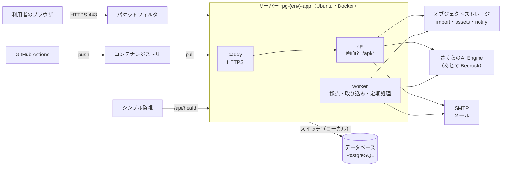
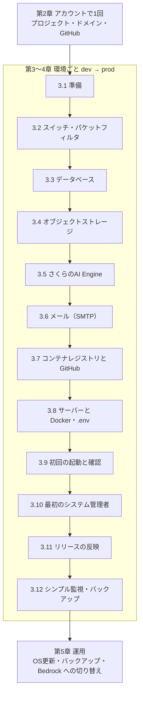

# RPG学習アプリ さくらのクラウド構築手順書

| 項目   | 内容 |
| ---- | --- |
| 文書名  | RPG学習アプリ さくらのクラウド構築手順書 |
| 版数   | 第0.1版（ドラフト。AWS 版の構築手順書 第0.5版に代わる。AWS 版は `aws/documents/` に退避） |
| 作成日  | 2026-10-27 |
| 入力文書 | 外部設計書 第1.1版（第2章 システム方式設計）、詳細設計書 第1.2版（2.4.6 環境変数、第10〜11章） |
| 対象   | Phase 1（MVP）のパイロット環境。dev・prod の2環境 |
| 作業方法 | さくらのクラウドのリソースはコントロールパネル（Web画面）で作る。アプリはコンテナイメージにして GitHub Actions がコンテナレジストリに置き、サーバーで `docker compose` を使って動かす（詳細設計書 第11章） |

---

## 1. はじめに

### 1.1 この手順書の使い方

- 第2章（アカウントで1回だけ行う作業）を最初に行い、そのあと **dev → prod の順** に第3〜4章を進める
- 第4章（prod）は第3章と同じ手順のため、値の違いだけを書いている
- 手順の中の `<DBのパスワード>` などの山かっこは、自分の環境の値に置き換える
- 作業中に控える値は「控える値」表（1.6）の番号（V-xx）で呼ぶ。パスワード・キーはパスワード管理ツールに入れ、文書やチャットに書かない
- コントロールパネルの項目名は2026年10月時点の想定。画面の文言が少し違う場合は、意味の近い項目を選ぶ
- AI は当面 **さくらのAI Engine** を使い、Amazon Bedrock が使えるようになったら AI だけを Bedrock に切り替える（5.5）

### 1.2 前提

| 項目 | 内容 |
| --- | --- |
| さくらのクラウドのアカウント | 1つ（dev・prod を同じアカウントに作り、プロジェクトで分ける）。作業者は二要素認証を設定する |
| ゾーン | 石狩第1ゾーン（`is1b`）。サーバー・スイッチ・データベースアプライアンスは同じゾーンに作る。オブジェクトストレージも石狩のサイト（`isk01`）を使う |
| ドメイン | HTTPS の証明書（Let's Encrypt）を Caddy が自動で取るため、環境ごとに名前（例：`rpg-dev.<ドメイン>`・`rpg.<ドメイン>`）が要る。DNS の A レコードを作れるドメインを用意する（2.2） |
| メール | SMTP で送れるメールサービス（例：さくらのメールボックス）。送信元のドメインに SPF・DKIM を設定できること（3.6） |
| GitHub | リポジトリ `pocarialice/rpglearning` の管理者権限（Settings を変更できる）。Environments を使う |
| 作業PC | SSH の鍵（ed25519）、`aws` CLI（オブジェクトストレージの CORS の設定に使う。S3 互換のため AWS の契約は不要） |

### 1.3 名前の決まり

| 項目 | ルール | 例 |
| --- | --- | --- |
| リソース名 | `rpg-{環境}-{用途}` | `rpg-dev-app`（サーバー）、`rpg-dev-db` |
| バケット名 | オブジェクトストレージ全体で重複できないため、`rpg-{環境}-{用途}` が使われていたら末尾に任意の英数字を付ける | `rpg-dev-import` |
| タグ | `rpg`・`dev`／`prod` | すべてのリソースに付ける（請求とコントロールパネルの絞り込みに使う） |

### 1.4 全体の構成



### 1.5 構築の順番



### 1.6 環境ごとの設定値と控える値

| 番号 | 項目 | dev | prod | どこで決まるか |
| --- | --- | --- | --- | --- |
| V-01 | サイトのドメイン名（`SITE_ADDRESS`） | `rpg-dev.<ドメイン>` | `rpg.<ドメイン>` | 2.2 |
| V-02 | サーバーのグローバルIPアドレス | | | 3.8 |
| V-03 | スイッチのネットワーク | `192.168.10.0/24` | `192.168.20.0/24` | 3.2 |
| V-04 | サーバーのローカルIPアドレス | `192.168.10.11` | `192.168.20.11` | 3.8 |
| V-05 | DB のIPアドレス | `192.168.10.21` | `192.168.20.21` | 3.3 |
| V-06 | DB のユーザー名 | `rpgadmin` | `rpgadmin` | 3.3 |
| V-07 | DB のパスワード | （管理ツールへ） | （管理ツールへ） | 3.3 |
| V-08 | オブジェクトストレージのエンドポイント・リージョン | `https://s3.isk01.sakurastorage.jp`・`jp-north-1` | 同じ | 3.4 |
| V-09 | バケット名（取り込み・画像・通知） | `rpg-dev-import`・`rpg-dev-assets`・`rpg-dev-notify` | `rpg-prod-*` | 3.4 |
| V-10 | オブジェクトストレージのアクセスキー・シークレットキー | （管理ツールへ） | （管理ツールへ） | 3.4 |
| V-11 | さくらのAI Engine のアカウントトークン | （管理ツールへ） | （管理ツールへ。dev と分ける） | 3.5 |
| V-12 | SMTP のホスト・ポート・ユーザー・パスワード | | | 3.6 |
| V-13 | 送信元のメールアドレス（`MAIL_FROM`） | `no-reply@<ドメイン>` | 同じ | 3.6 |
| V-14 | 監視のお知らせの宛先（`ALERT_EMAIL`） | 開発者 | システム管理者・開発者 | 3.6 |
| V-15 | `AUTH_SECRET`（ログインの署名の鍵） | （管理ツールへ） | （管理ツールへ。dev と別の値） | 3.8 |
| V-20 | コンテナレジストリのドメイン | `<レジストリ名>.sakuracr.jp` | dev と同じ | 3.7 |
| V-21 | レジストリの push 用ユーザー・パスワード | （管理ツールへ） | 同じ | 3.7 |
| V-22 | レジストリの pull 用ユーザー・パスワード | （管理ツールへ） | 同じ | 3.7 |

### 1.7 費用の目安

月額の料金は構築時にさくらのクラウドの料金表で確かめ、外部設計書のコストの表に書く（詳細設計書 12 No.14）。AI は、さくらのAI Engine の従量課金で prod が月に約400円の見込み（1か月の採点・抽出の回数から計算）。

| リソース | dev | prod |
| --- | --- | --- |
| サーバー | 2コア・4GB・ディスク40GB | 2コア・4GB・ディスク40GB（利用者が増えたら4コア・8GB） |
| スイッチ | 1 | 1 |
| データベースアプライアンス | 10GB プラン（1コア・2GB） | 30GB プラン（2コア・4GB） |
| オブジェクトストレージ | バケット3つ | バケット3つ |
| コンテナレジストリ | 1つを dev・prod で共用 | （共用） |
| シンプル監視 | 2つ（HTTPS・ping） | 2つ（HTTPS・ping） |

---

## 2. アカウントで1回だけ行う作業

### 2.1 プロジェクト

1. コントロールパネルにログインし、右上の「プロジェクト」で `rpg-dev` と `rpg-prod` の2つを作る
2. 作業者のユーザーに二要素認証を設定する（「会員メニュー」→「セキュリティ」）
3. 以降の作業は、環境ごとのプロジェクトを選んでから行う（リソースが混ざらないようにする）

### 2.2 ドメインと DNS

1. 使うドメインを決める（さくらのドメインで取る場合は「ドメイン取得」）。DNS は、さくらのクラウドの「DNS」アプライアンス、またはドメインの管理会社の DNS を使う
2. 名前を決めて V-01 に書く（`rpg-dev.<ドメイン>`・`rpg.<ドメイン>`）。A レコードはサーバーを作ったあと（3.8）に登録する
3. 送信元のドメインの SPF・DKIM は 3.6 で登録する

### 2.3 GitHub の設定

1. リポジトリの「Settings」→「Branches」で `main` のルールを作り、「Require status checks to pass」で `ci` を必須にする（詳細設計書 11.4）
2. 「Settings」→「Environments」で `dev` と `prod` を作る。`prod` は「Required reviewers」にシステム管理者と開発リーダーを入れ、「Prevent self-review」を有効にする。`prod` の「Deployment branches and tags」はタグ `release-*` だけにする
3. Variables・Secrets は 3.7 で入れる

---

## 3. dev 環境の構築

右上のプロジェクトで `rpg-dev` を選び、ゾーンを「石狩第1」にしてから始める。

### 3.1 準備

| 確認すること | 内容 |
| --- | --- |
| プロジェクト・ゾーン | `rpg-dev`・石狩第1 |
| 控える値の表 | 1.6 の dev の列を空けておく |
| SSH の鍵 | 作業PCの公開鍵（`~/.ssh/id_ed25519.pub`）をコントロールパネルの「公開鍵」に登録しておく（名前 `rpg-admin`） |

### 3.2 スイッチとパケットフィルタ

**スイッチ**

1. 「ネットワーク」→「スイッチ」→「追加」
2. 名前 `rpg-dev-sw`、タグ `rpg`・`dev`。ルータは付けない（サーバーと DB を内側でつなぐだけ）
3. このスイッチのネットワークを V-03（`192.168.10.0/24`）とする

**パケットフィルタ**（サーバーのインターネット側に付ける。さくらのクラウドのパケットフィルタは戻りの通信も明示して許可する必要がある）

1. 「ネットワーク」→「パケットフィルタ」→「追加」、名前 `rpg-dev-pf`
2. 次のルールを上から順に入れる

| No | プロトコル | 送信元ネットワーク | 送信元ポート | 宛先ポート | 動作 | 用途 |
| --- | --- | --- | --- | --- | --- | --- |
| 1 | tcp | （すべて） | | 80 | 許可 | Let's Encrypt の確認と HTTPS への転送 |
| 2 | tcp | （すべて） | | 443 | 許可 | 画面と API |
| 3 | tcp | `<作業場所のIPアドレス>/32` | | 22 | 許可 | SSH（作業者だけ） |
| 4 | tcp | （すべて） | | 32768-61000 | 許可 | サーバーから外への通信の戻り（レジストリ・AI・SMTP・オブジェクトストレージ・apt） |
| 5 | udp | （すべて） | 53 | | 許可 | DNS の戻り |
| 6 | udp | （すべて） | 123 | | 許可 | 時刻合わせ（NTP）の戻り |
| 7 | icmp | （すべて） | | | 許可 | ping（シンプル監視） |
| 8 | fragment | （すべて） | | | 許可 | 分割されたパケット |
| 9 | ip | （すべて） | | | 拒否 | ほかはすべて拒否 |

- SSH は作業場所のIPアドレスだけに開ける。IPアドレスが変わる環境なら、作業のときだけルール3を足す
- サーバーの中でも ufw で 22・80・443 だけを開ける（3.8）。二重に守る

### 3.3 データベースアプライアンス

1. 「アプライアンス」→「データベース」→「追加」
2. 次のとおり入れる

| 項目 | 値 |
| --- | --- |
| データベースの種類 | PostgreSQL（画面で選べる最新の版。16以上） |
| プラン | 10GB（1コア・2GB）。prod は 30GB（第4章） |
| 冗長化 | なし（Phase 1）。prod も Phase 3 で見直す |
| 接続先 | スイッチ `rpg-dev-sw` |
| IPアドレス・ネットマスク | V-05（`192.168.10.21`）・`24` |
| ポート | 5432（既定） |
| ユーザー名・パスワード | V-06（`rpgadmin`）・V-07（20文字以上のランダムな文字列。`openssl rand -base64 24`） |
| 送信元ネットワーク | `192.168.10.0/24`（スイッチの中だけから受け付ける） |
| 自動バックアップ | 毎日 3:00、保持8世代（日次処理 0:00 と重ならない時刻にする） |
| 名前・タグ | `rpg-dev-db`・`rpg`・`dev` |

3. 作成後、状態が「起動中」になるまで待つ（数分）
4. データベース `rpg` は、サーバーができたあと（3.9）に作る

- 作成後はプランと接続先スイッチを変えられない。プランを上げるときはバックアップから作り直す（5.3）

### 3.4 オブジェクトストレージ

**バケット**

1. 「オブジェクトストレージ」を開き、サイト「石狩第1（isk01）」でバケットを3つ作る

| バケット（V-09） | 中身 | 公開 |
| --- | --- | --- |
| `rpg-dev-import` | 問題の取り込みの原本（PDF・画像・テキスト） | 非公開 |
| `rpg-dev-assets` | パートナーの画像（api コンテナの `/partners/*` が配信する） | 非公開 |
| `rpg-dev-notify` | 通知メールの送信リスト（日次処理が作る） | 非公開 |

**アクセスキー**

2. 「パーミッション」（アクセスキー）を作り、上の3つのバケットに「読み取り・書き込み」を付ける。名前 `rpg-dev-app`
3. 表示されたアクセスキーとシークレットキーを V-10 に控える（シークレットキーはあとで表示できない）
4. エンドポイントとリージョンを V-08 に控える（画面に出る値を優先する）

**CORS**（画面からブラウザで署名付きURLに直接 PUT するため。`rpg-dev-import` と `rpg-dev-assets` の2つ）

5. 作業PCで次のファイル `cors.json` を作る（`<V-01>` を自分の値に）

```json
{
  "CORSRules": [
    {
      "AllowedOrigins": ["https://<V-01>"],
      "AllowedMethods": ["PUT"],
      "AllowedHeaders": ["content-type"],
      "MaxAgeSeconds": 3600
    }
  ]
}
```

6. S3 互換 API で設定する

```bash
export AWS_ACCESS_KEY_ID=<V-10 のアクセスキー> AWS_SECRET_ACCESS_KEY=<V-10 のシークレットキー>
for b in rpg-dev-import rpg-dev-assets; do
  aws s3api put-bucket-cors --endpoint-url https://s3.isk01.sakurastorage.jp --region jp-north-1 --bucket "$b" --cors-configuration file://cors.json
  aws s3api get-bucket-cors --endpoint-url https://s3.isk01.sakurastorage.jp --region jp-north-1 --bucket "$b"
done
```

- `put-bucket-cors` が受け付けられない場合は、コントロールパネルのバケットの設定に CORS の項目がないかを見る。どちらでも設定できなければ、6章 No.1 として相談する（画面からのアップロードができないため）

**古いファイルの削除**（任意）

7. `rpg-dev-import` の `uploads/` は取り込みが終われば使わないため、ライフサイクルで30日後に消す。`rpg-dev-notify` の `notify/` は7日後に消す（S3 互換 API の `put-bucket-lifecycle-configuration`。使えなければ手で年に数回消す）

### 3.5 さくらのAI Engine

1. コントロールパネルの「AI Engine」を開き、利用規約を確認して利用を始める
2. 「アカウントトークン」→「発行」。名前 `rpg-dev`。表示された値（`<UUID>:<シークレット>`）を V-11 に控える（あとで表示できない）
3. 使うモデルが `gpt-oss-120b` であること、料金（無料枠・従量課金）を画面で確かめる
4. 入力のデータの扱い（学習に使わないこと）を利用規約で確かめ、外部設計書の個人情報の扱いと食い違わないことを確認する。AI に渡すのは問題文・解説・学習者の説明文だけで、氏名・メールアドレスは渡さない（詳細設計書 9.1）
5. 作業PCで呼べることを確かめる

```bash
curl -s https://api.ai.sakura.ad.jp/v1/chat/completions \
  -H "Authorization: Bearer <V-11>" -H "Content-Type: application/json" \
  -d '{"model":"gpt-oss-120b","messages":[{"role":"user","content":"こんにちは"}],"max_tokens":50}'
```

- 応答の `choices[0].message.content` に文章が入っていれば OK

### 3.6 メール（SMTP）

ここでは、さくらのメールボックスで送る例を書く。ほかの SMTP サービスでも、ホスト・ポート・ユーザー・パスワードがあれば同じように使える。

1. 送信用のメールアドレス `no-reply@<ドメイン>` を作る（V-13）。パスワードを V-12 に控える
2. SMTP の設定を V-12 に控える

| 項目 | 値の例 |
| --- | --- |
| ホスト（`SMTP_HOST`） | `<初期ドメイン>.sakura.ne.jp` など、サービスの案内のとおり |
| ポート・暗号化（`SMTP_PORT`・`SMTP_SECURE`） | 587・`false`（STARTTLS）。465 を使うなら `true` |
| ユーザー（`SMTP_USER`） | `no-reply@<ドメイン>` |

3. 送信元のドメインの DNS に、サービスの案内どおりの SPF（TXT レコード、例 `v=spf1 include:<サービスの指定> ~all`）と DKIM を登録する
4. 監視のお知らせの宛先を決めて V-14 に書く
5. 作業PCから自分あてに1通送り、迷惑メールにならずに届くことを確かめる（3.9 でアプリからも確かめる）

- サーバーから外への 25番ポートは使わない（587・465 で送る）

### 3.7 コンテナレジストリと GitHub

レジストリは dev・prod で1つを共用する（dev のときだけ作る。prod では作らない）。

1. 「アプライアンス」→「コンテナレジストリ」→「追加」。名前（サブドメイン）を決め、公開設定は「非公開」にする。ドメイン `<名前>.sakuracr.jp` を V-20 に控える
2. 「ユーザー」を2つ作る

| ユーザー | 権限 | 使う場所 | 控える値 |
| --- | --- | --- | --- |
| `rpg-push` | 読み書き（push） | GitHub Actions（`release.yml`） | V-21 |
| `rpg-pull` | 読み取りだけ（pull） | サーバー（dev・prod） | V-22 |

3. GitHub の「Settings」→「Environments」で、`dev` と `prod` のそれぞれに入れる

| 種類 | 名前 | dev | prod |
| --- | --- | --- | --- |
| Variables | `REGISTRY` | V-20 | V-20 |
| Variables | `APP_ENV` | `dev` | `prod` |
| Secrets | `REGISTRY_USER` | `rpg-push` | `rpg-push` |
| Secrets | `REGISTRY_PASSWORD` | V-21 | V-21 |

4. 「Actions」→「release」→「Run workflow」（ブランチ `main`）で、最初の dev 用のイメージを作る。成功したら、ジョブの概要に出たイメージ名（`<V-20>/rpg-app:dev-YYYYMMDD-NN`）を控える

### 3.8 サーバーと Docker・compose・.env

**サーバーを作る**

1. 「サーバ」→「追加」

| 項目 | 値 |
| --- | --- |
| プラン | 2コア・4GB |
| ディスク | 40GB（SSD）、アーカイブ「Ubuntu Server 24.04 LTS」 |
| NIC 1 | インターネット（共有セグメント）、パケットフィルタ `rpg-dev-pf` |
| NIC 2 | スイッチ `rpg-dev-sw`（追加の NIC。作成後に「NIC」タブで足してもよい） |
| 公開鍵 | `rpg-admin`（パスワードでのログインは無効にする） |
| ホスト名・名前・タグ | `rpg-dev-app`・`rpg`・`dev` |

2. 作成後、グローバルIPアドレスを V-02 に控え、DNS に A レコード `<V-01>` → V-02 を登録する
3. SSH でログインする：`ssh ubuntu@<V-02>`

**OS の設定**

4. 更新・時刻・ファイアウォール

```bash
sudo apt update && sudo apt -y upgrade
sudo timedatectl set-timezone Asia/Tokyo
sudo ufw allow 22/tcp && sudo ufw allow 80/tcp && sudo ufw allow 443/tcp && sudo ufw --force enable
```

5. NIC 2（スイッチ側）にローカルIPアドレス V-04 を付ける。`/etc/netplan/60-switch.yaml` を作る（インターフェース名は `ip link` で確かめる。例 `ens4`）

```yaml
network:
  version: 2
  ethernets:
    ens4:
      addresses: [192.168.10.11/24]
```

```bash
sudo netplan apply
ping -c 3 192.168.10.21   # DB に届けば OK
```

**Docker**

6. Docker の公式手順（Ubuntu）で Docker Engine と compose プラグインを入れる

```bash
curl -fsSL https://get.docker.com -o get-docker.sh && sudo sh get-docker.sh
sudo usermod -aG docker ubuntu   # ログインし直す
docker compose version
```

7. コンテナレジストリにログインする（pull 用のユーザー）

```bash
docker login <V-20> -u rpg-pull   # パスワードは V-22
```

**compose と .env**

8. 置き場所を作り、リポジトリの `compose.yaml` と `Caddyfile` を置く

```bash
sudo mkdir -p /opt/rpg && sudo chown ubuntu: /opt/rpg && cd /opt/rpg
curl -fsSLO https://raw.githubusercontent.com/pocarialice/rpglearning/main/compose.yaml
curl -fsSLO https://raw.githubusercontent.com/pocarialice/rpglearning/main/Caddyfile
```

（リポジトリが非公開なら、作業PCから `scp compose.yaml Caddyfile ubuntu@<V-02>:/opt/rpg/` で置く）

9. `.env` を作る（見本はリポジトリの `.env.example`）。`AUTH_SECRET` は `openssl rand -base64 48` で作り V-15 に控える

```bash
IMAGE=<V-20>/rpg-app:<3.7 で控えたリリース番号>
SITE_ADDRESS=<V-01>
APP_ENV=dev
APP_URL=https://<V-01>
DATABASE_URL=postgres://rpgadmin:<V-07>@192.168.10.21:5432/rpg
DATABASE_SSL=
AUTH_SECRET=<V-15>
S3_ENDPOINT=https://s3.isk01.sakurastorage.jp
S3_REGION=jp-north-1
S3_ACCESS_KEY_ID=<V-10 のアクセスキー>
S3_SECRET_ACCESS_KEY=<V-10 のシークレットキー>
IMPORT_BUCKET=rpg-dev-import
ASSETS_BUCKET=rpg-dev-assets
NOTIFY_BUCKET=rpg-dev-notify
SMTP_HOST=<V-12>
SMTP_PORT=587
SMTP_SECURE=false
SMTP_USER=<V-12>
SMTP_PASS=<V-12>
MAIL_FROM=<V-13>
ALERT_EMAIL=<V-14>
AI_PROVIDER=sakura
AI_BASE_URL=https://api.ai.sakura.ad.jp/v1
AI_API_KEY=<V-11>
MODEL_HIGH=gpt-oss-120b
MODEL_LIGHT=gpt-oss-120b
MAIL_SCHEDULE_ENABLED=false
```

```bash
chmod 600 /opt/rpg/.env
```

- DB のパスワードに `@`・`/`・`:` が入っているときは URL エンコードする（例：`@` → `%40`）
- `.env` は Git に入れない。変えたら `docker compose up -d` で反映する

### 3.9 初回の起動と確認

1. データベース `rpg` を作る（一度だけ）

```bash
docker run --rm -it postgres:16 psql "postgres://rpgadmin:<V-07>@192.168.10.21:5432/postgres" -c "CREATE DATABASE rpg;"
```

2. 起動する（api の起動時にテーブルが作られる：V001〜V003）

```bash
cd /opt/rpg
docker compose pull
docker compose up -d
docker compose ps                       # api が healthy、worker・caddy が running
docker compose logs --since 5m api | grep -E 'migrate|ERROR'
```

3. 確認する

| No | 確認 | 期待する結果 |
| --- | --- | --- |
| 1 | ブラウザで `https://<V-01>/api/health` | `{"status":"ok"}`（証明書のエラーが出ない） |
| 2 | `https://<V-01>/` | ログイン画面（S-01）が出る |
| 3 | `docker compose logs api | grep migrate.done` | 適用したマイグレーション `V001`・`V002`・`V003` |
| 4 | `docker compose logs worker | grep schedule` | エラーが出ていない |

### 3.10 最初のシステム管理者

画面から利用者を登録できる人がまだいないため、1人目だけをコマンドで作る（詳細設計書 8.5）。

```bash
cd /opt/rpg
docker compose exec api node scripts/create-admin.mjs <メールアドレス> <氏名>
```

1. 表示された仮パスワードで `https://<V-01>/` にログインし、新しいパスワードを決める（仮パスワードは7日で切れる）
2. 管理画面（S-13）で自分あてにもう1人登録し、**招待メールが届くこと**を確かめる（3.6 の確認）
3. 「パスワードを忘れたとき」で再設定のメールが届くことを確かめる
4. 表示された仮パスワードはどこにも残さない（端末の履歴も `history -c` で消す）

### 3.11 リリースの反映

新しい版を反映するときは、詳細設計書 11.5 のとおりにサーバーで行う。

```bash
cd /opt/rpg
sed -i 's/^IMAGE=/# 前回 IMAGE=/' .env && echo "IMAGE=<V-20>/rpg-app:<新しいリリース番号>" >> .env
docker compose pull
docker compose up -d
docker compose ps
docker compose logs --since 10m api | grep -E 'migrate|ERROR'
```

- 切り戻しは、`.env` の `IMAGE=` を前回の値に戻して `docker compose up -d`（詳細設計書 11.6）
- `compose.yaml`・`Caddyfile` を変えたリリースのときだけ、8. のファイルも置き直す

### 3.12 シンプル監視とバックアップ

**シンプル監視**

1. 「シンプル監視」→「追加」を2つ

| 監視 | 対象 | 方法 | 間隔 | 通知 |
| --- | --- | --- | --- | --- |
| サイト | `<V-01>` | HTTPS、パス `/api/health`、ステータス 200 | 5分 | メールで V-14 |
| サーバー | V-02 | ping | 5分 | メールで V-14 |

2. `docker compose stop api` で止め、通知が届くことを確かめてから `docker compose start api` で戻す

**バックアップ**

3. データベースの「バックアップ」タブで自動バックアップ（毎日 3:00・8世代）が動いていることを翌日に確かめる
4. サーバーは、`/opt/rpg`（`.env`・`compose.yaml`・`Caddyfile`）だけが手で作ったもの。`.env` の中身はパスワード管理ツールに控えてあるため、サーバーのバックアップは取らない（壊れたら 3.8 で作り直す）

---

## 4. prod 環境の構築

右上のプロジェクトで `rpg-prod` を選び、第3章を上から同じ順で行う。違うところだけを書く。

| 手順 | prod での違い |
| --- | --- |
| 3.2 | スイッチ `rpg-prod-sw`（`192.168.20.0/24`）、パケットフィルタ `rpg-prod-pf` |
| 3.3 | プラン 30GB（2コア・4GB）、IPアドレス `192.168.20.21`、送信元 `192.168.20.0/24`、パスワードは dev と別 |
| 3.4 | バケット `rpg-prod-import`・`rpg-prod-assets`・`rpg-prod-notify`、アクセスキー `rpg-prod-app`（dev のバケットには権限を付けない）、CORS の `AllowedOrigins` は `https://rpg.<ドメイン>` |
| 3.5 | アカウントトークン `rpg-prod`（dev と分け、使った量を分けて見られるようにする） |
| 3.6 | `ALERT_EMAIL` はシステム管理者と開発者 |
| 3.7 | レジストリは作らない（dev と共用）。GitHub の Environment `prod` に Variables・Secrets を入れる。イメージはタグ `release-YYYYMMDD-NN` を付けて承認すると作られる |
| 3.8 | サーバー `rpg-prod-app`、ローカルIPアドレス `192.168.20.11`、`.env` は `APP_ENV=prod`・`SITE_ADDRESS=rpg.<ドメイン>`・`MAIL_SCHEDULE_ENABLED=true`・prod のバケット・キー・`AUTH_SECRET`（dev と別） |
| 3.10 | 本番のシステム管理者を作る。確認用の利用者は `[確認用]` を名前に付ける |
| 3.12 | 監視の通知先にシステム管理者を入れる |

- prod の `.env` を dev からコピーして直すときは、**キー・パスワード・`AUTH_SECRET` をすべて prod の値に替えた**ことを2人で確かめる

---

## 5. 運用

### 5.1 OS の更新（月に1回）

平日の 13:00〜13:30（詳細設計書 11.1 の時間帯）に行う。dev で先に行い、問題がなければ prod。

```bash
sudo apt update && sudo apt -y upgrade
docker compose -f /opt/rpg/compose.yaml pull caddy   # Caddy の更新（同じ 2.x の範囲）
sudo reboot                                            # カーネルの更新があったとき
# 再起動後
cd /opt/rpg && docker compose ps                       # restart: unless-stopped で自動で戻る
```

- 再起動のあいだ（1〜2分）サイトは止まる。シンプル監視の通知が来ることがある

### 5.2 リソースの確認（月に1回）

| 見るもの | 場所 | 目安 |
| --- | --- | --- |
| サーバーの CPU・メモリ | コントロールパネルの「リソースモニタ」、`docker stats` | CPU が常に70%を超える、メモリが足りない → プランを上げる |
| ディスク | `df -h`、`docker system df` | 70%を超えたら `docker image prune -a`（使っていない古いイメージを消す） |
| DB の容量 | データベースの「リソースモニタ」 | 70%を超えたらプランを上げる（5.3 の復元で作り直す） |
| AI の使った量 | AI Engine の利用状況 | 予算を超えそうなら相談する |
| 監視メール | `ALERT_EMAIL` の受信箱 | 届いたものの原因を確かめたか |

### 5.3 バックアップと復元

- リリースで DB の変更があるときは、prod へ反映する前にデータベースの「バックアップ」→「追加」で手動のバックアップを取る（詳細設計書 11.6）
- 復元は、データベースの「バックアップ」タブで世代を選んで「復元」。**今のデータが巻き戻る**ため、システム管理者の判断で行う
- プランを上げるときは、手動のバックアップを取ってから新しいプランで作り直し、そのバックアップから復元する（IPアドレスは同じにする）

### 5.4 ログを見る

詳細設計書 10.2 のとおり、サーバーで `docker compose logs` を使う。ログはコンテナごとに 20MB×10ファイルまで残る。

### 5.5 Bedrock への切り替え（AI だけ）

Amazon Bedrock が使えるようになったら、AI だけを Bedrock に替える。DB・ファイル・メール・ログインはさくらのクラウドのまま。

1. AWS で、Bedrock の呼び出しだけを許した IAM ユーザーを作り、アクセスキーを発行する（ポリシーは `bedrock:InvokeModel` を使うモデルだけに限る）
2. Bedrock で使うモデル（採点・抽出用の Sonnet、軽い用途の Haiku）が東京リージョンで呼べることを確かめる
3. **dev から** `.env` を書き換える

```bash
AI_PROVIDER=bedrock
AWS_REGION=ap-northeast-1
AWS_ACCESS_KEY_ID=<アクセスキー>
AWS_SECRET_ACCESS_KEY=<シークレットキー>
MODEL_HIGH=<Sonnet のモデルID>
MODEL_LIGHT=<Haiku のモデルID>
```

4. `docker compose up -d` で反映し、採点・取り込み（PDF・画像）・ひとことを試す
5. さくらのAI Engine と採点の質・速さ・費用を比べ、よければ prod も同じように替える
6. 戻すときは `AI_PROVIDER=sakura` と `MODEL_*` を戻して `docker compose up -d`

- 切り替えでコードは変えない（詳細設計書 7章）。画像の取り込みは Bedrock のときだけ使える

---

## 6. 確認したいこと（未決事項）

| No | 項目 | いまの仮置き | 決める時期 |
| --- | --- | --- | --- |
| 1 | オブジェクトストレージの CORS | S3 互換 API の `put-bucket-cors` で設定する想定。使えなければ、画面のアップロードを api 経由にするかを相談する | dev 構築時 |
| 2 | 使うドメインと SMTP のサービス | さくらのドメイン・さくらのメールボックスを例にした。会社のドメイン・メールを使うかを決める | dev 構築前 |
| 3 | 月額の料金 | 1.7 の大きさで料金表から計算し、外部設計書に書く | dev 構築時 |
| 4 | サーバーの冗長化 | Phase 1 は1台（止まると数分〜数十分使えない）。全社展開の前に2台とロードバランサにするかを決める | Phase 3 の計画時 |
| 5 | AWS に残っている dev のリソース | AWS 版で作った dev 環境（Aurora・Lambda・S3・CloudFront など）は、Bedrock の切り替えに使う IAM ユーザーを除いて片付ける。片付けるまでは費用がかかる | 早めに |
| 6 | サーバーの SSH を開ける範囲 | 作業場所のIPアドレスだけ。テレワークで IPアドレスが変わる場合の運用を決める | dev 構築時 |
