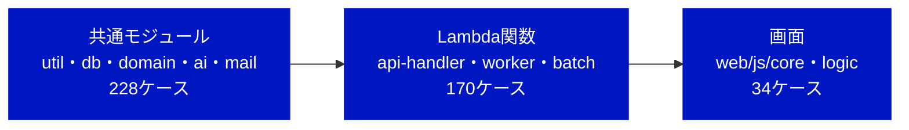
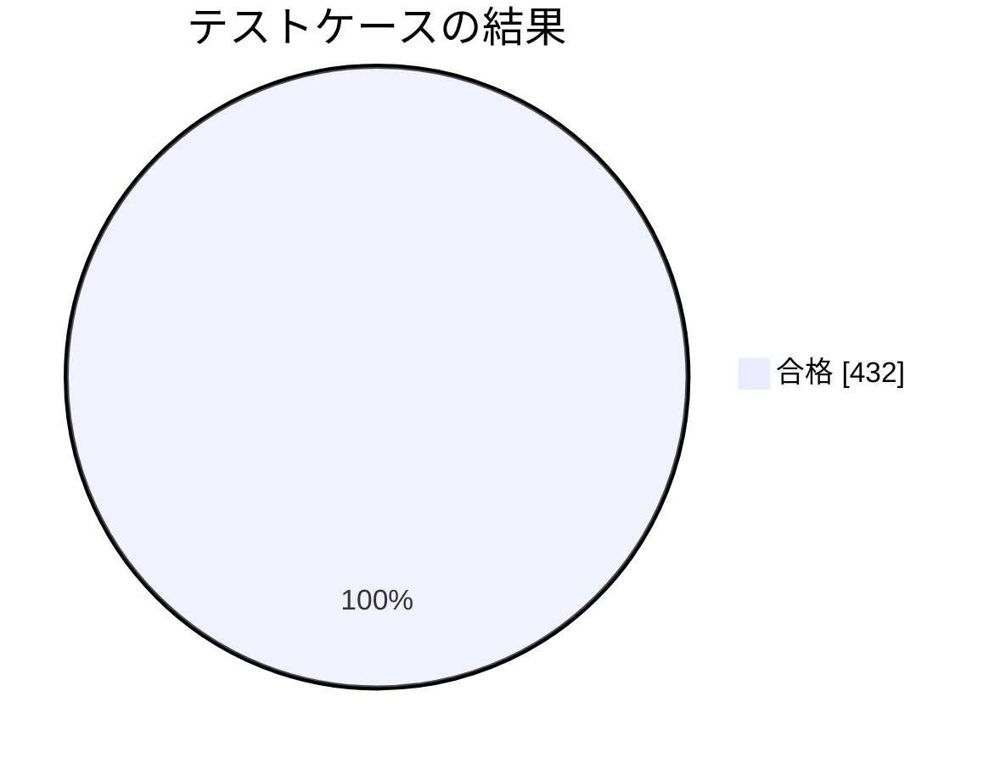
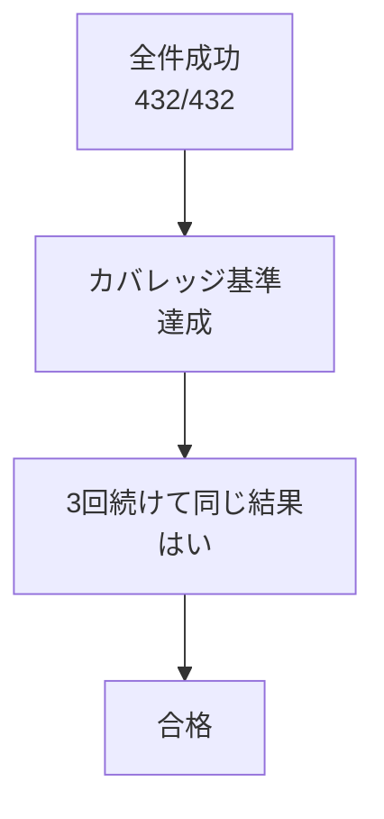

# RPG学習アプリ モジュールテスト結果報告書

| 項目 | 内容 |
| --- | --- |
| 文書名 | RPG学習アプリ モジュールテスト結果報告書 |
| 版数 | 第1.7版（最終報告：全モジュール。管理局の土台（A-01・A-14・ルーター）の変更後の文書の版で再実行） |
| 作成日 | 2026-10-21 |
| 入力文書 | モジュールテスト仕様書 第1.0版、詳細設計書 第1.0版、外部設計書 第1.0版 |
| 対象範囲 | 全モジュール（functions/ の共通モジュール・Lambda 4関数と、web/js/core・web/js/logic） |
| 実行日時・コミット | 2026-10-21 14:16（JST）、`0beb63f`（ブランチ `claude/beautiful-cray-m8heuy`） |
| 判定 | **合格**（対象範囲について、仕様書 6.2 の合否基準による） |

---

## 1. 概要

### 1.1 目的

モジュールテスト仕様書 第4〜5章のテストケースを Vitest で自動化して実行し、その結果を同書 6.2 の合否基準に照らして判定する。本版は段階リリースの第2弾（最終報告）で、第0.1版（中間報告：共通モジュール）に Lambda関数（MT-H・MT-W）と画面（MT-F）を加え、仕様書の全ケースで合否を判定する。第1.4版では、説明文の小見出しのルールをなくしたこと（外部設計書 第1.0版）に合わせて、仕様書 第0.7版で MT-U07-03〜07 を書き直し、MT-U07-08〜10・33 を欠番にし、MT-A02-11・MT-A04-07 を足して全件を流し直した。第1.5版では、S-08 で使う A-12 にレベル・累計EXPを足し、バッジの獲得日時を +09:00 付きにしたこと（詳細設計書 第0.8版）に合わせて、仕様書 第0.8版で MT-H02-17・18 を足して全件を流し直した。第1.6版では、S-07 の見出しに使うコース名を A-11 の応答に足したこと（詳細設計書 第0.9版）に合わせて、仕様書 第0.9版で MT-H08-08 を足して全件を流し直した。第1.7版では、管理局の画面に合わせて A-01 に担当コースを足し、A-14 の一覧の日時を +09:00 付きにし、管理局を初回の流れの対象外にしたこと（詳細設計書 第1.0版）に合わせて、仕様書 第1.0版で MT-H02-19・MT-F03-06 を足し、MT-H09-07 の期待結果を直して全件を流し直した。

### 1.2 今回の範囲

| 区分 | 層 | 仕様書のケース数 | 今回 |
| --- | --- | --- | --- |
| 対象 | util（MT-U） | 77 | 実行 |
| 対象 | db（MT-D） | 50 | 実行 |
| 対象 | domain（MT-G） | 69 | 実行 |
| 対象 | ai（MT-A） | 27 | 実行 |
| 対象 | mail（MT-M） | 5 | 実行 |
| 対象 | api-handler（MT-H） | 120 | 実行 |
| 対象 | ワーカー・バッチ（MT-W） | 50 | 実行 |
| 対象 | 画面（web/js）（MT-F） | 34 | 実行 |

## 2. 実行環境

| 項目 | 内容 |
| --- | --- |
| OS | Linux 6.18（作業用コンテナ） |
| Node.js | 22.22.0（Lambda の nodejs22.x と同じ系列） |
| Vitest・@vitest/coverage-v8 | 3.2.7（`test.projects` で functions＝Node、web＝jsdom に分けて実行） |
| jsdom | 29.1.1 |
| aws-sdk-client-mock | 4.1.0 |
| AWS SDK for JavaScript v3 | 3.1153.0（rds-data・bedrock-runtime・ses・s3・lambda・cognito-identity-provider、s3-request-presigner） |
| pdf-lib | 1.17.1（PDFの分割とテスト用PDFの作成） |
| 実行コマンド | `npx vitest run --coverage`（`npm test -- --coverage` と同じ） |

- 外部サービス（Aurora・Bedrock・SES・S3・Lambda・Cognito）には接続せず、`aws-sdk-client-mock` で応答を差し替えた（仕様書 2.3）
- `tests/helpers/vitest.setup.js` で `fetch` の既定をエラーにし、ネットワークへ出たテストは失敗する

## 3. 結果の要約

| 項目 | 結果 |
| --- | --- |
| テストケース（仕様書のID） | 432件中 合格 432・不合格 0・未実装 0 |
| 実行したテスト（`it` の数） | 572件（成功 572・失敗 0・スキップ 0・todo 0）、テストファイル 48 |
| うち仕様書 第0.3〜1.0版 で追加したケース | 73件（第0.1版 7.2 No.10 で分岐網羅のために採番した66件（うち MT-U07-33 は第0.7版で欠番）、第1.1版 7.2.6 の修正で追加した MT-H09-08、第0.7版で追加した MT-A02-11・MT-A04-07、第0.8版で追加した MT-H02-17・18、第0.9版で追加した MT-H08-08、第1.0版で追加した MT-H02-19・MT-F03-06） |
| IDのないテスト | 75件 |
| 実行時間 | 最大 14.28 秒（基準：60秒以内） |
| 安定性 | 同じコミットで3回実行し、すべて同じ結果（572/572、572/572、572/572） |
| 失敗したテスト | なし |

## 4. カバレッジ

| 対象 | ファイル数 | 命令網羅（C0） | 分岐網羅（C1） | 関数 | 基準（C0／C1） | 判定 |
| --- | --- | --- | --- | --- | --- | --- |
| 全体 | 86 | 99.94% | 98.59% | 98.40% | - | - |
| `functions/shared/domain/**` | 7 | 100.00% | 100.00% | 100.00% | 100%／100% | 合格 |
| `web/js/logic/validators.js` | 1 | 100.00% | 100.00% | 100.00% | 100%／100% | 合格 |
| `functions/**` | 78 | 99.93% | 98.47% | 99.04% | 90%／80% | 合格 |
| `web/js/**` | 8 | 100.00% | 99.19% | 95.16% | 90%／80% | 合格 |

**ファイル別**

| ファイル | C0 | C1 | 関数 |
| --- | --- | --- | --- |
| `functions/api-handler/index.mjs` | 100.00% | 96.15% | 100.00% |
| `functions/api-handler/router.js` | 100.00% | 100.00% | 100.00% |
| `functions/api-handler/lib/aws.js` | 100.00% | 100.00% | 100.00% |
| `functions/api-handler/routes/_admin.js` | 100.00% | 100.00% | 100.00% |
| `functions/api-handler/routes/admin-courses.js` | 100.00% | 100.00% | 100.00% |
| `functions/api-handler/routes/admin-dashboard.js` | 98.55% | 97.56% | 100.00% |
| `functions/api-handler/routes/admin-imports.js` | 100.00% | 95.45% | 100.00% |
| `functions/api-handler/routes/admin-partners.js` | 100.00% | 100.00% | 100.00% |
| `functions/api-handler/routes/admin-questions.js` | 100.00% | 100.00% | 100.00% |
| `functions/api-handler/routes/admin-users.js` | 100.00% | 95.31% | 100.00% |
| `functions/api-handler/routes/answers.js` | 100.00% | 95.00% | 100.00% |
| `functions/api-handler/routes/courses.js` | 100.00% | 100.00% | 100.00% |
| `functions/api-handler/routes/gradings.js` | 100.00% | 100.00% | 100.00% |
| `functions/api-handler/routes/health.js` | 100.00% | 100.00% | 100.00% |
| `functions/api-handler/routes/home.js` | 100.00% | 100.00% | 100.00% |
| `functions/api-handler/routes/me.js` | 100.00% | 94.54% | 100.00% |
| `functions/api-handler/routes/quests.js` | 100.00% | 100.00% | 100.00% |
| `functions/api-handler/routes/rankings.js` | 100.00% | 100.00% | 100.00% |
| `functions/batch-runner/index.mjs` | 100.00% | 92.30% | 100.00% |
| `functions/batch-runner/jobs/daily.js` | 100.00% | 100.00% | 100.00% |
| `functions/batch-runner/jobs/mail.js` | 100.00% | 95.00% | 100.00% |
| `functions/batch-runner/lib/s3.js` | 100.00% | 100.00% | 100.00% |
| `functions/batch-runner/steps/assign-quests.js` | 100.00% | 100.00% | 100.00% |
| `functions/batch-runner/steps/build-notify.js` | 100.00% | 100.00% | 100.00% |
| `functions/batch-runner/steps/cleanup-gradings.js` | 100.00% | 100.00% | 100.00% |
| `functions/batch-runner/steps/close-ranking.js` | 100.00% | 100.00% | 100.00% |
| `functions/batch-runner/steps/purge-users.js` | 100.00% | 100.00% | 100.00% |
| `functions/batch-runner/steps/update-streak.js` | 100.00% | 100.00% | 100.00% |
| `functions/grading-worker/grader.js` | 100.00% | 94.44% | 66.66% |
| `functions/grading-worker/index.mjs` | 100.00% | 100.00% | 100.00% |
| `functions/import-worker/extractor.js` | 100.00% | 100.00% | 100.00% |
| `functions/import-worker/index.mjs` | 100.00% | 94.54% | 100.00% |
| `functions/import-worker/pdf-splitter.js` | 100.00% | 100.00% | 100.00% |
| `functions/shared/ai/bedrock.js` | 100.00% | 95.45% | 100.00% |
| `functions/shared/ai/json-guard.js` | 100.00% | 100.00% | 100.00% |
| `functions/shared/ai/persona.js` | 100.00% | 100.00% | 100.00% |
| `functions/shared/ai/prompts/comment.js` | 100.00% | 100.00% | 100.00% |
| `functions/shared/ai/prompts/daily-message.js` | 100.00% | 92.30% | 81.81% |
| `functions/shared/ai/prompts/extraction.js` | 100.00% | 100.00% | 100.00% |
| `functions/shared/ai/prompts/grading.js` | 100.00% | 100.00% | 100.00% |
| `functions/shared/ai/prompts/sanitize.js` | 100.00% | 100.00% | 100.00% |
| `functions/shared/db/data-api.js` | 98.48% | 97.95% | 100.00% |
| `functions/shared/db/tx.js` | 100.00% | 100.00% | 100.00% |
| `functions/shared/db/repositories/_base.js` | 100.00% | 100.00% | 100.00% |
| `functions/shared/db/repositories/adventures.js` | 100.00% | 100.00% | 100.00% |
| `functions/shared/db/repositories/answers.js` | 100.00% | 100.00% | 100.00% |
| `functions/shared/db/repositories/audit.js` | 100.00% | 100.00% | 100.00% |
| `functions/shared/db/repositories/badges.js` | 100.00% | 100.00% | 100.00% |
| `functions/shared/db/repositories/courses.js` | 100.00% | 100.00% | 100.00% |
| `functions/shared/db/repositories/enrollments.js` | 100.00% | 100.00% | 100.00% |
| `functions/shared/db/repositories/exp.js` | 100.00% | 100.00% | 100.00% |
| `functions/shared/db/repositories/gradings.js` | 100.00% | 100.00% | 100.00% |
| `functions/shared/db/repositories/imports.js` | 100.00% | 100.00% | 100.00% |
| `functions/shared/db/repositories/notify.js` | 100.00% | 100.00% | 100.00% |
| `functions/shared/db/repositories/partners.js` | 100.00% | 100.00% | 100.00% |
| `functions/shared/db/repositories/questions.js` | 100.00% | 100.00% | 100.00% |
| `functions/shared/db/repositories/quests.js` | 100.00% | 100.00% | 100.00% |
| `functions/shared/db/repositories/rankings.js` | 100.00% | 100.00% | 100.00% |
| `functions/shared/db/repositories/reviews.js` | 100.00% | 100.00% | 100.00% |
| `functions/shared/db/repositories/users.js` | 100.00% | 100.00% | 100.00% |
| `functions/shared/domain/answer-flow.js` | 100.00% | 100.00% | 100.00% |
| `functions/shared/domain/badge.js` | 100.00% | 100.00% | 100.00% |
| `functions/shared/domain/exp.js` | 100.00% | 100.00% | 100.00% |
| `functions/shared/domain/picker.js` | 100.00% | 100.00% | 100.00% |
| `functions/shared/domain/quest.js` | 100.00% | 100.00% | 100.00% |
| `functions/shared/domain/ranking.js` | 100.00% | 100.00% | 100.00% |
| `functions/shared/domain/review.js` | 100.00% | 100.00% | 100.00% |
| `functions/shared/mail/ses.js` | 100.00% | 100.00% | 100.00% |
| `functions/shared/mail/templates.js` | 100.00% | 100.00% | 100.00% |
| `functions/shared/services/answer-recorder.js` | 100.00% | 100.00% | 100.00% |
| `functions/shared/util/authz.js` | 100.00% | 100.00% | 100.00% |
| `functions/shared/util/date-jst.js` | 100.00% | 100.00% | 100.00% |
| `functions/shared/util/env.js` | 100.00% | 100.00% | 100.00% |
| `functions/shared/util/errors.js` | 100.00% | 100.00% | 100.00% |
| `functions/shared/util/http.js` | 100.00% | 100.00% | 100.00% |
| `functions/shared/util/ids.js` | 100.00% | 100.00% | 100.00% |
| `functions/shared/util/logger.js` | 100.00% | 100.00% | 100.00% |
| `functions/shared/util/validators.js` | 100.00% | 100.00% | 100.00% |
| `web/js/core/api.js` | 100.00% | 97.50% | 100.00% |
| `web/js/core/auth.js` | 100.00% | 100.00% | 84.21% |
| `web/js/core/context.js` | 100.00% | 66.66% | 100.00% |
| `web/js/core/router.js` | 100.00% | 100.00% | 100.00% |
| `web/js/core/store.js` | 100.00% | 100.00% | 100.00% |
| `web/js/logic/format.js` | 100.00% | 100.00% | 100.00% |
| `web/js/logic/grading-poller.js` | 100.00% | 100.00% | 100.00% |
| `web/js/logic/validators.js` | 100.00% | 100.00% | 100.00% |

## 5. モジュール別の結果

| モジュール | 対象 | ケース | 合格 | 不合格 | 未実装 | it の数 |
| --- | --- | --- | --- | --- | --- | --- |
| M-U01 | `util/errors.js` | 5 | 5 | 0 | 0 | 14 |
| M-U02 | `util/ids.js` | 7 | 7 | 0 | 0 | 12 |
| M-U03 | `util/date-jst.js` | 14 | 14 | 0 | 0 | 14 |
| M-U04 | `util/authz.js` | 10 | 10 | 0 | 0 | 10 |
| M-U05 | `util/logger.js` | 5 | 5 | 0 | 0 | 5 |
| M-U06 | `util/http.js` | 6 | 6 | 0 | 0 | 6 |
| M-U07 | `web/js/logic/validators.js（画面とLambdaで共用）` | 29 | 29 | 0 | 0 | 47 |
| M-U08 | `util/env.js` | 1 | 1 | 0 | 0 | 1 |
| M-D01 | `db/data-api.js` | 12 | 12 | 0 | 0 | 12 |
| M-D02 | `db/tx.js` | 5 | 5 | 0 | 0 | 5 |
| M-D03 | `リポジトリ（代表的なもの）` | 33 | 33 | 0 | 0 | 33 |
| M-G01 | `domain/review.js 忘却曲線` | 14 | 14 | 0 | 0 | 15 |
| M-G02 | `domain/exp.js EXPとレベル` | 13 | 13 | 0 | 0 | 23 |
| M-G03 | `domain/quest.js デイリークエスト` | 12 | 12 | 0 | 0 | 12 |
| M-G04 | `domain/badge.js バッジ` | 7 | 7 | 0 | 0 | 7 |
| M-G05 | `domain/ranking.js 順位づけ` | 6 | 6 | 0 | 0 | 6 |
| M-G06 | `domain/picker.js 出題` | 9 | 9 | 0 | 0 | 9 |
| M-G07 | `domain/answer-flow.js 解答後の更新内容` | 8 | 8 | 0 | 0 | 8 |
| M-A01 | `ai/bedrock.js` | 7 | 7 | 0 | 0 | 8 |
| M-A02 | `ai/json-guard.js` | 11 | 11 | 0 | 0 | 20 |
| M-A03・M-A04 | `ai/persona.js・ai/prompts/*` | 9 | 9 | 0 | 0 | 9 |
| M-M01 | `mail/ses.js・mail/templates.js` | 5 | 5 | 0 | 0 | 6 |
| M-H01 | `router.js・入口` | 12 | 12 | 0 | 0 | 12 |
| M-H02 | `routes/me.js（A-01〜A-04、A-12）` | 19 | 19 | 0 | 0 | 21 |
| M-H03 | `routes/home.js（A-05）` | 7 | 7 | 0 | 0 | 7 |
| M-H04 | `routes/courses.js（A-06）` | 5 | 5 | 0 | 0 | 5 |
| M-H05 | `routes/quests.js（A-07）` | 8 | 8 | 0 | 0 | 8 |
| M-H06 | `routes/answers.js（A-08）` | 8 | 8 | 0 | 0 | 10 |
| M-H07 | `routes/gradings.js（A-09・A-10）` | 10 | 10 | 0 | 0 | 10 |
| M-H08 | `routes/rankings.js（A-11）` | 8 | 8 | 0 | 0 | 10 |
| M-H09 | `routes/admin-imports.js（A-13・A-14）` | 8 | 8 | 0 | 0 | 8 |
| M-H10 | `routes/admin-questions.js（A-15・A-16）` | 9 | 9 | 0 | 0 | 9 |
| M-H11 | `routes/admin-dashboard.js（A-17・A-18）` | 8 | 8 | 0 | 0 | 8 |
| M-H12 | `routes/admin-users.js（A-19・A-20）` | 9 | 9 | 0 | 0 | 9 |
| M-H13 | `routes/admin-courses.js（A-21）・M-H14 routes/admin-partners.js（A-22）` | 9 | 9 | 0 | 0 | 9 |
| M-W01 | `grading-worker/index.mjs・grader.js` | 12 | 12 | 0 | 0 | 13 |
| M-W02 | `import-worker/index.mjs・extractor.js・pdf-splitter.js` | 16 | 16 | 0 | 0 | 20 |
| M-W03 | `jobs/daily.js と steps/` | 15 | 15 | 0 | 0 | 15 |
| M-W04 | `jobs/mail.js` | 7 | 7 | 0 | 0 | 7 |
| M-F01 | `core/auth.js` | 10 | 10 | 0 | 0 | 10 |
| M-F02 | `core/api.js` | 8 | 8 | 0 | 0 | 8 |
| M-F03〜M-F06 | `core/router.js・core/store.js・logic/format.js・logic/grading-poller.js` | 16 | 16 | 0 | 0 | 16 |

## 6. テストケース別の結果

### M-U01 util/errors.js

| ID | 観点 | 技法 | 結果 | it |
| --- | --- | --- | --- | --- |
| MT-U01-01 | AppError の属性 | 同 | 合格 | 1 |
| MT-U01-02 | 応答への変換（想定エラー） | 同 | 合格 | 1 |
| MT-U01-03 | 応答への変換（想定外） | 異 | 合格 | 1 |
| MT-U01-04 | コードからHTTPの既定 | 同 | 合格 | 10 |
| MT-U01-05 | 表にないコード・details なし | 異 | 合格 | 1 |

### M-U02 util/ids.js

| ID | 観点 | 技法 | 結果 | it |
| --- | --- | --- | --- | --- |
| MT-U02-01 | 変換 | 同 | 合格 | 1 |
| MT-U02-02 | 逆変換 | 同 | 合格 | 1 |
| MT-U02-03 | 接頭辞の違い | 異 | 合格 | 1 |
| MT-U02-04 | 下限 | 境 | 合格 | 1 |
| MT-U02-05 | 上限 | 境 | 合格 | 1 |
| MT-U02-06 | 数字以外 | 異 | 合格 | 5 |
| MT-U02-07 | 文字列以外 | 異 | 合格 | 2 |

### M-U03 util/date-jst.js

| ID | 観点 | 技法 | 結果 | it |
| --- | --- | --- | --- | --- |
| MT-U03-01 | JSTの日付（0:00直前） | 境 | 合格 | 1 |
| MT-U03-02 | JSTの日付（0:00ちょうど） | 境 | 合格 | 1 |
| MT-U03-03 | 月末をまたぐ | 境 | 合格 | 1 |
| MT-U03-04 | 年末をまたぐ | 境 | 合格 | 1 |
| MT-U03-05 | うるう年 | 境 | 合格 | 1 |
| MT-U03-06 | 引き算 | 同 | 合格 | 1 |
| MT-U03-07 | 週の開始（月曜0:00） | 境 | 合格 | 1 |
| MT-U03-08 | 週の開始（日曜23:59） | 境 | 合格 | 1 |
| MT-U03-09 | 週の開始（次の月曜） | 境 | 合格 | 1 |
| MT-U03-10 | 送信枠 | 境 | 合格 | 1 |
| MT-U03-11 | ISO文字列 | 同 | 合格 | 1 |
| MT-U03-12 | 日数の差 | 同 | 合格 | 1 |
| MT-U03-13 | 不正な日付 | 異 | 合格 | 1 |
| MT-U03-14 | DBの日時の読み取り（`parseDbTimestamp`） | 同 | 合格 | 1 |

### M-U04 util/authz.js

| ID | 観点 | 技法 | 結果 | it |
| --- | --- | --- | --- | --- |
| MT-U04-01 | グループ（文字列） | 同 | 合格 | 1 |
| MT-U04-02 | グループ（配列）・なし | 同 | 合格 | 1 |
| MT-U04-03 | sub がない | 異 | 合格 | 1 |
| MT-U04-04 | ロールあり | 同 | 合格 | 1 |
| MT-U04-05 | ロールなし | 異 | 合格 | 1 |
| MT-U04-06 | 招待中の初回ログイン | 状 | 合格 | 1 |
| MT-U04-07 | 論理削除中・未登録 | 異 | 合格 | 1 |
| MT-U04-08 | 担当コース | DT | 合格 | 1 |
| MT-U04-09 | システム管理者は全コース | DT | 合格 | 1 |
| MT-U04-10 | 有効な利用者・DBのロール | DT | 合格 | 1 |

### M-U05 util/logger.js

| ID | 観点 | 技法 | 結果 | it |
| --- | --- | --- | --- | --- |
| MT-U05-01 | 1行のJSON | 同 | 合格 | 1 |
| MT-U05-02 | prod の DEBUG | DT | 合格 | 1 |
| MT-U05-03 | dev の DEBUG | DT | 合格 | 1 |
| MT-U05-04 | 伏せ字 | 異 | 合格 | 1 |
| MT-U05-05 | エラーのスタック | 異 | 合格 | 1 |

### M-U06 util/http.js

| ID | 観点 | 技法 | 結果 | it |
| --- | --- | --- | --- | --- |
| MT-U06-01 | 本文（JSON） | 同 | 合格 | 1 |
| MT-U06-02 | 本文（Base64） | 同 | 合格 | 1 |
| MT-U06-03 | 本文なし | 境 | 合格 | 1 |
| MT-U06-04 | 壊れたJSON | 異 | 合格 | 1 |
| MT-U06-05 | 通常の応答 | 同 | 合格 | 1 |
| MT-U06-06 | CSVの応答 | 同 | 合格 | 1 |

### M-U07 web/js/logic/validators.js（画面とLambdaで共用）

| ID | 観点 | 技法 | 結果 | it |
| --- | --- | --- | --- | --- |
| MT-U07-01 | 下限の1つ下 | 境 | 合格 | 1 |
| MT-U07-02 | 下限 | 境 | 合格 | 1 |
| MT-U07-03 | 200文字を超えても小見出しは要らない | 境 | 合格 | 1 |
| MT-U07-04 | 上限 | 境 | 合格 | 1 |
| MT-U07-05 | 上限の1つ上 | 境 | 合格 | 1 |
| MT-U07-06 | 【】も1文字として数える | 境 | 合格 | 1 |
| MT-U07-07 | 【】を含めて上限の1つ上 | 境 | 合格 | 1 |
| MT-U07-11 | 空白・改行は数えない | 同 | 合格 | 1 |
| MT-U07-12 | サロゲートペア | 境 | 合格 | 1 |
| MT-U07-13 | 空・null | 異 | 合格 | 3 |
| MT-U07-14 | 文字数の境界 | 境 | 合格 | 1 |
| MT-U07-15 | 使える文字 | 同 | 合格 | 5 |
| MT-U07-16 | 使えない文字 | 異 | 合格 | 4 |
| MT-U07-17 | 前後の空白 | 同 | 合格 | 1 |
| MT-U07-18 | パートナー名の空 | 同 | 合格 | 1 |
| MT-U07-19 | パートナー名の境界 | 境 | 合格 | 1 |
| MT-U07-20 | パートナー名の記号 | 異 | 合格 | 3 |
| MT-U07-21 | 通知時刻の範囲 | 境 | 合格 | 1 |
| MT-U07-22 | 通知時刻の刻み・形式 | 異 | 合格 | 4 |
| MT-U07-23 | 取り込みのサイズ | 境 | 合格 | 1 |
| MT-U07-24 | 取り込みの種類 | 異 | 合格 | 1 |
| MT-U07-25 | テキストの長さ | 境 | 合格 | 1 |
| MT-U07-26 | 公開できる問題 | 同 | 合格 | 1 |
| MT-U07-27 | 公開できない問題 | DT | 合格 | 5 |
| MT-U07-28 | キーワードの数と長さ | 境 | 合格 | 1 |
| MT-U07-29 | Lambda側の変換（`assertValid`） | 同 | 合格 | 1 |
| MT-U07-30 | 文字列以外のニックネーム・パートナー名 | 異 | 合格 | 1 |
| MT-U07-31 | 取り込みの要求の不正 | 異 | 合格 | 1 |
| MT-U07-32 | 問題の下書きの不正 | 異 | 合格 | 1 |

### M-U08 util/env.js

| ID | 観点 | 技法 | 結果 | it |
| --- | --- | --- | --- | --- |
| MT-U08-01 | 環境変数の読み取り（`requireEnv`） | 異 | 合格 | 1 |

### M-D01 db/data-api.js

| ID | 観点 | 技法 | 結果 | it |
| --- | --- | --- | --- | --- |
| MT-D01-01 | 接続情報 | 同 | 合格 | 1 |
| MT-D01-02 | パラメータの型（整数・小数） | 同 | 合格 | 1 |
| MT-D01-03 | パラメータの型（文字・真偽） | 同 | 合格 | 1 |
| MT-D01-04 | パラメータの型（null） | 同 | 合格 | 1 |
| MT-D01-05 | 日付・JSON | 同 | 合格 | 1 |
| MT-D01-06 | 結果の変換 | 同 | 合格 | 1 |
| MT-D01-07 | 結果なし | 境 | 合格 | 1 |
| MT-D01-08 | DB起動中・再試行0回 | 異 | 合格 | 1 |
| MT-D01-09 | DB起動中から復帰 | 状 | 合格 | 1 |
| MT-D01-10 | 再試行が尽きる | 境 | 合格 | 1 |
| MT-D01-11 | ほかのエラー | 異 | 合格 | 1 |
| MT-D01-12 | 変換できないパラメータ | 異 | 合格 | 1 |

### M-D02 db/tx.js

| ID | 観点 | 技法 | 結果 | it |
| --- | --- | --- | --- | --- |
| MT-D02-01 | 正常 | 同 | 合格 | 1 |
| MT-D02-02 | 途中の例外 | 異 | 合格 | 1 |
| MT-D02-03 | Commit の失敗 | 異 | 合格 | 1 |
| MT-D02-04 | 戻り値 | 同 | 合格 | 1 |
| MT-D02-05 | Rollback の失敗 | 異 | 合格 | 1 |

### M-D03 リポジトリ（代表的なもの）

| ID | 観点 | 技法 | 結果 | it |
| --- | --- | --- | --- | --- |
| MT-D03-01 | ニックネームの重複確認 | 同 | 合格 | 1 |
| MT-D03-02 | 重複なし | 同 | 合格 | 1 |
| MT-D03-03 | 採点の完了（条件付き） | 状 | 合格 | 1 |
| MT-D03-04 | 復習項目の登録・更新 | 同 | 合格 | 1 |
| MT-D03-05 | 週の集計 | 同 | 合格 | 1 |
| MT-D03-06 | ランキングの締め | 同 | 合格 | 1 |
| MT-D03-07 | 列名の変換 | 同 | 合格 | 1 |
| MT-D03-08 | 一覧の上限 | 境 | 合格 | 1 |
| MT-D03-09 | 並べ替えの許可リスト | 異 | 合格 | 1 |
| MT-D03-10 | users：取得とロール | 同 | 合格 | 1 |
| MT-D03-11 | users：更新系 | 同 | 合格 | 1 |
| MT-D03-12 | users：一覧の並べ替え | 同 | 合格 | 1 |
| MT-D03-13 | users：登録・ロール・削除・復活・物理削除 | 同 | 合格 | 1 |
| MT-D03-14 | users：物理削除・継続日数の対象 | 同 | 合格 | 1 |
| MT-D03-15 | courses の各関数 | 同 | 合格 | 1 |
| MT-D03-16 | enrollments の各関数 | 境 | 合格 | 1 |
| MT-D03-17 | questions：取得系 | 同 | 合格 | 1 |
| MT-D03-18 | questions：番号ごとの更新 | DT | 合格 | 1 |
| MT-D03-19 | questions：公開・削除 | DT | 合格 | 1 |
| MT-D03-20 | reviews の各関数 | 同 | 合格 | 1 |
| MT-D03-21 | answers の各関数 | 境 | 合格 | 1 |
| MT-D03-22 | exp の各関数 | 境 | 合格 | 1 |
| MT-D03-23 | quests の各関数 | 同 | 合格 | 1 |
| MT-D03-24 | badges の各関数 | 同 | 合格 | 1 |
| MT-D03-25 | rankings の各関数 | 境 | 合格 | 1 |
| MT-D03-26 | users.lastLoginLogAt・reviews.countDueByKind | 境 | 合格 | 1 |
| MT-D03-27 | badges.listOwnedDetail・rankings.weeks・courses.listAll・listIds | 同 | 合格 | 1 |
| MT-D03-28 | imports.setKey・listByCourse、quests.listAssignTargets、partners | 同 | 合格 | 1 |
| MT-D03-29 | gradings の各関数 | 同 | 合格 | 1 |
| MT-D03-30 | imports の各関数 | 同 | 合格 | 1 |
| MT-D03-31 | adventures の各関数 | 同 | 合格 | 1 |
| MT-D03-32 | audit.write | 境 | 合格 | 1 |
| MT-D03-33 | notify の各関数 | 同 | 合格 | 1 |

### M-G01 domain/review.js 忘却曲線

| ID | 観点 | 技法 | 結果 | it |
| --- | --- | --- | --- | --- |
| MT-G01-01 | 初回・正解 | DT | 合格 | 1 |
| MT-G01-02 | 初回・不正解 | DT | 合格 | 1 |
| MT-G01-03 | 予定日の前日 | 境 | 合格 | 1 |
| MT-G01-04 | 予定日当日に正解 | 境 | 合格 | 1 |
| MT-G01-05 | 段階2→3 | DT | 合格 | 1 |
| MT-G01-06 | 段階3→4 | DT | 合格 | 1 |
| MT-G01-07 | 段階4→5 | DT | 合格 | 1 |
| MT-G01-08 | 習得 | DT | 合格 | 1 |
| MT-G01-09 | 不正解で段階1へ | DT | 合格 | 1 |
| MT-G01-10 | 段階5で不正解 | DT | 合格 | 1 |
| MT-G01-11 | 段階1で不正解 | DT | 合格 | 1 |
| MT-G01-12 | 遅れて正解（段階を下げない） | DT | 合格 | 1 |
| MT-G01-13 | 習得済みを解く | 状 | 合格 | 2 |
| MT-G01-14 | 年末をまたぐ | 境 | 合格 | 1 |

### M-G02 domain/exp.js EXPとレベル

| ID | 観点 | 技法 | 結果 | it |
| --- | --- | --- | --- | --- |
| MT-G02-01 | 択一の正解 | DT | 合格 | 1 |
| MT-G02-02 | 択一の復習正解 | DT | 合格 | 1 |
| MT-G02-03 | 説明の合格 | DT | 合格 | 1 |
| MT-G02-04 | 説明の復習合格 | DT | 合格 | 1 |
| MT-G02-05 | 不正解は0 | DT | 合格 | 1 |
| MT-G02-06 | 必要EXP（表の値） | 同 | 合格 | 8 |
| MT-G02-07 | ちょうど整数になる値 | 境 | 合格 | 1 |
| MT-G02-08 | Lv1の範囲 | 境 | 合格 | 1 |
| MT-G02-09 | Lv2になる境界 | 境 | 合格 | 1 |
| MT-G02-10 | Lv3になる境界 | 境 | 合格 | 1 |
| MT-G02-11 | 表の累計EXP | 同 | 合格 | 4 |
| MT-G02-12 | 大きな値 | 異 | 合格 | 1 |
| MT-G02-13 | 不正な種類 | 異 | 合格 | 1 |

### M-G03 domain/quest.js デイリークエスト

| ID | 観点 | 技法 | 結果 | it |
| --- | --- | --- | --- | --- |
| MT-G03-01 | 復習ありの日 | DT | 合格 | 1 |
| MT-G03-02 | 復習なしの日 | DT | 合格 | 1 |
| MT-G03-03 | 乱数によらず守られる | 境 | 合格 | 1 |
| MT-G03-04 | 択一の不正解 | DT | 合格 | 1 |
| MT-G03-05 | 択一の正解 | DT | 合格 | 1 |
| MT-G03-06 | 達成 | 境 | 合格 | 1 |
| MT-G03-07 | 達成済みは進めない | 状 | 合格 | 1 |
| MT-G03-08 | 説明の合格・不合格 | DT | 合格 | 1 |
| MT-G03-09 | 復習 | 境 | 合格 | 1 |
| MT-G03-10 | 新しい問題 | DT | 合格 | 1 |
| MT-G03-11 | 同時に2つ達成 | 同 | 合格 | 1 |
| MT-G03-12 | クエストなし | 境 | 合格 | 1 |

### M-G04 domain/badge.js バッジ

| ID | 観点 | 技法 | 結果 | it |
| --- | --- | --- | --- | --- |
| MT-G04-01 | 習得の境界 | 境 | 合格 | 1 |
| MT-G04-02 | 次の段階 | 境 | 合格 | 1 |
| MT-G04-03 | まとめて達成 | 同 | 合格 | 1 |
| MT-G04-04 | 全部持っている | 同 | 合格 | 1 |
| MT-G04-05 | 継続の境界 | 境 | 合格 | 1 |
| MT-G04-06 | 継続の銀・金 | 境 | 合格 | 1 |
| MT-G04-07 | 0日 | 境 | 合格 | 1 |

### M-G05 domain/ranking.js 順位づけ

| ID | 観点 | 技法 | 結果 | it |
| --- | --- | --- | --- | --- |
| MT-G05-01 | 同点なし | 同 | 合格 | 1 |
| MT-G05-02 | 同点は同順位 | 境 | 合格 | 1 |
| MT-G05-03 | 同点の並び順 | 同 | 合格 | 1 |
| MT-G05-04 | 0 EXP は除く | 境 | 合格 | 1 |
| MT-G05-05 | 空 | 境 | 合格 | 1 |
| MT-G05-06 | 全員同点 | 境 | 合格 | 1 |

### M-G06 domain/picker.js 出題

| ID | 観点 | 技法 | 結果 | it |
| --- | --- | --- | --- | --- |
| MT-G06-01 | 最初は択一 | DT | 合格 | 1 |
| MT-G06-02 | 交互（択一のあと） | DT | 合格 | 1 |
| MT-G06-03 | 交互（説明のあと） | DT | 合格 | 1 |
| MT-G06-04 | 説明がないときは択一 | DT | 合格 | 1 |
| MT-G06-05 | 優先順位 | DT | 合格 | 1 |
| MT-G06-06 | 学習済みからの出題 | DT | 合格 | 1 |
| MT-G06-07 | 出したものは除く | 同 | 合格 | 1 |
| MT-G06-08 | 出せるものがない | 境 | 合格 | 1 |
| MT-G06-09 | キーワードのない説明候補 | 異 | 合格 | 1 |

### M-G07 domain/answer-flow.js 解答後の更新内容

| ID | 観点 | 技法 | 結果 | it |
| --- | --- | --- | --- | --- |
| MT-G07-01 | 初めての択一に正解 | 同 | 合格 | 1 |
| MT-G07-02 | 復習の択一に正解 | 同 | 合格 | 1 |
| MT-G07-03 | 復習の説明に合格 | 同 | 合格 | 1 |
| MT-G07-04 | 不正解 | 同 | 合格 | 1 |
| MT-G07-05 | 正解でレベルアップ | 境 | 合格 | 1 |
| MT-G07-06 | クエスト報酬だけでレベルアップ | 境 | 合格 | 1 |
| MT-G07-07 | 習得でバッジ | 境 | 合格 | 1 |
| MT-G07-08 | 習得済みの問題に正解 | 状 | 合格 | 1 |

### M-A01 ai/bedrock.js

| ID | 観点 | 技法 | 結果 | it |
| --- | --- | --- | --- | --- |
| MT-A01-01 | コマンドの中身 | 同 | 合格 | 1 |
| MT-A01-02 | 応答の取り出し | 同 | 合格 | 1 |
| MT-A01-03 | 打ち切り | 境 | 合格 | 1 |
| MT-A01-04 | 打ち切り前に返る | 境 | 合格 | 1 |
| MT-A01-05 | SDKのエラー | 異 | 合格 | 2 |
| MT-A01-06 | PDF・画像の入力 | 同 | 合格 | 1 |
| MT-A01-07 | ログ | 異 | 合格 | 1 |

### M-A02 ai/json-guard.js

| ID | 観点 | 技法 | 結果 | it |
| --- | --- | --- | --- | --- |
| MT-A02-01 | JSONだけ | 同 | 合格 | 1 |
| MT-A02-02 | 前後に文章 | 同 | 合格 | 1 |
| MT-A02-03 | コードブロック | 同 | 合格 | 1 |
| MT-A02-04 | 文字列の中の括弧 | 異 | 合格 | 1 |
| MT-A02-05 | 配列が先頭 | 同 | 合格 | 1 |
| MT-A02-06 | JSONがない | 異 | 合格 | 1 |
| MT-A02-07 | 採点の形（正常） | 同 | 合格 | 1 |
| MT-A02-08 | 範囲外の点数 | 境 | 合格 | 4 |
| MT-A02-09 | 必須キーがない・型違い | 異 | 合格 | 7 |
| MT-A02-10 | オブジェクト以外・任意キー | 異 | 合格 | 1 |
| MT-A02-11 | 模範説明の長さ | 境 | 合格 | 1 |

### M-A03・M-A04 ai/persona.js・ai/prompts/*

| ID | 観点 | 技法 | 結果 | it |
| --- | --- | --- | --- | --- |
| MT-A03-01 | 3人の定義 | 同 | 合格 | 1 |
| MT-A03-02 | 知らない性格 | 異 | 合格 | 1 |
| MT-A04-01 | 採点の指示文 | 同 | 合格 | 1 |
| MT-A04-02 | 閉じタグの無害化 | 異 | 合格 | 1 |
| MT-A04-03 | 小見出しはそのまま | 同 | 合格 | 1 |
| MT-A04-04 | 抽出の指示文 | 同 | 合格 | 1 |
| MT-A04-05 | ひとことに個人情報を入れない | 異 | 合格 | 1 |
| MT-A04-06 | 解説コメントの指示文 | 同 | 合格 | 1 |
| MT-A04-07 | 模範説明の長さと小見出し | 同 | 合格 | 1 |

### M-M01 mail/ses.js・mail/templates.js

| ID | 観点 | 技法 | 結果 | it |
| --- | --- | --- | --- | --- |
| MT-M01-01 | 通知メールの本文 | 同 | 合格 | 1 |
| MT-M01-02 | 環境名の付与 | DT | 合格 | 2 |
| MT-M01-03 | 削除予定の通知 | 同 | 合格 | 1 |
| MT-M01-04 | SES への送信 | 同 | 合格 | 1 |
| MT-M01-05 | 送信の失敗 | 異 | 合格 | 1 |

### M-H01 router.js・入口

| ID | 観点 | 技法 | 結果 | it |
| --- | --- | --- | --- | --- |
| MT-H01-01 | ルートの一致 | 同 | 合格 | 1 |
| MT-H01-02 | パスのパラメータ | 同 | 合格 | 1 |
| MT-H01-03 | ルートがない | 異 | 合格 | 1 |
| MT-H01-04 | メソッド違い | 異 | 合格 | 1 |
| MT-H01-05 | ヘルスチェック | 状 | 合格 | 1 |
| MT-H01-06 | ロール不足 | 異 | 合格 | 1 |
| MT-H01-07 | 上位ロール | DT | 合格 | 1 |
| MT-H01-08 | 想定外の例外 | 異 | 合格 | 1 |
| MT-H01-09 | 初回の流れが終わっていない | 状 | 合格 | 1 |
| MT-H01-10 | コースが未選択 | 状 | 合格 | 1 |
| MT-H01-11 | トークンがない・壊れた本文 | 異 | 合格 | 1 |
| MT-H01-12 | Lambda の入口（handler） | 同 | 合格 | 1 |

### M-H02 routes/me.js（A-01〜A-04、A-12）

| ID | 観点 | 技法 | 結果 | it |
| --- | --- | --- | --- | --- |
| MT-H02-01 | ログインの記録（30分より前） | 境 | 合格 | 1 |
| MT-H02-02 | ログインの記録（30分以内） | 境 | 合格 | 1 |
| MT-H02-03 | 初回の流れの判定 | 同 | 合格 | 1 |
| MT-H02-04 | ニックネームの登録 | 同 | 合格 | 1 |
| MT-H02-05 | ニックネームの重複 | 異 | 合格 | 1 |
| MT-H02-06 | ニックネームの形式 | 異 | 合格 | 1 |
| MT-H02-07 | パートナー（名前あり） | 同 | 合格 | 1 |
| MT-H02-08 | パートナー（名前なし） | 同 | 合格 | 1 |
| MT-H02-09 | 知らない性格 | 異 | 合格 | 3 |
| MT-H02-10 | 通知設定 | 境 | 合格 | 1 |
| MT-H02-11 | 学習記録の計算 | 同 | 合格 | 1 |
| MT-H02-12 | 解答がないときの正答率 | 境 | 合格 | 1 |
| MT-H02-13 | バッジ一覧 | 同 | 合格 | 1 |
| MT-H02-14 | 初回の流れが終わった利用者 | 同 | 合格 | 1 |
| MT-H02-15 | パートナー名を省いたとき | DT | 合格 | 1 |
| MT-H02-16 | 通知設定の取得 | 境 | 合格 | 1 |
| MT-H02-17 | 学習記録のレベルとEXP | 同 | 合格 | 1 |
| MT-H02-18 | バッジの獲得日時の形式 | 境 | 合格 | 1 |
| MT-H02-19 | 管理局で選べるコース | DT | 合格 | 1 |

### M-H03 routes/home.js（A-05）

| ID | 観点 | 技法 | 結果 | it |
| --- | --- | --- | --- | --- |
| MT-H03-01 | ひとことの使い回し | 状 | 合格 | 1 |
| MT-H03-02 | ひとことの生成 | 状 | 合格 | 1 |
| MT-H03-03 | ひとことの失敗 | 異 | 合格 | 1 |
| MT-H03-04 | 今日の復習数 | 同 | 合格 | 1 |
| MT-H03-05 | レベル表示 | 同 | 合格 | 1 |
| MT-H03-06 | コース未選択 | 状 | 合格 | 1 |
| MT-H03-07 | ひとことが空・パートナー未設定 | 異 | 合格 | 1 |

### M-H04 routes/courses.js（A-06）

| ID | 観点 | 技法 | 結果 | it |
| --- | --- | --- | --- | --- |
| MT-H04-01 | 受講の開始 | 同 | 合格 | 1 |
| MT-H04-02 | 受講済み | 状 | 合格 | 1 |
| MT-H04-03 | 移る先でニックネームが重複 | 異 | 合格 | 1 |
| MT-H04-04 | ないコース | 異 | 合格 | 1 |
| MT-H04-05 | コース一覧 | 同 | 合格 | 1 |

### M-H05 routes/quests.js（A-07）

| ID | 観点 | 技法 | 結果 | it |
| --- | --- | --- | --- | --- |
| MT-H05-01 | 冒険の開始 | 状 | 合格 | 1 |
| MT-H05-02 | 10問で終わり | 境 | 合格 | 1 |
| MT-H05-03 | 9問目の次 | 境 | 合格 | 1 |
| MT-H05-04 | 他人の冒険 | 異 | 合格 | 1 |
| MT-H05-05 | 出せる問題がない | 境 | 合格 | 1 |
| MT-H05-06 | 答えを返さない | 異 | 合格 | 1 |
| MT-H05-07 | 説明の出題 | 同 | 合格 | 1 |
| MT-H05-08 | 問題が取得できない・キーワードの文言がない | 異 | 合格 | 1 |

### M-H06 routes/answers.js（A-08）

| ID | 観点 | 技法 | 結果 | it |
| --- | --- | --- | --- | --- |
| MT-H06-01 | 正解 | 同 | 合格 | 1 |
| MT-H06-02 | 不正解 | 同 | 合格 | 1 |
| MT-H06-03 | 選択肢の範囲 | 境 | 合格 | 3 |
| MT-H06-04 | 非公開・他コースの問題 | 異 | 合格 | 1 |
| MT-H06-05 | 解説コメントの失敗 | 異 | 合格 | 1 |
| MT-H06-06 | 更新の途中で失敗 | 異 | 合格 | 1 |
| MT-H06-07 | 応答の形 | 同 | 合格 | 1 |
| MT-H06-08 | 冒険IDなし・クエスト達成・バッジ | 同 | 合格 | 1 |

### M-H07 routes/gradings.js（A-09・A-10）

| ID | 観点 | 技法 | 結果 | it |
| --- | --- | --- | --- | --- |
| MT-H07-01 | 採点の受付 | 同 | 合格 | 1 |
| MT-H07-02 | 説明文が短い | 異 | 合格 | 1 |
| MT-H07-03 | 他コースのキーワード | 異 | 合格 | 1 |
| MT-H07-04 | 起動の失敗 | 異 | 合格 | 1 |
| MT-H07-05 | 結果（完了） | 状 | 合格 | 1 |
| MT-H07-06 | 結果（採点中・30秒以内） | 境 | 合格 | 1 |
| MT-H07-07 | 結果（30秒超え） | 境 | 合格 | 1 |
| MT-H07-08 | 結果（AIの失敗） | 状 | 合格 | 1 |
| MT-H07-09 | 他人の採点 | 異 | 合格 | 1 |
| MT-H07-10 | 冒険IDなし・他人の冒険 | 異 | 合格 | 1 |

### M-H08 routes/rankings.js（A-11）

| ID | 観点 | 技法 | 結果 | it |
| --- | --- | --- | --- | --- |
| MT-H08-01 | 今週 | 同 | 合格 | 1 |
| MT-H08-02 | 上位10名＋自分 | 境 | 合格 | 1 |
| MT-H08-03 | 自分が10位以内 | 境 | 合格 | 1 |
| MT-H08-04 | 過去週 | 同 | 合格 | 1 |
| MT-H08-05 | 受講していないコース | 異 | 合格 | 1 |
| MT-H08-06 | 月曜以外の週の指定 | 異 | 合格 | 3 |
| MT-H08-07 | コース省略・論理削除中・圏外 | DT | 合格 | 1 |
| MT-H08-08 | コース名 | 同 | 合格 | 1 |

### M-H09 routes/admin-imports.js（A-13・A-14）

| ID | 観点 | 技法 | 結果 | it |
| --- | --- | --- | --- | --- |
| MT-H09-01 | PDFの取り込み | 同 | 合格 | 1 |
| MT-H09-02 | テキストの取り込み | 同 | 合格 | 1 |
| MT-H09-03 | 担当外のコース | 異 | 合格 | 1 |
| MT-H09-04 | ファイル名の無害化 | 異 | 合格 | 1 |
| MT-H09-05 | サイズ超え | 境 | 合格 | 1 |
| MT-H09-06 | 取り込み状況 | 同 | 合格 | 1 |
| MT-H09-07 | 取り込みがない・担当外・一覧 | 異 | 合格 | 1 |
| MT-H09-08 | 登録の途中で失敗 | 異 | 合格 | 1 |

### M-H10 routes/admin-questions.js（A-15・A-16）

| ID | 観点 | 技法 | 結果 | it |
| --- | --- | --- | --- | --- |
| MT-H10-01 | 番号ごとの更新 | 同 | 合格 | 1 |
| MT-H10-02 | キーワードを減らす | 同 | 合格 | 1 |
| MT-H10-03 | 下書きの削除 | 状 | 合格 | 1 |
| MT-H10-04 | 公開済みの削除 | 状 | 合格 | 1 |
| MT-H10-05 | 公開できない | 異 | 合格 | 1 |
| MT-H10-06 | 公開 | 状 | 合格 | 1 |
| MT-H10-07 | 担当外のコースの問題 | 異 | 合格 | 1 |
| MT-H10-08 | 下書きの修正 | DT | 合格 | 1 |
| MT-H10-09 | ない問題・公開済みの公開・状態の食い違い | 状 | 合格 | 1 |

### M-H11 routes/admin-dashboard.js（A-17・A-18）

| ID | 観点 | 技法 | 結果 | it |
| --- | --- | --- | --- | --- |
| MT-H11-01 | 集計 | 同 | 合格 | 1 |
| MT-H11-02 | 受講者0名 | 境 | 合格 | 1 |
| MT-H11-03 | CSVの形 | 同 | 合格 | 1 |
| MT-H11-04 | CSVの囲み | 異 | 合格 | 1 |
| MT-H11-05 | CSVの数式対策 | 異 | 合格 | 1 |
| MT-H11-06 | CSVのファイル名と記録 | 同 | 合格 | 1 |
| MT-H11-07 | 1,000件ずつの取得 | 境 | 合格 | 1 |
| MT-H11-08 | 担当外のコース | 異 | 合格 | 1 |

### M-H12 routes/admin-users.js（A-19・A-20）

| ID | 観点 | 技法 | 結果 | it |
| --- | --- | --- | --- | --- |
| MT-H12-01 | 登録 | 同 | 合格 | 1 |
| MT-H12-02 | Cognito の失敗 | 異 | 合格 | 1 |
| MT-H12-03 | ロールの変更 | 同 | 合格 | 1 |
| MT-H12-04 | 自分の system_admin を外す | 異 | 合格 | 1 |
| MT-H12-05 | 論理削除 | 状 | 合格 | 1 |
| MT-H12-06 | 自分自身の削除 | 異 | 合格 | 1 |
| MT-H12-07 | 復活 | 状 | 合格 | 1 |
| MT-H12-08 | 有効な利用者の復活 | 状 | 合格 | 1 |
| MT-H12-09 | 利用者管理の異常系 | 異 | 合格 | 1 |

### M-H13 routes/admin-courses.js（A-21）・M-H14 routes/admin-partners.js（A-22）

| ID | 観点 | 技法 | 結果 | it |
| --- | --- | --- | --- | --- |
| MT-H13-01 | コースの登録 | 同 | 合格 | 1 |
| MT-H13-02 | コース名の長さ | 境 | 合格 | 1 |
| MT-H13-03 | 担当者の割り当て | 異 | 合格 | 1 |
| MT-H13-04 | 担当者の割り当て（正常）・更新・一覧 | 同 | 合格 | 1 |
| MT-H14-01 | 画像の準備（PNG） | 境 | 合格 | 1 |
| MT-H14-02 | 画像の準備（範囲外） | 境 | 合格 | 1 |
| MT-H14-03 | 画像の確定 | 状 | 合格 | 1 |
| MT-H14-04 | 画像を外す | 状 | 合格 | 1 |
| MT-H14-05 | 画像の取得・WebP・不正な操作 | 異 | 合格 | 1 |

### M-W01 grading-worker/index.mjs・grader.js

| ID | 観点 | 技法 | 結果 | it |
| --- | --- | --- | --- | --- |
| MT-W01-01 | 合格 | 同 | 合格 | 1 |
| MT-W01-02 | 合格ライン | 境 | 合格 | 1 |
| MT-W01-03 | 合計で計算し直す | 異 | 合格 | 1 |
| MT-W01-04 | JSONのやり直し（成功） | 異 | 合格 | 1 |
| MT-W01-05 | JSONのやり直し（失敗） | 異 | 合格 | 1 |
| MT-W01-06 | 残り時間が少ないとき | 境 | 合格 | 1 |
| MT-W01-07 | Bedrock の時間切れ | 異 | 合格 | 1 |
| MT-W01-08 | 処理済みのジョブ | 状 | 合格 | 2 |
| MT-W01-09 | A-10 が先に時間切れにした | 状 | 合格 | 1 |
| MT-W01-10 | パートナーの口調 | 同 | 合格 | 1 |
| MT-W01-11 | DBの起動待ち | 状 | 合格 | 1 |
| MT-W01-12 | パートナー未設定・書き込み中の例外・入口 | 異 | 合格 | 1 |

### M-W02 import-worker/index.mjs・extractor.js・pdf-splitter.js

| ID | 観点 | 技法 | 結果 | it |
| --- | --- | --- | --- | --- |
| MT-W02-01 | キーから取り込みID | 同 | 合格 | 1 |
| MT-W02-02 | 処理済みの通知 | 状 | 合格 | 1 |
| MT-W02-03 | PDFの分割 | 境 | 合格 | 4 |
| MT-W02-04 | ページ数の上限 | 境 | 合格 | 1 |
| MT-W02-05 | 画像 | 同 | 合格 | 1 |
| MT-W02-06 | テキストの分割 | 境 | 合格 | 1 |
| MT-W02-07 | 正規化（選択肢の数） | DT | 合格 | 1 |
| MT-W02-08 | 正規化（正解なし） | DT | 合格 | 2 |
| MT-W02-09 | 正規化（キーワード） | 境 | 合格 | 1 |
| MT-W02-10 | 正規化（問題文が空） | 異 | 合格 | 1 |
| MT-W02-11 | 一部のかたまりで失敗 | 異 | 合格 | 1 |
| MT-W02-12 | 再試行（1・2回目） | 状 | 合格 | 1 |
| MT-W02-13 | 再試行（3回目） | 状 | 合格 | 1 |
| MT-W02-14 | 壊れたPDF | 異 | 合格 | 1 |
| MT-W02-15 | テキスト・JPEG・対応外の画像・知らないキー | 異 | 合格 | 1 |
| MT-W02-16 | 正規化の細部 | 境 | 合格 | 1 |

### M-W03 jobs/daily.js と steps/

| ID | 観点 | 技法 | 結果 | it |
| --- | --- | --- | --- | --- |
| MT-W03-01 | 実行順 | 同 | 合格 | 1 |
| MT-W03-02 | 月曜以外 | DT | 合格 | 1 |
| MT-W03-03 | ランキングの締め | 同 | 合格 | 1 |
| MT-W03-04 | 継続日数（続いた） | 境 | 合格 | 1 |
| MT-W03-05 | 継続日数（途切れた） | DT | 合格 | 1 |
| MT-W03-06 | 継続日数（二重実行） | 状 | 合格 | 1 |
| MT-W03-07 | クエストの割り当て | DT | 合格 | 1 |
| MT-W03-08 | クエストの二重実行 | 状 | 合格 | 1 |
| MT-W03-09 | 物理削除 | 状 | 合格 | 1 |
| MT-W03-10 | Cognito に利用者がいない | 異 | 合格 | 1 |
| MT-W03-11 | 採点ジョブの掃除 | 境 | 合格 | 1 |
| MT-W03-12 | 送信リスト | 同 | 合格 | 1 |
| MT-W03-13 | ステップの失敗 | 異 | 合格 | 1 |
| MT-W03-14 | 知らないジョブ | 異 | 合格 | 1 |
| MT-W03-15 | Cognito のほかのエラー・削除できない・入口 | 異 | 合格 | 1 |

### M-W04 jobs/mail.js

| ID | 観点 | 技法 | 結果 | it |
| --- | --- | --- | --- | --- |
| MT-W04-01 | 送信 | 同 | 合格 | 1 |
| MT-W04-02 | ファイルがない | 境 | 合格 | 1 |
| MT-W04-03 | 1回失敗して成功 | 異 | 合格 | 1 |
| MT-W04-04 | 2回とも失敗 | 異 | 合格 | 1 |
| MT-W04-05 | DBを使わない | 異 | 合格 | 1 |
| MT-W04-06 | 枠の丸め | 境 | 合格 | 1 |
| MT-W04-07 | S3 のほかのエラー | 異 | 合格 | 1 |

### M-F01 core/auth.js

| ID | 観点 | 技法 | 結果 | it |
| --- | --- | --- | --- | --- |
| MT-F01-01 | code_verifier | 同 | 合格 | 1 |
| MT-F01-02 | チャレンジの計算 | 同 | 合格 | 1 |
| MT-F01-03 | ログイン画面への移動 | 同 | 合格 | 1 |
| MT-F01-04 | 戻り（正常） | 状 | 合格 | 1 |
| MT-F01-05 | 戻り（state 不一致） | 異 | 合格 | 1 |
| MT-F01-06 | 保管場所 | 異 | 合格 | 1 |
| MT-F01-07 | 期限前の更新 | 境 | 合格 | 1 |
| MT-F01-08 | 更新の失敗 | 異 | 合格 | 1 |
| MT-F01-09 | ログアウト | 状 | 合格 | 1 |
| MT-F01-10 | IDトークンが読めないとき | 異 | 合格 | 1 |

### M-F02 core/api.js

| ID | 観点 | 技法 | 結果 | it |
| --- | --- | --- | --- | --- |
| MT-F02-01 | ヘッダー | 同 | 合格 | 1 |
| MT-F02-02 | DB起動中から復帰 | 状 | 合格 | 1 |
| MT-F02-03 | 再試行が尽きる | 境 | 合格 | 1 |
| MT-F02-04 | 401 で1回だけ更新 | 状 | 合格 | 1 |
| MT-F02-05 | 401 が続く | 異 | 合格 | 1 |
| MT-F02-06 | 入力エラー | 同 | 合格 | 1 |
| MT-F02-07 | 通信エラー | 異 | 合格 | 1 |
| MT-F02-08 | JSONでない応答・204・CSV・PUT・DELETE・既定の引数 | 異 | 合格 | 1 |

### M-F03〜M-F06 core/router.js・core/store.js・logic/format.js・logic/grading-poller.js

| ID | 観点 | 技法 | 結果 | it |
| --- | --- | --- | --- | --- |
| MT-F03-01 | 画面の切り替え | 同 | 合格 | 1 |
| MT-F03-02 | 知らないハッシュ | 異 | 合格 | 1 |
| MT-F03-03 | ロール不足 | 異 | 合格 | 1 |
| MT-F03-04 | 初回の流れ | 状 | 合格 | 1 |
| MT-F03-05 | ハッシュの解釈・hashchange・ロールなし | 状 | 合格 | 1 |
| MT-F03-06 | 管理局は初回の流れの前でも開ける | 状 | 合格 | 1 |
| MT-F04-01 | 状態の通知 | 同 | 合格 | 1 |
| MT-F04-02 | 既定のストア | 同 | 合格 | 1 |
| MT-F05-01 | HTMLエスケープ | 異 | 合格 | 1 |
| MT-F05-02 | 数値・日付の表示 | 同 | 合格 | 1 |
| MT-F05-03 | 日付の境界と空の値 | 境 | 合格 | 1 |
| MT-F06-01 | 採点結果が返る | 状 | 合格 | 1 |
| MT-F06-02 | 30秒で打ち切る | 境 | 合格 | 1 |
| MT-F06-03 | 504 が返る | 異 | 合格 | 1 |
| MT-F06-04 | 一時的な通信エラー | 異 | 合格 | 1 |
| MT-F06-05 | 失敗の結果・そのほかのエラー | 異 | 合格 | 1 |

## 7. 所見

### 7.1 不具合

- 製品コードの不具合を2件見つけ、どちらも直してから全件を流し直した（下の表）。最終の実行では失敗0件
- テスト仕様書の記述の矛盾を1件見つけた（7.2 No.3）。期待結果の値に合わせて実装し、仕様書の注記の修正を提案する
- テストコード側の誤り2件（期待値の書き違い・変数の宣言位置）は実行前・実行直後に直した。製品コードへの影響はない

| No | 見つけたテスト・作業 | 重大度 | 内容 | 対応 |
| --- | --- | --- | --- | --- |
| 1 | 第2弾の設計確認（詳細設計書 5.3 A-15）／MT-H10-01・02 | 高（データが消える） | 第1弾の `questions.update` が選択肢・キーワードを全件削除して作り直していた。公開済みの問題を直すと `keyword_id` が変わり、学習者の説明の復習段階（`review_items`）が CASCADE で消える | 番号（`choice_no`・`sort_order`）ごとの UPDATE に直し、減った番号だけ DELETE、増えた番号だけ INSERT にした。MT-H10-01・02、MT-D03-18 で確認 |
| 2 | MT-H09-01 | 中 | 取り込み用の署名付きURLの署名に `content-type` が入っておらず、申告と違う種類のファイルを置けた（設計の「Content-Type 固定」を満たしていない） | `getSignedUrl` に `signableHeaders: content-type` を指定した。MT-H09-01・MT-H14-01 で確認 |

### 7.2 決めてほしいこと

テストの結果そのものは合格で、下の8件はどれもリリースを止めるものではありません。それぞれ「いまの状態」「決めてほしいこと」「選んだときに起こること」を書き、★をおすすめとしました。2026-10-21 にジュンさんが8件すべて「おすすめどおり」と決め、設計書・テスト仕様書・プログラムに反映しました。

| No | 項目 | 決めてほしいこと | おすすめ | 決定 |
| --- | --- | --- | --- | --- |
| 1 | 新しく作った2つの部品を設計書に書くか | この2つの部品を設計書に正式に書き加えるかどうか | 設計書に書き加える | おすすめどおり（2026-10-21 ジュンさんが決定） |
| 2 | 追加したDB操作の関数を設計書に書くか | 追加・変更した関数を設計書の一覧に反映するかどうか | 設計書の一覧に反映する | おすすめどおり（2026-10-21 ジュンさんが決定） |
| 3 | キーワードの重複を、英字の大文字・小文字の違いで別物と見るか | 英字の大文字・小文字だけが違うキーワードを、同じものとして1つにまとめるか | まとめる（今のプログラムのまま。仕様書の注記を直す） | おすすめどおり（2026-10-21 ジュンさんが決定） |
| 4 | 採点の部品だけ「時計」の渡し方が違うことを設計書に書くか | この違いを設計書に注記するかどうか | 注記する | おすすめどおり（2026-10-21 ジュンさんが決定） |
| 5 | 問題の取り込み・修正画面に返す内容と、修正後の状態の決め方 | このふるまいを正式な仕様として設計書に書くか、変えるか | このまま設計書に書く | おすすめどおり（2026-10-21 ジュンさんが決定） |
| 6 | 取り込みを登録するときの、一時的な保存場所の書き方 | 仮の値が残ってしまう可能性をどう防ぐか | 登録と書き換えを1つのトランザクション（まとめて成功か、まとめて取り消し）にする | おすすめどおり（2026-10-21 ジュンさんが決定） |
| 7 | 本物のAWSでしか確かめられない3つの前提を、結合テストで確かめるか | この3つを dev 環境の結合テストで確かめる項目に入れるか | 結合テストの確認項目に入れる | おすすめどおり（2026-10-21 ジュンさんが決定） |
| 8 | 次にどれから作るか | 次の作業の順番 | 自動テスト（ci.yml）を先に作り、そのあと画面を作る | おすすめどおり（2026-10-21 ジュンさんが決定） |

#### 7.2.1 新しく作った2つの部品を設計書に書くか

- **関係する文書・場所**：詳細設計書 2.1（部品どうしの呼び出しのルール）・3.1（部品の一覧）
- **いまの状態**：プログラムを書く中で、設計書にない部品を2つ作りました。1つは `util/env.js`（起動時に、必要な設定値がそろっているかを確かめる部品）。もう1つは `services/answer-recorder.js`（択一の解答と、説明の採点の両方で「解答をDBに記録する」処理を1か所にまとめた部品）です。テスト仕様書には env.js のテスト（MT-U08-01）をすでに載せています
- **決めてほしいこと**：この2つの部品を設計書に正式に書き加えるかどうか
- **決定**：おすすめどおり（2026-10-21 ジュンさんが決定）。詳細設計書 第0.4版の 2.1（依存のルールに services を追加）・2.2（ディレクトリ）・3.1（M-U08・M-S01 を追加）に反映済み

| 選択肢 | 選んだときに起こること |
| --- | --- |
| ★ 設計書に書き加える（おすすめ） | 設計書・テスト仕様書・プログラムの3つがそろいます。後から入った開発者が設計書を読めば部品の役割が分かり、「同じ処理をもう1つ作ってしまう」ことを防げます。作業は設計書の表に2行と、呼び出しのルールに1行を足すだけです |
| 書き加えない | プログラムは今のまま動きます。ただ、設計書を見ても answer-recorder が見つからず、解答の記録を直すときに「どこを直せばよいか」を探す手間が増えます。テスト仕様書には MT-U08 があるのに設計書に M-U08 がない、という食い違いも残ります |
| 部品をなくし、元の設計どおり各所に同じ処理を書く | 設計書は直さずに済みます。代わりに、同じ記録の処理が2か所（択一・採点）に分かれ、片方だけ直して EXP やクエストの計算がずれる、という不具合が起きやすくなります。テストも2倍必要です |

#### 7.2.2 追加したDB操作の関数を設計書に書くか

- **関係する文書・場所**：詳細設計書 3.4（リポジトリの関数一覧）
- **いまの状態**：画面やバッチを作る中で、DBを読み書きする関数を12個ほど足しました（例：パートナーの画像を扱う `partners.js`、最後のログイン日時を調べる `users.lastLoginLogAt`、ランキングの過去の週を並べる `rankings.weeks`）。また、古い採点データを消す関数は「何日前より古いか」ではなく「この日時より古いか」を受け取る形に変えました
- **決めてほしいこと**：追加・変更した関数を設計書の一覧に反映するかどうか
- **決定**：おすすめどおり（2026-10-21 ジュンさんが決定）。詳細設計書 第0.4版の 3.4 に反映済み（partners.js を追加し、各リポジトリの関数を更新。deleteOlderThan は日時を受け取ると明記）

| 選択肢 | 選んだときに起こること |
| --- | --- |
| ★ 設計書の一覧に反映する（おすすめ） | 設計書とプログラムがそろい、DBの操作を探すときに一覧から見つけられます。古いデータを消す関数の引数が変わったことも記録に残り、別の人が日数で呼び出して消しすぎる、といった誤りを防げます |
| 反映しない | 動きには影響しません。ただ、一覧に載っていない関数が増えるほど、似た関数が重複して作られたり、使い方を間違えたりしやすくなります |

#### 7.2.3 キーワードの重複を、英字の大文字・小文字の違いで別物と見るか

- **関係する文書・場所**：テスト仕様書 MT-W02-09、詳細設計書 4.4（取り込みの正規化）
- **いまの状態**：資料から取り込んだキーワードが `DNS`・`dns `・`DNS`・`A`・`B` だったとき、仕様書の期待結果は `DNS`・`A`・`B` の3つです。これは「DNS と dns を同じものとして1つにまとめる」ときだけ得られる結果です。一方、同じ行の注記には「大文字小文字は区別する」と書かれていて、食い違っています。プログラムは期待結果に合わせて「まとめる」ほうで作りました
- **決めてほしいこと**：英字の大文字・小文字だけが違うキーワードを、同じものとして1つにまとめるか
- **決定**：おすすめどおり（2026-10-21 ジュンさんが決定）。テスト仕様書 第0.4版の MT-W02-09 の注記と、詳細設計書 第0.4版の 4.4（正規化）に反映済み。プログラムは変更なし

| 選択肢 | 選んだときに起こること |
| --- | --- |
| ★ まとめる（今のプログラムのまま。仕様書の注記を直す）（おすすめ） | 資料の表記ゆれ（DNS／dns など）で、同じ用語の説明問題が2回出ることがなくなります。最初に出てきた表記（例：DNS）が残ります。ただし、Mb（メガビット）と MB（メガバイト）のように大文字・小文字で意味が変わる用語が、同じ問題のキーワードに並んだ場合は片方が消えます。ネットワーク系の試験では起こり得るため、取り込み後の確認画面で管理者が気づいたら、キーワードを追加し直す運用になります |
| 区別する（プログラムと期待結果を直す） | DNS と dns が別々のキーワードとして保存され、学習者には同じ用語の説明問題が2回出ます。コース管理者が取り込み後に手で消す手間が増えます。プログラム1か所とテスト1件の修正が必要です |

#### 7.2.4 採点の部品だけ「時計」の渡し方が違うことを設計書に書くか

- **関係する文書・場所**：詳細設計書 4.1（4関数の共通の入口）
- **いまの状態**：設計書では、テストで時刻を固定できるよう、各関数に「今の時刻」を渡すことにしています。採点の部品（grading-worker）だけは、AIの返事がおかしかったときに「やり直す時間が残っているか」を測る必要があるため、時刻そのものではなく「呼ぶたびに今の時刻を返す仕組み」を渡す形にしました
- **決めてほしいこと**：この違いを設計書に注記するかどうか
- **決定**：おすすめどおり（2026-10-21 ジュンさんが決定）。詳細設計書 第0.4版の 4.1 に注記を追加済み

| 選択肢 | 選んだときに起こること |
| --- | --- |
| ★ 注記する（おすすめ） | 採点の部品を直す人が「なぜここだけ形が違うのか」で迷わずに済みます。誤って時刻そのものを渡すと、やり直しの判定で経過時間が常に0秒と計算され、時間切れ直前でもやり直してしまう、という誤りを防げます |
| 注記しない | 今の動きには影響しません。ただ、将来の修正で他の関数と形をそろえようとして、上の誤りを入れてしまうおそれがあります |

#### 7.2.5 問題の取り込み・修正画面に返す内容と、修正後の状態の決め方

- **関係する文書・場所**：詳細設計書 5.3（A-14 取り込み状況、A-15 問題の修正）
- **いまの状態**：取り込み状況のAPI（A-14）は、修正画面でそのまま使えるよう、下書きの問題文・選択肢・正解・解説・キーワードをすべて返すようにしました。問題の修正API（A-15）は、下書きなら選択肢を2〜10個まで受け付け、公開できる形（選択肢4つ・正解・解説がそろう）になれば「下書き」、そうでなければ「要確認」に自動で切り替えます。公開済みの問題は、公開できる形を崩す修正を受け付けません（エラーM-12）
- **決めてほしいこと**：このふるまいを正式な仕様として設計書に書くか、変えるか
- **決定**：おすすめどおり（2026-10-21 ジュンさんが決定）。詳細設計書 第0.4版の 5.3 に A-14 の項を追加し、A-15 に入力と状態の決め方を追記済み

| 選択肢 | 選んだときに起こること |
| --- | --- |
| ★ このまま設計書に書く（おすすめ） | 画面を作る人が、APIを1回呼ぶだけで修正画面を表示できます。公開済みの問題が、修正の途中で「選択肢が3つ」などの壊れた状態になり、学習者に出題されてしまうことを防げます |
| A-14 は一覧の項目（問題文の先頭・選択肢の数など）だけ返す形に絞る | 応答が軽くなります。代わりに修正画面を開くたびに、問題ごとに別のAPIを呼ぶ必要があり、そのAPIを新しく作る作業が増えます |
| 修正後の状態を自動で切り替えず、管理者が選ぶ | 管理者の意図どおりの状態にできます。ただ、選択肢が足りないのに「下書き」のままにされ、公開しようとして初めてエラーに気づく、ということが増えます |

#### 7.2.6 取り込みを登録するときの、一時的な保存場所の書き方

- **関係する文書・場所**：詳細設計書 5.3（A-13 取り込みの登録）、8.4（import_jobs テーブル）
- **いまの状態**：取り込みの記録には、原本の保存場所（S3のキー）を必ず書く決まりです（空にできない）。ところが保存場所の名前には取り込みの番号を含めるため、番号が決まる前は書けません。そこで今は、いったん仮の値「pending」で登録し、番号が決まった直後に本当の保存場所に書き換えています
- **決めてほしいこと**：仮の値が残ってしまう可能性をどう防ぐか
- **決定**：おすすめどおり（2026-10-21 ジュンさんが決定）。プログラムを修正済み（admin-imports.js で登録と書き換えを1つのトランザクションにした）。テスト MT-H09-08 を追加し、詳細設計書 第0.4版の 5.3 A-13 に明記

| 選択肢 | 選んだときに起こること |
| --- | --- |
| ★ 登録と書き換えを1つのトランザクション（まとめて成功か、まとめて取り消し）にする（おすすめ） | 途中でエラーが起きても登録ごと取り消されるため、仮の値「pending」のまま残る記録ができません。プログラムの修正は数行で、テストを1件足します。DBの定義は変えません |
| 今のままにする | 追加の作業はありません。ただ、登録と書き換えの間でエラーが起きると、仮の値のままの記録が1件残り、取り込み状況の画面に「待機中」のまま表示され続けます。今は取り込みの記録を消す画面がないため、消すにはDBを直接直す必要があります（起きる頻度は低いです） |
| 保存場所を空にできるようにDBを変える | 仮の値が不要になります。代わりにDBの定義を変える作業（マイグレーション）が増え、空のときの扱いを画面やワーカーにも足す必要があります |

#### 7.2.7 本物のAWSでしか確かめられない3つの前提を、結合テストで確かめるか

- **関係する文書・場所**：結合テスト（dev 環境）の確認項目
- **いまの状態**：モジュールテストはAWSをまねた部品で行うため、次の3つは「こう動くはず」という前提のまま作っています。(1) DBが返す日時の書き方（UTCで「年-月-日 時:分:秒」）。(2) 利用者を削除・停止するとき、Cognito に利用者の識別番号（sub）を渡せば通じること。(3) 画面からファイルをアップロードするとき、署名付きURLと同じ種類（Content-Type）を付けること
- **決めてほしいこと**：この3つを dev 環境の結合テストで確かめる項目に入れるか
- **決定**：おすすめどおり（2026-10-21 ジュンさんが決定）。テスト仕様書 第0.4版に「6.5 結合テストへの申し送り」を追加済み

| 選択肢 | 選んだときに起こること |
| --- | --- |
| ★ 結合テストの確認項目に入れる（おすすめ） | 本番の前に前提の誤りを見つけられます。確かめる作業は、dev 環境で採点・利用者の削除・取り込みを1回ずつ試すだけです |
| 入れない | 前提が外れていた場合、本番で初めて次のことが起きます。(1) 日時の読み違いで、採点がすぐに「時間切れ」になる、またはログイン回数が数えすぎになる。(2) 利用者の削除・停止・ロール変更が「利用者が見つからない」で失敗する。(3) 管理者のファイルのアップロードが拒否され、問題を取り込めない |

#### 7.2.8 次にどれから作るか

- **関係する文書・場所**：今回の範囲外として残っている作業
- **いまの状態**：今回はテスト仕様書の対象（Lambda関数と画面の土台）だけを作りました。画面そのもの（各ページと部品）、配置用のスクリプト、GitHub Actions の自動テスト・自動配置はまだありません
- **決めてほしいこと**：次の作業の順番
- **決定**：おすすめどおり（2026-10-21 ジュンさんが決定）。次の作業は「自動テスト（ci.yml）→ 画面」の順で進める

| 選択肢 | 選んだときに起こること |
| --- | --- |
| ★ 自動テスト（ci.yml）を先に作り、そのあと画面を作る（おすすめ） | プルリクエストのたびに428件のテストが自動で流れるので、画面を作る途中で今のプログラムを壊したら、すぐに気づけます。ci.yml だけなら短時間で作れます |
| 画面を先に作る | 動く画面を早く見られ、使い勝手の確認を早く始められます。その間、テストは手で流す必要があり、流し忘れると不具合に気づくのが遅れます |
| dev 環境の結合テストを先に行う | 7.2.7 の前提を早く確かめられます。ただ、配置の仕組みがまだないため、Lambda や画面を手作業で配置する手間がかかります |

## 8. 判定と次の作業

| 基準（仕様書 6.2） | 結果 | 判定 |
| --- | --- | --- |
| テストケースがすべて実装され成功する（skip・todo 0件） | 432/432、skip 0・todo 0 | 合格 |
| カバレッジ（domain・validators 100%、そのほか 90%／80%以上） | 4章のとおり | 合格 |
| 実行時間 60秒以内 | 14.28 秒 | 合格 |
| 安定性（3回続けて同じ結果） | 同じ | 合格 |

- 管理局の残り（S-13 利用者・コース・権限管理、S-14 AIパートナー設定）を作る。画面の部品と画面のテスト（仕様書のIDなし）は「IDのないテスト」に入っている
- dev 環境の結合テストで 6.5 の申し送り（テスト仕様書）を確かめる。あわせて、AIの模範説明が50〜400文字で、200文字を超えるときに【】の小見出しが付くことを本物の Bedrock で確かめる
