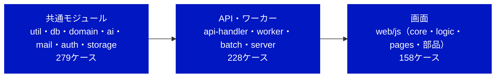
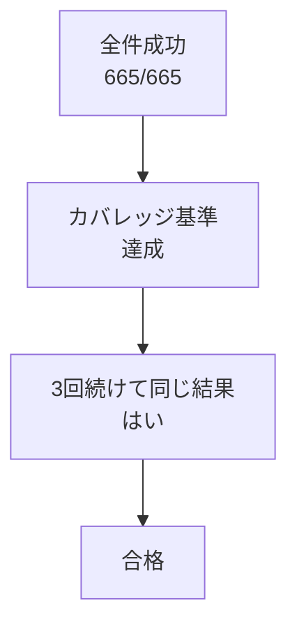

# RPG学習アプリ モジュールテスト結果報告書

| 項目 | 内容 |
| --- | --- |
| 文書名 | RPG学習アプリ モジュールテスト結果報告書 |
| 版数 | 第2.2版（さくらのクラウド版：ホームの受講中のコース（MT-H03-08・MT-F10-05）を加えた、仕様書 第1.5版の全ケースを実行） |
| 作成日 | 2026-10-21（第2.0版：2026-10-27、第2.1版：2026-10-31、第2.2版：2026-10-31） |
| 入力文書 | モジュールテスト仕様書 第1.5版、詳細設計書 第1.2版、外部設計書 第1.1版。AWS 版の報告書（第1.9版まで）は aws/documents/ に退避 |
| 対象範囲 | 全モジュール（functions/ の共通モジュール・API・ワーカー・バッチ、server/ のコンテナの入口、web/js の画面） |
| 実行日時・コミット | 2026-10-31（JST）、`2862371`（ブランチ `claude/beautiful-cray-m8heuy`） |
| 判定 | **合格**（対象範囲について、仕様書 6.2 の合否基準による） |

---

## 1. 概要

### 1.1 目的

モジュールテスト仕様書 第4〜5章のテストケースを Vitest で自動化して実行し、その結果を同書 6.2 の合否基準に照らして判定する。第2.0版では、AWS から さくらのクラウドへの切り替え（2026-10-27）に合わせて、DB を pg（データベースアプライアンス）に、SQS・Lambda の非同期呼び出し・EventBridge を DB のジョブキューと worker の定期処理に、Cognito をアプリのログインに、SES を SMTP に、S3 をオブジェクトストレージに替え、AI を差し替え口（さくらのAI Engine／Bedrock）にした。仕様書 第1.3版でそれらのテストケースを追加・差し替えて、全件を流し直した。AWS 版の結果（第1.9版）は aws/documents/ に残している。第2.1版では、そのあとに加えたテストケース（クエスト達成・レベルアップのお祝い、結果画面の獲得EXPの演出、説明問題の問いかけ、問題のまとめて削除、Service Worker など）と、テストにはあったが仕様書になかった MT-A05-08・09 を仕様書 第1.4版に載せ、全件を流し直した。第2.2版では、ホームのパートナーのひとことの下に受講中のコースを出す変更に合わせて、MT-H03-08・MT-F10-05 を仕様書 第1.5版に載せ、全件を流し直した。

### 1.2 今回の範囲

| 区分 | 層 | 仕様書のケース数 | 今回 |
| --- | --- | --- | --- |
| 対象 | util（MT-U） | 79 | 実行 |
| 対象 | db（MT-D） | 67 | 実行 |
| 対象 | domain（MT-G） | 69 | 実行 |
| 対象 | ai（MT-A） | 42 | 実行 |
| 対象 | mail（MT-M） | 8 | 実行 |
| 対象 | auth（ログイン）（MT-K） | 9 | 実行 |
| 対象 | storage（MT-O） | 5 | 実行 |
| 対象 | api-handler（MT-H） | 146 | 実行 |
| 対象 | ワーカー・バッチ（MT-W） | 56 | 実行 |
| 対象 | server（HTTP・ワーカーの入口）（MT-S） | 26 | 実行 |
| 対象 | 画面（web/js）（MT-F） | 158 | 実行 |

## 2. 実行環境

| 項目 | 内容 |
| --- | --- |
| OS | Linux 6.18（作業用コンテナ） |
| Node.js | 22.23.4（コンテナイメージ `node:22` と同じ系列） |
| Vitest・@vitest/coverage-v8 | 3.2.7（`test.projects` で functions・server＝Node、web＝jsdom に分けて実行） |
| jsdom | 29.1.1 |
| aws-sdk-client-mock | 4.1.0（オブジェクトストレージ（S3 互換）・Bedrock のモック） |
| AWS SDK for JavaScript v3 | 3.1157.0（client-s3・s3-request-presigner・client-bedrock-runtime） |
| pg・nodemailer・unpdf | 8.23.1・10.2.1・1.9.1 |
| pdf-lib | 1.17.1（PDFの分割とテスト用PDFの作成） |
| 実行コマンド | `npx vitest run --coverage`（`npm test -- --coverage` と同じ） |

- 外部サービス（DB・さくらのAI Engine・Bedrock・オブジェクトストレージ・SMTP）には接続せず、`dbMock`・`mailMock`・`aws-sdk-client-mock`・`fetch` の差し替えで応答を決めた（仕様書 2.3）
- `tests/helpers/vitest.setup.js` で `fetch` の既定をエラーにし、ネットワークへ出たテストは失敗する

## 3. 結果の要約

| 項目 | 結果 |
| --- | --- |
| テストケース（仕様書のID） | 665件中 合格 665・不合格 0・未実装 0 |
| 実行したテスト（`it` の数） | 735件（成功 735・失敗 0・スキップ 0・todo 0）、テストファイル 61 |
| うち仕様書 第1.5版 で追加したケース | 2件（ホームの受講中のコース：MT-H03-08・MT-F10-05） |
| うち仕様書 第1.4版 で追加したケース | 39件（第2.0版のあとに加えた MT-A04-08〜10、MT-D03-34、MT-F05-04、MT-F07-11〜16、MT-F13-05・06、MT-F14-06〜11、MT-F19-11〜15、M-F24（MT-F24-01・02）、MT-H05-09〜11、MT-H07-11、MT-H10-10〜14、MT-W01-13・14 と、仕様書に載せ忘れていた MT-A05-08・09） |
| IDのないテスト | 0件 |
| 実行時間 | 最大 21.71 秒（基準：60秒以内） |
| 安定性 | 同じコミットで3回実行し、すべて同じ結果（735/735、735/735、735/735） |
| 失敗したテスト | なし |

## 4. カバレッジ

| 対象 | ファイル数 | 命令網羅（C0） | 分岐網羅（C1） | 関数 | 基準（C0／C1） | 判定 |
| --- | --- | --- | --- | --- | --- | --- |
| 全体 | 135 | 98.74% | 93.91% | 98.95% | - | - |
| `functions/shared/domain/**` | 7 | 100.00% | 100.00% | 100.00% | 100%／100% | 合格 |
| `web/js/logic/validators.js` | 1 | 100.00% | 100.00% | 100.00% | 100%／100% | 合格 |
| `functions/**` | 88 | 99.97% | 97.95% | 99.22% | 90%／80% | 合格 |
| `server/**` | 3 | 96.44% | 91.67% | 100.00% | 90%／80% | 合格 |
| `web/js/**` | 44 | 97.28% | 89.11% | 98.49% | 90%／80% | 合格 |

**ファイル別**

| ファイル | C0 | C1 | 関数 |
| --- | --- | --- | --- |
| `functions/api-handler/index.mjs` | 100.00% | 96.00% | 100.00% |
| `functions/api-handler/router.js` | 100.00% | 100.00% | 100.00% |
| `functions/api-handler/routes/_admin.js` | 100.00% | 100.00% | 100.00% |
| `functions/api-handler/routes/admin-courses.js` | 100.00% | 100.00% | 100.00% |
| `functions/api-handler/routes/admin-dashboard.js` | 98.55% | 97.56% | 100.00% |
| `functions/api-handler/routes/admin-imports.js` | 100.00% | 96.15% | 100.00% |
| `functions/api-handler/routes/admin-partners.js` | 100.00% | 100.00% | 100.00% |
| `functions/api-handler/routes/admin-questions.js` | 100.00% | 100.00% | 100.00% |
| `functions/api-handler/routes/admin-users.js` | 100.00% | 97.14% | 100.00% |
| `functions/api-handler/routes/answers.js` | 100.00% | 95.00% | 100.00% |
| `functions/api-handler/routes/auth.js` | 100.00% | 98.27% | 100.00% |
| `functions/api-handler/routes/courses.js` | 100.00% | 100.00% | 100.00% |
| `functions/api-handler/routes/gradings.js` | 100.00% | 96.66% | 100.00% |
| `functions/api-handler/routes/health.js` | 100.00% | 100.00% | 100.00% |
| `functions/api-handler/routes/home.js` | 100.00% | 100.00% | 100.00% |
| `functions/api-handler/routes/me.js` | 100.00% | 94.54% | 100.00% |
| `functions/api-handler/routes/quests.js` | 100.00% | 89.47% | 100.00% |
| `functions/api-handler/routes/rankings.js` | 100.00% | 100.00% | 100.00% |
| `functions/batch-runner/index.mjs` | 100.00% | 100.00% | 100.00% |
| `functions/batch-runner/jobs/daily.js` | 100.00% | 100.00% | 100.00% |
| `functions/batch-runner/jobs/mail.js` | 100.00% | 95.00% | 100.00% |
| `functions/batch-runner/steps/assign-quests.js` | 100.00% | 100.00% | 100.00% |
| `functions/batch-runner/steps/build-notify.js` | 100.00% | 100.00% | 100.00% |
| `functions/batch-runner/steps/cleanup-gradings.js` | 100.00% | 100.00% | 100.00% |
| `functions/batch-runner/steps/close-ranking.js` | 100.00% | 100.00% | 100.00% |
| `functions/batch-runner/steps/purge-users.js` | 100.00% | 100.00% | 100.00% |
| `functions/batch-runner/steps/update-streak.js` | 100.00% | 100.00% | 100.00% |
| `functions/grading-worker/grader.js` | 100.00% | 91.48% | 100.00% |
| `functions/grading-worker/index.mjs` | 100.00% | 80.00% | 50.00% |
| `functions/import-worker/extractor.js` | 100.00% | 100.00% | 100.00% |
| `functions/import-worker/index.mjs` | 100.00% | 95.55% | 100.00% |
| `functions/import-worker/pdf-splitter.js` | 100.00% | 100.00% | 100.00% |
| `functions/import-worker/pdf-text.js` | 100.00% | 100.00% | 100.00% |
| `functions/shared/ai/bedrock.js` | 100.00% | 95.45% | 100.00% |
| `functions/shared/ai/client.js` | 100.00% | 100.00% | 100.00% |
| `functions/shared/ai/json-guard.js` | 100.00% | 100.00% | 100.00% |
| `functions/shared/ai/persona.js` | 100.00% | 100.00% | 100.00% |
| `functions/shared/ai/sakura.js` | 100.00% | 97.82% | 100.00% |
| `functions/shared/ai/prompts/comment.js` | 100.00% | 100.00% | 100.00% |
| `functions/shared/ai/prompts/daily-message.js` | 100.00% | 92.30% | 81.81% |
| `functions/shared/ai/prompts/explain-question.js` | 100.00% | 100.00% | 100.00% |
| `functions/shared/ai/prompts/extraction.js` | 100.00% | 100.00% | 100.00% |
| `functions/shared/ai/prompts/grading.js` | 100.00% | 87.50% | 100.00% |
| `functions/shared/ai/prompts/sanitize.js` | 100.00% | 100.00% | 100.00% |
| `functions/shared/auth/password.js` | 100.00% | 100.00% | 100.00% |
| `functions/shared/auth/token.js` | 100.00% | 100.00% | 100.00% |
| `functions/shared/db/client.js` | 100.00% | 92.10% | 100.00% |
| `functions/shared/db/migrate.js` | 100.00% | 100.00% | 100.00% |
| `functions/shared/db/tx.js` | 100.00% | 92.85% | 100.00% |
| `functions/shared/db/repositories/_base.js` | 100.00% | 100.00% | 100.00% |
| `functions/shared/db/repositories/adventures.js` | 100.00% | 100.00% | 100.00% |
| `functions/shared/db/repositories/answers.js` | 100.00% | 100.00% | 100.00% |
| `functions/shared/db/repositories/audit.js` | 100.00% | 100.00% | 100.00% |
| `functions/shared/db/repositories/auth.js` | 100.00% | 100.00% | 100.00% |
| `functions/shared/db/repositories/badges.js` | 100.00% | 100.00% | 100.00% |
| `functions/shared/db/repositories/courses.js` | 100.00% | 100.00% | 100.00% |
| `functions/shared/db/repositories/enrollments.js` | 100.00% | 100.00% | 100.00% |
| `functions/shared/db/repositories/exp.js` | 100.00% | 100.00% | 100.00% |
| `functions/shared/db/repositories/gradings.js` | 100.00% | 100.00% | 100.00% |
| `functions/shared/db/repositories/imports.js` | 100.00% | 100.00% | 100.00% |
| `functions/shared/db/repositories/jobs.js` | 100.00% | 100.00% | 100.00% |
| `functions/shared/db/repositories/notify.js` | 100.00% | 100.00% | 100.00% |
| `functions/shared/db/repositories/partners.js` | 100.00% | 100.00% | 100.00% |
| `functions/shared/db/repositories/questions.js` | 100.00% | 100.00% | 100.00% |
| `functions/shared/db/repositories/quests.js` | 100.00% | 100.00% | 100.00% |
| `functions/shared/db/repositories/rankings.js` | 100.00% | 100.00% | 100.00% |
| `functions/shared/db/repositories/reviews.js` | 100.00% | 100.00% | 100.00% |
| `functions/shared/db/repositories/schedules.js` | 100.00% | 100.00% | 100.00% |
| `functions/shared/db/repositories/users.js` | 100.00% | 100.00% | 100.00% |
| `functions/shared/domain/answer-flow.js` | 100.00% | 100.00% | 100.00% |
| `functions/shared/domain/badge.js` | 100.00% | 100.00% | 100.00% |
| `functions/shared/domain/exp.js` | 100.00% | 100.00% | 100.00% |
| `functions/shared/domain/picker.js` | 100.00% | 100.00% | 100.00% |
| `functions/shared/domain/quest.js` | 100.00% | 100.00% | 100.00% |
| `functions/shared/domain/ranking.js` | 100.00% | 100.00% | 100.00% |
| `functions/shared/domain/review.js` | 100.00% | 100.00% | 100.00% |
| `functions/shared/mail/smtp.js` | 100.00% | 100.00% | 100.00% |
| `functions/shared/mail/templates.js` | 100.00% | 100.00% | 100.00% |
| `functions/shared/services/answer-recorder.js` | 100.00% | 100.00% | 100.00% |
| `functions/shared/storage/object-storage.js` | 100.00% | 87.50% | 100.00% |
| `functions/shared/util/alert.js` | 100.00% | 100.00% | 100.00% |
| `functions/shared/util/authz.js` | 100.00% | 100.00% | 100.00% |
| `functions/shared/util/date-jst.js` | 100.00% | 100.00% | 100.00% |
| `functions/shared/util/errors.js` | 100.00% | 100.00% | 100.00% |
| `functions/shared/util/http.js` | 100.00% | 100.00% | 100.00% |
| `functions/shared/util/ids.js` | 100.00% | 100.00% | 100.00% |
| `functions/shared/util/logger.js` | 100.00% | 100.00% | 100.00% |
| `functions/shared/util/validators.js` | 100.00% | 100.00% | 100.00% |
| `server/http.mjs` | 99.14% | 91.52% | 100.00% |
| `server/main.mjs` | 85.71% | 81.81% | 100.00% |
| `server/worker.mjs` | 100.00% | 98.07% | 100.00% |
| `web/js/shell.js` | 100.00% | 97.36% | 100.00% |
| `web/js/components/_util.js` | 100.00% | 66.66% | 100.00% |
| `web/js/components/button.js` | 100.00% | 83.33% | 100.00% |
| `web/js/components/celebration.js` | 100.00% | 89.28% | 100.00% |
| `web/js/components/choice-option.js` | 100.00% | 88.88% | 100.00% |
| `web/js/components/dialog.js` | 100.00% | 57.14% | 100.00% |
| `web/js/components/exp-bar.js` | 100.00% | 92.68% | 100.00% |
| `web/js/components/guild-badge.js` | 100.00% | 60.00% | 100.00% |
| `web/js/components/partner-bubble.js` | 100.00% | 88.88% | 100.00% |
| `web/js/components/quest-card.js` | 100.00% | 100.00% | 100.00% |
| `web/js/components/ranking-row.js` | 100.00% | 87.50% | 100.00% |
| `web/js/components/review-stage.js` | 100.00% | 100.00% | 100.00% |
| `web/js/components/score-meter.js` | 100.00% | 90.00% | 100.00% |
| `web/js/components/status.js` | 100.00% | 100.00% | 100.00% |
| `web/js/core/api.js` | 100.00% | 97.50% | 100.00% |
| `web/js/core/auth.js` | 100.00% | 100.00% | 83.33% |
| `web/js/core/context.js` | 100.00% | 66.66% | 100.00% |
| `web/js/core/router.js` | 100.00% | 100.00% | 100.00% |
| `web/js/core/store.js` | 100.00% | 100.00% | 100.00% |
| `web/js/logic/exp-gain.js` | 100.00% | 86.66% | 100.00% |
| `web/js/logic/format.js` | 100.00% | 100.00% | 100.00% |
| `web/js/logic/grading-poller.js` | 100.00% | 100.00% | 100.00% |
| `web/js/logic/validators.js` | 100.00% | 100.00% | 100.00% |
| `web/js/pages/index.js` | 0.00% | 0.00% | 0.00% |
| `web/js/pages/login.js` | 100.00% | 100.00% | 100.00% |
| `web/js/pages/admin/_course.js` | 100.00% | 100.00% | 100.00% |
| `web/js/pages/admin/s11-import.js` | 95.96% | 85.28% | 100.00% |
| `web/js/pages/admin/s12-dashboard.js` | 95.32% | 84.48% | 100.00% |
| `web/js/pages/admin/s13-users.js` | 97.66% | 88.49% | 100.00% |
| `web/js/pages/admin/s14-partners.js` | 97.41% | 86.95% | 100.00% |
| `web/js/pages/learner/adventure.js` | 100.00% | 88.88% | 100.00% |
| `web/js/pages/learner/onboarding.js` | 100.00% | 96.66% | 100.00% |
| `web/js/pages/learner/s02-home.js` | 95.52% | 72.22% | 100.00% |
| `web/js/pages/learner/s03-courses.js` | 100.00% | 100.00% | 100.00% |
| `web/js/pages/learner/s04-choice.js` | 100.00% | 84.61% | 100.00% |
| `web/js/pages/learner/s05-explain.js` | 98.01% | 74.07% | 100.00% |
| `web/js/pages/learner/s06-result.js` | 97.39% | 79.45% | 100.00% |
| `web/js/pages/learner/s07-ranking.js` | 100.00% | 88.23% | 100.00% |
| `web/js/pages/learner/s08-profile.js` | 100.00% | 87.50% | 100.00% |
| `web/js/pages/learner/s09-partner.js` | 100.00% | 50.00% | 100.00% |
| `web/js/pages/learner/s10-notify.js` | 93.75% | 96.29% | 100.00% |
| `web/js/parts/course-step.js` | 95.45% | 77.77% | 100.00% |
| `web/js/parts/nickname-step.js` | 100.00% | 90.00% | 100.00% |
| `web/js/parts/partner-step.js` | 95.38% | 77.77% | 100.00% |

## 5. モジュール別の結果

| モジュール | 対象 | ケース | 合格 | 不合格 | 未実装 | it の数 |
| --- | --- | --- | --- | --- | --- | --- |
| M-U01 | `util/errors.js` | 5 | 5 | 0 | 0 | 14 |
| M-U02 | `util/ids.js` | 7 | 7 | 0 | 0 | 12 |
| M-U03 | `util/date-jst.js` | 14 | 14 | 0 | 0 | 14 |
| M-U04 | `util/authz.js` | 10 | 10 | 0 | 0 | 10 |
| M-U05 | `util/logger.js` | 5 | 5 | 0 | 0 | 5 |
| M-U06 | `util/http.js` | 6 | 6 | 0 | 0 | 6 |
| M-U07 | `web/js/logic/validators.js（画面とサーバーで共用）` | 29 | 29 | 0 | 0 | 47 |
| M-U08 | `util/alert.js（監視のお知らせメール）` | 3 | 3 | 0 | 0 | 3 |
| M-D01 | `db/client.js` | 12 | 12 | 0 | 0 | 12 |
| M-D02 | `db/tx.js` | 7 | 7 | 0 | 0 | 7 |
| M-D03 | `リポジトリ（代表的なもの）` | 34 | 34 | 0 | 0 | 34 |
| M-D04 | `リポジトリ（ジョブキュー・定期処理・ログイン）` | 9 | 9 | 0 | 0 | 9 |
| M-D05 | `db/migrate.js` | 5 | 5 | 0 | 0 | 5 |
| M-G01 | `domain/review.js 忘却曲線` | 14 | 14 | 0 | 0 | 15 |
| M-G02 | `domain/exp.js EXPとレベル` | 13 | 13 | 0 | 0 | 23 |
| M-G03 | `domain/quest.js デイリークエスト` | 12 | 12 | 0 | 0 | 12 |
| M-G04 | `domain/badge.js バッジ` | 7 | 7 | 0 | 0 | 7 |
| M-G05 | `domain/ranking.js 順位づけ` | 6 | 6 | 0 | 0 | 6 |
| M-G06 | `domain/picker.js 出題` | 9 | 9 | 0 | 0 | 9 |
| M-G07 | `domain/answer-flow.js 解答後の更新内容` | 8 | 8 | 0 | 0 | 8 |
| M-A01 | `ai/bedrock.js` | 7 | 7 | 0 | 0 | 8 |
| M-A02 | `ai/json-guard.js` | 11 | 11 | 0 | 0 | 20 |
| M-A03・M-A04 | `ai/persona.js・ai/prompts/*` | 12 | 12 | 0 | 0 | 12 |
| M-A05 | `ai/sakura.js（さくらのAI Engine）` | 9 | 9 | 0 | 0 | 9 |
| M-A06 | `ai/client.js（差し替え口）` | 3 | 3 | 0 | 0 | 3 |
| M-M01 | `mail/smtp.js・mail/templates.js` | 8 | 8 | 0 | 0 | 9 |
| M-O01 | `storage/object-storage.js（さくらのオブジェクトストレージ）` | 5 | 5 | 0 | 0 | 5 |
| M-K01 | `auth/password.js` | 4 | 4 | 0 | 0 | 4 |
| M-K02 | `auth/token.js` | 5 | 5 | 0 | 0 | 5 |
| M-H01 | `router.js・入口` | 12 | 12 | 0 | 0 | 12 |
| M-H02 | `routes/me.js（A-01〜A-04、A-12）` | 19 | 19 | 0 | 0 | 21 |
| M-H03 | `routes/home.js（A-05）` | 8 | 8 | 0 | 0 | 8 |
| M-H04 | `routes/courses.js（A-06）` | 5 | 5 | 0 | 0 | 5 |
| M-H05 | `routes/quests.js（A-07・A-07b）` | 11 | 11 | 0 | 0 | 11 |
| M-H06 | `routes/answers.js（A-08）` | 8 | 8 | 0 | 0 | 10 |
| M-H07 | `routes/gradings.js（A-09・A-10）` | 11 | 11 | 0 | 0 | 11 |
| M-H08 | `routes/rankings.js（A-11）` | 8 | 8 | 0 | 0 | 10 |
| M-H09 | `routes/admin-imports.js（A-13・A-13b・A-14）` | 9 | 9 | 0 | 0 | 9 |
| M-H10 | `routes/admin-questions.js（A-15・A-16）` | 14 | 14 | 0 | 0 | 14 |
| M-H11 | `routes/admin-dashboard.js（A-17・A-18）` | 8 | 8 | 0 | 0 | 8 |
| M-H12 | `routes/admin-users.js（A-19・A-20・A-21b）` | 11 | 11 | 0 | 0 | 11 |
| M-H15 | `routes/auth.js（A-30〜A-35）` | 12 | 12 | 0 | 0 | 12 |
| M-H13 | `routes/admin-courses.js（A-21）・M-H14 routes/admin-partners.js（A-22）` | 10 | 10 | 0 | 0 | 10 |
| M-W01 | `grading-worker/index.mjs・grader.js` | 14 | 14 | 0 | 0 | 15 |
| M-W02 | `import-worker/index.mjs・extractor.js・pdf-splitter.js・pdf-text.js` | 20 | 20 | 0 | 0 | 24 |
| M-W03 | `jobs/daily.js と steps/` | 15 | 15 | 0 | 0 | 15 |
| M-W04 | `jobs/mail.js` | 7 | 7 | 0 | 0 | 7 |
| M-S01 | `server/http.mjs` | 10 | 10 | 0 | 0 | 15 |
| M-S02 | `server/worker.mjs` | 11 | 11 | 0 | 0 | 11 |
| M-S03 | `server/main.mjs` | 5 | 5 | 0 | 0 | 5 |
| M-F01 | `core/auth.js` | 10 | 10 | 0 | 0 | 10 |
| M-F02 | `core/api.js` | 8 | 8 | 0 | 0 | 8 |
| M-F03〜M-F06 | `core/router.js・core/store.js・logic/format.js・logic/grading-poller.js` | 17 | 17 | 0 | 0 | 17 |
| M-F07 | `components/*.js` | 16 | 16 | 0 | 0 | 16 |
| M-F08 | `shell.js` | 6 | 6 | 0 | 0 | 6 |
| M-F09 | `pages/learner/onboarding.js・parts/*.js（初回の流れ）` | 7 | 7 | 0 | 0 | 7 |
| M-F10 | `pages/learner/s02-home.js（S-02 ホーム）` | 5 | 5 | 0 | 0 | 5 |
| M-F11 | `pages/learner/s03-courses.js（S-03 コース選択）` | 3 | 3 | 0 | 0 | 3 |
| M-F12 | `pages/learner/s04-choice.js（S-04 演習・四肢択一）` | 3 | 3 | 0 | 0 | 3 |
| M-F13 | `pages/learner/s05-explain.js（S-05 キーワード説明）` | 6 | 6 | 0 | 0 | 6 |
| M-F14 | `pages/learner/s06-result.js（S-06 結果・フィードバック）` | 11 | 11 | 0 | 0 | 11 |
| M-F15 | `pages/learner/s07-ranking.js（S-07 週間ランキング）` | 5 | 5 | 0 | 0 | 5 |
| M-F16 | `pages/learner/s08-profile.js（S-08 プロフィール）` | 5 | 5 | 0 | 0 | 5 |
| M-F17 | `pages/learner/s09-partner.js（S-09 AIパートナー選択）` | 3 | 3 | 0 | 0 | 3 |
| M-F18 | `pages/learner/s10-notify.js（S-10 通知設定）` | 5 | 5 | 0 | 0 | 5 |
| M-F19 | `pages/admin/s11-import.js（S-11 問題取り込み・レビュー）` | 15 | 15 | 0 | 0 | 15 |
| M-F20 | `pages/admin/s12-dashboard.js・pages/admin/_course.js（S-12 学習状況ダッシュボード）` | 6 | 6 | 0 | 0 | 6 |
| M-F21 | `pages/admin/s13-users.js（S-13 利用者・コース・権限管理）` | 11 | 11 | 0 | 0 | 11 |
| M-F22 | `pages/admin/s14-partners.js（S-14 AIパートナー設定）` | 6 | 6 | 0 | 0 | 6 |
| M-F23 | `pages/login.js（S-01 ログイン）` | 8 | 8 | 0 | 0 | 8 |
| M-F24 | `sw.js（Service Worker）` | 2 | 2 | 0 | 0 | 2 |

## 6. テストケース別の結果

### M-U01 util/errors.js

| ID | 観点 | 技法 | 結果 | it |
| --- | --- | --- | --- | --- |
| MT-U01-01 | AppError の属性 | 同 | 合格 | 1 |
| MT-U01-02 | 応答への変換（想定エラー） | 同 | 合格 | 1 |
| MT-U01-03 | 応答への変換（想定外） | 異 | 合格 | 1 |
| MT-U01-04 | コードからHTTPの既定 | 同 | 合格 | 10 |
| MT-U01-05 | 表にないコード・details なし | 異 | 合格 | 1 |

### M-U02 util/ids.js

| ID | 観点 | 技法 | 結果 | it |
| --- | --- | --- | --- | --- |
| MT-U02-01 | 変換 | 同 | 合格 | 1 |
| MT-U02-02 | 逆変換 | 同 | 合格 | 1 |
| MT-U02-03 | 接頭辞の違い | 異 | 合格 | 1 |
| MT-U02-04 | 下限 | 境 | 合格 | 1 |
| MT-U02-05 | 上限 | 境 | 合格 | 1 |
| MT-U02-06 | 数字以外 | 異 | 合格 | 5 |
| MT-U02-07 | 文字列以外 | 異 | 合格 | 2 |

### M-U03 util/date-jst.js

| ID | 観点 | 技法 | 結果 | it |
| --- | --- | --- | --- | --- |
| MT-U03-01 | JSTの日付（0:00直前） | 境 | 合格 | 1 |
| MT-U03-02 | JSTの日付（0:00ちょうど） | 境 | 合格 | 1 |
| MT-U03-03 | 月末をまたぐ | 境 | 合格 | 1 |
| MT-U03-04 | 年末をまたぐ | 境 | 合格 | 1 |
| MT-U03-05 | うるう年 | 境 | 合格 | 1 |
| MT-U03-06 | 引き算 | 同 | 合格 | 1 |
| MT-U03-07 | 週の開始（月曜0:00） | 境 | 合格 | 1 |
| MT-U03-08 | 週の開始（日曜23:59） | 境 | 合格 | 1 |
| MT-U03-09 | 週の開始（次の月曜） | 境 | 合格 | 1 |
| MT-U03-10 | 送信枠 | 境 | 合格 | 1 |
| MT-U03-11 | ISO文字列 | 同 | 合格 | 1 |
| MT-U03-12 | 日数の差 | 同 | 合格 | 1 |
| MT-U03-13 | 不正な日付 | 異 | 合格 | 1 |
| MT-U03-14 | DBの日時の読み取り（`parseDbTimestamp`） | 同 | 合格 | 1 |

### M-U04 util/authz.js

| ID | 観点 | 技法 | 結果 | it |
| --- | --- | --- | --- | --- |
| MT-U04-01 | グループ（文字列） | 同 | 合格 | 1 |
| MT-U04-02 | グループ（配列）・なし | 同 | 合格 | 1 |
| MT-U04-03 | sub がない | 異 | 合格 | 1 |
| MT-U04-04 | ロールあり | 同 | 合格 | 1 |
| MT-U04-05 | ロールなし | 異 | 合格 | 1 |
| MT-U04-06 | 招待中の初回ログイン | 状 | 合格 | 1 |
| MT-U04-07 | 論理削除中・未登録 | 異 | 合格 | 1 |
| MT-U04-08 | 担当コース | DT | 合格 | 1 |
| MT-U04-09 | システム管理者は全コース | DT | 合格 | 1 |
| MT-U04-10 | 有効な利用者・DBのロール | DT | 合格 | 1 |

### M-U05 util/logger.js

| ID | 観点 | 技法 | 結果 | it |
| --- | --- | --- | --- | --- |
| MT-U05-01 | 1行のJSON | 同 | 合格 | 1 |
| MT-U05-02 | prod の DEBUG | DT | 合格 | 1 |
| MT-U05-03 | dev の DEBUG | DT | 合格 | 1 |
| MT-U05-04 | 伏せ字 | 異 | 合格 | 1 |
| MT-U05-05 | エラーのスタック | 異 | 合格 | 1 |

### M-U06 util/http.js

| ID | 観点 | 技法 | 結果 | it |
| --- | --- | --- | --- | --- |
| MT-U06-01 | 本文（JSON） | 同 | 合格 | 1 |
| MT-U06-02 | 本文（Base64） | 同 | 合格 | 1 |
| MT-U06-03 | 本文なし | 境 | 合格 | 1 |
| MT-U06-04 | 壊れたJSON | 異 | 合格 | 1 |
| MT-U06-05 | 通常の応答 | 同 | 合格 | 1 |
| MT-U06-06 | CSVの応答 | 同 | 合格 | 1 |

### M-U07 web/js/logic/validators.js（画面とサーバーで共用）

| ID | 観点 | 技法 | 結果 | it |
| --- | --- | --- | --- | --- |
| MT-U07-01 | 下限の1つ下 | 境 | 合格 | 1 |
| MT-U07-02 | 下限 | 境 | 合格 | 1 |
| MT-U07-03 | 200文字を超えても小見出しは要らない | 境 | 合格 | 1 |
| MT-U07-04 | 上限 | 境 | 合格 | 1 |
| MT-U07-05 | 上限の1つ上 | 境 | 合格 | 1 |
| MT-U07-06 | 【】も1文字として数える | 境 | 合格 | 1 |
| MT-U07-07 | 【】を含めて上限の1つ上 | 境 | 合格 | 1 |
| MT-U07-11 | 空白・改行は数えない | 同 | 合格 | 1 |
| MT-U07-12 | サロゲートペア | 境 | 合格 | 1 |
| MT-U07-13 | 空・null | 異 | 合格 | 3 |
| MT-U07-14 | 文字数の境界 | 境 | 合格 | 1 |
| MT-U07-15 | 使える文字 | 同 | 合格 | 5 |
| MT-U07-16 | 使えない文字 | 異 | 合格 | 4 |
| MT-U07-17 | 前後の空白 | 同 | 合格 | 1 |
| MT-U07-18 | パートナー名の空 | 同 | 合格 | 1 |
| MT-U07-19 | パートナー名の境界 | 境 | 合格 | 1 |
| MT-U07-20 | パートナー名の記号 | 異 | 合格 | 3 |
| MT-U07-21 | 通知時刻の範囲 | 境 | 合格 | 1 |
| MT-U07-22 | 通知時刻の刻み・形式 | 異 | 合格 | 4 |
| MT-U07-23 | 取り込みのサイズ | 境 | 合格 | 1 |
| MT-U07-24 | 取り込みの種類 | 異 | 合格 | 1 |
| MT-U07-25 | テキストの長さ | 境 | 合格 | 1 |
| MT-U07-26 | 公開できる問題 | 同 | 合格 | 1 |
| MT-U07-27 | 公開できない問題 | DT | 合格 | 5 |
| MT-U07-28 | キーワードの数と長さ | 境 | 合格 | 1 |
| MT-U07-29 | サーバー側の変換（`assertValid`） | 同 | 合格 | 1 |
| MT-U07-30 | 文字列以外のニックネーム・パートナー名 | 異 | 合格 | 1 |
| MT-U07-31 | 取り込みの要求の不正 | 異 | 合格 | 1 |
| MT-U07-32 | 問題の下書きの不正 | 異 | 合格 | 1 |

### M-U08 util/alert.js（監視のお知らせメール）

| ID | 観点 | 技法 | 結果 | it |
| --- | --- | --- | --- | --- |
| MT-U08-01 | 送る | 同 | 合格 | 1 |
| MT-U08-02 | 同じ key は1時間に1通 | 境 | 合格 | 1 |
| MT-U08-03 | 宛先がない・送れない・環境名がない | 異 | 合格 | 1 |

### M-D01 db/client.js

| ID | 観点 | 技法 | 結果 | it |
| --- | --- | --- | --- | --- |
| MT-D01-01 | `:name` の置き換え | 同 | 合格 | 1 |
| MT-D01-02 | 型変換とキャスト | 異 | 合格 | 1 |
| MT-D01-03 | パラメータの型（真偽・null・undefined） | 同 | 合格 | 1 |
| MT-D01-04 | 接続プール | 同 | 合格 | 1 |
| MT-D01-05 | 日付・JSON | 同 | 合格 | 1 |
| MT-D01-06 | 結果の行 | 同 | 合格 | 1 |
| MT-D01-07 | 更新件数 | 境 | 合格 | 1 |
| MT-D01-08 | DBにつながらない | 異 | 合格 | 1 |
| MT-D01-09 | ほかのエラー | 異 | 合格 | 1 |
| MT-D01-10 | トランザクションの接続 | 同 | 合格 | 1 |
| MT-D01-11 | 日時の列 | 同 | 合格 | 1 |
| MT-D01-12 | 変換できない・足りないパラメータ | 異 | 合格 | 1 |

### M-D02 db/tx.js

| ID | 観点 | 技法 | 結果 | it |
| --- | --- | --- | --- | --- |
| MT-D02-01 | 正常 | 同 | 合格 | 1 |
| MT-D02-02 | 途中の例外 | 異 | 合格 | 1 |
| MT-D02-03 | Commit の失敗 | 異 | 合格 | 1 |
| MT-D02-04 | 戻り値 | 同 | 合格 | 1 |
| MT-D02-05 | Rollback の失敗 | 異 | 合格 | 1 |
| MT-D02-06 | 並べて呼ぶ | 状 | 合格 | 1 |
| MT-D02-07 | 並べた片方の失敗 | 異 | 合格 | 1 |

### M-D03 リポジトリ（代表的なもの）

| ID | 観点 | 技法 | 結果 | it |
| --- | --- | --- | --- | --- |
| MT-D03-01 | ニックネームの重複確認 | 同 | 合格 | 1 |
| MT-D03-02 | 重複なし | 同 | 合格 | 1 |
| MT-D03-03 | 採点の完了（条件付き） | 状 | 合格 | 1 |
| MT-D03-04 | 復習項目の登録・更新 | 同 | 合格 | 1 |
| MT-D03-05 | 週の集計 | 同 | 合格 | 1 |
| MT-D03-06 | ランキングの締め | 同 | 合格 | 1 |
| MT-D03-07 | 列名の変換 | 同 | 合格 | 1 |
| MT-D03-08 | 一覧の上限 | 境 | 合格 | 1 |
| MT-D03-09 | 並べ替えの許可リスト | 異 | 合格 | 1 |
| MT-D03-10 | users：取得とロール | 同 | 合格 | 1 |
| MT-D03-11 | users：更新系 | 同 | 合格 | 1 |
| MT-D03-12 | users：一覧の並べ替え | 同 | 合格 | 1 |
| MT-D03-13 | users：登録・ロール・削除・復活・物理削除 | 同 | 合格 | 1 |
| MT-D03-14 | users：物理削除・継続日数の対象 | 同 | 合格 | 1 |
| MT-D03-15 | courses の各関数 | 同 | 合格 | 1 |
| MT-D03-16 | enrollments の各関数 | 境 | 合格 | 1 |
| MT-D03-17 | questions：取得系 | 同 | 合格 | 1 |
| MT-D03-18 | questions：番号ごとの更新 | DT | 合格 | 1 |
| MT-D03-19 | questions：公開・削除 | DT | 合格 | 1 |
| MT-D03-20 | reviews の各関数 | 同 | 合格 | 1 |
| MT-D03-21 | answers の各関数 | 境 | 合格 | 1 |
| MT-D03-22 | exp の各関数 | 境 | 合格 | 1 |
| MT-D03-23 | quests の各関数 | 同 | 合格 | 1 |
| MT-D03-24 | badges の各関数 | 同 | 合格 | 1 |
| MT-D03-25 | rankings の各関数 | 境 | 合格 | 1 |
| MT-D03-26 | users.lastLoginLogAt・reviews.countDueByKind | 境 | 合格 | 1 |
| MT-D03-27 | badges.listOwnedDetail・rankings.weeks・courses.listAll・listIds | 同 | 合格 | 1 |
| MT-D03-28 | imports.setKey・listByCourse、quests.listAssignTargets、partners | 同 | 合格 | 1 |
| MT-D03-29 | gradings の各関数 | 同 | 合格 | 1 |
| MT-D03-30 | imports の各関数 | 同 | 合格 | 1 |
| MT-D03-31 | adventures の各関数 | 同 | 合格 | 1 |
| MT-D03-32 | audit.write | 境 | 合格 | 1 |
| MT-D03-33 | notify の各関数 | 同 | 合格 | 1 |
| MT-D03-34 | listByCourse・findByIds | 同 | 合格 | 1 |

### M-D04 リポジトリ（ジョブキュー・定期処理・ログイン）

| ID | 観点 | 技法 | 結果 | it |
| --- | --- | --- | --- | --- |
| MT-D04-01 | キューに入れる | 同 | 合格 | 1 |
| MT-D04-02 | 1件取り出す | 状 | 合格 | 1 |
| MT-D04-03 | 完了・やり直し・失敗・数える・掃除 | 状 | 合格 | 1 |
| MT-D04-04 | 定期処理の枠 | 状 | 合格 | 1 |
| MT-D04-05 | メールアドレスで探す | 同 | 合格 | 1 |
| MT-D04-06 | 失敗の回数とロック | 境 | 合格 | 1 |
| MT-D04-07 | パスワードの保存 | DT | 合格 | 1 |
| MT-D04-08 | リフレッシュトークン | 状 | 合格 | 1 |
| MT-D04-09 | 再設定リンク | 状 | 合格 | 1 |

### M-D05 db/migrate.js

| ID | 観点 | 技法 | 結果 | it |
| --- | --- | --- | --- | --- |
| MT-D05-01 | ファイルの並べ方 | 同 | 合格 | 1 |
| MT-D05-02 | 未適用だけを流す | 状 | 合格 | 1 |
| MT-D05-03 | 初めての DB | 境 | 合格 | 1 |
| MT-D05-04 | 失敗 | 異 | 合格 | 1 |
| MT-D05-05 | 記録のないファイル | 異 | 合格 | 1 |

### M-G01 domain/review.js 忘却曲線

| ID | 観点 | 技法 | 結果 | it |
| --- | --- | --- | --- | --- |
| MT-G01-01 | 初回・正解 | DT | 合格 | 1 |
| MT-G01-02 | 初回・不正解 | DT | 合格 | 1 |
| MT-G01-03 | 予定日の前日 | 境 | 合格 | 1 |
| MT-G01-04 | 予定日当日に正解 | 境 | 合格 | 1 |
| MT-G01-05 | 段階2→3 | DT | 合格 | 1 |
| MT-G01-06 | 段階3→4 | DT | 合格 | 1 |
| MT-G01-07 | 段階4→5 | DT | 合格 | 1 |
| MT-G01-08 | 習得 | DT | 合格 | 1 |
| MT-G01-09 | 不正解で段階1へ | DT | 合格 | 1 |
| MT-G01-10 | 段階5で不正解 | DT | 合格 | 1 |
| MT-G01-11 | 段階1で不正解 | DT | 合格 | 1 |
| MT-G01-12 | 遅れて正解（段階を下げない） | DT | 合格 | 1 |
| MT-G01-13 | 習得済みを解く | 状 | 合格 | 2 |
| MT-G01-14 | 年末をまたぐ | 境 | 合格 | 1 |

### M-G02 domain/exp.js EXPとレベル

| ID | 観点 | 技法 | 結果 | it |
| --- | --- | --- | --- | --- |
| MT-G02-01 | 択一の正解 | DT | 合格 | 1 |
| MT-G02-02 | 択一の復習正解 | DT | 合格 | 1 |
| MT-G02-03 | 説明の合格 | DT | 合格 | 1 |
| MT-G02-04 | 説明の復習合格 | DT | 合格 | 1 |
| MT-G02-05 | 不正解は0 | DT | 合格 | 1 |
| MT-G02-06 | 必要EXP（表の値） | 同 | 合格 | 8 |
| MT-G02-07 | ちょうど整数になる値 | 境 | 合格 | 1 |
| MT-G02-08 | Lv1の範囲 | 境 | 合格 | 1 |
| MT-G02-09 | Lv2になる境界 | 境 | 合格 | 1 |
| MT-G02-10 | Lv3になる境界 | 境 | 合格 | 1 |
| MT-G02-11 | 表の累計EXP | 同 | 合格 | 4 |
| MT-G02-12 | 大きな値 | 異 | 合格 | 1 |
| MT-G02-13 | 不正な種類 | 異 | 合格 | 1 |

### M-G03 domain/quest.js デイリークエスト

| ID | 観点 | 技法 | 結果 | it |
| --- | --- | --- | --- | --- |
| MT-G03-01 | 復習ありの日 | DT | 合格 | 1 |
| MT-G03-02 | 復習なしの日 | DT | 合格 | 1 |
| MT-G03-03 | 乱数によらず守られる | 境 | 合格 | 1 |
| MT-G03-04 | 択一の不正解 | DT | 合格 | 1 |
| MT-G03-05 | 択一の正解 | DT | 合格 | 1 |
| MT-G03-06 | 達成 | 境 | 合格 | 1 |
| MT-G03-07 | 達成済みは進めない | 状 | 合格 | 1 |
| MT-G03-08 | 説明の合格・不合格 | DT | 合格 | 1 |
| MT-G03-09 | 復習 | 境 | 合格 | 1 |
| MT-G03-10 | 新しい問題 | DT | 合格 | 1 |
| MT-G03-11 | 同時に2つ達成 | 同 | 合格 | 1 |
| MT-G03-12 | クエストなし | 境 | 合格 | 1 |

### M-G04 domain/badge.js バッジ

| ID | 観点 | 技法 | 結果 | it |
| --- | --- | --- | --- | --- |
| MT-G04-01 | 習得の境界 | 境 | 合格 | 1 |
| MT-G04-02 | 次の段階 | 境 | 合格 | 1 |
| MT-G04-03 | まとめて達成 | 同 | 合格 | 1 |
| MT-G04-04 | 全部持っている | 同 | 合格 | 1 |
| MT-G04-05 | 継続の境界 | 境 | 合格 | 1 |
| MT-G04-06 | 継続の銀・金 | 境 | 合格 | 1 |
| MT-G04-07 | 0日 | 境 | 合格 | 1 |

### M-G05 domain/ranking.js 順位づけ

| ID | 観点 | 技法 | 結果 | it |
| --- | --- | --- | --- | --- |
| MT-G05-01 | 同点なし | 同 | 合格 | 1 |
| MT-G05-02 | 同点は同順位 | 境 | 合格 | 1 |
| MT-G05-03 | 同点の並び順 | 同 | 合格 | 1 |
| MT-G05-04 | 0 EXP は除く | 境 | 合格 | 1 |
| MT-G05-05 | 空 | 境 | 合格 | 1 |
| MT-G05-06 | 全員同点 | 境 | 合格 | 1 |

### M-G06 domain/picker.js 出題

| ID | 観点 | 技法 | 結果 | it |
| --- | --- | --- | --- | --- |
| MT-G06-01 | 最初は択一 | DT | 合格 | 1 |
| MT-G06-02 | 交互（択一のあと） | DT | 合格 | 1 |
| MT-G06-03 | 交互（説明のあと） | DT | 合格 | 1 |
| MT-G06-04 | 説明がないときは択一 | DT | 合格 | 1 |
| MT-G06-05 | 優先順位 | DT | 合格 | 1 |
| MT-G06-06 | 学習済みからの出題 | DT | 合格 | 1 |
| MT-G06-07 | 出したものは除く | 同 | 合格 | 1 |
| MT-G06-08 | 出せるものがない | 境 | 合格 | 1 |
| MT-G06-09 | キーワードのない説明候補 | 異 | 合格 | 1 |

### M-G07 domain/answer-flow.js 解答後の更新内容

| ID | 観点 | 技法 | 結果 | it |
| --- | --- | --- | --- | --- |
| MT-G07-01 | 初めての択一に正解 | 同 | 合格 | 1 |
| MT-G07-02 | 復習の択一に正解 | 同 | 合格 | 1 |
| MT-G07-03 | 復習の説明に合格 | 同 | 合格 | 1 |
| MT-G07-04 | 不正解 | 同 | 合格 | 1 |
| MT-G07-05 | 正解でレベルアップ | 境 | 合格 | 1 |
| MT-G07-06 | クエスト報酬だけでレベルアップ | 境 | 合格 | 1 |
| MT-G07-07 | 習得でバッジ | 境 | 合格 | 1 |
| MT-G07-08 | 習得済みの問題に正解 | 状 | 合格 | 1 |

### M-A01 ai/bedrock.js

| ID | 観点 | 技法 | 結果 | it |
| --- | --- | --- | --- | --- |
| MT-A01-01 | コマンドの中身 | 同 | 合格 | 1 |
| MT-A01-02 | 応答の取り出し | 同 | 合格 | 1 |
| MT-A01-03 | 打ち切り | 境 | 合格 | 1 |
| MT-A01-04 | 打ち切り前に返る | 境 | 合格 | 1 |
| MT-A01-05 | SDKのエラー | 異 | 合格 | 2 |
| MT-A01-06 | PDF・画像の入力 | 同 | 合格 | 1 |
| MT-A01-07 | ログ | 異 | 合格 | 1 |

### M-A02 ai/json-guard.js

| ID | 観点 | 技法 | 結果 | it |
| --- | --- | --- | --- | --- |
| MT-A02-01 | JSONだけ | 同 | 合格 | 1 |
| MT-A02-02 | 前後に文章 | 同 | 合格 | 1 |
| MT-A02-03 | コードブロック | 同 | 合格 | 1 |
| MT-A02-04 | 文字列の中の括弧 | 異 | 合格 | 1 |
| MT-A02-05 | 配列が先頭 | 同 | 合格 | 1 |
| MT-A02-06 | JSONがない | 異 | 合格 | 1 |
| MT-A02-07 | 採点の形（正常） | 同 | 合格 | 1 |
| MT-A02-08 | 範囲外の点数 | 境 | 合格 | 4 |
| MT-A02-09 | 必須キーがない・型違い | 異 | 合格 | 7 |
| MT-A02-10 | オブジェクト以外・任意キー | 異 | 合格 | 1 |
| MT-A02-11 | 模範説明の長さ | 境 | 合格 | 1 |

### M-A03・M-A04 ai/persona.js・ai/prompts/*

| ID | 観点 | 技法 | 結果 | it |
| --- | --- | --- | --- | --- |
| MT-A03-01 | 3人の定義 | 同 | 合格 | 1 |
| MT-A03-02 | 知らない性格 | 異 | 合格 | 1 |
| MT-A04-01 | 採点の指示文 | 同 | 合格 | 1 |
| MT-A04-02 | 閉じタグの無害化 | 異 | 合格 | 1 |
| MT-A04-03 | 小見出しはそのまま | 同 | 合格 | 1 |
| MT-A04-04 | 抽出の指示文 | 同 | 合格 | 1 |
| MT-A04-05 | ひとことに個人情報を入れない | 異 | 合格 | 1 |
| MT-A04-06 | 解説コメントの指示文 | 同 | 合格 | 1 |
| MT-A04-07 | 模範説明の長さと小見出し | 同 | 合格 | 1 |
| MT-A04-08 | 問いかけへの答えとして採点する指示文 | 同 | 合格 | 1 |
| MT-A04-09 | 説明問題の問いかけの指示文 | 同 | 合格 | 1 |
| MT-A04-10 | 問いかけの定型文と長さの切り詰め | 境 | 合格 | 1 |

### M-A05 ai/sakura.js（さくらのAI Engine）

| ID | 観点 | 技法 | 結果 | it |
| --- | --- | --- | --- | --- |
| MT-A05-01 | リクエストの中身 | 同 | 合格 | 1 |
| MT-A05-02 | 応答の取り出し | 同 | 合格 | 1 |
| MT-A05-03 | ログに本文を出さない | 異 | 合格 | 1 |
| MT-A05-04 | HTTP・通信のエラー | 異 | 合格 | 1 |
| MT-A05-05 | 時間切れ | 境 | 合格 | 1 |
| MT-A05-06 | 文書・画像のブロック | 異 | 合格 | 1 |
| MT-A05-07 | 既定の fetch | 同 | 合格 | 1 |
| MT-A05-08 | 考える深さ（reasoning_effort） | 同 | 合格 | 1 |
| MT-A05-09 | 考えた分のトークン数と空の答え | 境 | 合格 | 1 |

### M-A06 ai/client.js（差し替え口）

| ID | 観点 | 技法 | 結果 | it |
| --- | --- | --- | --- | --- |
| MT-A06-01 | 既定 | 同 | 合格 | 1 |
| MT-A06-02 | Bedrock に切り替える | DT | 合格 | 1 |
| MT-A06-03 | 知らない名前 | 異 | 合格 | 1 |

### M-M01 mail/smtp.js・mail/templates.js

| ID | 観点 | 技法 | 結果 | it |
| --- | --- | --- | --- | --- |
| MT-M01-01 | 通知メールの本文 | 同 | 合格 | 1 |
| MT-M01-02 | 環境名の付与 | DT | 合格 | 2 |
| MT-M01-03 | 削除予定の通知 | 同 | 合格 | 1 |
| MT-M01-04 | SMTP での送信 | 同 | 合格 | 1 |
| MT-M01-05 | 送信の失敗 | 異 | 合格 | 1 |
| MT-M01-06 | SMTP の接続設定 | 同 | 合格 | 1 |
| MT-M01-07 | 招待メール | 同 | 合格 | 1 |
| MT-M01-08 | 再設定メール | 同 | 合格 | 1 |

### M-O01 storage/object-storage.js（さくらのオブジェクトストレージ）

| ID | 観点 | 技法 | 結果 | it |
| --- | --- | --- | --- | --- |
| MT-O01-01 | 接続先 | 同 | 合格 | 1 |
| MT-O01-02 | 置く・読む・消す | 同 | 合格 | 1 |
| MT-O01-03 | ないとき | 異 | 合格 | 1 |
| MT-O01-04 | 画像を流す | 同 | 合格 | 1 |
| MT-O01-05 | 署名付きURL | 同 | 合格 | 1 |

### M-K01 auth/password.js

| ID | 観点 | 技法 | 結果 | it |
| --- | --- | --- | --- | --- |
| MT-K01-01 | ハッシュと照合 | 同 | 合格 | 1 |
| MT-K01-02 | 形の崩れたハッシュ | 異 | 合格 | 1 |
| MT-K01-03 | パスワードの決まり | 境 | 合格 | 1 |
| MT-K01-04 | 仮パスワード | 同 | 合格 | 1 |

### M-K02 auth/token.js

| ID | 観点 | 技法 | 結果 | it |
| --- | --- | --- | --- | --- |
| MT-K02-01 | 署名と確認 | 同 | 合格 | 1 |
| MT-K02-02 | 期限・用途・改ざん | 異 | 合格 | 1 |
| MT-K02-03 | 発行者・期限・用途 | 異 | 合格 | 1 |
| MT-K02-04 | 鍵が短い・ない | 境 | 合格 | 1 |
| MT-K02-05 | 使い捨ての値 | 同 | 合格 | 1 |

### M-H01 router.js・入口

| ID | 観点 | 技法 | 結果 | it |
| --- | --- | --- | --- | --- |
| MT-H01-01 | ルートの一致 | 同 | 合格 | 1 |
| MT-H01-02 | パスのパラメータ | 同 | 合格 | 1 |
| MT-H01-03 | ルートがない | 異 | 合格 | 1 |
| MT-H01-04 | メソッド違い | 異 | 合格 | 1 |
| MT-H01-05 | ヘルスチェック | 状 | 合格 | 1 |
| MT-H01-06 | ロール不足 | 異 | 合格 | 1 |
| MT-H01-07 | 上位ロール | DT | 合格 | 1 |
| MT-H01-08 | 想定外の例外 | 異 | 合格 | 1 |
| MT-H01-09 | 初回の流れが終わっていない | 状 | 合格 | 1 |
| MT-H01-10 | コースが未選択 | 状 | 合格 | 1 |
| MT-H01-11 | トークンがない・壊れた本文 | 異 | 合格 | 1 |
| MT-H01-12 | event がないときの既定 | 境 | 合格 | 1 |

### M-H02 routes/me.js（A-01〜A-04、A-12）

| ID | 観点 | 技法 | 結果 | it |
| --- | --- | --- | --- | --- |
| MT-H02-01 | ログインの記録（30分より前） | 境 | 合格 | 1 |
| MT-H02-02 | ログインの記録（30分以内） | 境 | 合格 | 1 |
| MT-H02-03 | 初回の流れの判定 | 同 | 合格 | 1 |
| MT-H02-04 | ニックネームの登録 | 同 | 合格 | 1 |
| MT-H02-05 | ニックネームの重複 | 異 | 合格 | 1 |
| MT-H02-06 | ニックネームの形式 | 異 | 合格 | 1 |
| MT-H02-07 | パートナー（名前あり） | 同 | 合格 | 1 |
| MT-H02-08 | パートナー（名前なし） | 同 | 合格 | 1 |
| MT-H02-09 | 知らない性格 | 異 | 合格 | 3 |
| MT-H02-10 | 通知設定 | 境 | 合格 | 1 |
| MT-H02-11 | 学習記録の計算 | 同 | 合格 | 1 |
| MT-H02-12 | 解答がないときの正答率 | 境 | 合格 | 1 |
| MT-H02-13 | バッジ一覧 | 同 | 合格 | 1 |
| MT-H02-14 | 初回の流れが終わった利用者 | 同 | 合格 | 1 |
| MT-H02-15 | パートナー名を省いたとき | DT | 合格 | 1 |
| MT-H02-16 | 通知設定の取得 | 境 | 合格 | 1 |
| MT-H02-17 | 学習記録のレベルとEXP | 同 | 合格 | 1 |
| MT-H02-18 | バッジの獲得日時の形式 | 境 | 合格 | 1 |
| MT-H02-19 | 管理局で選べるコース | DT | 合格 | 1 |

### M-H03 routes/home.js（A-05）

| ID | 観点 | 技法 | 結果 | it |
| --- | --- | --- | --- | --- |
| MT-H03-01 | ひとことの使い回し | 状 | 合格 | 1 |
| MT-H03-02 | ひとことの生成 | 状 | 合格 | 1 |
| MT-H03-03 | ひとことの失敗 | 異 | 合格 | 1 |
| MT-H03-04 | 今日の復習数 | 同 | 合格 | 1 |
| MT-H03-05 | レベル表示 | 同 | 合格 | 1 |
| MT-H03-06 | コース未選択 | 状 | 合格 | 1 |
| MT-H03-07 | ひとことが空・パートナー未設定 | 異 | 合格 | 1 |
| MT-H03-08 | 受講中のコース | 同 | 合格 | 1 |

### M-H04 routes/courses.js（A-06）

| ID | 観点 | 技法 | 結果 | it |
| --- | --- | --- | --- | --- |
| MT-H04-01 | 受講の開始 | 同 | 合格 | 1 |
| MT-H04-02 | 受講済み | 状 | 合格 | 1 |
| MT-H04-03 | 移る先でニックネームが重複 | 異 | 合格 | 1 |
| MT-H04-04 | ないコース | 異 | 合格 | 1 |
| MT-H04-05 | コース一覧 | 同 | 合格 | 1 |

### M-H05 routes/quests.js（A-07・A-07b）

| ID | 観点 | 技法 | 結果 | it |
| --- | --- | --- | --- | --- |
| MT-H05-01 | 冒険の開始 | 状 | 合格 | 1 |
| MT-H05-02 | 10問で終わり | 境 | 合格 | 1 |
| MT-H05-03 | 9問目の次 | 境 | 合格 | 1 |
| MT-H05-04 | 他人の冒険 | 異 | 合格 | 1 |
| MT-H05-05 | 出せる問題がない | 境 | 合格 | 1 |
| MT-H05-06 | 答えを返さない | 異 | 合格 | 1 |
| MT-H05-07 | 説明の出題 | 同 | 合格 | 1 |
| MT-H05-08 | 問題が取得できない・キーワードの文言がない | 異 | 合格 | 1 |
| MT-H05-09 | 説明問題の問いかけ（A-07b） | 同 | 合格 | 1 |
| MT-H05-10 | 問いかけの失敗 | 異 | 合格 | 1 |
| MT-H05-11 | 問いかけできないキーワード | 異 | 合格 | 1 |

### M-H06 routes/answers.js（A-08）

| ID | 観点 | 技法 | 結果 | it |
| --- | --- | --- | --- | --- |
| MT-H06-01 | 正解 | 同 | 合格 | 1 |
| MT-H06-02 | 不正解 | 同 | 合格 | 1 |
| MT-H06-03 | 選択肢の範囲 | 境 | 合格 | 3 |
| MT-H06-04 | 非公開・他コースの問題 | 異 | 合格 | 1 |
| MT-H06-05 | 解説コメントの失敗 | 異 | 合格 | 1 |
| MT-H06-06 | 更新の途中で失敗 | 異 | 合格 | 1 |
| MT-H06-07 | 応答の形 | 同 | 合格 | 1 |
| MT-H06-08 | 冒険IDなし・クエスト達成・バッジ | 同 | 合格 | 1 |

### M-H07 routes/gradings.js（A-09・A-10）

| ID | 観点 | 技法 | 結果 | it |
| --- | --- | --- | --- | --- |
| MT-H07-01 | 採点の受付 | 同 | 合格 | 1 |
| MT-H07-02 | 説明文が短い | 異 | 合格 | 1 |
| MT-H07-03 | 他コースのキーワード | 異 | 合格 | 1 |
| MT-H07-04 | キューに入れられない | 異 | 合格 | 1 |
| MT-H07-05 | 結果（完了） | 状 | 合格 | 1 |
| MT-H07-06 | 結果（採点中・30秒以内） | 境 | 合格 | 1 |
| MT-H07-07 | 結果（30秒超え） | 境 | 合格 | 1 |
| MT-H07-08 | 結果（AIの失敗） | 状 | 合格 | 1 |
| MT-H07-09 | 他人の採点 | 異 | 合格 | 1 |
| MT-H07-10 | 冒険IDなし・他人の冒険 | 異 | 合格 | 1 |
| MT-H07-11 | 問いかけつきの採点依頼 | 境 | 合格 | 1 |

### M-H08 routes/rankings.js（A-11）

| ID | 観点 | 技法 | 結果 | it |
| --- | --- | --- | --- | --- |
| MT-H08-01 | 今週 | 同 | 合格 | 1 |
| MT-H08-02 | 上位10名＋自分 | 境 | 合格 | 1 |
| MT-H08-03 | 自分が10位以内 | 境 | 合格 | 1 |
| MT-H08-04 | 過去週 | 同 | 合格 | 1 |
| MT-H08-05 | 受講していないコース | 異 | 合格 | 1 |
| MT-H08-06 | 月曜以外の週の指定 | 異 | 合格 | 3 |
| MT-H08-07 | コース省略・論理削除中・圏外 | DT | 合格 | 1 |
| MT-H08-08 | コース名 | 同 | 合格 | 1 |

### M-H09 routes/admin-imports.js（A-13・A-13b・A-14）

| ID | 観点 | 技法 | 結果 | it |
| --- | --- | --- | --- | --- |
| MT-H09-01 | PDFの取り込み | 同 | 合格 | 1 |
| MT-H09-02 | テキストの取り込み | 同 | 合格 | 1 |
| MT-H09-03 | 担当外のコース | 異 | 合格 | 1 |
| MT-H09-04 | ファイル名の無害化 | 異 | 合格 | 1 |
| MT-H09-05 | サイズ超え | 境 | 合格 | 1 |
| MT-H09-06 | 取り込み状況 | 同 | 合格 | 1 |
| MT-H09-07 | 取り込みがない・担当外・一覧 | 異 | 合格 | 1 |
| MT-H09-09 | アップロード完了（A-13b） | 状 | 合格 | 1 |
| MT-H09-08 | 登録の途中で失敗 | 異 | 合格 | 1 |

### M-H10 routes/admin-questions.js（A-15・A-16）

| ID | 観点 | 技法 | 結果 | it |
| --- | --- | --- | --- | --- |
| MT-H10-01 | 番号ごとの更新 | 同 | 合格 | 1 |
| MT-H10-02 | キーワードを減らす | 同 | 合格 | 1 |
| MT-H10-03 | 下書きの削除 | 状 | 合格 | 1 |
| MT-H10-04 | 公開済みの削除 | 状 | 合格 | 1 |
| MT-H10-05 | 公開できない | 異 | 合格 | 1 |
| MT-H10-06 | 公開 | 状 | 合格 | 1 |
| MT-H10-07 | 担当外のコースの問題 | 異 | 合格 | 1 |
| MT-H10-08 | 下書きの修正 | DT | 合格 | 1 |
| MT-H10-09 | ない問題・公開済みの公開・状態の食い違い | 状 | 合格 | 1 |
| MT-H10-10 | 登録済みの問題の一覧（A-15b） | 同 | 合格 | 1 |
| MT-H10-11 | 一覧の指定が正しくない・担当外 | 異 | 合格 | 1 |
| MT-H10-12 | まとめて公開（A-16b） | 同 | 合格 | 1 |
| MT-H10-13 | まとめて削除（A-16b） | 同 | 合格 | 1 |
| MT-H10-14 | まとめて処理の入力の検証・担当外が混ざる | 異 | 合格 | 1 |

### M-H11 routes/admin-dashboard.js（A-17・A-18）

| ID | 観点 | 技法 | 結果 | it |
| --- | --- | --- | --- | --- |
| MT-H11-01 | 集計 | 同 | 合格 | 1 |
| MT-H11-02 | 受講者0名 | 境 | 合格 | 1 |
| MT-H11-03 | CSVの形 | 同 | 合格 | 1 |
| MT-H11-04 | CSVの囲み | 異 | 合格 | 1 |
| MT-H11-05 | CSVの数式対策 | 異 | 合格 | 1 |
| MT-H11-06 | CSVのファイル名と記録 | 同 | 合格 | 1 |
| MT-H11-07 | 1,000件ずつの取得 | 境 | 合格 | 1 |
| MT-H11-08 | 担当外のコース | 異 | 合格 | 1 |

### M-H12 routes/admin-users.js（A-19・A-20・A-21b）

| ID | 観点 | 技法 | 結果 | it |
| --- | --- | --- | --- | --- |
| MT-H12-01 | 登録 | 同 | 合格 | 1 |
| MT-H12-02 | 登録の失敗 | 異 | 合格 | 1 |
| MT-H12-03 | ロールの変更 | 同 | 合格 | 1 |
| MT-H12-04 | 自分の system_admin を外す | 異 | 合格 | 1 |
| MT-H12-05 | 論理削除 | 状 | 合格 | 1 |
| MT-H12-06 | 自分自身の削除 | 異 | 合格 | 1 |
| MT-H12-07 | 復活 | 状 | 合格 | 1 |
| MT-H12-08 | 有効な利用者の復活 | 状 | 合格 | 1 |
| MT-H12-09 | 利用者管理の異常系 | 異 | 合格 | 1 |
| MT-H12-11 | 再招待（A-21b） | 状 | 合格 | 1 |
| MT-H12-10 | 一覧の最終ログイン日時 | 境 | 合格 | 1 |

### M-H15 routes/auth.js（A-30〜A-35）

| ID | 観点 | 技法 | 結果 | it |
| --- | --- | --- | --- | --- |
| MT-H15-01 | ログイン（A-30） | 同 | 合格 | 1 |
| MT-H15-02 | 失敗 | 異 | 合格 | 1 |
| MT-H15-03 | ログインできない利用者 | DT | 合格 | 1 |
| MT-H15-04 | 仮パスワード | 状 | 合格 | 1 |
| MT-H15-05 | 新しいパスワード（A-31） | 境 | 合格 | 1 |
| MT-H15-06 | 新しいパスワードを受け付けない | 異 | 合格 | 1 |
| MT-H15-07 | トークンの更新（A-32） | 状 | 合格 | 1 |
| MT-H15-08 | ログアウト（A-33） | 同 | 合格 | 1 |
| MT-H15-09 | パスワードを忘れたとき（A-34） | 異 | 合格 | 1 |
| MT-H15-10 | 再設定メールを送れない | 異 | 合格 | 1 |
| MT-H15-11 | 再設定（A-35） | 状 | 合格 | 1 |
| MT-H15-12 | 再設定を受け付けない | 異 | 合格 | 1 |

### M-H13 routes/admin-courses.js（A-21）・M-H14 routes/admin-partners.js（A-22）

| ID | 観点 | 技法 | 結果 | it |
| --- | --- | --- | --- | --- |
| MT-H13-01 | コースの登録 | 同 | 合格 | 1 |
| MT-H13-02 | コース名の長さ | 境 | 合格 | 1 |
| MT-H13-03 | 担当者の割り当て | 異 | 合格 | 1 |
| MT-H13-04 | 担当者の割り当て（正常）・更新・一覧 | 同 | 合格 | 1 |
| MT-H14-01 | 画像の準備（PNG） | 境 | 合格 | 1 |
| MT-H14-02 | 画像の準備（範囲外） | 境 | 合格 | 1 |
| MT-H14-03 | 画像の確定 | 状 | 合格 | 1 |
| MT-H14-04 | 画像を外す | 状 | 合格 | 1 |
| MT-H14-05 | 画像の取得・WebP・不正な操作 | 異 | 合格 | 1 |
| MT-H14-06 | 取得の性格名と初期名 | 同 | 合格 | 1 |

### M-W01 grading-worker/index.mjs・grader.js

| ID | 観点 | 技法 | 結果 | it |
| --- | --- | --- | --- | --- |
| MT-W01-01 | 合格 | 同 | 合格 | 1 |
| MT-W01-02 | 合格ライン | 境 | 合格 | 1 |
| MT-W01-03 | 合計で計算し直す | 異 | 合格 | 1 |
| MT-W01-04 | JSONのやり直し（成功） | 異 | 合格 | 1 |
| MT-W01-05 | JSONのやり直し（失敗） | 異 | 合格 | 1 |
| MT-W01-06 | 残り時間が少ないとき | 境 | 合格 | 1 |
| MT-W01-07 | AI の時間切れ | 異 | 合格 | 1 |
| MT-W01-08 | 処理済みのジョブ | 状 | 合格 | 2 |
| MT-W01-09 | A-10 が先に時間切れにした | 状 | 合格 | 1 |
| MT-W01-10 | パートナーの口調 | 同 | 合格 | 1 |
| MT-W01-11 | リポジトリと DB の接続を通した採点 | 状 | 合格 | 1 |
| MT-W01-12 | パートナー未設定・書き込み中の例外・ジョブの入口 | 異 | 合格 | 1 |
| MT-W01-13 | 問いかけへの答えとして採点 | 同 | 合格 | 1 |
| MT-W01-14 | 問いかけのない採点 | 異 | 合格 | 1 |

### M-W02 import-worker/index.mjs・extractor.js・pdf-splitter.js・pdf-text.js

| ID | 観点 | 技法 | 結果 | it |
| --- | --- | --- | --- | --- |
| MT-W02-01 | 原本を読む | 同 | 合格 | 1 |
| MT-W02-02 | 処理済み・取り込みがない | 状 | 合格 | 1 |
| MT-W02-03 | PDFの分割 | 境 | 合格 | 4 |
| MT-W02-04 | ページ数の上限 | 境 | 合格 | 1 |
| MT-W02-05 | 画像 | 同 | 合格 | 1 |
| MT-W02-06 | テキストの分割 | 境 | 合格 | 1 |
| MT-W02-07 | 正規化（選択肢の数） | DT | 合格 | 1 |
| MT-W02-08 | 正規化（正解なし） | DT | 合格 | 2 |
| MT-W02-09 | 正規化（キーワード） | 境 | 合格 | 1 |
| MT-W02-10 | 正規化（問題文が空） | 異 | 合格 | 1 |
| MT-W02-11 | 一部のかたまりで失敗 | 異 | 合格 | 1 |
| MT-W02-12 | やり直し（1・2回目） | 状 | 合格 | 1 |
| MT-W02-13 | やり直し（3回目） | 状 | 合格 | 1 |
| MT-W02-14 | 壊れたPDF | 異 | 合格 | 1 |
| MT-W02-15 | テキスト・JPEG・対応外の画像・失敗の記録が書けない | 異 | 合格 | 1 |
| MT-W02-16 | 正規化の細部 | 境 | 合格 | 1 |
| MT-W02-17 | PDFは文字を取り出してから渡す（sakura） | 同 | 合格 | 1 |
| MT-W02-18 | 取り込めないもの（sakura） | 異 | 合格 | 1 |
| MT-W02-19 | 文字のかたまり | 境 | 合格 | 1 |
| MT-W02-20 | `processImport` を直接呼ぶ | 同 | 合格 | 1 |

### M-W03 jobs/daily.js と steps/

| ID | 観点 | 技法 | 結果 | it |
| --- | --- | --- | --- | --- |
| MT-W03-01 | 実行順 | 同 | 合格 | 1 |
| MT-W03-02 | 月曜以外 | DT | 合格 | 1 |
| MT-W03-03 | ランキングの締め | 同 | 合格 | 1 |
| MT-W03-04 | 継続日数（続いた） | 境 | 合格 | 1 |
| MT-W03-05 | 継続日数（途切れた） | DT | 合格 | 1 |
| MT-W03-06 | 継続日数（二重実行） | 状 | 合格 | 1 |
| MT-W03-07 | クエストの割り当て | DT | 合格 | 1 |
| MT-W03-08 | クエストの二重実行 | 状 | 合格 | 1 |
| MT-W03-09 | 物理削除 | 状 | 合格 | 1 |
| MT-W03-10 | 期限切れのトークンの掃除 | 同 | 合格 | 1 |
| MT-W03-11 | 採点とジョブの掃除 | 境 | 合格 | 1 |
| MT-W03-12 | 送信リスト | 同 | 合格 | 1 |
| MT-W03-13 | ステップの失敗 | 異 | 合格 | 1 |
| MT-W03-14 | 知らないジョブ | 異 | 合格 | 1 |
| MT-W03-15 | 削除できなかった利用者・削除の失敗 | 異 | 合格 | 1 |

### M-W04 jobs/mail.js

| ID | 観点 | 技法 | 結果 | it |
| --- | --- | --- | --- | --- |
| MT-W04-01 | 送信 | 同 | 合格 | 1 |
| MT-W04-02 | ファイルがない | 境 | 合格 | 1 |
| MT-W04-03 | 1回失敗して成功 | 異 | 合格 | 1 |
| MT-W04-04 | 2回とも失敗 | 異 | 合格 | 1 |
| MT-W04-05 | DBを使わない | 異 | 合格 | 1 |
| MT-W04-06 | 枠の丸め | 境 | 合格 | 1 |
| MT-W04-07 | オブジェクトストレージのほかのエラー | 異 | 合格 | 1 |

### M-S01 server/http.mjs

| ID | 観点 | 技法 | 結果 | it |
| --- | --- | --- | --- | --- |
| MT-S01-01 | `/api` を API に渡す | 同 | 合格 | 2 |
| MT-S01-02 | トークンがない・正しくない | 異 | 合格 | 2 |
| MT-S01-03 | 本文 | 境 | 合格 | 2 |
| MT-S01-04 | API の例外 | 異 | 合格 | 2 |
| MT-S01-05 | 画面のファイル | 同 | 合格 | 2 |
| MT-S01-06 | 画面の外のファイル | 異 | 合格 | 1 |
| MT-S01-07 | キャラクター画像 | 異 | 合格 | 1 |
| MT-S01-08 | 5xx が続いたら知らせる | 境 | 合格 | 1 |
| MT-S01-09 | API の 5xx を数える | 同 | 合格 | 1 |
| MT-S01-10 | イベントの既定 | 同 | 合格 | 1 |

### M-S02 server/worker.mjs

| ID | 観点 | 技法 | 結果 | it |
| --- | --- | --- | --- | --- |
| MT-S02-01 | 取り出して処理 | 同 | 合格 | 1 |
| MT-S02-02 | 待ちがない | 境 | 合格 | 1 |
| MT-S02-03 | やり直し・失敗 | 状 | 合格 | 1 |
| MT-S02-04 | 処理の例外 | 状 | 合格 | 1 |
| MT-S02-05 | 取り戻したジョブ | 異 | 合格 | 1 |
| MT-S02-06 | ループ | 状 | 合格 | 1 |
| MT-S02-07 | 動かす枠 | 境 | 合格 | 1 |
| MT-S02-08 | 枠ごとに1回 | 状 | 合格 | 1 |
| MT-S02-09 | 失敗のやり直し | 状 | 合格 | 1 |
| MT-S02-10 | メール送信の有効・無効 | DT | 合格 | 1 |
| MT-S02-11 | 起動と停止 | 状 | 合格 | 1 |

### M-S03 server/main.mjs

| ID | 観点 | 技法 | 結果 | it |
| --- | --- | --- | --- | --- |
| MT-S03-01 | 役割ごとの環境変数 | DT | 合格 | 1 |
| MT-S03-02 | AI の切り替えに要る設定 | DT | 合格 | 1 |
| MT-S03-03 | api と worker（all） | 同 | 合格 | 1 |
| MT-S03-04 | worker だけ | 同 | 合格 | 1 |
| MT-S03-05 | 設定が足りない | 異 | 合格 | 1 |

### M-F01 core/auth.js

| ID | 観点 | 技法 | 結果 | it |
| --- | --- | --- | --- | --- |
| MT-F01-01 | ログインしていない | 状 | 合格 | 1 |
| MT-F01-02 | ログイン（A-30） | 同 | 合格 | 1 |
| MT-F01-03 | 仮パスワード（A-31） | 状 | 合格 | 1 |
| MT-F01-04 | 失敗の応答 | 異 | 合格 | 1 |
| MT-F01-05 | 保存済みのトークン | 状 | 合格 | 1 |
| MT-F01-06 | 期限の5分前に更新（A-32） | 境 | 合格 | 1 |
| MT-F01-07 | 更新の失敗 | 異 | 合格 | 1 |
| MT-F01-08 | ログアウト（A-33） | 状 | 合格 | 1 |
| MT-F01-09 | やり直し・再設定 | 同 | 合格 | 1 |
| MT-F01-10 | 既定 | 境 | 合格 | 1 |

### M-F02 core/api.js

| ID | 観点 | 技法 | 結果 | it |
| --- | --- | --- | --- | --- |
| MT-F02-01 | ヘッダー | 同 | 合格 | 1 |
| MT-F02-02 | DB起動中から復帰 | 状 | 合格 | 1 |
| MT-F02-03 | 再試行が尽きる | 境 | 合格 | 1 |
| MT-F02-04 | 401 で1回だけ更新 | 状 | 合格 | 1 |
| MT-F02-05 | 401 が続く | 異 | 合格 | 1 |
| MT-F02-06 | 入力エラー | 同 | 合格 | 1 |
| MT-F02-07 | 通信エラー | 異 | 合格 | 1 |
| MT-F02-08 | JSONでない応答・204・CSV・PUT・DELETE・既定の引数 | 異 | 合格 | 1 |

### M-F03〜M-F06 core/router.js・core/store.js・logic/format.js・logic/grading-poller.js

| ID | 観点 | 技法 | 結果 | it |
| --- | --- | --- | --- | --- |
| MT-F03-01 | 画面の切り替え | 同 | 合格 | 1 |
| MT-F03-02 | 知らないハッシュ | 異 | 合格 | 1 |
| MT-F03-03 | ロール不足 | 異 | 合格 | 1 |
| MT-F03-04 | 初回の流れ | 状 | 合格 | 1 |
| MT-F03-05 | ハッシュの解釈・hashchange・ロールなし | 状 | 合格 | 1 |
| MT-F03-06 | 管理局は初回の流れの前でも開ける | 状 | 合格 | 1 |
| MT-F04-01 | 状態の通知 | 同 | 合格 | 1 |
| MT-F04-02 | 既定のストア | 同 | 合格 | 1 |
| MT-F05-01 | HTMLエスケープ | 異 | 合格 | 1 |
| MT-F05-02 | 数値・日付の表示 | 同 | 合格 | 1 |
| MT-F05-03 | 日付の境界と空の値 | 境 | 合格 | 1 |
| MT-F05-04 | AI の文章の整形 | 境 | 合格 | 1 |
| MT-F06-01 | 採点結果が返る | 状 | 合格 | 1 |
| MT-F06-02 | 30秒で打ち切る | 境 | 合格 | 1 |
| MT-F06-03 | 504 が返る | 異 | 合格 | 1 |
| MT-F06-04 | 一時的な通信エラー | 異 | 合格 | 1 |
| MT-F06-05 | 失敗の結果・そのほかのエラー | 異 | 合格 | 1 |

### M-F07 components/*.js

| ID | 観点 | 技法 | 結果 | it |
| --- | --- | --- | --- | --- |
| MT-F07-01 | デザインシステムの CSS の複製 | 同 | 合格 | 1 |
| MT-F07-02 | ExpBar | 境 | 合格 | 1 |
| MT-F07-03 | PartnerBubble | 異 | 合格 | 1 |
| MT-F07-04 | QuestCard | 境 | 合格 | 1 |
| MT-F07-05 | ChoiceOption | 状 | 合格 | 1 |
| MT-F07-06 | ScoreMeter | 境 | 合格 | 1 |
| MT-F07-07 | ReviewStage | 境 | 合格 | 1 |
| MT-F07-08 | GuildBadge | 同 | 合格 | 1 |
| MT-F07-09 | エラーの文言 | DT | 合格 | 1 |
| MT-F07-10 | 紋章の画像 | 同 | 合格 | 1 |
| MT-F07-11 | Celebration の表示と閉じ方 | 同 | 合格 | 1 |
| MT-F07-12 | Celebration の紙吹雪の動き | 同 | 合格 | 1 |
| MT-F07-13 | Celebration のクエストと順送り | 状 | 合格 | 1 |
| MT-F07-14 | ExpGain の区間分け | 境 | 合格 | 1 |
| MT-F07-15 | ExpBar の演出（レベルアップ） | 状 | 合格 | 1 |
| MT-F07-16 | ExpBar の演出（動かさないとき） | 異 | 合格 | 1 |

### M-F08 shell.js

| ID | 観点 | 技法 | 結果 | it |
| --- | --- | --- | --- | --- |
| MT-F08-01 | 下部ナビを隠す画面 | 同 | 合格 | 1 |
| MT-F08-02 | 下部ナビを出す画面 | 同 | 合格 | 1 |
| MT-F08-03 | ログイン後の最初の画面 | DT | 合格 | 1 |
| MT-F08-04 | サイドメニュー | DT | 合格 | 1 |
| MT-F08-05 | 管理局の外枠 | 状 | 合格 | 1 |
| MT-F08-06 | 学習者エリアの外枠 | 状 | 合格 | 1 |

### M-F09 pages/learner/onboarding.js・parts/*.js（初回の流れ）

| ID | 観点 | 技法 | 結果 | it |
| --- | --- | --- | --- | --- |
| MT-F09-01 | 済んだ利用者 | 状 | 合格 | 1 |
| MT-F09-02 | ステップ1 ニックネーム | 境 | 合格 | 1 |
| MT-F09-03 | ニックネームの重複 | 異 | 合格 | 1 |
| MT-F09-04 | ステップ2 コース | 状 | 合格 | 1 |
| MT-F09-05 | コースでの重複 | 状 | 合格 | 1 |
| MT-F09-06 | コースの読み込み失敗 | 異 | 合格 | 1 |
| MT-F09-07 | ステップ3 仲間 | 境 | 合格 | 1 |

### M-F10 pages/learner/s02-home.js（S-02 ホーム）

| ID | 観点 | 技法 | 結果 | it |
| --- | --- | --- | --- | --- |
| MT-F10-01 | 表示の順番 | 同 | 合格 | 1 |
| MT-F10-02 | 冒険に出る | 状 | 合格 | 1 |
| MT-F10-03 | 冒険の終わりのお知らせ | 状 | 合格 | 1 |
| MT-F10-04 | 読み込み失敗 | 異 | 合格 | 1 |
| MT-F10-05 | 受講中のコース | 同 | 合格 | 1 |

### M-F11 pages/learner/s03-courses.js（S-03 コース選択）

| ID | 観点 | 技法 | 結果 | it |
| --- | --- | --- | --- | --- |
| MT-F11-01 | コースを選び直す | 状 | 合格 | 1 |
| MT-F11-02 | ニックネームの重複 | 異 | 合格 | 1 |
| MT-F11-03 | 戻る | 同 | 合格 | 1 |

### M-F12 pages/learner/s04-choice.js（S-04 演習・四肢択一）

| ID | 観点 | 技法 | 結果 | it |
| --- | --- | --- | --- | --- |
| MT-F12-01 | 問題がない | 異 | 合格 | 1 |
| MT-F12-02 | 選んで答える | 状 | 合格 | 1 |
| MT-F12-03 | 送れなかった | 異 | 合格 | 1 |

### M-F13 pages/learner/s05-explain.js（S-05 キーワード説明）

| ID | 観点 | 技法 | 結果 | it |
| --- | --- | --- | --- | --- |
| MT-F13-01 | 入力中の文字数と文言 | 境 | 合格 | 1 |
| MT-F13-02 | 採点待ちと結果 | 状 | 合格 | 1 |
| MT-F13-03 | 時間切れ | 異 | 合格 | 1 |
| MT-F13-04 | 採点の失敗 | 異 | 合格 | 1 |
| MT-F13-05 | パートナーの問いかけ | 状 | 合格 | 1 |
| MT-F13-06 | 問いかけを読み込めない・開き直し | 異 | 合格 | 1 |

### M-F14 pages/learner/s06-result.js（S-06 結果・フィードバック）

| ID | 観点 | 技法 | 結果 | it |
| --- | --- | --- | --- | --- |
| MT-F14-01 | 択一の結果 | 同 | 合格 | 1 |
| MT-F14-02 | 説明の結果 | 同 | 合格 | 1 |
| MT-F14-03 | 次の問題へ | 状 | 合格 | 1 |
| MT-F14-04 | 冒険の終わり | 状 | 合格 | 1 |
| MT-F14-05 | 10問目のあと | 境 | 合格 | 1 |
| MT-F14-06 | 説明の結果（問いかけつき） | 同 | 合格 | 1 |
| MT-F14-07 | AI の文章の太字と改行 | 同 | 合格 | 1 |
| MT-F14-08 | レベルアップのお祝い | 状 | 合格 | 1 |
| MT-F14-09 | クエスト達成のお祝い | 状 | 合格 | 1 |
| MT-F14-10 | 獲得EXPの位置と演出 | 状 | 合格 | 1 |
| MT-F14-11 | お祝いのあとにEXPバーを動かす | 状 | 合格 | 1 |

### M-F15 pages/learner/s07-ranking.js（S-07 週間ランキング）

| ID | 観点 | 技法 | 結果 | it |
| --- | --- | --- | --- | --- |
| MT-F15-01 | 今週の順位表 | 同 | 合格 | 1 |
| MT-F15-02 | 週の切り替え | 状 | 合格 | 1 |
| MT-F15-03 | 過去週 | 状 | 合格 | 1 |
| MT-F15-04 | だれもいない週 | 境 | 合格 | 1 |
| MT-F15-05 | 読み込み失敗 | 異 | 合格 | 1 |

### M-F16 pages/learner/s08-profile.js（S-08 プロフィール）

| ID | 観点 | 技法 | 結果 | it |
| --- | --- | --- | --- | --- |
| MT-F16-01 | 表示 | 同 | 合格 | 1 |
| MT-F16-02 | メニュー | 同 | 合格 | 1 |
| MT-F16-03 | ニックネームの変更 | 状 | 合格 | 1 |
| MT-F16-04 | ダイアログを開いた状態で開く | 状 | 合格 | 1 |
| MT-F16-05 | 読み込み失敗 | 異 | 合格 | 1 |

### M-F17 pages/learner/s09-partner.js（S-09 AIパートナー選択）

| ID | 観点 | 技法 | 結果 | it |
| --- | --- | --- | --- | --- |
| MT-F17-01 | 今の仲間 | 同 | 合格 | 1 |
| MT-F17-02 | キャラクターを変える | 状 | 合格 | 1 |
| MT-F17-03 | やめる | 同 | 合格 | 1 |

### M-F18 pages/learner/s10-notify.js（S-10 通知設定）

| ID | 観点 | 技法 | 結果 | it |
| --- | --- | --- | --- | --- |
| MT-F18-01 | 送る時刻の選択肢 | 境 | 合格 | 1 |
| MT-F18-02 | 保存 | 状 | 合格 | 1 |
| MT-F18-03 | メールをオフ | 状 | 合格 | 1 |
| MT-F18-04 | 保存の失敗 | 異 | 合格 | 1 |
| MT-F18-05 | 戻る | 同 | 合格 | 1 |

### M-F19 pages/admin/s11-import.js（S-11 問題取り込み・レビュー）

| ID | 観点 | 技法 | 結果 | it |
| --- | --- | --- | --- | --- |
| MT-F19-01 | 取り込み状況と登録済みの問題 | 同 | 合格 | 1 |
| MT-F19-02 | 5秒ごとの確認 | 状 | 合格 | 1 |
| MT-F19-03 | 画面を離れたとき | 状 | 合格 | 1 |
| MT-F19-04 | テキストの取り込み | 同 | 合格 | 1 |
| MT-F19-05 | PDFの取り込み | 境 | 合格 | 1 |
| MT-F19-06 | アップロードの失敗 | 異 | 合格 | 1 |
| MT-F19-07 | ダイアログで修正して保存 | 同 | 合格 | 1 |
| MT-F19-08 | 公開して次へ | 同 | 合格 | 1 |
| MT-F19-09 | ダイアログで削除 | 同 | 合格 | 1 |
| MT-F19-10 | 選択肢が5つ以上 | 境 | 合格 | 1 |
| MT-F19-11 | 学習者の見え方 | 同 | 合格 | 1 |
| MT-F19-12 | 前へ・次へ | 状 | 合格 | 1 |
| MT-F19-13 | 絞り込みとすべて選ぶ | 同 | 合格 | 1 |
| MT-F19-14 | 選んだ問題をまとめて公開 | 同 | 合格 | 1 |
| MT-F19-15 | 選んだ問題をまとめて削除 | 同 | 合格 | 1 |

### M-F20 pages/admin/s12-dashboard.js・pages/admin/_course.js（S-12 学習状況ダッシュボード）

| ID | 観点 | 技法 | 結果 | it |
| --- | --- | --- | --- | --- |
| MT-F20-01 | 開くコースの決め方 | DT | 合格 | 1 |
| MT-F20-02 | 担当コースなし | 異 | 合格 | 1 |
| MT-F20-03 | 集計と一覧 | 同 | 合格 | 1 |
| MT-F20-04 | 並べ替え | 状 | 合格 | 1 |
| MT-F20-05 | CSV出力 | 同 | 合格 | 1 |
| MT-F20-06 | 読み込み失敗 | 異 | 合格 | 1 |

### M-F21 pages/admin/s13-users.js（S-13 利用者・コース・権限管理）

| ID | 観点 | 技法 | 結果 | it |
| --- | --- | --- | --- | --- |
| MT-F21-01 | 利用者の一覧 | 同 | 合格 | 1 |
| MT-F21-02 | 探す・絞る・ページ | 境 | 合格 | 1 |
| MT-F21-03 | 登録 | 異 | 合格 | 1 |
| MT-F21-04 | ロールの変更 | 同 | 合格 | 1 |
| MT-F21-05 | 削除と復活 | 状 | 合格 | 1 |
| MT-F21-06 | 復活の失敗 | 異 | 合格 | 1 |
| MT-F21-07 | 読み込み失敗 | 異 | 合格 | 1 |
| MT-F21-08 | タブ | 状 | 合格 | 1 |
| MT-F21-09 | コースの一覧 | 同 | 合格 | 1 |
| MT-F21-10 | コースの登録と編集 | 同 | 合格 | 1 |
| MT-F21-11 | 招待の送り直し（A-21b） | 状 | 合格 | 1 |

### M-F22 pages/admin/s14-partners.js（S-14 AIパートナー設定）

| ID | 観点 | 技法 | 結果 | it |
| --- | --- | --- | --- | --- |
| MT-F22-01 | 一覧と見本 | 同 | 合格 | 1 |
| MT-F22-02 | 画像の確認とプレビュー | 境 | 合格 | 1 |
| MT-F22-03 | 差し替え | 状 | 合格 | 1 |
| MT-F22-04 | アップロードの失敗 | 異 | 合格 | 1 |
| MT-F22-05 | 画像を外す | 状 | 合格 | 1 |
| MT-F22-06 | 読み込み失敗 | 異 | 合格 | 1 |

### M-F23 pages/login.js（S-01 ログイン）

| ID | 観点 | 技法 | 結果 | it |
| --- | --- | --- | --- | --- |
| MT-F23-01 | ログイン | 同 | 合格 | 1 |
| MT-F23-02 | 入力がない・失敗 | 異 | 合格 | 1 |
| MT-F23-03 | 新しいパスワード | 境 | 合格 | 1 |
| MT-F23-04 | 新しいパスワードの失敗 | 異 | 合格 | 1 |
| MT-F23-05 | パスワードを忘れたとき（A-34） | 状 | 合格 | 1 |
| MT-F23-06 | 再設定（A-35） | 状 | 合格 | 1 |
| MT-F23-07 | 使えない再設定リンク | 異 | 合格 | 1 |
| MT-F23-08 | パスワードの決まり | 境 | 合格 | 1 |

### M-F24 sw.js（Service Worker）

| ID | 観点 | 技法 | 結果 | it |
| --- | --- | --- | --- | --- |
| MT-F24-01 | キャッシュにないファイル | 同 | 合格 | 1 |
| MT-F24-02 | キャッシュにあるファイル・扱わない要求 | 同 | 合格 | 1 |

## 7. 所見

### 7.1 不具合

- 第2.2版の実行では、製品コードの不具合は見つからなかった（失敗0件）
- 次の2項目は第2.1版のもの（記録として残す）
- 第2.1版の実行では、製品コードの不具合は見つからなかった（失敗0件）
- 文書の食い違いを2件見つけて直した：(1) MT-A05-08・09 はテストにあるのに仕様書になかったため、仕様書 第1.4版に載せた。(2) MT-F19-01・07〜09 は仕様書の観点が書き換わっていたのに報告書が古いままだったため、仕様書に合わせた
- 次の3項目と表は第2.0版で見つけて直したもの（記録として残す）
- 切り替えの作業中に製品コードの不具合を3件見つけ、どれも直してから全件を流し直した（下の表）。最終の実行では失敗0件
- 文書の食い違いを1件見つけて直した：さくらのAI Engine・差し替え口のモジュールIDが、既存の persona・prompts（M-A03・M-A04）と重なっていたため、M-A05・M-A06 にした
- モジュールテストのほかに、作業PCの PostgreSQL 16 と偽の SMTP・AI・オブジェクトストレージで、ログイン・招待・再設定・取り込み・採点・日次処理を通しで動かして確かめた（結合テストの前の確認）

| No | 見つけたテスト・作業 | 重大度 | 内容 | 対応 |
| --- | --- | --- | --- | --- |
| 1 | 招待メールの実装（MT-H12-01） | 高（登録できない） | 招待メールを送る関数が、置き換えの誤りで自分自身を呼んでいた | 送信部品（`mail/smtp.js`）を呼ぶように直した。MT-H12-01・02 で確認 |
| 2 | PostgreSQL での通しの確認（再招待） | 中 | `audit_logs` の CHECK 制約に `user.reinvite` がなく、再招待（A-21b）の操作記録で失敗した | V003 で CHECK 制約を作り直した。MT-H12-11 と通しの確認で確認 |
| 3 | MT-D02-06・07 | 低（警告） | トランザクションの中で問い合わせを同時に呼ぶと、pg が「同じ接続で同時に問い合わせている」と警告した | `db/tx.js` で問い合わせを1つずつ順に流すようにした |

### 7.2 決めてほしいこと

テストの結果そのものは合格で、下の2件はどれもリリースを止めるものではありません。それぞれ「いまの状態」「決めてほしいこと」「選んだときに起こること」を書き、★をおすすめとしました。

| No | 項目 | 決めてほしいこと | おすすめ | 決定 |
| --- | --- | --- | --- | --- |
| 1 | さくらのAI Engine のあいだの画像の取り込み | Bedrock に戻るまで、S-11 で画像を選べないようにするか | 今のまま（選べるが、失敗の理由を出す） | 未定 |
| 2 | さくらのAI Engine の採点の質の確かめ方 | dev でどこまで確かめてから prod に出すか | dev で説明10件・抽出3資料を試し、`ai_error` が1割未満なら出す | 未定 |

#### 7.2.1 さくらのAI Engine のあいだの画像の取り込み

- **関係する文書・場所**：詳細設計書 7章・12 No.12、S-11（`admin/s11-import.js`）
- **いまの状態**：さくらのAI Engine（gpt-oss-120b）は画像を読めないため、画像の取り込みは「失敗」になり、理由（「画像の取り込みは、いまのAIでは使えません…」）を S-11 に出します。画面では今も画像を選べます
- **決めてほしいこと**：Bedrock に戻るまで、S-11 で画像を選べないようにするか

| 選択肢 | 選んだときに起こること |
| --- | --- |
| ★ 今のまま（選べるが、失敗の理由を出す）（おすすめ） | コードを変えずに済み、Bedrock に戻したらそのまま画像を取り込めます。管理者が一度失敗を見ることがありますが、理由の文言で次にすることが分かります |
| `AI_PROVIDER` を見て、画像の選択肢を隠す | 失敗を見ることはなくなります。代わりに、画面が API から AI の種類を知るしくみ（A-01 に1項目足す）と、そのテストが要ります |

#### 7.2.2 さくらのAI Engine の採点の質の確かめ方

- **関係する文書・場所**：テスト仕様書 6.5 No.3、詳細設計書 12 No.3・No.11
- **いまの状態**：モジュールテストでは AI の応答をモックにしているため、gpt-oss-120b が実際に採点の JSON をどのくらい正しく返すかは分かっていません
- **決めてほしいこと**：dev でどこまで確かめてから prod に出すか

| 選択肢 | 選んだときに起こること |
| --- | --- |
| ★ dev で説明10件・抽出3資料を試し、`ai_error` が1割未満なら出す（おすすめ） | 短い時間で、使えるかどうかの目安が分かります。1割を超えたら指示文を直すか、Bedrock の復旧を待ちます |
| 確かめずに出し、本番の失敗率を見る | 早く出せますが、学習者が採点の失敗（「もう一度採点してもらう」）を何度も見るおそれがあります |

## 8. 判定と次の作業

| 基準（仕様書 6.2） | 結果 | 判定 |
| --- | --- | --- |
| テストケースがすべて実装され成功する（skip・todo 0件） | 665/665、skip 0・todo 0 | 合格 |
| カバレッジ（domain・validators 100%、そのほか 90%／80%以上） | 4章のとおり | 合格 |
| 実行時間 60秒以内 | 21.71 秒 | 合格 |
| 安定性（3回続けて同じ結果） | 同じ | 合格 |

- dev 環境（さくらのクラウド）を構築手順書のとおりに作り、テスト仕様書 6.5 の申し送り5件を結合テストで確かめる
- Bedrock が使えるようになったら、`AI_PROVIDER=bedrock` で dev の採点・取り込みを試し、さくらのAI Engine と比べてから prod を切り替える（詳細設計書 12 No.11）
