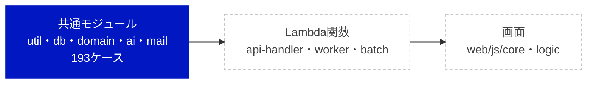

# RPG学習アプリ モジュールテスト結果報告書

| 項目 | 内容 |
| --- | --- |
| 文書名 | RPG学習アプリ モジュールテスト結果報告書 |
| 版数 | 第0.1版（中間報告：共通モジュール） |
| 作成日 | 2026-10-20 |
| 入力文書 | モジュールテスト仕様書 第0.1版、詳細設計書 第0.1版 |
| 対象範囲 | 共通モジュール（functions/shared の util・db・domain・ai・mail と web/js/logic/validators.js） |
| 実行日時・コミット | 2026-10-20 16:23（JST）、`cdfd493`（ブランチ `claude/beautiful-cray-m8heuy`） |
| 判定 | **合格**（対象範囲について、仕様書 6.2 の合否基準による） |

---

## 1. 概要

### 1.1 目的

モジュールテスト仕様書 第4〜5章のテストケースを Vitest で自動化して実行し、その結果を同書 6.2 の合否基準に照らして判定する。本版は段階リリースの第1弾（中間報告）で、共通モジュールだけを対象とする。Lambda関数（MT-H・MT-W）と画面（MT-F）は第2弾で実装・試験し、本書を更新する。

### 1.2 今回の範囲

| 区分 | 層 | 仕様書のケース数 | 今回 |
| --- | --- | --- | --- |
| 対象 | util（MT-U） | 72 | 実行 |
| 対象 | db（MT-D） | 24 | 実行 |
| 対象 | domain（MT-G） | 69 | 実行 |
| 対象 | ai（MT-A） | 23 | 実行 |
| 対象 | mail（MT-M） | 5 | 実行 |
| 対象外（次回） | api-handler（MT-H） | 97 | - |
| 対象外（次回） | ワーカー・バッチ（MT-W） | 45 | - |
| 対象外（次回） | 画面（web/js）（MT-F） | 27 | - |

## 2. 実行環境

| 項目 | 内容 |
| --- | --- |
| OS | Linux 6.18（作業用コンテナ） |
| Node.js | 22.22.0（Lambda の nodejs22.x と同じ系列） |
| Vitest・@vitest/coverage-v8 | 3.2.7 |
| jsdom | 29.1.1（web/ のテストの実行環境） |
| aws-sdk-client-mock | 4.1.0 |
| AWS SDK for JavaScript v3 | 3.1153.0（client-rds-data・client-bedrock-runtime・client-ses） |
| 実行コマンド | `npx vitest run --coverage`（`npm test -- --coverage` と同じ） |

- 外部サービス（Aurora・Bedrock・SES）には接続せず、`aws-sdk-client-mock` で応答を差し替えた（仕様書 2.3）
- `tests/helpers/vitest.setup.js` で `fetch` の既定をエラーにし、ネットワークへ出たテストは失敗する

## 3. 結果の要約

| 項目 | 結果 |
| --- | --- |
| テストケース（仕様書のID） | 193件中 合格 193・不合格 0・未実装 0 |
| 実行したテスト（`it` の数） | 279件（成功 279・失敗 0・スキップ 0・todo 0）、テストファイル 23 |
| うち補足テスト | 32件（仕様書にない分岐を網羅するための追加。7.2 参照） |
| 実行時間 | 最大 5.59 秒（基準：60秒以内） |
| 安定性 | 同じコミットで3回実行し、すべて同じ結果（279/279、279/279、279/279） |
| 失敗したテスト | なし |

## 4. カバレッジ

| 対象 | ファイル数 | 命令網羅（C0） | 分岐網羅（C1） | 関数 | 基準（C0／C1） | 判定 |
| --- | --- | --- | --- | --- | --- | --- |
| 全体 | 43 | 99.93% | 99.50% | 98.89% | - | - |
| `functions/shared/domain/**` | 7 | 100.00% | 100.00% | 100.00% | 100%／100% | 合格 |
| `web/js/logic/validators.js` | 1 | 100.00% | 100.00% | 100.00% | 100%／100% | 合格 |
| `functions/**` | 42 | 99.93% | 99.42% | 98.83% | 90%／80% | 合格 |
| `web/js/**` | 1 | 100.00% | 100.00% | 100.00% | 90%／80% | 合格 |

**ファイル別**

| ファイル | C0 | C1 | 関数 |
| --- | --- | --- | --- |
| `functions/shared/ai/bedrock.js` | 100.00% | 94.44% | 100.00% |
| `functions/shared/ai/json-guard.js` | 100.00% | 100.00% | 100.00% |
| `functions/shared/ai/persona.js` | 100.00% | 100.00% | 100.00% |
| `functions/shared/ai/prompts/comment.js` | 100.00% | 100.00% | 100.00% |
| `functions/shared/ai/prompts/daily-message.js` | 100.00% | 100.00% | 50.00% |
| `functions/shared/ai/prompts/extraction.js` | 100.00% | 100.00% | 100.00% |
| `functions/shared/ai/prompts/grading.js` | 100.00% | 100.00% | 100.00% |
| `functions/shared/ai/prompts/sanitize.js` | 100.00% | 100.00% | 100.00% |
| `functions/shared/db/data-api.js` | 98.48% | 97.95% | 100.00% |
| `functions/shared/db/tx.js` | 100.00% | 100.00% | 100.00% |
| `functions/shared/db/repositories/_base.js` | 100.00% | 100.00% | 100.00% |
| `functions/shared/db/repositories/adventures.js` | 100.00% | 100.00% | 100.00% |
| `functions/shared/db/repositories/answers.js` | 100.00% | 88.88% | 100.00% |
| `functions/shared/db/repositories/audit.js` | 100.00% | 100.00% | 100.00% |
| `functions/shared/db/repositories/badges.js` | 100.00% | 100.00% | 100.00% |
| `functions/shared/db/repositories/courses.js` | 100.00% | 100.00% | 100.00% |
| `functions/shared/db/repositories/enrollments.js` | 100.00% | 100.00% | 100.00% |
| `functions/shared/db/repositories/exp.js` | 100.00% | 100.00% | 100.00% |
| `functions/shared/db/repositories/gradings.js` | 100.00% | 100.00% | 100.00% |
| `functions/shared/db/repositories/imports.js` | 100.00% | 100.00% | 100.00% |
| `functions/shared/db/repositories/notify.js` | 100.00% | 100.00% | 100.00% |
| `functions/shared/db/repositories/questions.js` | 100.00% | 100.00% | 100.00% |
| `functions/shared/db/repositories/quests.js` | 100.00% | 100.00% | 100.00% |
| `functions/shared/db/repositories/rankings.js` | 100.00% | 100.00% | 100.00% |
| `functions/shared/db/repositories/reviews.js` | 100.00% | 100.00% | 100.00% |
| `functions/shared/db/repositories/users.js` | 100.00% | 100.00% | 100.00% |
| `functions/shared/domain/answer-flow.js` | 100.00% | 100.00% | 100.00% |
| `functions/shared/domain/badge.js` | 100.00% | 100.00% | 100.00% |
| `functions/shared/domain/exp.js` | 100.00% | 100.00% | 100.00% |
| `functions/shared/domain/picker.js` | 100.00% | 100.00% | 100.00% |
| `functions/shared/domain/quest.js` | 100.00% | 100.00% | 100.00% |
| `functions/shared/domain/ranking.js` | 100.00% | 100.00% | 100.00% |
| `functions/shared/domain/review.js` | 100.00% | 100.00% | 100.00% |
| `functions/shared/mail/ses.js` | 100.00% | 100.00% | 100.00% |
| `functions/shared/mail/templates.js` | 100.00% | 100.00% | 100.00% |
| `functions/shared/util/authz.js` | 100.00% | 100.00% | 100.00% |
| `functions/shared/util/date-jst.js` | 100.00% | 100.00% | 100.00% |
| `functions/shared/util/errors.js` | 100.00% | 100.00% | 100.00% |
| `functions/shared/util/http.js` | 100.00% | 100.00% | 100.00% |
| `functions/shared/util/ids.js` | 100.00% | 100.00% | 100.00% |
| `functions/shared/util/logger.js` | 100.00% | 100.00% | 100.00% |
| `functions/shared/util/validators.js` | 100.00% | 100.00% | 100.00% |
| `web/js/logic/validators.js` | 100.00% | 100.00% | 100.00% |

## 5. モジュール別の結果

| モジュール | 対象 | ケース | 合格 | 不合格 | 未実装 | it の数 |
| --- | --- | --- | --- | --- | --- | --- |
| M-U01 | `util/errors.js` | 4 | 4 | 0 | 0 | 14 |
| M-U02 | `util/ids.js` | 7 | 7 | 0 | 0 | 12 |
| M-U03 | `util/date-jst.js` | 13 | 13 | 0 | 0 | 13 |
| M-U04 | `util/authz.js` | 9 | 9 | 0 | 0 | 10 |
| M-U05 | `util/logger.js` | 5 | 5 | 0 | 0 | 5 |
| M-U06 | `util/http.js` | 6 | 6 | 0 | 0 | 6 |
| M-U07 | `web/js/logic/validators.js（画面とLambdaで共用）` | 28 | 28 | 0 | 0 | 46 |
| M-D01 | `db/data-api.js` | 11 | 11 | 0 | 0 | 12 |
| M-D02 | `db/tx.js` | 4 | 4 | 0 | 0 | 5 |
| M-D03 | `リポジトリ（代表的なもの）` | 9 | 9 | 0 | 0 | 9 |
| M-G01 | `domain/review.js 忘却曲線` | 14 | 14 | 0 | 0 | 15 |
| M-G02 | `domain/exp.js EXPとレベル` | 13 | 13 | 0 | 0 | 23 |
| M-G03 | `domain/quest.js デイリークエスト` | 12 | 12 | 0 | 0 | 12 |
| M-G04 | `domain/badge.js バッジ` | 7 | 7 | 0 | 0 | 7 |
| M-G05 | `domain/ranking.js 順位づけ` | 6 | 6 | 0 | 0 | 6 |
| M-G06 | `domain/picker.js 出題` | 9 | 9 | 0 | 0 | 9 |
| M-G07 | `domain/answer-flow.js 解答後の更新内容` | 8 | 8 | 0 | 0 | 8 |
| M-A01 | `ai/bedrock.js` | 7 | 7 | 0 | 0 | 8 |
| M-A02 | `ai/json-guard.js` | 9 | 9 | 0 | 0 | 19 |
| M-A03・M-A04 | `ai/persona.js・ai/prompts/*` | 7 | 7 | 0 | 0 | 7 |
| M-M01 | `mail/ses.js・mail/templates.js` | 5 | 5 | 0 | 0 | 6 |

## 6. テストケース別の結果

### M-U01 util/errors.js

| ID | 観点 | 技法 | 結果 | it |
| --- | --- | --- | --- | --- |
| MT-U01-01 | AppError の属性 | 同 | 合格 | 1 |
| MT-U01-02 | 応答への変換（想定エラー） | 同 | 合格 | 1 |
| MT-U01-03 | 応答への変換（想定外） | 異 | 合格 | 1 |
| MT-U01-04 | コードからHTTPの既定 | 同 | 合格 | 11 |

### M-U02 util/ids.js

| ID | 観点 | 技法 | 結果 | it |
| --- | --- | --- | --- | --- |
| MT-U02-01 | 変換 | 同 | 合格 | 1 |
| MT-U02-02 | 逆変換 | 同 | 合格 | 1 |
| MT-U02-03 | 接頭辞の違い | 異 | 合格 | 1 |
| MT-U02-04 | 下限 | 境 | 合格 | 1 |
| MT-U02-05 | 上限 | 境 | 合格 | 1 |
| MT-U02-06 | 数字以外 | 異 | 合格 | 5 |
| MT-U02-07 | 文字列以外 | 異 | 合格 | 2 |

### M-U03 util/date-jst.js

| ID | 観点 | 技法 | 結果 | it |
| --- | --- | --- | --- | --- |
| MT-U03-01 | JSTの日付（0:00直前） | 境 | 合格 | 1 |
| MT-U03-02 | JSTの日付（0:00ちょうど） | 境 | 合格 | 1 |
| MT-U03-03 | 月末をまたぐ | 境 | 合格 | 1 |
| MT-U03-04 | 年末をまたぐ | 境 | 合格 | 1 |
| MT-U03-05 | うるう年 | 境 | 合格 | 1 |
| MT-U03-06 | 引き算 | 同 | 合格 | 1 |
| MT-U03-07 | 週の開始（月曜0:00） | 境 | 合格 | 1 |
| MT-U03-08 | 週の開始（日曜23:59） | 境 | 合格 | 1 |
| MT-U03-09 | 週の開始（次の月曜） | 境 | 合格 | 1 |
| MT-U03-10 | 送信枠 | 境 | 合格 | 1 |
| MT-U03-11 | ISO文字列 | 同 | 合格 | 1 |
| MT-U03-12 | 日数の差 | 同 | 合格 | 1 |
| MT-U03-13 | 不正な日付 | 異 | 合格 | 1 |

### M-U04 util/authz.js

| ID | 観点 | 技法 | 結果 | it |
| --- | --- | --- | --- | --- |
| MT-U04-01 | グループ（文字列） | 同 | 合格 | 1 |
| MT-U04-02 | グループ（配列）・なし | 同 | 合格 | 1 |
| MT-U04-03 | sub がない | 異 | 合格 | 1 |
| MT-U04-04 | ロールあり | 同 | 合格 | 1 |
| MT-U04-05 | ロールなし | 異 | 合格 | 1 |
| MT-U04-06 | 招待中の初回ログイン | 状 | 合格 | 1 |
| MT-U04-07 | 論理削除中・未登録 | 異 | 合格 | 2 |
| MT-U04-08 | 担当コース | DT | 合格 | 1 |
| MT-U04-09 | システム管理者は全コース | DT | 合格 | 1 |

### M-U05 util/logger.js

| ID | 観点 | 技法 | 結果 | it |
| --- | --- | --- | --- | --- |
| MT-U05-01 | 1行のJSON | 同 | 合格 | 1 |
| MT-U05-02 | prod の DEBUG | DT | 合格 | 1 |
| MT-U05-03 | dev の DEBUG | DT | 合格 | 1 |
| MT-U05-04 | 伏せ字 | 異 | 合格 | 1 |
| MT-U05-05 | エラーのスタック | 異 | 合格 | 1 |

### M-U06 util/http.js

| ID | 観点 | 技法 | 結果 | it |
| --- | --- | --- | --- | --- |
| MT-U06-01 | 本文（JSON） | 同 | 合格 | 1 |
| MT-U06-02 | 本文（Base64） | 同 | 合格 | 1 |
| MT-U06-03 | 本文なし | 境 | 合格 | 1 |
| MT-U06-04 | 壊れたJSON | 異 | 合格 | 1 |
| MT-U06-05 | 通常の応答 | 同 | 合格 | 1 |
| MT-U06-06 | CSVの応答 | 同 | 合格 | 1 |

### M-U07 web/js/logic/validators.js（画面とLambdaで共用）

| ID | 観点 | 技法 | 結果 | it |
| --- | --- | --- | --- | --- |
| MT-U07-01 | 下限の1つ下 | 境 | 合格 | 1 |
| MT-U07-02 | 下限 | 境 | 合格 | 1 |
| MT-U07-03 | 小見出し不要の上限 | 境 | 合格 | 1 |
| MT-U07-04 | 小見出しが必要になる | 境 | 合格 | 1 |
| MT-U07-05 | 小見出しあり | 境 | 合格 | 1 |
| MT-U07-06 | 上限 | 境 | 合格 | 1 |
| MT-U07-07 | 上限の1つ上 | 境 | 合格 | 1 |
| MT-U07-08 | 小見出しが行の途中 | 異 | 合格 | 1 |
| MT-U07-09 | 2行目の行頭の小見出し | 同 | 合格 | 1 |
| MT-U07-10 | 中身のない小見出し | 異 | 合格 | 1 |
| MT-U07-11 | 空白・改行は数えない | 同 | 合格 | 1 |
| MT-U07-12 | サロゲートペア | 境 | 合格 | 1 |
| MT-U07-13 | 空・null | 異 | 合格 | 3 |
| MT-U07-14 | 文字数の境界 | 境 | 合格 | 1 |
| MT-U07-15 | 使える文字 | 同 | 合格 | 5 |
| MT-U07-16 | 使えない文字 | 異 | 合格 | 4 |
| MT-U07-17 | 前後の空白 | 同 | 合格 | 1 |
| MT-U07-18 | パートナー名の空 | 同 | 合格 | 1 |
| MT-U07-19 | パートナー名の境界 | 境 | 合格 | 1 |
| MT-U07-20 | パートナー名の記号 | 異 | 合格 | 3 |
| MT-U07-21 | 通知時刻の範囲 | 境 | 合格 | 1 |
| MT-U07-22 | 通知時刻の刻み・形式 | 異 | 合格 | 4 |
| MT-U07-23 | 取り込みのサイズ | 境 | 合格 | 1 |
| MT-U07-24 | 取り込みの種類 | 異 | 合格 | 1 |
| MT-U07-25 | テキストの長さ | 境 | 合格 | 1 |
| MT-U07-26 | 公開できる問題 | 同 | 合格 | 1 |
| MT-U07-27 | 公開できない問題 | DT | 合格 | 5 |
| MT-U07-28 | キーワードの数と長さ | 境 | 合格 | 1 |

### M-D01 db/data-api.js

| ID | 観点 | 技法 | 結果 | it |
| --- | --- | --- | --- | --- |
| MT-D01-01 | 接続情報 | 同 | 合格 | 1 |
| MT-D01-02 | パラメータの型（整数・小数） | 同 | 合格 | 1 |
| MT-D01-03 | パラメータの型（文字・真偽） | 同 | 合格 | 1 |
| MT-D01-04 | パラメータの型（null） | 同 | 合格 | 1 |
| MT-D01-05 | 日付・JSON | 同 | 合格 | 2 |
| MT-D01-06 | 結果の変換 | 同 | 合格 | 1 |
| MT-D01-07 | 結果なし | 境 | 合格 | 1 |
| MT-D01-08 | DB起動中・再試行0回 | 異 | 合格 | 1 |
| MT-D01-09 | DB起動中から復帰 | 状 | 合格 | 1 |
| MT-D01-10 | 再試行が尽きる | 境 | 合格 | 1 |
| MT-D01-11 | ほかのエラー | 異 | 合格 | 1 |

### M-D02 db/tx.js

| ID | 観点 | 技法 | 結果 | it |
| --- | --- | --- | --- | --- |
| MT-D02-01 | 正常 | 同 | 合格 | 1 |
| MT-D02-02 | 途中の例外 | 異 | 合格 | 2 |
| MT-D02-03 | Commit の失敗 | 異 | 合格 | 1 |
| MT-D02-04 | 戻り値 | 同 | 合格 | 1 |

### M-D03 リポジトリ（代表的なもの）

| ID | 観点 | 技法 | 結果 | it |
| --- | --- | --- | --- | --- |
| MT-D03-01 | ニックネームの重複確認 | 同 | 合格 | 1 |
| MT-D03-02 | 重複なし | 同 | 合格 | 1 |
| MT-D03-03 | 採点の完了（条件付き） | 状 | 合格 | 1 |
| MT-D03-04 | 復習項目の登録・更新 | 同 | 合格 | 1 |
| MT-D03-05 | 週の集計 | 同 | 合格 | 1 |
| MT-D03-06 | ランキングの締め | 同 | 合格 | 1 |
| MT-D03-07 | 列名の変換 | 同 | 合格 | 1 |
| MT-D03-08 | 一覧の上限 | 境 | 合格 | 1 |
| MT-D03-09 | 並べ替えの許可リスト | 異 | 合格 | 1 |

### M-G01 domain/review.js 忘却曲線

| ID | 観点 | 技法 | 結果 | it |
| --- | --- | --- | --- | --- |
| MT-G01-01 | 初回・正解 | DT | 合格 | 1 |
| MT-G01-02 | 初回・不正解 | DT | 合格 | 1 |
| MT-G01-03 | 予定日の前日 | 境 | 合格 | 1 |
| MT-G01-04 | 予定日当日に正解 | 境 | 合格 | 1 |
| MT-G01-05 | 段階2→3 | DT | 合格 | 1 |
| MT-G01-06 | 段階3→4 | DT | 合格 | 1 |
| MT-G01-07 | 段階4→5 | DT | 合格 | 1 |
| MT-G01-08 | 習得 | DT | 合格 | 1 |
| MT-G01-09 | 不正解で段階1へ | DT | 合格 | 1 |
| MT-G01-10 | 段階5で不正解 | DT | 合格 | 1 |
| MT-G01-11 | 段階1で不正解 | DT | 合格 | 1 |
| MT-G01-12 | 遅れて正解（段階を下げない） | DT | 合格 | 1 |
| MT-G01-13 | 習得済みを解く | 状 | 合格 | 2 |
| MT-G01-14 | 年末をまたぐ | 境 | 合格 | 1 |

### M-G02 domain/exp.js EXPとレベル

| ID | 観点 | 技法 | 結果 | it |
| --- | --- | --- | --- | --- |
| MT-G02-01 | 択一の正解 | DT | 合格 | 1 |
| MT-G02-02 | 択一の復習正解 | DT | 合格 | 1 |
| MT-G02-03 | 説明の合格 | DT | 合格 | 1 |
| MT-G02-04 | 説明の復習合格 | DT | 合格 | 1 |
| MT-G02-05 | 不正解は0 | DT | 合格 | 1 |
| MT-G02-06 | 必要EXP（表の値） | 同 | 合格 | 8 |
| MT-G02-07 | ちょうど整数になる値 | 境 | 合格 | 1 |
| MT-G02-08 | Lv1の範囲 | 境 | 合格 | 1 |
| MT-G02-09 | Lv2になる境界 | 境 | 合格 | 1 |
| MT-G02-10 | Lv3になる境界 | 境 | 合格 | 1 |
| MT-G02-11 | 表の累計EXP | 同 | 合格 | 4 |
| MT-G02-12 | 大きな値 | 異 | 合格 | 1 |
| MT-G02-13 | 不正な種類 | 異 | 合格 | 1 |

### M-G03 domain/quest.js デイリークエスト

| ID | 観点 | 技法 | 結果 | it |
| --- | --- | --- | --- | --- |
| MT-G03-01 | 復習ありの日 | DT | 合格 | 1 |
| MT-G03-02 | 復習なしの日 | DT | 合格 | 1 |
| MT-G03-03 | 乱数によらず守られる | 境 | 合格 | 1 |
| MT-G03-04 | 択一の不正解 | DT | 合格 | 1 |
| MT-G03-05 | 択一の正解 | DT | 合格 | 1 |
| MT-G03-06 | 達成 | 境 | 合格 | 1 |
| MT-G03-07 | 達成済みは進めない | 状 | 合格 | 1 |
| MT-G03-08 | 説明の合格・不合格 | DT | 合格 | 1 |
| MT-G03-09 | 復習 | 境 | 合格 | 1 |
| MT-G03-10 | 新しい問題 | DT | 合格 | 1 |
| MT-G03-11 | 同時に2つ達成 | 同 | 合格 | 1 |
| MT-G03-12 | クエストなし | 境 | 合格 | 1 |

### M-G04 domain/badge.js バッジ

| ID | 観点 | 技法 | 結果 | it |
| --- | --- | --- | --- | --- |
| MT-G04-01 | 習得の境界 | 境 | 合格 | 1 |
| MT-G04-02 | 次の段階 | 境 | 合格 | 1 |
| MT-G04-03 | まとめて達成 | 同 | 合格 | 1 |
| MT-G04-04 | 全部持っている | 同 | 合格 | 1 |
| MT-G04-05 | 継続の境界 | 境 | 合格 | 1 |
| MT-G04-06 | 継続の銀・金 | 境 | 合格 | 1 |
| MT-G04-07 | 0日 | 境 | 合格 | 1 |

### M-G05 domain/ranking.js 順位づけ

| ID | 観点 | 技法 | 結果 | it |
| --- | --- | --- | --- | --- |
| MT-G05-01 | 同点なし | 同 | 合格 | 1 |
| MT-G05-02 | 同点は同順位 | 境 | 合格 | 1 |
| MT-G05-03 | 同点の並び順 | 同 | 合格 | 1 |
| MT-G05-04 | 0 EXP は除く | 境 | 合格 | 1 |
| MT-G05-05 | 空 | 境 | 合格 | 1 |
| MT-G05-06 | 全員同点 | 境 | 合格 | 1 |

### M-G06 domain/picker.js 出題

| ID | 観点 | 技法 | 結果 | it |
| --- | --- | --- | --- | --- |
| MT-G06-01 | 最初は択一 | DT | 合格 | 1 |
| MT-G06-02 | 交互（択一のあと） | DT | 合格 | 1 |
| MT-G06-03 | 交互（説明のあと） | DT | 合格 | 1 |
| MT-G06-04 | 説明がないときは択一 | DT | 合格 | 1 |
| MT-G06-05 | 優先順位 | DT | 合格 | 1 |
| MT-G06-06 | 学習済みからの出題 | DT | 合格 | 1 |
| MT-G06-07 | 出したものは除く | 同 | 合格 | 1 |
| MT-G06-08 | 出せるものがない | 境 | 合格 | 1 |
| MT-G06-09 | キーワードのない説明候補 | 異 | 合格 | 1 |

### M-G07 domain/answer-flow.js 解答後の更新内容

| ID | 観点 | 技法 | 結果 | it |
| --- | --- | --- | --- | --- |
| MT-G07-01 | 初めての択一に正解 | 同 | 合格 | 1 |
| MT-G07-02 | 復習の択一に正解 | 同 | 合格 | 1 |
| MT-G07-03 | 復習の説明に合格 | 同 | 合格 | 1 |
| MT-G07-04 | 不正解 | 同 | 合格 | 1 |
| MT-G07-05 | 正解でレベルアップ | 境 | 合格 | 1 |
| MT-G07-06 | クエスト報酬だけでレベルアップ | 境 | 合格 | 1 |
| MT-G07-07 | 習得でバッジ | 境 | 合格 | 1 |
| MT-G07-08 | 習得済みの問題に正解 | 状 | 合格 | 1 |

### M-A01 ai/bedrock.js

| ID | 観点 | 技法 | 結果 | it |
| --- | --- | --- | --- | --- |
| MT-A01-01 | コマンドの中身 | 同 | 合格 | 1 |
| MT-A01-02 | 応答の取り出し | 同 | 合格 | 1 |
| MT-A01-03 | 打ち切り | 境 | 合格 | 1 |
| MT-A01-04 | 打ち切り前に返る | 境 | 合格 | 1 |
| MT-A01-05 | SDKのエラー | 異 | 合格 | 2 |
| MT-A01-06 | PDF・画像の入力 | 同 | 合格 | 1 |
| MT-A01-07 | ログ | 異 | 合格 | 1 |

### M-A02 ai/json-guard.js

| ID | 観点 | 技法 | 結果 | it |
| --- | --- | --- | --- | --- |
| MT-A02-01 | JSONだけ | 同 | 合格 | 1 |
| MT-A02-02 | 前後に文章 | 同 | 合格 | 1 |
| MT-A02-03 | コードブロック | 同 | 合格 | 1 |
| MT-A02-04 | 文字列の中の括弧 | 異 | 合格 | 1 |
| MT-A02-05 | 配列が先頭 | 同 | 合格 | 1 |
| MT-A02-06 | JSONがない | 異 | 合格 | 1 |
| MT-A02-07 | 採点の形（正常） | 同 | 合格 | 1 |
| MT-A02-08 | 範囲外の点数 | 境 | 合格 | 4 |
| MT-A02-09 | 必須キーがない・型違い | 異 | 合格 | 8 |

### M-A03・M-A04 ai/persona.js・ai/prompts/*

| ID | 観点 | 技法 | 結果 | it |
| --- | --- | --- | --- | --- |
| MT-A03-01 | 3人の定義 | 同 | 合格 | 1 |
| MT-A03-02 | 知らない性格 | 異 | 合格 | 1 |
| MT-A04-01 | 採点の指示文 | 同 | 合格 | 1 |
| MT-A04-02 | 閉じタグの無害化 | 異 | 合格 | 1 |
| MT-A04-03 | 小見出しはそのまま | 同 | 合格 | 1 |
| MT-A04-04 | 抽出の指示文 | 同 | 合格 | 1 |
| MT-A04-05 | ひとことに個人情報を入れない | 異 | 合格 | 1 |

### M-M01 mail/ses.js・mail/templates.js

| ID | 観点 | 技法 | 結果 | it |
| --- | --- | --- | --- | --- |
| MT-M01-01 | 通知メールの本文 | 同 | 合格 | 1 |
| MT-M01-02 | 環境名の付与 | DT | 合格 | 2 |
| MT-M01-03 | 削除予定の通知 | 同 | 合格 | 1 |
| MT-M01-04 | SES への送信 | 同 | 合格 | 1 |
| MT-M01-05 | 送信の失敗 | 異 | 合格 | 1 |

## 7. 所見

### 7.1 不具合

- 製品コードの不具合は見つからなかった（全ケースが初回の実行から合格）
- テストコード側の誤り1件（validators の補足テストで変数の宣言位置が誤っていた）を実行前の確認で直した。製品コードへの影響はない

### 7.2 設計書・仕様書の解釈と補足

| No | 対象 | 内容 | 対応の提案 |
| --- | --- | --- | --- |
| 1 | M-U07 validators | ニックネーム・パートナー名・通知時刻・取り込みの入力エラーには外部設計書のメッセージID（M-xx）がないため、`code: 'INVALID'` と `field` で返すようにした | 外部設計書 3.7 にメッセージIDを追加するか、`INVALID` を正式なコードとして詳細設計書 3.2 に追記する |
| 2 | M-U04 authz | util は db を呼べない（2.1 の依存ルール）ため、`loadUser`・`assertCourseAdmin` はリポジトリを引数 `db` で受け取る形にした。担当コースの確認には `courses.isAdmin(courseId, userId)` を追加した | 詳細設計書 3.4 の courses.js の関数一覧に `isAdmin`・`dashboardRows` を追記する |
| 3 | M-D01 data-api | 再試行回数の既定値（api-handler は0、ほかは6）を関数ごとに切り替えるため `setDefaultResumeRetries(n)` を追加した。各 `index.mjs` の先頭で呼ぶ想定 | 詳細設計書 3.3 に追記する |
| 4 | M-G03 quest | `applyQuestEvent` の戻り値を `{ quests, achievedNow, questExp }` とした（仕様書 MT-G03-06 の achievedNow と報酬の合計を返すため） | 詳細設計書 3.5 の表に戻り値の形を追記する |
| 5 | M-G06 picker | `servedIds` は形式ごとに ID が重なるため `choice:{問題ID}`・`explain:{キーワードID}` の文字列にした（adventures.served の k・q・kw と対応） | 詳細設計書 3.5 に servedIds の形を追記する |
| 6 | M-G07 answer-flow | 戻り値の exp にクエスト報酬を足したあとの `totalExp` を含め、今回達成したクエスト `achievedNow` も返すようにした（DBへの書き込みで使う） | 詳細設計書 3.5 の擬似コードに追記する |
| 7 | M-A01 bedrock | AI_TIMEOUT・AI_ERROR は内部用（HTTP なし）だが、万一外に出たときのため status を 500 とした | 詳細設計書 2.4.4 の表に注記する |
| 8 | M-M01 templates | メールのパートナーの定型のひとことと問い合わせ先の文言は設計書に具体的な文がないため仮の文にした | 外部設計書 5.6 で文言を確定する（未決事項に追加） |
| 9 | vitest.config.js | 仕様書 3.2 の `environmentMatchGlobs` は Vitest 3.2 で非推奨の警告が出る（動作は問題なし） | 次の版で `test.projects` に置き換えることを仕様書に反映する |
| 10 | 補足テスト | 仕様書のケースだけでは C1 100%（domain・validators）と 90%／80%（そのほか）に届かない分岐があったため、ID の後ろに「補足」を付けたテストを追加した（リポジトリの全関数のSQL組み立てなど） | 仕様書 6.3 の決まりに沿って、次の版でケースIDを採番して本書と仕様書に載せる |

## 8. 判定と次の作業

| 基準（仕様書 6.2） | 結果 | 判定 |
| --- | --- | --- |
| テストケースがすべて実装され成功する（skip・todo 0件） | 193/193、skip 0・todo 0 | 合格 |
| カバレッジ（domain・validators 100%、そのほか 90%／80%以上） | 4章のとおり | 合格 |
| 実行時間 60秒以内 | 5.59 秒 | 合格 |
| 安定性（3回続けて同じ結果） | 同じ | 合格 |

- 第2弾：api-handler（MT-H01〜H14）・grading-worker・import-worker・batch-runner（MT-W01〜W04）・画面（MT-F01〜F06）を実装し、残りのケースを試験する
- 第2弾の完了時に本書を最終版に更新し、全362ケースで合否を判定する
- 7.2 の解釈・補足を詳細設計書と仕様書に反映するかをジュンさんに確認する
