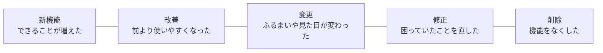
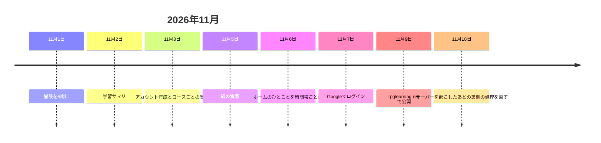
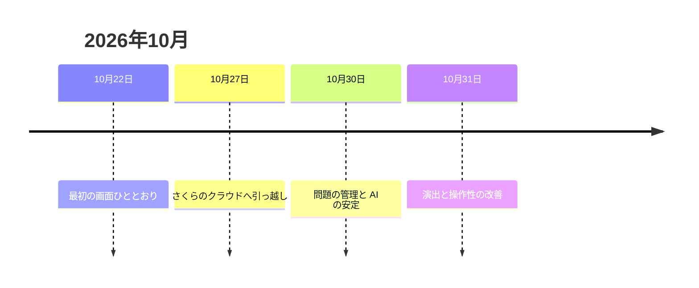

# RPG学習アプリ リリースノート

| 項目 | 内容 |
| --- | --- |
| 文書名 | RPG学習アプリ リリースノート |
| 版数 | 第1.0版 |
| 作成日 | 2026-11-10 |
| 対象 | 学習者・管理者（アプリを使う人から見た変更） |
| 元にしたもの | プルリクエスト #1〜#44 のうち、使う人から見て変わったもの |

---

## 1. このリリースノートについて

### 1.1 読み方

アプリを使う人から見て「何が変わったか」を、新しい順にまとめる。開発や運用だけの変更（テスト・文書・サーバーの設定など）は載せない。日付は変更を取り込んだ日（日本時間）。dev への反映は、その日か次の日になる。

| 区分 | 意味 |
| --- | --- |
| 新機能 | できることが増えた |
| 改善 | 前より使いやすくなった |
| 変更 | ふるまいや見た目が変わった |
| 修正 | 困っていたことを直した |
| 削除 | 機能をなくした |

「対象」は、その変更が関わる人。学習者・管理者・全員（両方）のどれか。

### 1.2 いまの公開先

- アドレス：`https://rpglearning.net`（2026-11-09 から）
- しばらく使われていないときはサーバーが休んでいる。開くと「起動中」の画面が出て、数分で使えるようになる

---

## 2. 2026年11月の変更

### 2.1 11月10日：サーバーを起こしたあとの裏側の処理を直す

| 区分 | 対象 | 内容 | PR |
| --- | --- | --- | --- |
| 修正 | 全員 | サーバーを作り直したり起こしたりしたとき、説明問題の採点などを受け持つ裏側の処理（worker）が起動しないことがあったのを直した | [#44](https://github.com/pocarialice/rpglearning/pull/44) |

### 2.2 11月9日：rpglearning.net で公開

| 区分 | 対象 | 内容 | PR |
| --- | --- | --- | --- |
| 変更 | 全員 | アプリのアドレスを `https://rpglearning.net` にした。前のアドレスや `www` から開いても、自動でこのアドレスに移る | [#38](https://github.com/pocarialice/rpglearning/pull/38) |
| 変更 | 全員 | しばらく誰も使っていないときはサーバーが休むようにした。休んでいるときに開くと「起動中」の画面が出て、数分で使えるようになる。ログイン中の画面は、起動を待って自動でやり直す | [#38](https://github.com/pocarialice/rpglearning/pull/38) |
| 削除 | 学習者 | 通知メールと通知設定の画面（S-10）をなくした。招待・パスワード再設定・アカウント作成・アカウント停止のメールはこれまでどおり届く | [#38](https://github.com/pocarialice/rpglearning/pull/38) |

### 2.3 11月7日：Googleでログイン

| 区分 | 対象 | 内容 | PR |
| --- | --- | --- | --- |
| 新機能 | 全員 | ログイン画面に「Googleでログイン」を追加した。Google のアカウントで、パスワードを入れずにログインできる | [#34](https://github.com/pocarialice/rpglearning/pull/34) |

### 2.4 11月6日：ホームのひとことを時間帯ごとに

| 区分 | 対象 | 内容 | PR |
| --- | --- | --- | --- |
| 改善 | 学習者 | ホームの AI パートナーのひとことを、朝・昼・夜の時間帯ごとに作り直すようにした。復習の話より、その日・前日に学んだ実績を優先して伝える | [#32](https://github.com/pocarialice/rpglearning/pull/32) |

### 2.5 11月5日：紙の質感

| 区分 | 対象 | 内容 | PR |
| --- | --- | --- | --- |
| 改善 | 学習者 | 学習者の画面に、古い羊皮紙ふうの紙の質感を控えめに足した | [#31](https://github.com/pocarialice/rpglearning/pull/31) |

### 2.6 11月3日：アカウント作成とコースごとの実績

| 区分 | 対象 | 内容 | PR |
| --- | --- | --- | --- |
| 新機能 | 全員 | ログイン画面の「アカウントを作る」から、自分でアカウントを作れるようにした。届いたメールの確認リンクを開くと登録され、そのままログインできる | [#25](https://github.com/pocarialice/rpglearning/pull/25) |
| 新機能 | 学習者 | プロフィールに受講中のコースを出し、下部メニューの「コースごとの実績」から一覧（S-16）と詳細（S-17）を見られるようにした。コースごとの累計の学習時間と、AI パートナーのコメントが見られる | [#27](https://github.com/pocarialice/rpglearning/pull/27) |

### 2.7 11月2日：学習サマリ

| 区分 | 対象 | 内容 | PR |
| --- | --- | --- | --- |
| 新機能 | 学習者 | 冒険のまとめ（S-15）とプロフィール（S-08）に、学習サマリを Markdown で出す機能を追加した。ふだんは閉じていて、開くとワンクリックでコピーでき、ほかのノートアプリに貼り付けられる。AI パートナーのコメントも付く | [#24](https://github.com/pocarialice/rpglearning/pull/24) |

### 2.8 11月1日：冒険を5問に

| 区分 | 対象 | 内容 | PR |
| --- | --- | --- | --- |
| 変更 | 学習者 | 1回の冒険を10問から5問にした | [#23](https://github.com/pocarialice/rpglearning/pull/23) |
| 新機能 | 学習者 | 冒険の最後に「冒険のまとめ」（S-15）を出すようにした。学習時間を冒険ごとと累計で記録する | [#23](https://github.com/pocarialice/rpglearning/pull/23) |

---

## 3. 2026年10月の変更

### 3.1 10月31日：演出と操作性の改善

| 区分 | 対象 | 内容 | PR |
| --- | --- | --- | --- |
| 変更 | 学習者 | キーワード説明の問題を、パートナーが「どの観点で説明してほしいか」を問いかけ、それに答える形にした。採点もその問いかけへの答えとして行う | [#12](https://github.com/pocarialice/rpglearning/pull/12) |
| 改善 | 学習者 | AI の文章の【】の小見出しを太字にし、改行を入れて読みやすくした | [#12](https://github.com/pocarialice/rpglearning/pull/12) |
| 新機能 | 学習者 | レベルアップとクエスト達成のときに、光の柱と紙吹雪のお祝いを出すようにした | [#13](https://github.com/pocarialice/rpglearning/pull/13) |
| 修正 | 全員 | 新しい版に入れ替えたあとも、前の版の画面が表示されることがあったのを直した | [#14](https://github.com/pocarialice/rpglearning/pull/14) |
| 改善 | 学習者 | 結果画面（S-06）で、獲得EXPのカードを問題文より上に移し、EXPのバーが伸びる演出を付けた | [#15](https://github.com/pocarialice/rpglearning/pull/15) |
| 新機能 | 学習者 | ホームのパートナーのひとことの下に、受講中のコースを出すようにした | [#17](https://github.com/pocarialice/rpglearning/pull/17) |
| 修正 | 学習者 | スマホで入力欄を選んだときに、画面が勝手に拡大されないようにした。指で広げる拡大も止めた | [#18](https://github.com/pocarialice/rpglearning/pull/18) |
| 新機能 | 全員 | PC で Ctrl+Enter（Mac は ⌘+Enter）を押すと、入力を確定できるようにした | [#18](https://github.com/pocarialice/rpglearning/pull/18) |
| 修正 | 学習者 | iPhone でホームの右側が切れてはみ出していたのを直し、横にスクロールしないようにした | [#20](https://github.com/pocarialice/rpglearning/pull/20) |

### 3.2 10月30日：問題の管理と AI の安定

| 区分 | 対象 | 内容 | PR |
| --- | --- | --- | --- |
| 改善 | 全員 | AI の解説コメントやひとことが、AI が考えているうちに文字数の上限に届いて空になることがないようにした | [#8](https://github.com/pocarialice/rpglearning/pull/8) |
| 改善 | 管理者 | AI で問題を取り込むとき、選択肢に「A.」「ア」「①」などの項番が入らないようにした。問題文に書かれた HTML のコードも消えないようにした | [#9](https://github.com/pocarialice/rpglearning/pull/9)・[#10](https://github.com/pocarialice/rpglearning/pull/10) |
| 新機能 | 管理者 | 問題取り込み・レビュー画面（S-11）で、登録済みの問題を状態で絞り込んで見られるようにした。下書きもここに出る | [#9](https://github.com/pocarialice/rpglearning/pull/9)・[#10](https://github.com/pocarialice/rpglearning/pull/10) |
| 新機能 | 管理者 | チェックボックスで選んだ問題を、まとめて公開・削除できるようにした | [#9](https://github.com/pocarialice/rpglearning/pull/9)・[#10](https://github.com/pocarialice/rpglearning/pull/10) |
| 改善 | 管理者 | 問題の修正をダイアログで行うようにした。学習者からの見え方を横に表示し、保存・公開・削除したら次の問題へ進む | [#10](https://github.com/pocarialice/rpglearning/pull/10) |

### 3.3 10月27日：さくらのクラウドへ引っ越し

| 区分 | 対象 | 内容 | PR |
| --- | --- | --- | --- |
| 変更 | 全員 | アプリを動かす場所を AWS からさくらのクラウドに移した。データはすべて国内に置く。ログインはアプリのログイン（メールアドレス＋パスワード）になる | [#6](https://github.com/pocarialice/rpglearning/pull/6) |

### 3.4 10月22日：最初の画面ひととおり

| 区分 | 対象 | 内容 | PR |
| --- | --- | --- | --- |
| 新機能 | 学習者 | ホーム・コース選択・演習（四肢択一）・キーワード説明・結果・週間ランキング・プロフィール・AI パートナー選択の画面と、初回の流れ「はじめての冒険」を作った | [#3](https://github.com/pocarialice/rpglearning/pull/3)・[#4](https://github.com/pocarialice/rpglearning/pull/4) |
| 新機能 | 管理者 | 管理局に、問題取り込み・レビュー、学習状況ダッシュボード、利用者・コース・権限管理、AI パートナー設定の画面を作った | [#4](https://github.com/pocarialice/rpglearning/pull/4) |
| 変更 | 学習者 | 説明文の「200文字を超えたら【】の小見出しが必要」というルールをなくした（AI の模範説明のほうで小見出しを使う） | [#4](https://github.com/pocarialice/rpglearning/pull/4) |

---

## 変更履歴

| 版数 | 日付 | 変更内容 | 関連PR |
| --- | --- | --- | --- |
| 第1.0版 | 2026-11-10 | 作成。PR #1〜#44 から、使う人から見た変更をまとめる | — |
