# RPG学習アプリ 外部設計書

| 項目     | 内容                               |
| ------ | -------------------------------- |
| 文書名    | RPG学習アプリ 外部設計書                   |
| 版数     | 第0.7版（ドラフト：第1〜10章、HTML版あり）       |
| 作成日    | 2026-10-19（第0.7版：2026-10-20）       |
| 入力文書   | RPG学習アプリ 要件定義書 第1版（ドラフト）         |
| 対象フェーズ | Phase 1（MVP）。Phase 2/3は「拡張予定」と注記 |

---

## 1. 文書概要

### 1.1 目的

要件定義書で決めた「何を作るか」を、利用者から見える形（画面・操作・外部とのやり取り・システム構成）に落とし込む。内部設計（プログラム構造・テーブル定義の詳細）の入力とする。

### 1.2 本書で確定する事項

| 区分      | 確定内容                                                                                              | 要件定義書の対応     |
| ------- | ------------------------------------------------------------------------------------------------- | ------------ |
| 方式      | サーバーレス構成（CloudFront＋S3／API Gateway＋Lambda／Aurora Serverless v2）                                   | 6.1          |
| 認証      | Amazon Cognito（将来のSAML/OIDCに対応）                                                                   | 6.5          |
| 環境      | dev／stg／prod の3環境を1つのAWSアカウント内でリソース名の接頭辞（rpg-dev- など）とタグ Environment で分ける。東京リージョン（ap-northeast-1） | 6.1          |
| AIモデル   | 高精度＝Claude Sonnet 5.5、軽量＝Claude Haiku 5.5。東京リージョンで使えない場合は、東京リージョンで使える別バージョンを使う（クロスリージョン推論は使わない）      | 6.3          |
| フロントエンド | Vanilla JS（フレームワークなし）のSPA＋PWA                                                                     | 6.7          |
| リリース方式  | GitHub Actions で配置する（`main` への push で dev、タグで stg → 承認後に prod）。AWS へは OIDC で認証し、アクセスキーは使わない。AWSリソースの作成はマネジメントコンソール | 6.1          |
| レベル計算式  | 次のレベルまでの必要EXP＝100 × Lv^1.2（端数切り上げ）                                                                | 仮置き No.8     |
| AIパートナー | 励まし型・論理型・ライバル型の3人。名前は学習者が入力。紋章はキャラクター画像（まずは表情1種、管理画面で差し替え可）。画像が未設定なら名前の頭文字を表示                     | 仮置き No.9     |
| 管理画面    | 羊皮紙の世界観のまま「ギルド管理局」型で学習者画面と区別                                                                      | 5.1          |
| コスト方針   | パイロット期間はコスト最小構成：Aurora は全環境で自動停止。CloudFront は定額の Free プラン（月0ドル、AWS WAF 付き）を全環境で使う                 | 6.1          |
| ドメイン    | 未定。本書では `app.example.co.jp` を仮置き                                                                  | -            |
| 表示名     | ランキングなど学習者どうしの表示はニックネーム（2〜12文字、コース内で重複不可）                                                         | 4.3          |
| 説明問題の入力 | 50〜400文字。200文字を超える場合は【】の小見出しが必要                                                                   | 3.4          |
| 通知時刻    | 学習者が6:00〜22:00の30分刻みで選ぶ（初期値7:30）                                                                  | 5.3          |
| ゲームルール  | 1回の冒険は10問。デイリークエストは5種類から1日3つ（復習対象がある日はQ-04を必ず含む、報酬20〜30 EXP）。バッジは習得10／50／100問・継続7／30／100日         | 仮置き No.6、4.4 |
| 説明の採点   | 正確さ50点・観点の網羅30点・具体性20点、合格60点                                                                      | 仮置き No.1、3.4 |
| ログイン    | パスワード8文字以上（英大文字・英小文字・数字を含む）。ログイン状態は7日間保持                                                          | 6.5          |

### 1.3 関連文書

| 文書                     | 用途                   |
| ---------------------- | -------------------- |
| 要件定義書\_RPG学習アプリ        | 要件の根拠                |
| アプリ用\_デザインシステム（冒険者ギルド） | 画面イメージ・部品            |
| デジタル庁\_デザインシステム        | 本書HTML版の体裁           |
| AWS構築手順書\_RPG学習アプリ     | AWSマネジメントコンソールでの構築手順と、GitHub Actions との連携（OIDC・配置用ロール）の設定 |
| 詳細設計書\_RPG学習アプリ       | GitHub Actions によるビルド・リリース手順（第11章） |

---

## 2. システム方式設計

### 2.1 方式の選定理由

| 観点    | 判断                                              |
| ----- | ----------------------------------------------- |
| 規模の変動 | パイロット約10名から全社約1,000名まで、構成を変えずに自動で拡張できる          |
| コスト   | 利用がない時間はほぼ課金されない（Aurora Serverless v2は最小容量まで縮小） |
| 運用    | サーバーのOS管理が不要。少人数での運用に向く                         |
| AI連携  | Lambdaから同じリージョンのBedrockを直接呼べる                   |

### 2.2 AWS構成図

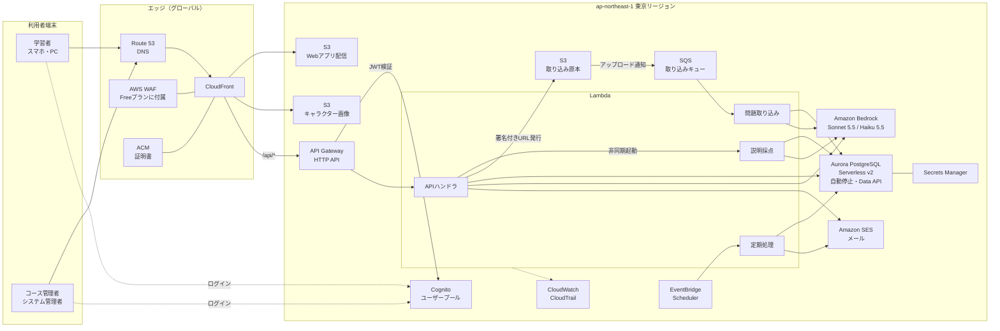

※ CloudFront は定額の Free プランを使う。AWS WAF はプランに含まれ、Phase 1 から有効になる（ルールは5個まで。Phase 3 で見直す）。

### 2.3 AWSサービス一覧

| サービス                            | 役割                              | 主な設定                                                                                                                    |
| ------------------------------- | ------------------------------- | ----------------------------------------------------------------------------------------------------------------------- |
| Route 53                        | 独自ドメインのDNS                      | CloudFrontへのエイリアスレコード（ドメイン未定。決まるまではCloudFrontの既定ドメインで運用可）                                                               |
| ACM                             | TLS証明書                          | CloudFront用は us-east-1 で発行                                                                                              |
| CloudFront                      | 配信の入口。画面・画像・APIを1つのドメインにまとめる    | `/api/*` をAPI Gatewayへ、それ以外をS3へ                                                                                         |
| AWS WAF                         | 不正アクセスの遮断                       | CloudFront の Free プランに含まれる（追加料金なし、外せない）。Phase 1 はプランの既定ルールで運用し、Phase 3 でAWSマネージドルール（共通・既知の不正入力・IP評価）とレート制限に見直す。ルールは5個まで |
| S3（Webアプリ配信）                    | HTML／CSS／JSの配置                  | 非公開。CloudFrontのOACからのみ読み取り                                                                                              |
| S3（キャラクター画像）                    | AIパートナーの紋章画像（管理画面からアップロード・差し替え） | 非公開。CloudFront経由で配信                                                                                                     |
| S3（取り込み原本）                      | 問題取り込みのPDF・画像                   | 非公開。署名付きURLでアップロード。90日で自動削除                                                                                             |
| Cognito ユーザープール                 | ログイン・パスワード管理・ロール                | マネージドログイン、グループ `learner`・`course_admin`・`system_admin`                                                                  |
| API Gateway（HTTP API）           | APIの受付                          | Cognitoで発行したJWTで認証                                                                                                      |
| Lambda（Node.js 22）              | 業務処理                            | 4つの関数（2.4参照）                                                                                                            |
| SQS                             | 問題取り込みの順番待ち                     | 失敗時はデッドレターキューへ                                                                                                          |
| Aurora PostgreSQL Serverless v2 | 業務データ                           | 0〜4 ACU（prod）、自動停止を有効化（無操作5分で停止）、Data APIを有効化                                                                           |
| Secrets Manager                 | DBの認証情報                         | Data APIから参照                                                                                                            |
| Amazon Bedrock                  | 抽出・採点・コメント生成                    | Claude Sonnet 5.5、Claude Haiku 5.5。モデルは既定で使える状態。Anthropic のモデルは初回だけ利用目的を申請する。モデル呼び出しログは記録しない                               |
| EventBridge Scheduler           | 定期処理の起動                         | タイムゾーン Asia/Tokyo                                                                                                       |
| Amazon SES                      | 通知メール・招待メール                     | 送信ドメインの認証（DKIM）                                                                                                         |
| CloudWatch／CloudTrail           | ログ・監視・操作記録                      | エラー率と採点時間のアラーム                                                                                                          |
| IAM（OIDC IDプロバイダー）            | GitHub Actions からの配置の認証            | GitHub が発行するトークンで環境ごとの配置用ロール `rpg-{env}-deploy-role` を引き受ける。長期のアクセスキーは作らない                                                    |

### 2.4 Lambda関数の分担

| 関数               | 起動のきっかけ                | 処理                                                     | タイムアウト |
| ---------------- | ---------------------- | ------------------------------------------------------ | ------ |
| `api-handler`    | API Gateway            | 画面からのAPI全般。四肢択一の正誤判定、軽量モデルでのひとこと生成                     | 29秒    |
| `grading-worker` | `api-handler` からの非同期起動 | キーワード説明の採点（高精度モデル）                                     | 60秒    |
| `import-worker`  | SQS                    | PDF・画像・テキストから問題とキーワードを抽出（高精度モデル）                       | 15分    |
| `batch-runner`   | EventBridge Scheduler  | 日次処理（クエスト更新・ランキング締め・物理削除・通知リスト作成）と30分ごとのメール送信（DBを使わない） | 15分    |

### 2.5 説明採点の非同期方式

API Gatewayは約30秒で応答を打ち切るため、採点は受付と処理を分ける。画面は2秒ごとに結果を確認し、その間AIパートナーの待機演出を表示する。

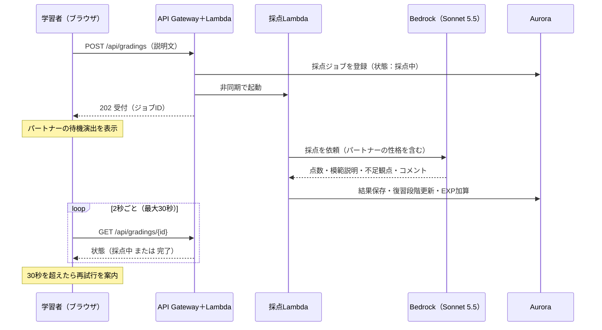

### 2.6 フロントエンド方式

| 項目     | 方式                                                                                               |
| ------ | ------------------------------------------------------------------------------------------------ |
| 実装     | Vanilla JS（ES Modules）。ビルドツールなしで動く構成                                                             |
| 画面切り替え | URLのハッシュ（`#/home` など）で切り替えるSPA                                                                   |
| 部品     | アプリ用デザインシステムの `bundle.css` のクラス（`gd-btn`・`gd-card` など）をそのまま使う。React版の部品は使わず、同じHTML構造をJSの関数で組み立てる |
| ログイン   | Cognitoのマネージドログイン画面へ移動し、認可コード＋PKCEでトークンを取得                                                       |
| トークン保管 | メモリとsessionStorage。画面を閉じたら破棄                                                                     |
| PWA    | `manifest.webmanifest` と Service Worker を配置。ホーム画面に追加できる。Phase 2のプッシュ通知の土台                        |
| 対応ブラウザ | スマホ・PCの主要ブラウザの最新版                                                                                |

### 2.7 環境構成

| 環境   | 用途               | 利用者        | DB容量                      |
| ---- | ---------------- | ---------- | ------------------------- |
| dev  | 開発・動作確認          | 開発者        | 0〜1 ACU（自動停止）             |
| stg  | 受け入れ確認・パイロット前の検証 | 開発者・コース管理者 | 0〜2 ACU（自動停止）             |
| prod | 本番（パイロット→全社）     | 全利用者       | 0〜4 ACU（自動停止。Phase 3で見直し） |

1つのAWSアカウントの中で、リソース名の接頭辞とタグで環境を分ける。

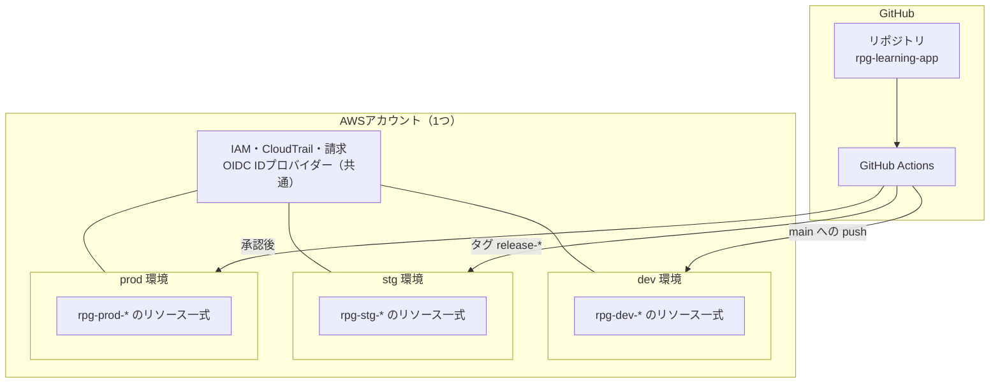

- 命名規則：`rpg-{env}-{用途}`（例：`rpg-prod-api-handler`）
- タグ：`Project=rpg-learning`、`Environment=dev|stg|prod`。請求はタグで環境ごとに集計する
- IAMの権限は環境ごとに、リソース名の接頭辞で範囲を絞る
- AWSのリソースは構築手順書に沿ってマネジメントコンソールで dev → stg → prod の順に作る。アプリ（Lambda のコード・画面・DBのテーブル）は GitHub Actions が配置する
- 配置のきっかけ：dev は `main` への push、stg はタグ `release-YYYYMMDD-NN` の push、prod は stg での確認のあと承認者が GitHub で承認したとき（詳細設計書 第11章）

### 2.8 AIモデルの使い分け

| 用途                     | モデル               | 呼び出し元            |
| ---------------------- | ----------------- | ---------------- |
| 問題・キーワードの抽出            | Claude Sonnet 5.5 | `import-worker`  |
| キーワード説明の採点             | Claude Sonnet 5.5 | `grading-worker` |
| 四肢択一の解説コメント・パートナーのひとこと | Claude Haiku 5.5  | `api-handler`    |
| 四肢択一の正誤判定              | AI不使用             | `api-handler`    |

- Bedrockに送ったデータはモデルの学習に使われない（Bedrockの標準の扱い）。構築時に利用規約を確認し、記録を残す
- 具体的なモデルIDは構築時にBedrockコンソールで確認する。Sonnet 5.5が東京リージョンで使えない場合は、東京リージョンで使える別バージョンのSonnetを使う。Haiku 5.5も同じく、使えない場合は東京リージョンで使える別バージョンのHaikuを使う（データを東京リージョンの外に出さない）
- Haiku 5.5 は既定で思考（adaptive thinking）が動き、effort の既定は medium。5秒で打ち切る呼び出しのため effort は low を基本にし、dev で応答時間を確かめる。思考トークンを固定で指定する設定（budget_tokens）はエラーになるため使わない

### 2.9 月額コスト試算（パイロット10名）

パイロット期間はコストを最小にする構成とする（Aurora は全環境で自動停止。CloudFront は定額の Free プランで、配信と AWS WAF の料金はかからない）。

| 環境      | 月額（目安）            |
| ------- | ----------------- |
| prod    | 約5,200円（$35）      |
| dev＋stg | 約3,300円（$22）      |
| **合計**  | **約8,500円（$57）**  |

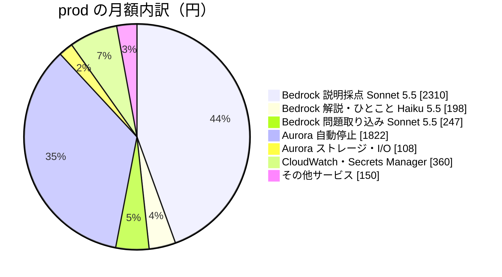

| 項目                                                     | 月額      | 前提                                                             |
| ------------------------------------------------------ | ------- | -------------------------------------------------------------- |
| Bedrock 説明採点（Sonnet 5.5）                               | 約2,300円 | 1人1日5回 × 22日。1回あたり入力3,000・出力800トークン                            |
| Bedrock 解説・ひとこと（Haiku 5.5）                             | 約200円   | 1人1日20回 × 22日。1回あたり入力1,500・出力300トークン                           |
| Bedrock 問題取り込み（Sonnet 5.5）                             | 約200円   | 月150ページ、300問                                                   |
| Aurora（自動停止）                                           | 約1,800円 | 0.5 ACUで月約160時間動作                                              |
| Aurora ストレージ・I/O                                       | 約100円   | 2GB                                                            |
| CloudWatch・Secrets Manager                             | 約400円   |                                                                |
| その他（S3・API Gateway・Lambda・SQS・SES・Cognito・EventBridge） | 約150円   | 10名ならほぼ無料枠に収まる                                                 |
| CloudFront・AWS WAF                                     | 0円      | 定額の Free プラン。月100万リクエスト・100GBまで追加料金なし（超えても課金されず、速度が落とされることがある） |

**試算の前提**

- 為替は1ドル＝150円
- Aurora は東京リージョンで 0.15ドル／ACU時間
- Sonnet 5.5 は入力2ドル・出力10ドル／100万トークン（以前の Sonnet 4.6 の入力3ドル・出力15ドルより3分の1安い）
- Claude の単価は Anthropic の公表単価で試算した。Bedrock の単価は AWS が別に決めるため、構築時に Bedrock の料金ページで確かめる。東京リージョン内での推論は、海外リージョンをまたぐ推論より1割ほど高い場合がある
- Haiku 5.5 は入力0.1ドル・出力0.5ドル／100万トークン（1回のプロンプトが10万トークン以下の場合。超えると入力0.5ドル・出力2.5ドル）。以前の Haiku 4.5（入力1ドル・出力5ドル）の約10分の1
- 利用回数は仮置き。説明問題を多く解くほど Bedrock の費用は増える
- CloudFront の Free プランはアカウントあたり3つまで。dev・stg・prod で3つを使う。アクセスログ、独自のキャッシュポリシー・レスポンスヘッダーポリシーは使えない（必要になれば Pro プラン、月15ドル）

**自動停止による制約**

- 止まっているDBを起こすのに約15秒かかる。24時間以上止まっていた場合は30秒以上かかることがある
- そのため、その日最初の操作では画面の表示が遅れる。読み込み中の表示を出し、APIはDBの起動中を示すエラーを受けたら再試行する（詳細は第3章以降で定める）
- 体験に問題があれば、prod だけ平日の日中は最小0.5 ACUにする（月額は約16,000円前後に増える）

---

## 3. 画面設計

### 3.1 画面一覧

要件定義書の画面一覧（S-01〜S-13）に、キャラクター画像の差し替え用として **S-14 AIパートナー設定** を追加する。

| ID   | 画面              | 利用者     | URL                 | 区分  |
| ---- | --------------- | ------- | ------------------- | --- |
| S-01 | ログイン            | 全員      | Cognito マネージドログイン   | 共通  |
| S-02 | ホーム             | 学習者     | `#/home`            | 学習者 |
| S-03 | コース選択           | 学習者     | `#/courses`         | 学習者 |
| S-04 | 演習（四肢択一）        | 学習者     | `#/quest/choice`    | 学習者 |
| S-05 | キーワード説明         | 学習者     | `#/quest/explain`   | 学習者 |
| S-06 | 結果・フィードバック      | 学習者     | `#/quest/result`    | 学習者 |
| S-07 | 週間ランキング         | 学習者     | `#/ranking`         | 学習者 |
| S-08 | プロフィール（レベル・バッジ） | 学習者     | `#/profile`         | 学習者 |
| S-09 | AIパートナー選択       | 学習者     | `#/partner`         | 学習者 |
| S-10 | 通知設定            | 学習者     | `#/settings/notify` | 学習者 |
| S-11 | 問題取り込み・レビュー     | コース管理者  | `#/admin/import`    | 管理局 |
| S-12 | 学習状況ダッシュボード     | コース管理者  | `#/admin/dashboard` | 管理局 |
| S-13 | 利用者・コース・権限管理    | システム管理者 | `#/admin/users`     | 管理局 |
| S-14 | AIパートナー設定（追加）   | システム管理者 | `#/admin/partners`  | 管理局 |

### 3.2 画面構成図

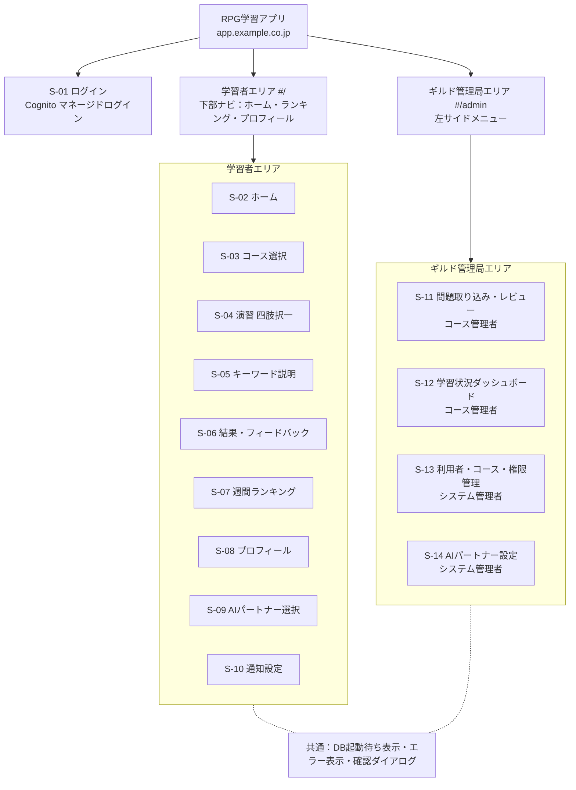

### 3.3 画面遷移

#### 3.3.1 学習者

初回ログイン時は「はじめての冒険」として、ニックネーム登録 → コース選択 → AIパートナー選択の3段階を済ませてからホームに進む。

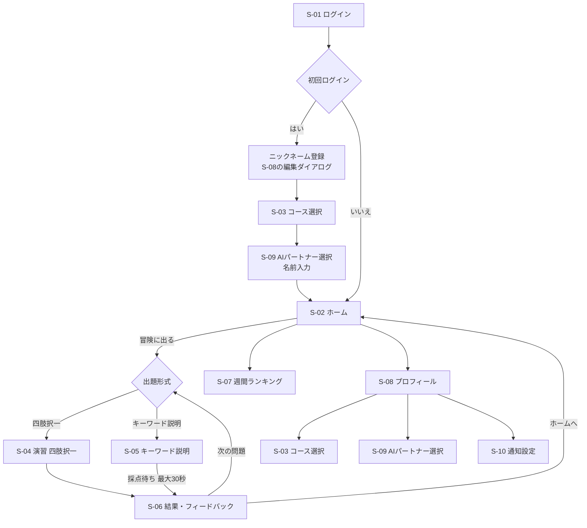

#### 3.3.2 管理者

ログイン後はロールで初期画面を決める。管理者も学習者として学習できるため、ヘッダーで両エリアを切り替えられる。

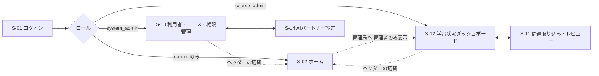

### 3.4 画面レイアウトの基本

| 項目      | 学習者画面                                           | 管理画面（ギルド管理局型）                                      |
| ------- | ----------------------------------------------- | -------------------------------------------------- |
| 想定端末    | スマホ縦（最大幅420px）。PCでも中央に420px幅で表示                 | PC横（1280px基準）。タブレット横まで対応                           |
| 背景      | `parchment`                                     | `parchment`                                        |
| ヘッダー    | `parchment-raised` の地に `ink` の文字。アプリ名とコース名      | **`ink`（濃い茶）の地に `parchment` の文字**。「ギルド管理局」ラベルとロール名 |
| ナビゲーション | 下部固定ナビ（ホーム・ランキング・プロフィール）                        | 左サイドメニュー（幅240px、`parchment-sunk`）                  |
| 本文      | `gd-card` を縦に積む                                 | 表・フォーム中心。罫線は `line`                                |
| ゲーム部品   | EXPバー・クエスト・パートナーなどを使う                           | **使わない**（S-14の見本表示を除く）                             |
| 主要ボタン   | `gd-btn-primary`（crimson）を1画面1つ、`block` で横幅いっぱい | `gd-btn-primary` を1画面1つ、右寄せ                        |

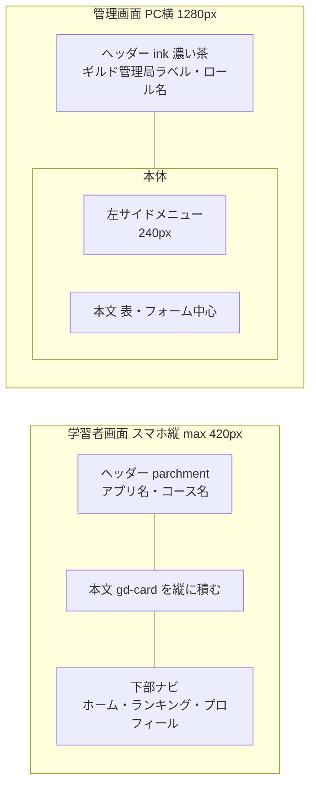

### 3.5 共通の表示ルール

| 場面                 | 表示                                                                         |
| ------------------ | -------------------------------------------------------------------------- |
| DBの起動待ち（自動停止からの復帰） | 「ギルドの扉を開けています…」と `gd-dots` の待機演出。APIは最大3回まで再試行（2秒・4秒・8秒の間隔）。それでも失敗したらエラー表示 |
| 読み込み中（通常）          | 該当カードの中に `gd-dots` を表示                                                     |
| エラー                | 画面上部に `wrong-soft` の帯。文言は「〜できませんでした。もう一度お試しください」の形で、責める表現を使わない             |
| 確認ダイアログ            | 削除・公開など取り消しにくい操作の前に表示。ボタンは「〜する」と「やめる」                                      |
| フォーカス              | `teal` の3pxリング（デザインシステムの既定）                                                |
| 正誤の表示              | 色だけでなく ○×と文字を必ず付ける                                                         |

### 3.6 AIパートナー設計

#### 3.6.1 キャラクター定義

| 項目          | 励まし型 `encourage`       | 論理型 `logic`                   | ライバル型 `rival`             |
| ----------- | ---------------------- | ----------------------------- | ------------------------- |
| 初期名         | ミナ                     | セージ                           | レン                        |
| 性格          | 明るく寄り添う。小さな前進を見つけて褒める  | 冷静で分析的。根拠と効率を重視する             | 負けず嫌いで競争心をあおる。ただし相手を責めない  |
| 口調          | くだけた話し方「〜だね」「〜しよう」     | です・ます調「〜です」「〜が効率的です」          | 少し強気「〜だな」「次は負けないぞ」        |
| 採点コメントの組み立て | 良い点 → 足りない観点を1つ → 応援   | 点数の根拠 → 足りない観点 → 次にやること       | 点数への反応 → 足りない観点 → 挑戦の呼びかけ |
| ホームのひとこと例   | 「昨日より3問多く解けてるよ。今日もいこう」 | 「今日の復習は5問です。説明問題から始めるのが効率的です」 | 「今週はまだ俺の方が上だな。追いつけるか？」    |
| 紋章の枠の色      | `gold-ink`             | `teal`                        | `crimson`                 |

**AIへの共通指示（全キャラクター）**

- 発言は2〜3文まで
- 説教・減点の言い方・人格を否定する表現はしない
- 不合格のときも、次にやることを1つ示して終える

#### 3.6.2 名前の入力ルール

| 項目     | ルール                                                   |
| ------ | ----------------------------------------------------- |
| 入力する画面 | S-09（初回は必須の流れの中で表示）                                   |
| 文字数    | 1〜10文字                                                |
| 使える文字  | ひらがな・カタカナ・漢字・英数字。記号と絵文字は不可                            |
| 未入力のとき | 初期名（ミナ・セージ・レン）を使う                                     |
| 変更     | いつでも変更できる。キャラクターを変えると名前は新しいキャラクターの初期名に戻る（以前の名前は保持しない） |
| 表示範囲   | 本人の画面だけ。ランキングなど他の人には出さない                              |

#### 3.6.3 紋章（キャラクター画像）

| 項目      | ルール                                               |
| ------- | ------------------------------------------------- |
| 画像      | 1キャラクターにつき1枚（表情1種）。将来は「通常・喜び・考え中」などの表情を追加できる作りにする |
| 形式      | PNG または WebP、正方形、512×512px 以上、透過背景を推奨、2MBまで       |
| 表示      | `gd-sigil` の円の中に画像を表示し、枠の色で性格を示す                  |
| 画像がないとき | 名前の頭文字を明朝で表示する（デザインシステムの既定の表示）                    |
| 差し替え    | S-14 でシステム管理者が行う。差し替えると全学習者の表示が変わる                |

### 3.7 学習者画面

#### S-02 ホーム

| 順 | 領域       | 表示内容                       | 部品                                 |
| - | -------- | -------------------------- | ---------------------------------- |
| 1 | レベル      | レベル紋章、EXP（現在／次のレベルまで）      | `ExpBar`                           |
| 2 | ひとこと     | パートナーの紋章・名前・ひとこと（ログイン時に生成） | `PartnerBubble`                    |
| 3 | デイリークエスト | 今日のクエスト3件と進み具合             | `QuestCard` × 3                    |
| 4 | 今日の復習    | 復習対象数（択一・説明の内訳）と「冒険に出る」ボタン | `gd-card` ＋ `Button primary block` |

#### S-03 コース選択

| 領域    | 表示内容                          | 部品        |
| ----- | ----------------------------- | --------- |
| コース一覧 | コース名、資格名、問題数、自分の網羅率           | `gd-card` |
| 操作    | 「このコースで冒険する」。受講中のコースには「受講中」の印 | `Button`  |

#### S-04 演習（四肢択一）

| 領域   | 表示内容                 | 部品                     |
| ---- | -------------------- | ---------------------- |
| 進み具合 | 「3 / 10問」、復習なら「復習」の印 | `meta` 書体              |
| 問題文  | 問題文                  | `question` 書体          |
| 選択肢  | ア〜エの4つ               | `ChoiceOption` × 4     |
| 操作   | 「答える」（選ぶまで押せない）      | `Button primary block` |

#### S-05 キーワード説明

| 領域   | 表示内容                                      | 部品                       |
| ---- | ----------------------------------------- | ------------------------ |
| お題   | キーワードと、出典の問題文（折りたたみ）                      | `title` 書体               |
| 入力欄  | 説明文（50〜400文字）と文字数。200文字を超える場合は小見出しが必要（下記） | テキストエリア                  |
| 操作   | 「採点してもらう」                                 | `Button primary block`   |
| 採点待ち | 「〇〇が採点しています」と待機演出（最大30秒）                  | `PartnerBubble thinking` |

**説明文の入力ルール**

| 項目     | ルール                                                                        |
| ------ | -------------------------------------------------------------------------- |
| 文字数    | 50〜400文字（改行・空白を除いて数える）                                                     |
| 小見出し   | 200文字を超える場合は、小見出しを1つ以上使う。小見出しは行の先頭に `【】` で書く（例：`【定義】【しくみ】【具体例】`）           |
| 補助     | 「見出しを入れる」ボタンで `【定義】【しくみ】【具体例】` のひな形を入力欄に挿入できる                              |
| 入力中の表示 | 文字数カウンターを常に表示。200文字を超えて小見出しがないと、カウンターの下に「200文字を超えたので、【】で小見出しを付けてください」と表示する |
| 送信の可否  | 50文字未満、400文字超、または200文字超で小見出しなしのときは「採点してもらう」を押せない                           |
| 採点への反映 | 小見出しの有無は点数に含めない（構成を整えて読みやすくするためのルール）。小見出しは採点AIにそのまま渡す                      |

#### S-06 結果・フィードバック

| 領域    | 表示内容                    | 部品                                  |
| ----- | ----------------------- | ----------------------------------- |
| 結果    | 択一：○×と正解。説明：点数と合格ライン    | `ChoiceOption` の判定状態 / `ScoreMeter` |
| 獲得EXP | 「+15 EXP」（復習ボーナスは内訳を表示） | `ExpBar gain`                       |
| 復習段階  | 択一・説明それぞれの段階            | `ReviewStage` × 2                   |
| コメント  | 解説（択一）または模範説明と不足観点（説明）  | `PartnerBubble`                     |
| 達成    | クエスト達成・バッジ獲得があれば表示      | `QuestCard` / `GuildBadge`          |
| 操作    | 「次の問題へ」（primary）、「ホームへ」 | `Button`                            |

#### S-07 週間ランキング

| 領域  | 表示内容                                     | 部品           |
| --- | ---------------------------------------- | ------------ |
| 見出し | コース名、集計期間（月〜日）、リセットまでの日数                 | `title` 書体   |
| 順位表 | 上位10名と自分の行（11位以下でも表示）。名前は**ニックネーム**で表示する | `RankingRow` |
| 履歴  | 過去週を選ぶ切り替え                               | `Button sm`  |

#### S-08 プロフィール

| 領域   | 表示内容                       | 部品             |
| ---- | -------------------------- | -------------- |
| レベル  | ニックネーム（編集ボタンつき）、レベル、累計EXP  | `ExpBar`       |
| 学習記録 | 網羅率、正答率、連続学習日数             | `gd-card`      |
| バッジ  | 獲得済み（獲得日つき）と未獲得（条件を表示）     | `GuildBadge`   |
| メニュー | コース選択、AIパートナー選択、通知設定、ログアウト | `Button quiet` |

**ニックネームのルール**

| 項目        | ルール                                 |
| --------- | ----------------------------------- |
| 用途        | ランキングに表示する名前。氏名は学習者どうしには表示しない       |
| 文字数       | 2〜12文字                              |
| 使える文字     | ひらがな・カタカナ・漢字・英数字・`_-`。絵文字は不可        |
| 重複        | 同じコース内で重複しない（コースをまたいだ重複は可）          |
| 登録        | 初回ログイン時に必須。あとから S-08 の編集ダイアログで変更できる |
| 管理者からの見え方 | S-12・S-13 では氏名とニックネームを並べて表示する       |

#### S-09 AIパートナー選択

| 領域     | 表示内容                          | 部品                     |
| ------ | ----------------------------- | ---------------------- |
| キャラクター | 3人の紋章・性格・発言例。選んだものは `teal` の枠 | `PartnerBubble` ＋ 選択枠  |
| 名前     | 名前入力欄（初期名を薄く表示）               | テキスト入力                 |
| 操作     | 「この仲間と冒険する」                   | `Button primary block` |

#### S-10 通知設定

| 項目     | 内容                                          | Phase                |
| ------ | ------------------------------------------- | -------------------- |
| メール通知  | オン／オフ、送信時刻（学習者が選ぶ。6:00〜22:00の30分刻み、初期値7:30） | 1                    |
| プッシュ通知 | オン／オフ（ブラウザの許可を求める）                          | 2（Phase 1では「準備中」と表示） |
| 通知内容   | その日の復習対象数、デイリークエスト                          | 1                    |

### 3.8 管理画面（ギルド管理局）

#### S-11 問題取り込み・レビュー

| 領域     | 表示内容                                       |
| ------ | ------------------------------------------ |
| 取り込み   | コースを選び、PDF・画像（各20MBまで）をアップロード、またはテキストを貼り付け |
| 取り込み状況 | 取り込みごとの状態（待機中・抽出中・完了・失敗）と抽出件数              |
| 下書き一覧  | 問題文の先頭、形式、キーワード数、状態（下書き・公開済み）              |
| 編集     | 問題文・選択肢4つ・正解・解説・キーワード（最大3つ）を修正             |
| 操作     | 「公開する」（primary）、「保存する」、「削除する」（確認ダイアログあり）   |

#### S-12 学習状況ダッシュボード

| 領域      | 表示内容                                                    |
| ------- | ------------------------------------------------------- |
| コース切り替え | 担当コースのみ選べる                                              |
| 集計      | 受講者数、アクティブ率（直近7日間に2回以上ログイン）、平均網羅率、平均正答率                 |
| 受講者一覧   | 氏名、ニックネーム、目指している資格、網羅率、正答率、最終ログイン日時、直近7日のログイン回数。並べ替えできる |
| 操作      | 「CSVで出力する」（Phase 1 に含める。形式は 5.4 参照）                     |

#### S-13 利用者・コース・権限管理

| タブ  | 表示内容と操作                                                     |
| --- | ----------------------------------------------------------- |
| 利用者 | 氏名、ニックネーム、メール、ロール、状態（有効・論理削除・削除予定日）。登録（招待メール送信）・ロール変更・削除・復活 |
| コース | コース名、資格名、担当のコース管理者。登録・編集・担当者の割り当て                           |

- 削除は確認ダイアログで「30日後に学習履歴を含めて完全に削除されます」と示す
- 論理削除中の行には削除予定日と「復活する」ボタンを表示する

#### S-14 AIパートナー設定（追加）

| 領域       | 表示内容と操作                                                |
| -------- | ------------------------------------------------------ |
| キャラクター一覧 | 3人の性格名、初期名、現在の画像（なければ頭文字の表示）                           |
| 画像の差し替え  | 画像を選ぶ → プレビュー → 「差し替える」。「画像を外す」で頭文字の表示に戻す              |
| 見本表示     | 学習者画面でどう見えるかを `PartnerBubble` で表示する（管理画面で唯一ゲーム部品を使う場所） |

---

## 4. 機能設計

### 4.1 機能と画面・APIの対応

| ID   | 機能          | 画面             | 主なAPI                                                                    | Phase 1     |
| ---- | ----------- | -------------- | ------------------------------------------------------------------------ | ----------- |
| F-01 | 問題取り込み      | S-11           | `POST /api/admin/imports`                                                | ○           |
| F-02 | 問題レビュー・公開   | S-11           | `PUT /api/admin/questions/{id}`、`POST /api/admin/questions/{id}/publish` | ○           |
| F-03 | 四肢択一演習      | S-04、S-06      | `GET /api/quests/next`、`POST /api/answers/choice`                        | ○           |
| F-04 | キーワード説明     | S-05、S-06      | `POST /api/gradings`、`GET /api/gradings/{id}`                            | ○           |
| F-05 | 忘却曲線復習      | S-02、S-04、S-05 | `GET /api/home`、`GET /api/quests/next`                                   | ○           |
| F-06 | 学習状況ダッシュボード | S-12           | `GET /api/admin/dashboard`、`GET /api/admin/dashboard.csv`                | ○（基本項目＋CSV） |
| F-07 | 全体管理        | S-13           | `/api/admin/users`、`/api/admin/courses`                                  | ○           |
| F-08 | 経験値・レベル     | S-02、S-06、S-08 | 解答APIの結果に含める                                                             | ○           |
| F-09 | 週間ランキング     | S-07           | `GET /api/rankings`                                                      | ○           |
| F-10 | デイリークエスト    | S-02、S-06      | `GET /api/home`                                                          | ○           |
| F-11 | バッジ         | S-06、S-08      | `GET /api/me/badges`                                                     | 習得・継続のみ     |
| F-12 | AIパートナー選択   | S-09、S-14      | `PUT /api/me/partner`、`/api/admin/partners`                              | ○           |
| F-13 | 通知          | S-10           | `PUT /api/me/notify`                                                     | メールのみ       |

### 4.2 解答から結果表示までの処理

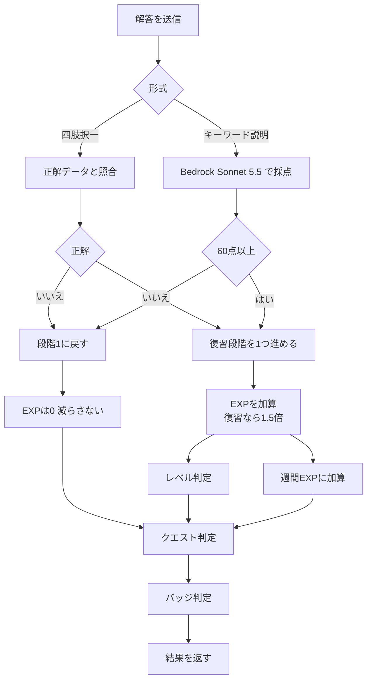

### 4.3 出題ルール（F-03、F-05）

| 順 | 出題対象           | 条件                          |
| - | -------------- | --------------------------- |
| 1 | 今日の復習（期限切れを含む） | 復習予定日が今日以前。予定日の古い順          |
| 2 | 未学習の問題         | 公開済みで、まだ解いていない問題。登録順        |
| 3 | 学習済みの問題        | 1と2がないとき。正答率の低い順（復習段階は変えない） |

- 1回の冒険は10問。途中でやめてもそれまでの結果は保存する
- 四肢択一とキーワード説明は、出題対象の中で交互に出す。キーワードがない問題は択一のみ
- キーワード説明は1問につき1キーワードを出す（復習予定日の早いもの）

### 4.4 忘却曲線復習（F-05）

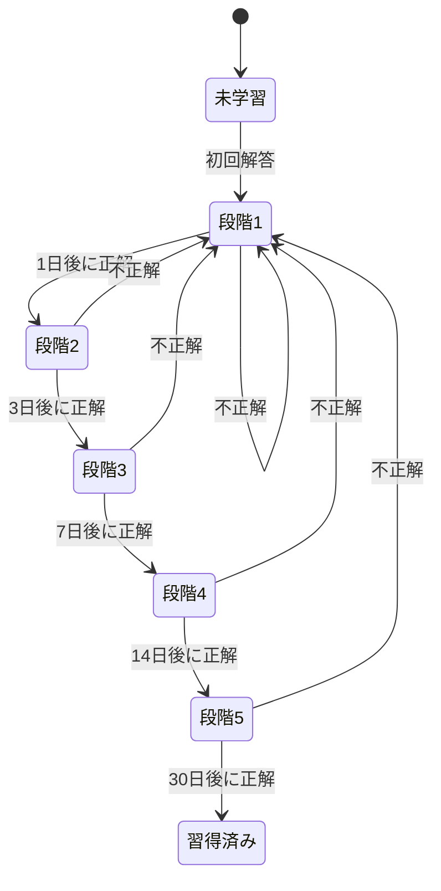

| 項目        | ルール                                         |
| --------- | ------------------------------------------- |
| 管理の単位     | 択一は「学習者×問題」、説明は「学習者×キーワード」で別々に管理            |
| 次回予定日     | 解答日＋段階の日数（1・3・7・14・30日）。日付は Asia/Tokyo で数える |
| 初回解答      | 正誤にかかわらず段階1とし、次回予定日は翌日                      |
| 予定日より前の解答 | 復習扱いにしない（段階は変わらず、復習ボーナスもつかない）               |
| 予定日を過ぎた解答 | 復習扱いとする（遅れても段階は下げない）                        |
| 習得済み      | 復習対象から外す。学習済みの問題として出題される場合はある               |

### 4.5 経験値・レベル（F-08）

| 行動                | 獲得EXP       | 復習のとき |
| ----------------- | ----------- | ----- |
| 四肢択一 正解           | 10          | 15    |
| キーワード説明 合格（60点以上） | 30          | 45    |
| デイリークエスト達成        | クエストごと（4.7） | 対象外   |
| 不正解・不合格           | 0（減らさない）    | 0     |

**レベル計算式**

- 次のレベルまでの必要EXP ＝ 100 × Lv^1.2（端数は切り上げ）
- 累計EXPは減らないため、レベルは下がらない
- 上限は設けない

| レベル | 次のレベルまでの必要EXP | そのレベルに到達する累計EXP |
| --- | ------------- | --------------- |
| 1   | 100           | 0               |
| 2   | 230           | 100             |
| 3   | 374           | 330             |
| 4   | 528           | 704             |
| 5   | 690           | 1,232           |
| 10  | 1,585         | 6,425           |
| 15  | 2,579         | 16,306          |
| 20  | 3,642         | 31,300          |
| 30  | 5,924         | 77,833          |

> 目安：1日に択一10問正解・説明1問合格・クエスト達成（約210 EXP）を続けると、1週間でLv5、1か月でLv9、3か月でLv16。

### 4.6 週間ランキング（F-09）

| 項目        | ルール                                   |
| --------- | ------------------------------------- |
| 単位        | コースごと                                 |
| 集計期間      | 月曜0:00〜日曜23:59（Asia/Tokyo）            |
| 順位        | その週に獲得したEXPの多い順。同点は同順位、表示はニックネームの五十音順 |
| 対象        | 受講中で、その週に1EXP以上獲得した学習者                |
| 表示名       | ニックネーム                                |
| 表示        | 上位10名＋自分の行                            |
| 締め        | 月曜0:00の定期処理で前週の順位を確定し、履歴として保存         |
| 論理削除中の利用者 | ランキングに表示しない                           |

### 4.7 デイリークエスト（F-10）

毎日0:00に、次の候補から3つを学習者ごとに割り当てる（同じ種類は重ならない）。

| ID   | クエスト           | 達成条件                             | 報酬     |
| ---- | -------------- | -------------------------------- | ------ |
| Q-01 | 択一を5問解く        | 四肢択一を5問解答（正誤は問わない）               | 20 EXP |
| Q-02 | 択一で3問正解する      | 四肢択一で3問正解                        | 20 EXP |
| Q-03 | キーワード説明を1問合格する | 説明で60点以上を1回                      | 30 EXP |
| Q-04 | 今日の復習をすべて終える   | 0:00時点の復習対象をすべて解答。対象が0件の日は割り当てない | 30 EXP |
| Q-05 | 新しい問題に3問挑戦する   | 未学習の問題を3問解答                      | 20 EXP |

- 復習対象がある日は Q-04 を必ず含める
- 達成したらその場でEXPを付与し、S-06 に「達成」スタンプを出す
- 未達成でもペナルティはない。翌日0:00に入れ替える

### 4.8 バッジ（F-11）

| カテゴリ          | バッジ    | 条件                    | 段階    | Phase |
| ------------- | ------ | --------------------- | ----- | ----- |
| 習得 `mastery`  | 習得の証   | 習得済みの問題が10／50／100問    | 銅／銀／金 | 1     |
| 継続 `streak`   | 継続の証   | 7日／30日／100日連続で1問以上解答  | 銅／銀／金 | 1     |
| 網羅 `coverage` | 網羅の証   | コース網羅率50%／80%／100%    | 銅／銀／金 | 2     |
| 説明 `explain`  | 説明の達人  | 説明で100点を1回／5回／20回     | 銅／銀／金 | 2     |
| 復習 `review`   | 忘却への勝利 | 30日後の復習に初めて正解／10回／50回 | 銅／銀／金 | 2     |

- 判定は解答のたび（習得）と毎日0:00（継続）に行う
- 一度獲得したバッジは取り消さない

### 4.9 キーワード説明の採点（F-04）

| 項目    | 内容                                                         |
| ----- | ---------------------------------------------------------- |
| 入力    | キーワード、出典の問題文と解説、学習者の説明文、パートナーの性格・名前                        |
| 出力    | 点数（0〜100）、合否、模範説明（200文字程度）、不足していた観点（最大3つ）、パートナーのコメント（2〜3文） |
| 合格ライン | 60点                                                        |
| 採点の観点 | 正確さ（50点）、重要な観点の網羅（30点）、自分の言葉での具体性（20点）                     |
| 時間の上限 | 30秒。超えたら「採点に時間がかかっています。もう一度お試しください」と表示し、EXPと復習段階は変えない      |
| 失敗時   | 同じ説明文で「もう一度採点してもらう」を押せる（入力をやり直さなくてよい）                      |

### 4.10 問題取り込み（F-01、F-02）

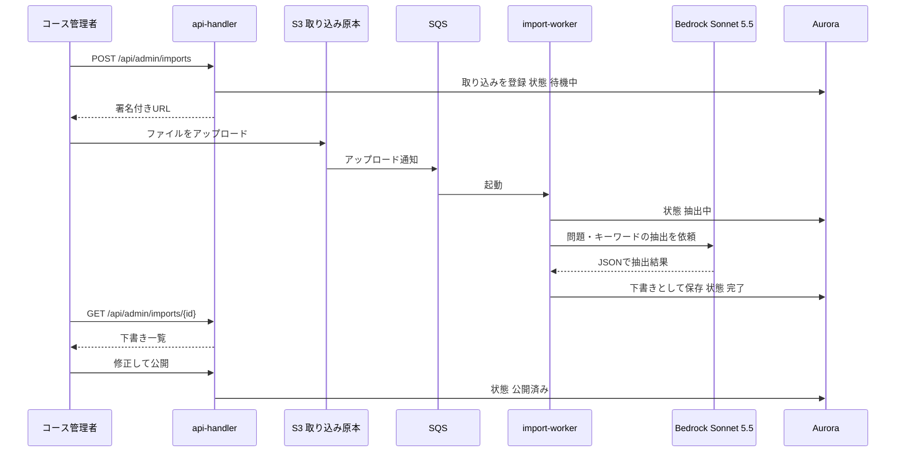

| 項目          | ルール                                                |
| ----------- | -------------------------------------------------- |
| 入力          | PDF（50ページ・20MBまで）、画像（PNG・JPEG、20MBまで）、テキスト（2万文字まで） |
| 抽出項目        | 問題文、選択肢4つ、正解、解説、キーワード（最大3つ）                        |
| 選択肢が4つでない問題 | 下書きに「要確認」の印を付ける。公開前に4つにそろえる                        |
| 公開の条件       | 問題文・選択肢4つ・正解・解説がそろっていること                           |
| 公開後の修正      | できる。学習者の解答履歴と復習段階はそのまま残す                           |
| 失敗時         | SQSで最大3回やり直し、それでも失敗したら状態を「失敗」にして理由を表示              |

### 4.11 アカウント管理（F-07）

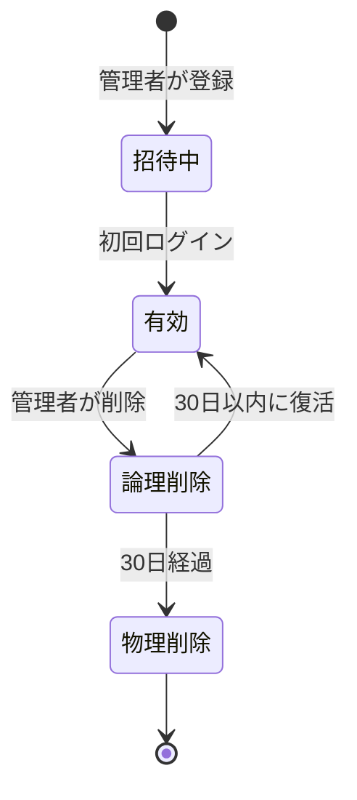

| 操作   | アプリの処理               | Cognitoの処理                |
| ---- | -------------------- | ------------------------- |
| 登録   | 利用者を「招待中」で登録         | ユーザーを作成し、招待メール（仮パスワード）を送る |
| 削除   | 状態を「論理削除」、削除予定日＝30日後 | ユーザーを無効化（ログインできなくする）      |
| 復活   | 状態を「有効」に戻す。学習履歴はそのまま | ユーザーを有効化                  |
| 物理削除 | 学習履歴を含めて削除           | ユーザーを削除                   |

---

## 5. 外部インターフェース設計

### 5.1 API共通仕様

| 項目     | 仕様                                                            |
| ------ | ------------------------------------------------------------- |
| ベースURL | `https://app.example.co.jp/api`（CloudFront経由）                 |
| 形式     | JSON（UTF-8）。CSV出力のみ `text/csv`                                |
| 認証     | `Authorization: Bearer <IDトークン>`。API Gateway の JWT オーソライザーで検証 |
| 権限     | トークンの `cognito:groups` で判定。コース管理者は担当コースのデータだけ扱える              |
| 日時     | ISO 8601、タイムゾーン付き（`+09:00`）                                   |
| DB起動中  | `503` とコード `DB_RESUMING` を返す。画面は 3.5 のとおり再試行する                |

**エラー応答**

```json
{"error": {"code": "VALIDATION_ERROR", "message": "説明は50文字以上で入力してください", "details": [{"field": "text"}]}}
```

| HTTP | コード                | 場面               |
| ---- | ------------------ | ---------------- |
| 400  | `VALIDATION_ERROR` | 入力エラー            |
| 401  | `UNAUTHORIZED`     | トークンがない・期限切れ     |
| 403  | `FORBIDDEN`        | 権限がない（担当外のコースなど） |
| 404  | `NOT_FOUND`        | 対象がない            |
| 409  | `CONFLICT`         | ニックネームの重複など      |
| 503  | `DB_RESUMING`      | DBの起動中           |
| 504  | `GRADING_TIMEOUT`  | 採点が30秒を超えた       |

### 5.2 API一覧

| No   | メソッド           | パス                                    | 用途                            | ロール     |
| ---- | -------------- | ------------------------------------- | ----------------------------- | ------- |
| A-01 | GET            | `/me`                                 | 自分の情報（ニックネーム、ロール、パートナー、初回フラグ） | 全員      |
| A-02 | PUT            | `/me/profile`                         | ニックネームの登録・変更                  | 学習者     |
| A-03 | PUT            | `/me/partner`                         | パートナーと名前の設定                   | 学習者     |
| A-04 | GET／PUT        | `/me/notify`                          | 通知設定の取得・変更（送信時刻を含む）           | 学習者     |
| A-05 | GET            | `/home`                               | ホームの表示内容（レベル、ひとこと、クエスト、復習数）   | 学習者     |
| A-06 | GET／POST       | `/courses`、`/enrollments`             | コース一覧、受講の開始                   | 学習者     |
| A-07 | GET            | `/quests/next`                        | 次の問題（10問の冒険の中の1問）             | 学習者     |
| A-08 | POST           | `/answers/choice`                     | 四肢択一の解答と結果                    | 学習者     |
| A-09 | POST           | `/gradings`                           | 説明文の採点依頼（202で受付）              | 学習者     |
| A-10 | GET            | `/gradings/{id}`                      | 採点結果の取得                       | 学習者     |
| A-11 | GET            | `/rankings?course=&week=`             | 週間ランキング                       | 学習者     |
| A-12 | GET            | `/me/stats`、`/me/badges`              | 学習記録とバッジ                      | 学習者     |
| A-13 | POST           | `/admin/imports`                      | 取り込みの登録と署名付きURLの発行            | コース管理者  |
| A-14 | GET            | `/admin/imports/{id}`                 | 取り込み状況と下書き                    | コース管理者  |
| A-15 | PUT／DELETE     | `/admin/questions/{id}`               | 問題の修正・削除                      | コース管理者  |
| A-16 | POST           | `/admin/questions/{id}/publish`       | 問題の公開                         | コース管理者  |
| A-17 | GET            | `/admin/dashboard?course=`            | ダッシュボードの集計と受講者一覧              | コース管理者  |
| A-18 | GET            | `/admin/dashboard.csv?course=`        | 受講者一覧のCSV                     | コース管理者  |
| A-19 | GET／POST／PUT   | `/admin/users`                        | 利用者の一覧・登録・ロール変更               | システム管理者 |
| A-20 | POST           | `/admin/users/{id}/delete`、`/restore` | 論理削除・復活                       | システム管理者 |
| A-21 | GET／POST／PUT   | `/admin/courses`                      | コースの一覧・登録・担当者の割り当て            | システム管理者 |
| A-22 | GET／PUT／DELETE | `/admin/partners/{persona}/image`     | キャラクター画像の取得・差し替え・削除           | システム管理者 |

### 5.3 主なAPIの入出力

**A-09 採点依頼**

```json
// リクエスト
{"keywordId": "kw_123", "text": "【定義】...\n【しくみ】...", "isReview": true}
// レスポンス 202
{"gradingId": "gr_456", "status": "processing"}
```

**A-10 採点結果**

```json
{"status": "done", "score": 72, "passed": true,
 "modelAnswer": "...", "missingPoints": ["..."],
 "comment": {"partnerName": "ミナ", "persona": "encourage", "text": "..."},
 "exp": {"gained": 45, "reviewBonus": true, "level": 5, "levelUp": false, "expInLevel": 410, "next": 690},
 "review": {"stage": 3, "nextDate": "2026-11-02"},
 "quests": [{"id": "Q-03", "done": true, "reward": 30}],
 "badges": []}
```

### 5.4 CSV出力（S-12）

| 項目     | 仕様                                                                           |
| ------ | ---------------------------------------------------------------------------- |
| ファイル名  | `dashboard_{コースID}_{YYYYMMDD}.csv`                                           |
| 文字コード  | UTF-8（BOM付き。Excelで文字化けしないため）                                                 |
| 区切り・改行 | カンマ、CRLF                                                                     |
| 列      | 氏名、ニックネーム、メールアドレス、受講開始日、網羅率(%)、正答率(%)、習得済み問題数、レベル、累計EXP、最終ログイン日時、直近7日のログイン回数 |
| 対象     | 担当コースの受講者（論理削除中を除く）                                                          |
| 記録     | 出力したことを操作記録に残す（出力者、日時、コース）                                                   |

### 5.5 Bedrock連携

| 用途             | モデル        | 呼び出し元            | 出力形式                    | 上限                  |
| -------------- | ---------- | ---------------- | ----------------------- | ------------------- |
| 問題・キーワードの抽出    | Sonnet 5.5 | `import-worker`  | JSON（問題の配列）             | 1回あたり10ページずつ分けて送る   |
| 説明の採点          | Sonnet 5.5 | `grading-worker` | JSON（点数・模範説明・不足観点・コメント） | 25秒で打ち切り            |
| ひとこと・択一の解説コメント | Haiku 5.5  | `api-handler`    | テキスト（2〜3文）              | 5秒で打ち切り。失敗したら定型文を表示 |

**指示文（プロンプト）の構成**

| 部分    | 内容                                |
| ----- | --------------------------------- |
| 役割    | 「資格学習の採点者」＋選ばれたパートナーの性格・口調（3.6.1） |
| 共通ルール | 2〜3文、説教しない、次にやることを1つ示す            |
| 採点基準  | 4.9 の観点と配点。小見出しの有無で点数を変えない        |
| 入力    | キーワード、出典の問題と解説、学習者の説明文            |
| 出力    | 決められたJSONの形。形が崩れていたら1回だけやり直す      |

- 学習者の説明文は「採点対象のデータ」として渡し、その中の指示には従わないよう指示文に書く（指示の乗っ取り対策）
- ひとことは、ログイン時に1日1回だけ生成して保存し、同じ日は使い回す（コストを抑えるため）

### 5.6 メール（Amazon SES）

| 種類      | 送るタイミング              | 件名                     | 主な本文                             |
| ------- | -------------------- | ---------------------- | -------------------------------- |
| 招待      | 利用者の登録時（Cognitoから送信） | 【RPG学習アプリ】ギルドへの招待      | ログインURL、仮パスワード                   |
| 学習のお知らせ | 学習者が選んだ時刻            | 【RPG学習アプリ】今日の依頼が届いています | 今日の復習数、今日のクエスト3つ、パートナーのひとこと（定型文） |
| 削除予定の通知 | 論理削除時（本人宛）           | 【RPG学習アプリ】アカウント停止のお知らせ | 30日後に完全に削除されること、問い合わせ先           |

- 送信元：`no-reply@app.example.co.jp`（ドメイン決定後に確定）
- 配信停止：本文末尾に通知設定画面（S-10）へのリンクを入れる
- SESは最初「サンドボックス」状態のため、本番利用前に上限解除を申請する（手順書に記載）

---

## 6. 定期処理設計

### 6.1 一覧

| ID   | 処理      | 実行タイミング              | DB       | 内容                                  |
| ---- | ------- | -------------------- | -------- | ----------------------------------- |
| B-01 | 日次処理    | 毎日 0:00              | 使う       | クエストの割り当て、継続バッジの判定、物理削除、その日の通知内容の作成 |
| B-02 | ランキング締め | 毎週月曜 0:00（B-01の中で実行） | 使う       | 前週の順位を確定して履歴に保存                     |
| B-03 | メール送信   | 毎日 6:00〜22:00 の30分ごと | **使わない** | その時刻の送信リストをS3から読み、SESで送る            |

```mermaid
gantt
  title 定期処理のスケジュール（Asia/Tokyo）
  dateFormat HH:mm
  axisFormat %H:%M
  section 毎日 DBを使う
  日次処理 クエスト更新・物理削除・通知準備 :a1, 00:00, 15m
  section 毎週月曜 DBを使う
  ランキング締め・リセット 日次処理の中で実行 :b1, 00:00, 15m
  section 毎日 DBを使わない
  メール送信 30分ごとの送信枠 :c1, 06:00, 16h
```

### 6.2 メール送信の方式（DBの自動停止との両立）

学習者が送信時刻を選べるため、メールは1日に何度も送る。そのたびにDBを起こすと自動停止の効果がなくなるため、次の方式にする。

1. B-01（0:00）で、通知オンの学習者ごとに「送信時刻・宛先・復習数・クエスト」を作る
2. 送信時刻ごとのファイル（例：`notify/2026-10-20/0730.json`）にしてS3に置く
3. B-03（30分ごと）は、その時刻のファイルだけを読んでSESで送る。DBにはアクセスしない

- 0:00より後に通知設定を変えた場合は、翌日の送信から反映する（S-10に注記を表示）
- 送信に失敗した宛先は1回だけやり直し、結果をCloudWatchに記録する

### 6.3 処理ごとのルール

| 処理        | ルール                                             |
| --------- | ----------------------------------------------- |
| クエストの割り当て | 4.7 のとおり。前日の未達成クエストは残さない                        |
| 継続バッジ     | 前日に1問以上解答していれば連続日数を1増やす。していなければ0に戻す（バッジは取り消さない） |
| 物理削除      | 削除予定日を過ぎた利用者の学習履歴をすべて削除し、Cognitoのユーザーも削除する      |
| ランキング締め   | 前週分の順位を履歴に保存し、今週の集計を0から始める                      |
| 失敗時       | 最大2回やり直す。それでも失敗したらCloudWatchのアラームでシステム管理者にメール   |

---

## 7. データ設計

### 7.1 ER図

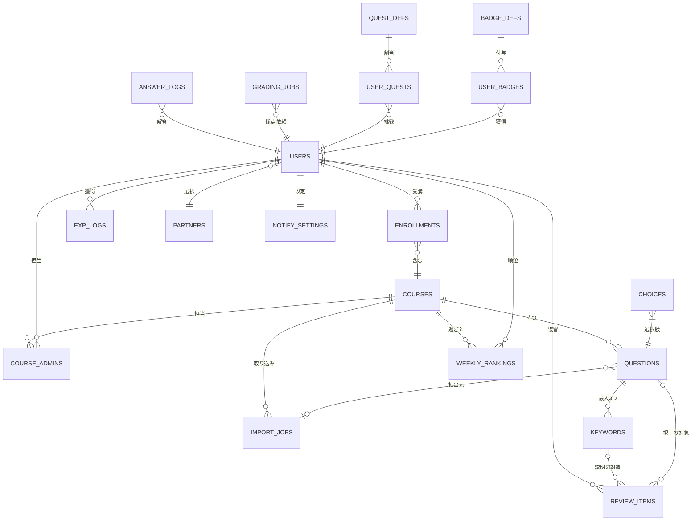

### 7.2 主なデータ項目

| データ               | 主な項目                                                                                           |
| ----------------- | ---------------------------------------------------------------------------------------------- |
| `USERS`           | 利用者ID、Cognitoのsub、氏名、ニックネーム、メール、状態（招待中・有効・論理削除）、削除予定日、パートナー種別、パートナー名、累計EXP、レベル、連続学習日数、最終ログイン日時 |
| `COURSES`         | コースID、コース名、資格名                                                                                 |
| `ENROLLMENTS`     | 利用者ID、コースID、受講開始日                                                                              |
| `QUESTIONS`       | 問題ID、コースID、問題文、正解、解説、状態（下書き・要確認・公開済み）、取り込みID                                                   |
| `KEYWORDS`        | キーワードID、問題ID、キーワード                                                                             |
| `ANSWER_LOGS`     | 利用者ID、問題ID、キーワードID、形式、正誤、点数、説明文、復習かどうか、解答日時                                                    |
| `REVIEW_ITEMS`    | 利用者ID、形式（択一・説明）、問題ID または キーワードID、段階（0〜6）、次回予定日                                                 |
| `GRADING_JOBS`    | 採点ID、状態（採点中・完了・失敗）、結果JSON、作成日時                                                                 |
| `EXP_LOGS`        | 利用者ID、コースID、理由、EXP、獲得日時（週間ランキングの元データ）                                                          |
| `WEEKLY_RANKINGS` | コースID、週の開始日、利用者ID、週間EXP、順位、ニックネーム（確定時点）                                                        |
| `PARTNERS`        | 性格（encourage・logic・rival）、初期名、画像のS3キー（なければ空）                                                   |
| `NOTIFY_SETTINGS` | 利用者ID、メール通知オン／オフ、送信時刻、プッシュ通知オン／オフ（Phase 2）                                                     |

### 7.3 保持期間

| データ            | 保持                               |
| -------------- | -------------------------------- |
| 学習履歴           | 利用者が有効な間は永続。物理削除時にすべて削除          |
| ランキング履歴        | 永続（論理削除・物理削除された利用者の行は表示しない／削除する） |
| 取り込み原本（S3）     | 90日で自動削除                         |
| 採点ジョブ          | 30日で削除（結果は `ANSWER_LOGS` に残る）    |
| 通知の送信リスト（S3）   | 7日で自動削除                          |
| ログ（CloudWatch） | 90日                              |

---

## 8. 非機能・セキュリティ設計

### 8.1 認証・権限

| 項目      | 設計                                               |
| ------- | ------------------------------------------------ |
| 認証      | Cognitoのマネージドログイン。パスワードは8文字以上・英大小文字と数字を含む        |
| トークン    | IDトークン1時間、リフレッシュトークン7日                           |
| 権限      | Cognitoのグループで判定。画面の出し分けだけでなく、APIでも必ず確認する         |
| コース管理者  | 担当コースのデータだけ参照・操作できる                              |
| 管理画面の入口 | 管理者のグループに入っている人にだけ、ヘッダーに「管理局へ」を表示                |
| 将来のSSO  | Cognitoに社内のIDプロバイダー（SAML／OIDC）を追加する形で対応（Phase 3） |

### 8.2 データ保護

| 項目      | 設計                                                                   |
| ------- | -------------------------------------------------------------------- |
| 通信      | すべてHTTPS（TLS 1.2以上）。CloudFrontでHTTPをHTTPSに転送                         |
| 保存      | Aurora・S3とも暗号化を有効化                                                   |
| S3      | すべて非公開。CloudFront経由または署名付きURLでのみ読み書き                                 |
| Bedrock | 送ったデータはモデルの学習に使われない。構築時に確認して記録を残す。モデル呼び出しログは記録しない（学習者の説明文をログに残さないため） |
| 学習者どうし  | 氏名・メールは見えない。ランキングはニックネームのみ                                           |
| 操作記録    | 管理者の操作（公開・削除・復活・ロール変更・CSV出力）を記録                                      |

### 8.3 性能・可用性

| 項目     | 目標                                                                                    |
| ------ | ------------------------------------------------------------------------------------- |
| 画面表示   | 通常2秒以内。DB起動中は最大30秒程度（3.5の待機表示）                                                        |
| 択一の判定  | 1秒以内                                                                                  |
| 説明の採点  | 30秒以内                                                                                 |
| 稼働時間   | 業務時間内に使えること（パイロット期間は24時間保証なし）                                                         |
| バックアップ | Auroraの自動バックアップ7日分                                                                    |
| 全社展開   | Phase 3でAuroraの最小容量、WAFのルール、CloudFrontの料金プラン（利用量が Free プランの上限を超える場合）、Lambdaの同時実行数を見直す |

### 8.4 監視

| 対象      | アラームの条件                        | 通知先         |
| ------- | ------------------------------ | ----------- |
| APIのエラー | 5分間で5xxが5件以上                   | システム管理者のメール |
| 採点      | 採点の失敗・30秒超えが1時間で3件以上           | 同上          |
| 定期処理    | 失敗                             | 同上          |
| コスト     | 月の予測額が15,000円を超える（AWS Budgets） | 同上          |

---

## 9. メッセージ設計

### 9.1 方針

- 責めない。不正解・不合格・未達成に赤い警告色や強い言葉を使わない
- 「〜できませんでした。〜してください」の形で、次にやることを示す
- ボタンは動詞で終える（「答える」「採点してもらう」）。「OK」「はい」だけにしない

### 9.2 主なメッセージ

| ID   | 場面        | 文言                                |
| ---- | --------- | --------------------------------- |
| M-01 | DBの起動中    | ギルドの扉を開けています…                     |
| M-02 | 通信エラー     | 通信できませんでした。もう一度お試しください            |
| M-03 | 説明が短い     | 説明は50文字以上で入力してください（いま◯文字）         |
| M-04 | 説明が長い     | 説明は400文字以内で入力してください（いま◯文字）        |
| M-05 | 小見出しなし    | 200文字を超えたので、【】で小見出しを付けてください       |
| M-06 | 採点中       | ◯◯が採点しています                        |
| M-07 | 採点の時間切れ   | 採点に時間がかかっています。もう一度お試しください         |
| M-08 | ニックネームの重複 | このニックネームはすでに使われています               |
| M-09 | 通知時刻の反映   | 変更は明日の通知から反映されます                  |
| M-10 | 削除の確認     | ◯◯さんを削除します。30日後に学習履歴を含めて完全に削除されます |
| M-11 | 権限なし      | この画面を開く権限がありません                   |
| M-12 | 公開できない    | 選択肢を4つそろえてから公開してください              |

---

## 10. 未決事項

| No | 項目                           | 現在の仮置き                                                                     | 決める時期            |
| -- | ---------------------------- | -------------------------------------------------------------------------- | ---------------- |
| 1  | 独自ドメイン                       | `app.example.co.jp`。決まるまではCloudFrontの既定ドメイン                                | 本番構築前            |
| 2  | メールの送信元アドレス                  | `no-reply@app.example.co.jp`                                               | ドメイン決定時          |
| 3  | Sonnet 5.5・Haiku 5.5 の東京リージョンでの提供状況と単価 | 提供されていなければ東京で使える別バージョン                                                     | 構築時              |
| 4  | キャラクター画像                     | 未提供の間は頭文字を表示                                                               | パイロット開始前         |
| 5  | 表情の追加（喜び・考え中など）              | 1種類のみ                                                                      | Phase 2          |
| 6  | パイロット後のDB常時起動の要否             | 全環境で自動停止                                                                   | パイロット1か月後        |
| 7  | 利用回数の前提（コスト試算）               | 説明5回・択一20回／人・日                                                             | パイロット1か月後に実績で見直し |
| 8  | CloudFront の料金プラン            | **決定（2026-10-19）**：全環境で定額の Free プラン（月0ドル、AWS WAF 付き）を使う。WAF は Phase 1 から付く | 決定済み             |
| 9  | リリースの方式                      | **決定（2026-10-20）**：GitHub Actions で配置する（2.7）。AWSリソースの定義（IaC）は Phase 2 以降に検討 | 決定済み             |

<p></p>
