# RPG学習アプリ 要件定義書

| 項目 | 内容 |
|---|---|
| 文書名 | RPG学習アプリ 要件定義書 |
| 版数 | 第1.5版（ドラフト。変更の内容は「変更履歴」を参照） |
| 作成日 | 2026-10-17（各版の日付は「変更履歴」を参照） |
| 作成者 | ジュン |

---

## 1. 目的・背景・スコープ

### 1.1 背景

- チームメンバーが資格学習を始めても継続できず、合格や知識定着につながりにくい
- 学習が孤独な作業になりやすく、進捗や理解度が本人にもチームにも見えにくい

### 1.2 目的

- AIパートナーと一緒に、RPGのようにゲーム感覚で楽しみながら資格知識を定着させる仕組みを提供する
- 忘却曲線に基づく復習と「自分の言葉で説明する」学習で、覚えたつもりを防ぐ

### 1.3 スコープ

| 区分 | 内容 |
|---|---|
| 対象 | IT系を中心とした資格試験の学習 |
| 対象外 | 社内業務知識・システム固有知識の教材化 |
| 利用者 | 社内メンバー（学習者・コース管理者・システム管理者） |
| 提供形態 | スマホ対応Webアプリ |

### 1.4 成功指標（KPI）

| 指標 | 定義 | 目標値 |
|---|---|---|
| アクティブユーザー率 | 直近7日間に2回以上ログインした利用者 ÷ 全利用者 | 50%以上 |

### 1.5 全体像

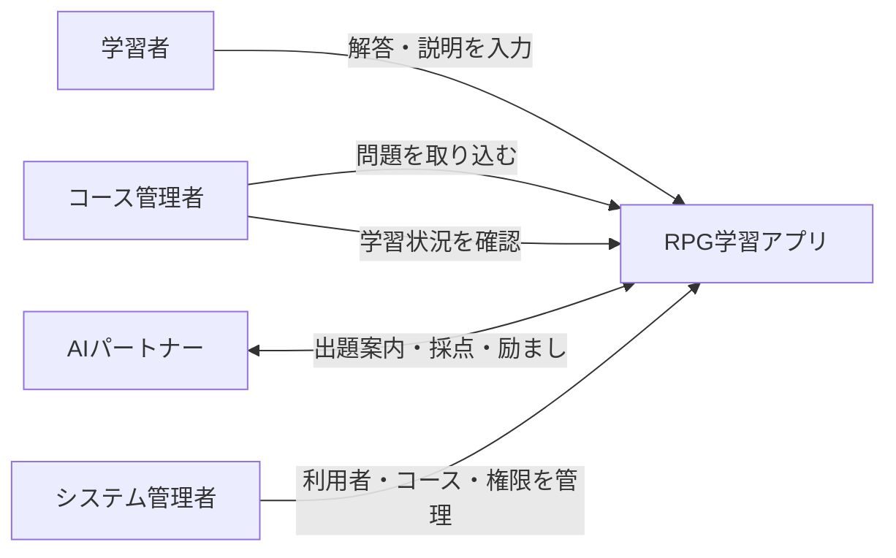

---

## 2. 利用者とロール

### 2.1 利用規模

| フェーズ | 利用者数 | 位置づけ |
|---|---|---|
| パイロット | 約10名 | チーム内で検証 |
| 全社展開 | 約1,000名 | 全社の資格学習基盤 |

### 2.2 ロール定義

| ロール | 主な操作 |
|---|---|
| 学習者 | コース選択、問題演習、復習、キーワード説明、ランキング閲覧、AIパートナー選択（名前をつける）、ニックネーム登録、学習の振り返り（冒険のまとめ・学習サマリ・コースごとの実績） |
| コース管理者 | 担当コースの問題取り込み・レビュー・公開、担当コースの学習状況把握 |
| システム管理者 | 利用者・コース・コース管理者の登録（招待メール）と権限付与、アカウントの削除・復活、AIパートナーの画像の差し替え |
| AIパートナー | 出題案内、キーワード説明の採点、フィードバック、励まし |

### 2.3 コース管理者が把握する項目

- 学習者が目指している資格（受講コース）
- 問題網羅率（コース内の全問題のうち解いた割合）
- 正答率
- 最終ログイン日時、ログイン頻度

### 2.4 ユースケース

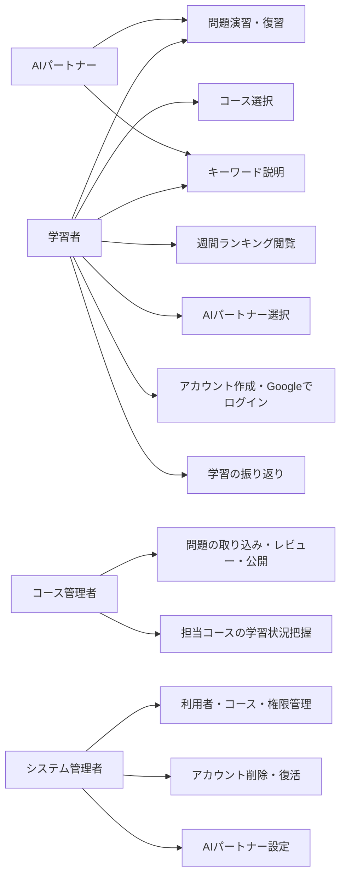

---

## 3. 機能要件

### 3.1 機能一覧

| ID | 機能 | 利用者 | 概要 |
|---|---|---|---|
| F-01 | 問題取り込み | コース管理者 | PDF・画像・テキストからAIが問題とキーワードを抽出（さくらのAI Engine の間は、画像と文字のないPDFは取り込めない） |
| F-02 | 問題レビュー・公開 | コース管理者 | 抽出結果を確認・修正し、コースに公開。登録済みの問題をまとめて公開・削除でき、公開後も修正できる |
| F-03 | 四肢択一演習 | 学習者 | 選択肢から解答し、正誤と解説を表示。1回の冒険は5問で、終わったら冒険のまとめを出す |
| F-04 | キーワード説明 | 学習者 | AIパートナーが説明してほしい観点を問いかけ、学習者がキーワードを自分の言葉で説明し、AIが採点 |
| F-05 | 忘却曲線復習 | 学習者 | 固定間隔で復習対象を自動出題 |
| F-06 | 学習状況ダッシュボード | コース管理者 | 担当コースの網羅率・正答率・ログイン状況を表示し、CSVで出力 |
| F-07 | 全体管理 | システム管理者 | 利用者・コース・管理者の登録（招待メール）、権限付与、アカウント削除・復活 |
| F-08 | 経験値・レベル | 学習者 | 学習行動に応じてEXPを付与しレベルアップ |
| F-09 | 週間ランキング | 学習者 | コース別に週間獲得EXPで順位を表示（名前はニックネーム） |
| F-10 | デイリークエスト | 学習者 | 毎日のクエストを提示し達成でEXPを付与 |
| F-11 | バッジ | 学習者 | 学習成果に応じてバッジを付与し一覧表示 |
| F-12 | AIパートナー選択 | 学習者・システム管理者 | 性格の異なるキャラクターから1人を選び、名前をつける。キャラクター画像はシステム管理者が差し替える |
| F-13 | （欠番） | - | 通知を機能ごと削除したため使わない（第1.3版） |
| F-14 | アカウント作成・Googleでログイン | 学習者（未登録の人） | ログイン画面から自分でアカウントを作る。メールの確認リンクを開いたら学習者として登録される。Google のアカウントでもログインでき、初めての人は学習者として登録される |

### 3.2 問題取り込み（F-01, F-02）

- 入力形式：PDF、画像、テキスト貼り付け。ただし生成AIがさくらのAI Engine の間は、PDF は文字を取り出してから渡すため、画像と文字のない（スキャンした）PDF は取り込めない（Bedrock に戻すと取り込める）
- 問題の登録はコース管理者のみが行う（学習者はアップロードしない。問題品質をそろえ、ランキングの公平性を保つため）
- AIが問題文・選択肢・正解・解説・キーワードを抽出する
- 1問につきキーワードは最大3つ
- コース管理者が確認・修正して確定するまで学習者には公開しない
- 登録済みの問題は、まとめて公開・削除できる。公開後も修正でき、学習者の解答履歴と復習段階はそのまま残す

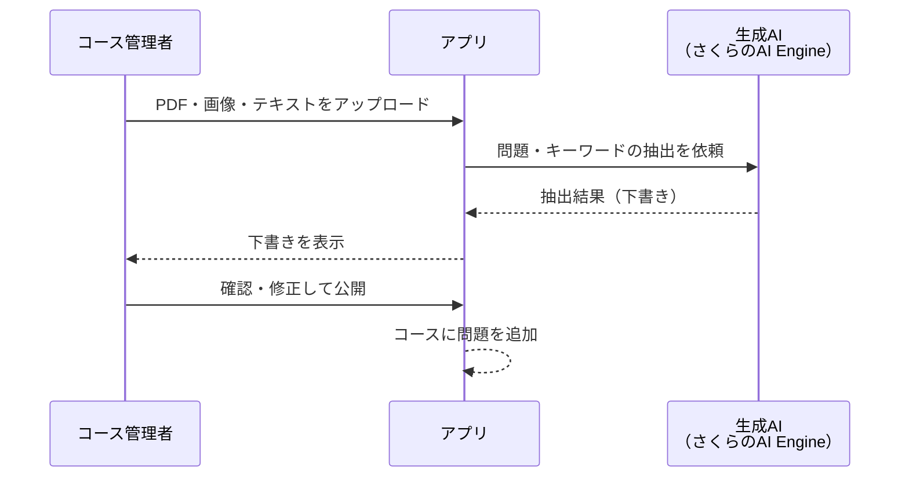

### 3.3 問題形式

| 形式 | 内容 | 採点 |
|---|---|---|
| 四肢択一 | 4つの選択肢から1つ選ぶ | 正解データとの照合による正誤判定 |
| キーワード説明 | 問題に含まれるキーワードを自分の言葉で説明する | AIが100点満点で部分点採点 |

### 3.4 キーワード説明の採点（F-04）

- 説明の前に、AIパートナーが「どの観点で説明してほしいか」を問いかける（例：「なんで3回もやりとりが必要なの？」）。学習者はその問いかけに答える形で説明し、採点も問いかけへの答えとして行う
- AIが点数、模範説明、不足していた観点を返す
- 採点の観点は、正確さ（50点）・重要な観点の網羅（30点）・自分の言葉での具体性（20点）
- 60点以上を合格（正解扱い）とし、復習スケジュールに反映する
- 採点コメントは学習者が選んだAIパートナーの口調で返す

### 3.5 忘却曲線復習（F-05）

- 復習間隔は固定：1日後 → 3日後 → 7日後 → 14日後 → 30日後
- 正解で次の段階へ進み、不正解で段階1（1日後）に戻る（段階1で不正解なら段階1のまま）
- 30日後の復習に正解した項目は「習得済み」とする
- 四肢択一とキーワード説明は別々に復習段階を管理する（「選べるが説明できない」状態を可視化するため）

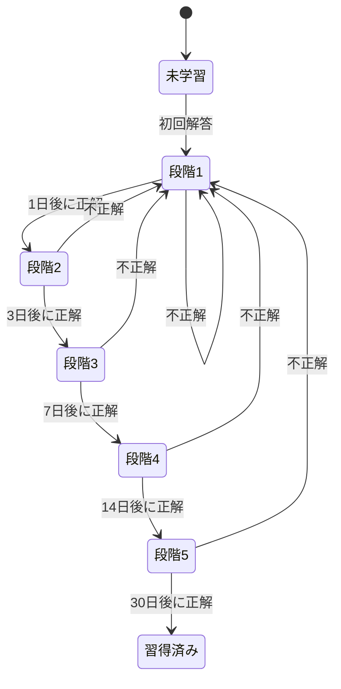

### 3.6 冒険と学習の振り返り（F-03〜F-05）

- 1回の冒険は5問。5問目の結果のあとに「冒険のまとめ」（S-15）を出す。途中でやめても、それまでの結果は保存する
- 学習時間を解答のたびに数え、冒険ごとと利用者ごとの累計で記録する（問題を開いたまま放置しても増えすぎないよう、1問あたり10分まで）
- 学習サマリ：冒険のまとめとプロフィールで、その日に学習した内容・復習するべき観点・AIパートナーのコメントを Markdown で出し、ワンクリックでコピーできる（ほかのノートアプリに貼れる）
- コースごとの実績（S-16・S-17）：コースごとに学習時間・正答率・網羅率・苦手な問題を見られる。AIパートナーが、そのコースの学習全体をもとにしたコメントを返す

---

## 4. ゲーム要素

### 4.1 経験値（EXP）

| 行動 | 獲得EXP |
|---|---|
| 四肢択一 正解 | 10 |
| キーワード説明 合格（60点以上） | 30 |
| 復習での正解 | 上記 × 1.5 |
| デイリークエスト達成 | クエストごとに20〜30（4.4） |

- キーワード説明は学習負荷が高いため、択一より多くのEXPを与える
- 不正解でもEXPは減らさない

### 4.2 レベル

- 累計EXPに応じてレベルアップする
- 次のレベルまでの必要EXP ＝ 100 × Lv^1.2（端数切り上げ）。レベルが上がるほど必要EXPは増える（Lv1→2は100、Lv10→11は1,585）
- 累計EXPは減らないため、レベルは下がらない

### 4.3 ランキング

- コース別に用意する（異なる資格同士で比較しない）
- 週単位で集計し、毎週月曜0時にリセットする
- 週間獲得EXPで順位をつける（古参と新規の差がつきすぎないようにするため）
- 過去週の順位は履歴として閲覧できる
- 順位表の名前はニックネームで表示する（4.9）

### 4.4 デイリークエスト

- 毎日0時に、次の5種類から3つを学習者ごとに割り当てる（同じ種類は重ならない）
- 復習対象がある日は「今日の復習をすべて終える」を必ず含める
- 達成したらその場でEXPを付与する。未達成でもペナルティはなく、翌日0時に入れ替える

| クエスト | 達成条件 | 報酬 |
|---|---|---|
| 択一を5問解く | 四肢択一を5問解答（正誤は問わない） | 20 EXP |
| 択一で3問正解する | 四肢択一で3問正解 | 20 EXP |
| キーワード説明を1問合格する | 説明で60点以上を1回 | 30 EXP |
| 今日の復習をすべて終える | 0時時点の復習対象をすべて解答 | 30 EXP |
| 新しい問題に3問挑戦する | 未学習の問題を3問解答 | 20 EXP |

### 4.5 バッジ

- これまでの学習成果を可視化する目的で付与する
- 獲得済みバッジは獲得日つきでプロフィールに一覧表示する
- どのバッジも銅・銀・金の3段階がある

| カテゴリ | 例 |
|---|---|
| 習得 | 習得済み問題10問／50問／100問 |
| 網羅 | コース網羅率50%／80%／100% |
| 説明 | キーワード説明で満点（100点）を1回／5回／20回 |
| 継続 | 7日／30日／100日連続で学習 |
| 復習 | 30日後の復習に正解（初回／10回／50回） |

### 4.6 AIパートナー

- 励まし型・論理型・ライバル型の3人から1人を選ぶ（初期名：ミナ・セージ・レン）
- 選んだキャラクターに名前をつけられる（1〜10文字）
- 選んだキャラクターが出題案内・説明の問いかけ・採点コメント・励ましを担当する
- あとから変更できる
- キャラクター画像（紋章）は、システム管理者が AIパートナー設定（S-14）で差し替える。画像がない間は名前の頭文字を表示する

### 4.7 ペナルティ

- 設けない（学習しない日があってもレベルやEXPは減らない）

### 4.8 EXPの流れ

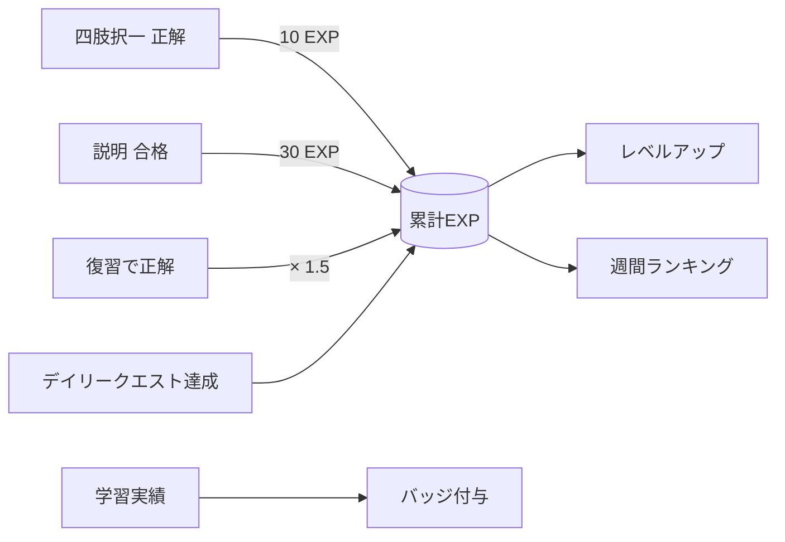

### 4.9 ニックネーム

- ランキングなど学習者どうしの表示はニックネームにし、氏名は見せない
- 2〜12文字。同じコースの中で重複しない（コースをまたいだ重複は可）
- 初回ログイン時に登録する（5.4 の「はじめての冒険」）。あとからプロフィールで変更できる

---

## 5. データ・画面・処理フロー

### 5.1 画面一覧

| ID | 画面 | 利用者 |
|---|---|---|
| S-01 | ログイン（アカウント作成・Googleでログインを含む） | 全員 |
| S-02 | ホーム | 学習者 |
| S-03 | コース選択 | 学習者 |
| S-04 | 演習（四肢択一） | 学習者 |
| S-05 | キーワード説明 | 学習者 |
| S-06 | 結果・フィードバック | 学習者 |
| S-07 | 週間ランキング | 学習者 |
| S-08 | プロフィール（レベル・バッジ） | 学習者 |
| S-09 | AIパートナー選択 | 学習者 |
| S-10 | （欠番。通知設定を削除） | - |
| S-11 | 問題取り込み・レビュー | コース管理者 |
| S-12 | 学習状況ダッシュボード | コース管理者 |
| S-13 | 利用者・コース・権限管理 | システム管理者 |
| S-14 | AIパートナー設定 | システム管理者 |
| S-15 | 冒険のまとめ | 学習者 |
| S-16 | コースごとの実績 | 学習者 |
| S-17 | コースの実績 | 学習者 |

### 5.2 ホーム画面の表示優先度

1. レベルとEXP
2. AIパートナーのひとこと
3. デイリークエスト
4. 今日の復習数（開始ボタンつき）

### 5.3 通知（削除）

- 通知（メール・プッシュ）は第1.3版で機能ごと削除した。学習者には通知を送らない

### 5.4 画面遷移

- 初回ログイン時は「はじめての冒険」として、ニックネーム登録 → コース選択 → AIパートナー選択を済ませてからホームに進む
- 冒険は5問目の結果のあとに、冒険のまとめを出してホームに戻る

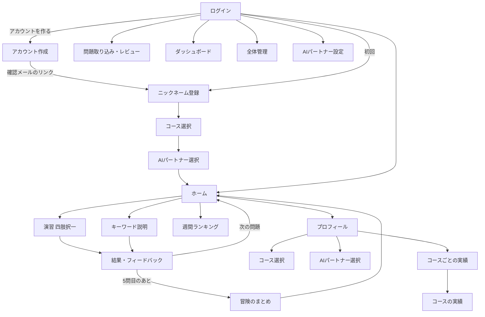

### 5.5 データモデル（ER図）

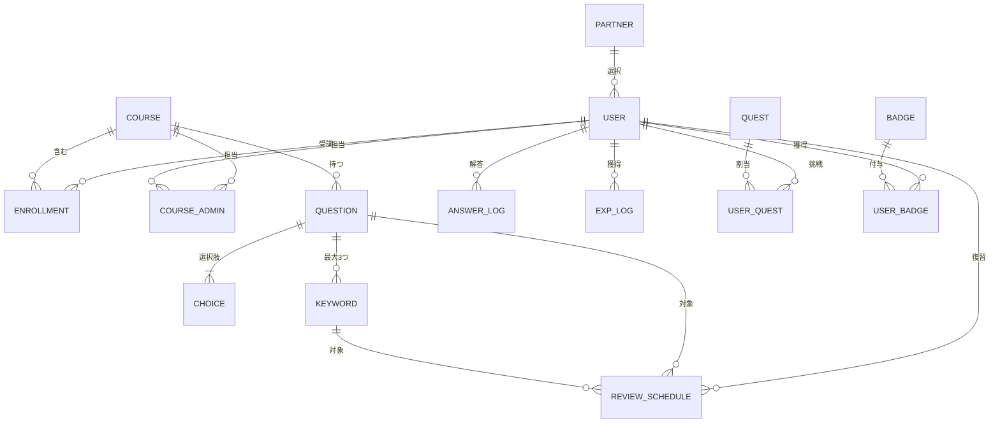

### 5.6 学習の処理フロー

```mermaid
flowchart TD
  A[ホームで学習開始] --> B{今日の復習対象あり?}
  B -->|あり| C[復習問題を出題]
  B -->|なし| D[未学習問題を出題]
  C --> E[解答・説明を入力]
  D --> E
  E --> F[採点とAIパートナーのコメント]
  F --> G[復習段階を更新]
  G --> H[EXP加算・クエスト判定・バッジ判定]
  H --> I{続ける?}
  I -->|はい| B
  I -->|いいえ| J[ホームへ]
```

---

## 6. 非機能要件・制約

### 6.1 インフラ

- さくらのクラウド（国内の事業者・国内のデータセンター）上にホストする（2026-10-27 に AWS から変更。AWS 版は `aws/` に退避）
- ドメインは `rpglearning.net`。DNS は Cloudflare で管理し、サーバーの前に Cloudflare の Worker を置く（2026-11-09 追加）
- 生成AIは当面さくらのAI Engine を利用する。Amazon Bedrock が使えるようになったら、設定だけで戻せるようにする
- リリース（アプリの配置）は GitHub Actions で行う。テストに通ったものだけを、dev → prod（承認つき）の順に配置する。コストを抑えるため検証用の stg 環境は置かず、受け入れ確認は dev で行う（2026-10-21 変更）
- 費用を抑えるため、prod の構築は軌道に乗るまで凍結し、dev を本番としてテスターに公開する。dev はアクセスがない時間が続いたらサーバーを止め、アクセスがあれば自動で起こす（2026-11-09 追加）

### 6.2 AIの利用とデータ保護

- 問題文・学習者の説明をさくらのAI Engine（Bedrock に戻したあとは Bedrock）に送信してよい
- 送信データがモデルの再学習に使われない設定・契約であることを確認し、オプトアウトを担保する

### 6.3 AIモデルの使い分け

| 用途 | モデル方針 | 理由 |
|---|---|---|
| 問題・キーワードの抽出 | 高精度モデル | 誤抽出は全学習者に影響するため |
| キーワード説明の採点 | 高精度モデル | 速度より採点精度を重視するため |
| 四肢択一の解説コメント・パートナーのひとこと | 軽量モデル | 呼び出し回数が多くコストを抑えるため |
| キーワード説明の問いかけ | 軽量モデル | 説明問題が出るたびに作るため |
| 四肢択一の正誤判定 | AI不使用 | 正解データとの照合で足りるため |

- 当面のさくらのAI Engine では、高精度・軽量のどちらにも同じモデル（gpt-oss-120b）を使う。Bedrock に戻したら使い分ける

### 6.4 性能

- 説明採点は精度を優先し、応答時間の上限は30秒とする
- 採点中はAIパートナーの待機演出を表示する
- 全社展開時に約1,000名の利用に耐えること
- dev でサーバーが止まっていたときは、開いてから使えるようになるまで1〜3分待つことを許容する（テスター向けの公開のため）

### 6.5 認証・セキュリティ

- ID/パスワード認証（パスワードは8文字以上で英大文字・英小文字・数字を含める。ハッシュ化して保存）
- 管理者が登録した人には、仮パスワードを招待メールで送る。パスワードを忘れたときは、メールのリンクから再設定できる
- 5回続けてログインに失敗したら15分ログインできなくする。ログイン状態は7日間保持する
- 利用者はログイン画面から自分でアカウントを作れる（メールアドレスの確認が必要。作れるのは学習者だけで、管理者のロールはシステム管理者が付ける）
- Google のアカウントでもログインできる（Googleでログイン。メールアドレスのドメインは制限しない）。初めての人は学習者として登録される。管理者が登録した人・自分で作った人は、同じメールアドレスなら同じ利用者として入れる
- 将来のSSO（OIDC）対応を前提とした認証基盤を採用する
- 通信はすべてTLSで暗号化する
- ロールに応じたアクセス制御を行う（コース管理者は担当コースのデータのみ参照可能）

### 6.6 データ保持

- 学習履歴は同一ユーザーについて永続的に保持する
- 管理者が登録した人と自分でアカウントを作った人は「招待中」から始まり、初回ログインで「有効」になる
- システム管理者がアカウントを削除すると論理削除状態になる
- 論理削除から30日以内に復活させた場合は、学習履歴をすべて引き継ぐ
- 論理削除から30日経過後に、学習履歴を含めて物理削除する（以降は復活できない）

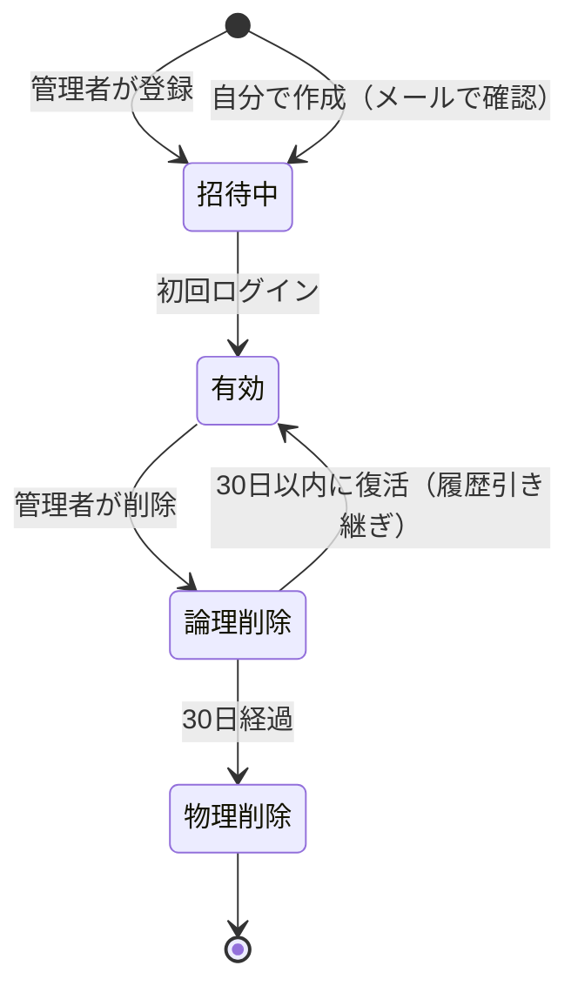

### 6.7 対応環境

- スマートフォン・PCの主要ブラウザの最新版

---

## 7. リリース計画

### 7.1 方針

- KPI（アクティブユーザー率50%以上）の達成には「楽しさ」が鍵となるため、MVPの段階からゲーム要素の中核を含める（体験重視型）

### 7.2 フェーズ別スコープ

| 機能 | Phase 1：MVP（パイロット約10名） | Phase 2：拡張 | Phase 3：全社展開（約1,000名） |
|---|---|---|---|
| 問題取り込み（PDF・画像・テキスト。画像は 3.2 の制約あり） | ○ | | |
| 四肢択一・キーワード説明 | ○ | | |
| 忘却曲線復習 | ○ | | |
| EXP・レベル | ○ | | |
| 週間ランキング | ○ | | |
| デイリークエスト | ○ | | |
| AIパートナー（複数から選択） | ○ | | |
| 冒険のまとめ・学習の振り返り | ○ | | |
| Googleでログイン | ○ | | |
| バッジ | 基本セット（習得・継続） | 全カテゴリ | |
| 学習状況ダッシュボード | 基本項目・CSV出力 | 傾向分析 | |
| SSO | | | ○ |
| 大規模利用への性能対応 | | | ○ |

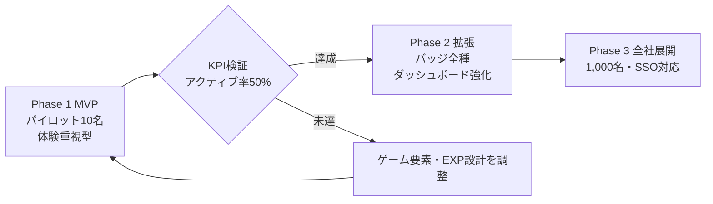

---

## 8. 仮置き事項（要確認）

| No | 項目 | 仮置き内容 |
|---|---|---|
| 1 | 説明問題の合格ライン | **決定（第1.5版）**：60点。採点の観点と配点は 3.4 |
| 2 | 復習で不正解のとき | 段階1に戻す |
| 3 | 復習ボーナス | 1.5倍 |
| 4 | ランキングのリセット | 毎週月曜0時 |
| 5 | 説明採点の応答時間上限 | 30秒 |
| 6 | デイリークエスト数 | **決定（第1.5版）**：5種類から1日3つ（4.4） |
| 7 | （欠番） | 通知を削除したため（第1.3版） |
| 8 | レベルアップに必要なEXPの計算式 | **決定（第1.5版）**：100 × Lv^1.2（4.2） |
| 9 | AIパートナーのキャラクター数・設定 | **決定（第1.5版）**：励まし型・論理型・ライバル型の3人（4.6） |
| 10 | 自分でアカウントを作れる人の範囲 | メールアドレスの確認だけで誰でも作れる。社外の人も登録できてしまうため、社内のドメインに絞るか、管理者の承認を待つ形にするかをパイロット前に決める（外部設計書 10 未決事項 No.14 に影響を詳しく記載） |

---

## 変更履歴

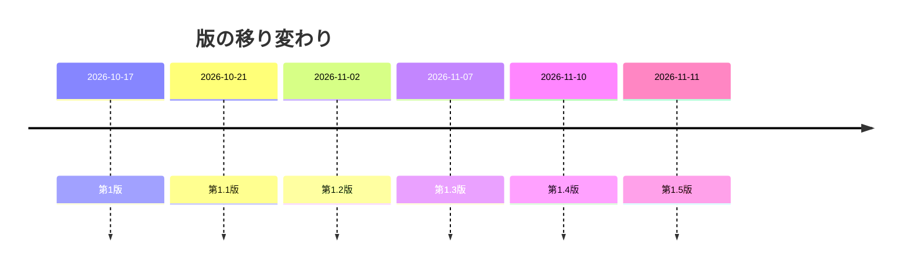

日付は版を作った日。

| 版数 | 日付 | 変更内容 |
| --- | --- | --- |
| 第1版 | 2026-10-17 | 作成 |
| 第1.1版 | 2026-10-21 | リリースの環境を dev・prod の2つに変更 |
| 第1.2版 | 2026-11-02 | ログイン画面からのアカウント作成（F-14）を追加 |
| 第1.3版 | 2026-11-07 | 通知（F-13・S-10）を機能ごと削除 |
| 第1.4版 | 2026-11-10 | インフラ（6.1）をいまの構成に合わせる：さくらのクラウド・さくらのAI Engine・Cloudflare（DNS・Worker）、prod の凍結と dev の本番公開、dev の自動停止と起動。6.2 の送信先と 6.4 の起動待ちも直す |
| 第1.5版 | 2026-11-11 | 外部設計書に合わせる：Googleでログイン、冒険のまとめと学習の振り返り（3.6）、説明の問いかけ、ニックネーム（4.9）、AIパートナーの名前と画像の差し替え、問題のまとめて公開・削除、ダッシュボードのCSV出力、招待・パスワード再設定などを追加し、画面一覧に S-14〜S-17 を足す。画像の取り込みの制約、バッジの段階、復習とアカウントの状態遷移、SSO の方式を直し、仮置き No.1・6・8・9 を決定にする |
