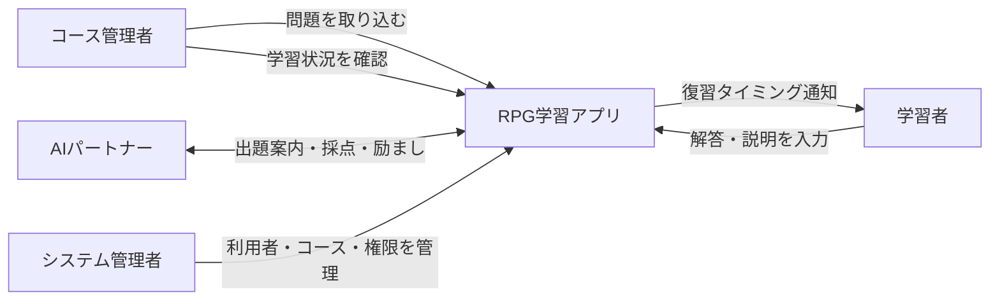
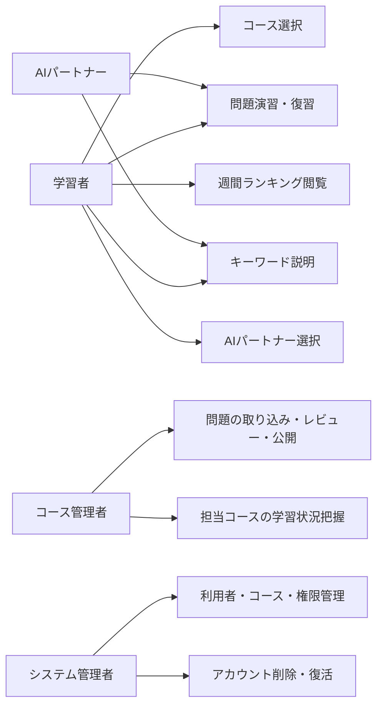
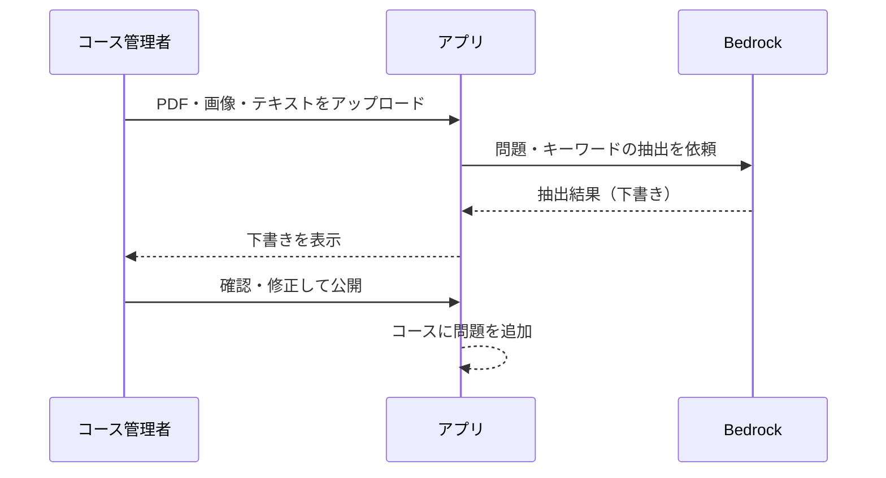
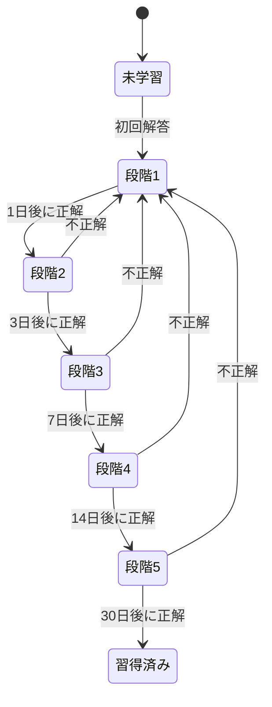
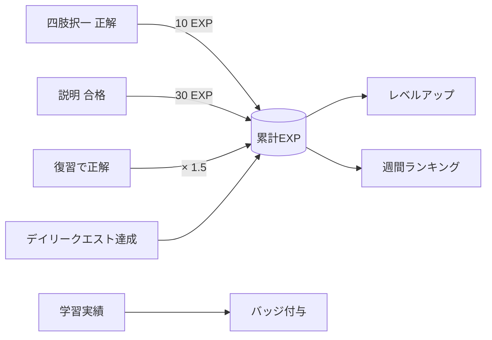
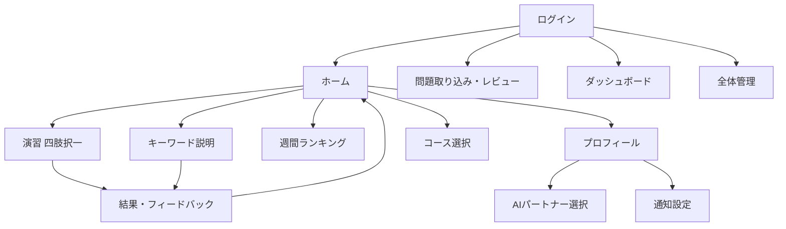
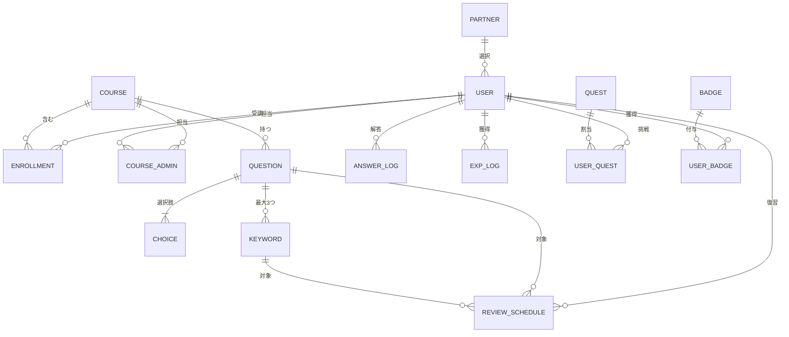
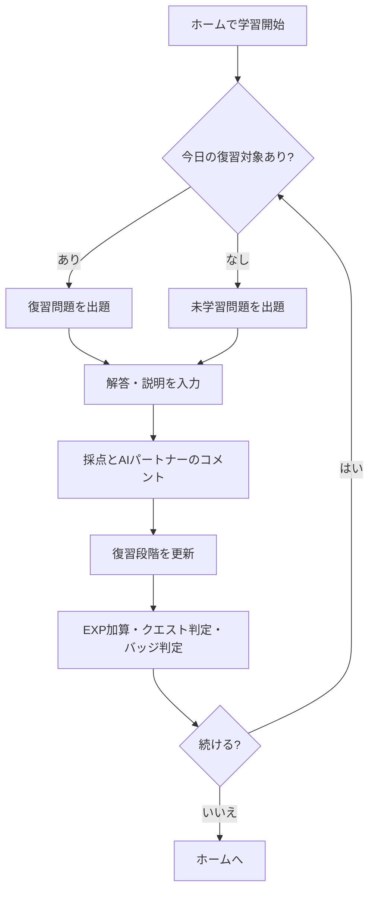
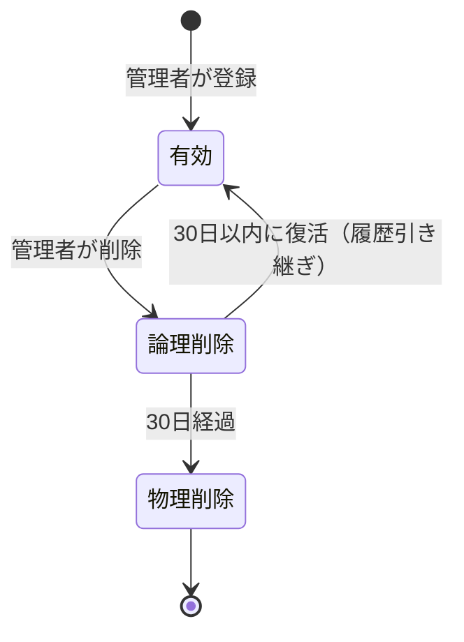
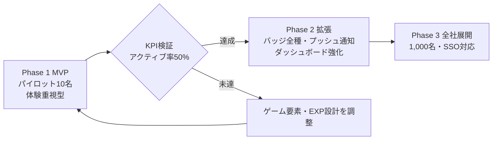

# RPG学習アプリ 要件定義書

| 項目 | 内容 |
|---|---|
| 文書名 | RPG学習アプリ 要件定義書 |
| 版数 | 第1版（ドラフト） |
| 作成日 | 2026-10-17 |
| 作成者 | ジュン |

---

## 1. 目的・背景・スコープ

### 1.1 背景

- チームメンバーが資格学習を始めても継続できず、合格や知識定着につながりにくい
- 学習が孤独な作業になりやすく、進捗や理解度が本人にもチームにも見えにくい

### 1.2 目的

- AIパートナーと一緒に、RPGのようにゲーム感覚で楽しみながら資格知識を定着させる仕組みを提供する
- 忘却曲線に基づく復習と「自分の言葉で説明する」学習で、覚えたつもりを防ぐ

### 1.3 スコープ

| 区分 | 内容 |
|---|---|
| 対象 | IT系を中心とした資格試験の学習 |
| 対象外 | 社内業務知識・システム固有知識の教材化 |
| 利用者 | 社内メンバー（学習者・コース管理者・システム管理者） |
| 提供形態 | スマホ対応Webアプリ |

### 1.4 成功指標（KPI）

| 指標 | 定義 | 目標値 |
|---|---|---|
| アクティブユーザー率 | 直近7日間に2回以上ログインした利用者 ÷ 全利用者 | 50%以上 |

### 1.5 全体像

---

## 2. 利用者とロール

### 2.1 利用規模

| フェーズ | 利用者数 | 位置づけ |
|---|---|---|
| パイロット | 約10名 | チーム内で検証 |
| 全社展開 | 約1,000名 | 全社の資格学習基盤 |

### 2.2 ロール定義

| ロール | 主な操作 |
|---|---|
| 学習者 | コース選択、問題演習、復習、キーワード説明、ランキング閲覧、AIパートナー選択 |
| コース管理者 | 担当コースの問題取り込み・レビュー・公開、担当コースの学習状況把握 |
| システム管理者 | 利用者・コース・コース管理者の登録と権限付与、アカウントの削除・復活 |
| AIパートナー | 出題案内、キーワード説明の採点、フィードバック、励まし |

### 2.3 コース管理者が把握する項目

- 学習者が目指している資格（受講コース）
- 問題網羅率（コース内の全問題のうち解いた割合）
- 正答率
- 最終ログイン日時、ログイン頻度

### 2.4 ユースケース

---

## 3. 機能要件

### 3.1 機能一覧

| ID | 機能 | 利用者 | 概要 |
|---|---|---|---|
| F-01 | 問題取り込み | コース管理者 | PDF・画像・テキストからAIが問題とキーワードを抽出 |
| F-02 | 問題レビュー・公開 | コース管理者 | 抽出結果を確認・修正し、コースに公開 |
| F-03 | 四肢択一演習 | 学習者 | 選択肢から解答し、正誤と解説を表示 |
| F-04 | キーワード説明 | 学習者 | キーワードを自分の言葉で説明し、AIが採点 |
| F-05 | 忘却曲線復習 | 学習者 | 固定間隔で復習対象を自動出題 |
| F-06 | 学習状況ダッシュボード | コース管理者 | 担当コースの網羅率・正答率・ログイン状況を表示 |
| F-07 | 全体管理 | システム管理者 | 利用者・コース・管理者の登録、権限付与、アカウント削除・復活 |
| F-08 | 経験値・レベル | 学習者 | 学習行動に応じてEXPを付与しレベルアップ |
| F-09 | 週間ランキング | 学習者 | コース別に週間獲得EXPで順位を表示 |
| F-10 | デイリークエスト | 学習者 | 毎日のクエストを提示し達成でEXPを付与 |
| F-11 | バッジ | 学習者 | 学習成果に応じてバッジを付与し一覧表示 |
| F-12 | AIパートナー選択 | 学習者 | 性格の異なるキャラクターから1人を選ぶ |
| F-13 | 通知 | 学習者 | 復習対象・クエストをメールとプッシュで通知 |

### 3.2 問題取り込み（F-01, F-02）

- 入力形式：PDF、画像、テキスト貼り付け
- 問題の登録はコース管理者のみが行う（学習者はアップロードしない。問題品質をそろえ、ランキングの公平性を保つため）
- AIが問題文・選択肢・正解・解説・キーワードを抽出する
- 1問につきキーワードは最大3つ
- コース管理者が確認・修正して確定するまで学習者には公開しない

### 3.3 問題形式

| 形式 | 内容 | 採点 |
|---|---|---|
| 四肢択一 | 4つの選択肢から1つ選ぶ | 正解データとの照合による正誤判定 |
| キーワード説明 | 問題に含まれるキーワードを自分の言葉で説明する | AIが100点満点で部分点採点 |

### 3.4 キーワード説明の採点（F-04）

- AIが点数、模範説明、不足していた観点を返す
- 60点以上を合格（正解扱い）とし、復習スケジュールに反映する
- 採点コメントは学習者が選んだAIパートナーの口調で返す

### 3.5 忘却曲線復習（F-05）

- 復習間隔は固定：1日後 → 3日後 → 7日後 → 14日後 → 30日後
- 正解で次の段階へ進み、不正解で段階1（1日後）に戻る
- 30日後の復習に正解した項目は「習得済み」とする
- 四肢択一とキーワード説明は別々に復習段階を管理する（「選べるが説明できない」状態を可視化するため）

---

## 4. ゲーム要素

### 4.1 経験値（EXP）

| 行動 | 獲得EXP |
|---|---|
| 四肢択一 正解 | 10 |
| キーワード説明 合格（60点以上） | 30 |
| 復習での正解 | 上記 × 1.5 |
| デイリークエスト達成 | クエストごとに設定 |

- キーワード説明は学習負荷が高いため、択一より多くのEXPを与える
- 不正解でもEXPは減らさない

### 4.2 レベル

- 累計EXPに応じてレベルアップする
- 必要EXPはレベルが上がるほど緩やかに増える

### 4.3 ランキング

- コース別に用意する（異なる資格同士で比較しない）
- 週単位で集計し、毎週月曜0時にリセットする
- 週間獲得EXPで順位をつける（古参と新規の差がつきすぎないようにするため）
- 過去週の順位は履歴として閲覧できる

### 4.4 デイリークエスト

- 毎日3つ程度のクエストを提示し、毎日0時に更新する
- 例：択一を5問解く、キーワード説明を1問合格する、今日の復習をすべて終える

### 4.5 バッジ

- これまでの学習成果を可視化する目的で付与する
- 獲得済みバッジは獲得日つきでプロフィールに一覧表示する

| カテゴリ | 例 |
|---|---|
| 習得 | 習得済み問題10問／50問／100問 |
| 網羅 | コース網羅率50%／100% |
| 説明 | キーワード説明で満点を獲得 |
| 継続 | 7日連続／30日連続で学習 |
| 復習 | 30日後復習を初クリア |

### 4.6 AIパートナー

- 性格の異なる複数キャラクターから1人を選ぶ（例：励まし型、論理型、ライバル型）
- 選んだキャラクターが出題案内・採点コメント・励ましを担当する
- あとから変更できる

### 4.7 ペナルティ

- 設けない（学習しない日があってもレベルやEXPは減らない）

### 4.8 EXPの流れ

---

## 5. データ・画面・処理フロー

### 5.1 画面一覧

| ID | 画面 | 利用者 |
|---|---|---|
| S-01 | ログイン | 全員 |
| S-02 | ホーム | 学習者 |
| S-03 | コース選択 | 学習者 |
| S-04 | 演習（四肢択一） | 学習者 |
| S-05 | キーワード説明 | 学習者 |
| S-06 | 結果・フィードバック | 学習者 |
| S-07 | 週間ランキング | 学習者 |
| S-08 | プロフィール（レベル・バッジ） | 学習者 |
| S-09 | AIパートナー選択 | 学習者 |
| S-10 | 通知設定 | 学習者 |
| S-11 | 問題取り込み・レビュー | コース管理者 |
| S-12 | 学習状況ダッシュボード | コース管理者 |
| S-13 | 利用者・コース・権限管理 | システム管理者 |

### 5.2 ホーム画面の表示優先度

1. レベルとEXP
2. AIパートナーのひとこと
3. デイリークエスト
4. 今日の復習数（開始ボタンつき）

### 5.3 通知

- メール通知とブラウザのプッシュ通知の両方に対応する
- 学習者が通知設定画面でそれぞれオン・オフできる
- 通知内容：その日の復習対象数、デイリークエスト更新

### 5.4 画面遷移

### 5.5 データモデル（ER図）

### 5.6 学習の処理フロー

---

## 6. 非機能要件・制約

### 6.1 インフラ

- AWS上にホストする
- 生成AIはAmazon Bedrockを利用する
- AWSへのリリース（アプリの配置）は GitHub Actions で行う。テストに通ったものだけを、dev → stg → prod（承認つき）の順に配置する

### 6.2 AIの利用とデータ保護

- 問題文・学習者の説明をBedrockに送信してよい
- 送信データがモデルの再学習に使われない設定・契約であることを確認し、オプトアウトを担保する

### 6.3 AIモデルの使い分け

| 用途 | モデル方針 | 理由 |
|---|---|---|
| 問題・キーワードの抽出 | 高精度モデル | 誤抽出は全学習者に影響するため |
| キーワード説明の採点 | 高精度モデル | 速度より採点精度を重視するため |
| 四肢択一の解説コメント・パートナーのひとこと | 軽量モデル | 呼び出し回数が多くコストを抑えるため |
| 四肢択一の正誤判定 | AI不使用 | 正解データとの照合で足りるため |

### 6.4 性能

- 説明採点は精度を優先し、応答時間の上限は30秒とする
- 採点中はAIパートナーの待機演出を表示する
- 全社展開時に約1,000名の利用に耐えること

### 6.5 認証・セキュリティ

- ID/パスワード認証（パスワードはハッシュ化して保存）
- 将来のSSO（SAML/OIDC）対応を前提とした認証基盤を採用する
- 通信はすべてTLSで暗号化する
- ロールに応じたアクセス制御を行う（コース管理者は担当コースのデータのみ参照可能）

### 6.6 データ保持

- 学習履歴は同一ユーザーについて永続的に保持する
- システム管理者がアカウントを削除すると論理削除状態になる
- 論理削除から30日以内に復活させた場合は、学習履歴をすべて引き継ぐ
- 論理削除から30日経過後に、学習履歴を含めて物理削除する（以降は復活できない）

### 6.7 対応環境

- スマートフォン・PCの主要ブラウザの最新版

---

## 7. リリース計画

### 7.1 方針

- KPI（アクティブユーザー率50%以上）の達成には「楽しさ」が鍵となるため、MVPの段階からゲーム要素の中核を含める（体験重視型）

### 7.2 フェーズ別スコープ

| 機能 | Phase 1：MVP（パイロット約10名） | Phase 2：拡張 | Phase 3：全社展開（約1,000名） |
|---|---|---|---|
| 問題取り込み（PDF・画像・テキスト） | ○ | | |
| 四肢択一・キーワード説明 | ○ | | |
| 忘却曲線復習 | ○ | | |
| EXP・レベル | ○ | | |
| 週間ランキング | ○ | | |
| デイリークエスト | ○ | | |
| AIパートナー（複数から選択） | ○ | | |
| バッジ | 基本セット（習得・継続） | 全カテゴリ | |
| 通知 | メール | プッシュ通知 | |
| 学習状況ダッシュボード | 基本項目 | 傾向分析 | |
| SSO | | | ○ |
| 大規模利用への性能対応 | | | ○ |

---

## 8. 仮置き事項（要確認）

| No | 項目 | 仮置き内容 |
|---|---|---|
| 1 | 説明問題の合格ライン | 60点 |
| 2 | 復習で不正解のとき | 段階1に戻す |
| 3 | 復習ボーナス | 1.5倍 |
| 4 | ランキングのリセット | 毎週月曜0時 |
| 5 | 説明採点の応答時間上限 | 30秒 |
| 6 | デイリークエスト数 | 1日3つ程度 |
| 7 | MVPの通知 | メールのみ（プッシュはPhase 2） |
| 8 | レベルアップに必要なEXPの計算式 | 基本設計で決定 |
| 9 | AIパートナーのキャラクター数・設定 | 基本設計で決定 |
